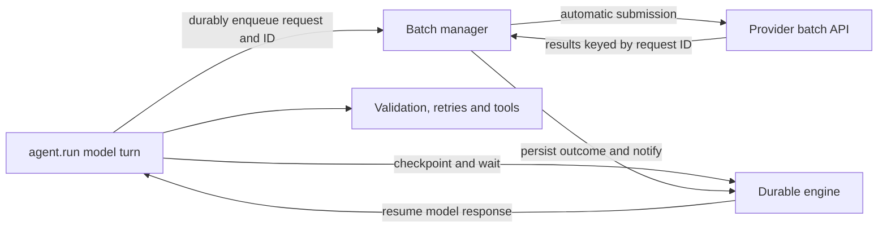

# Plan: Batch API support for durable agent runs

Tracking issue: [#1771](https://github.com/pydantic/pydantic-ai/issues/1771). This PR only adds this plan so you can review it inline. It does not close the issue. Anthropic and OpenAI coverage determines when the tracking issue can be closed.

## Goal

Provider batch APIs cost less in exchange for latency. This plan lets you get batch pricing from an ordinary `agent.run(...)` inside a supported durable execution context. You don't write submit, flush, poll, store or service loops. The library handles submission, collection and results.

Proposed API, not executable against today's release. Configure your model name through `ANTHROPIC_MODEL`.

```python
import os
from datetime import timedelta

from pydantic_ai import Agent
from pydantic_ai.models.anthropic import AnthropicModel
from pydantic_ai.models.batch import BatchModel, BatchSettings

model = BatchModel(
    AnthropicModel(os.environ['ANTHROPIC_MODEL']),
    batch_settings=BatchSettings(max_requests=100, max_wait=timedelta(seconds=30)),
)
agent = Agent(model, name='summarizer')
```

Attach the existing Temporal durability integration and register its worker handlers. Inside the workflow, call `await agent.run(prompt)` as usual.

`BatchModel` is opt-in. It wraps a registered provider `Model`. Nothing changes for an `Agent` that doesn't use it: defaults, operation names and history stay as they are.

## Responsibilities

| Layer | Owns |
|---|---|
| Agent orchestration | The graph, tool turns, output validation, retries, and usage, as today |
| Durable agent | Waiting and restart recovery inside the workflow |
| Batch manager | Grouping items into batches, submitting and collecting them, recovery after crashes |
| Provider wire adapter | Encoding batch requests and decoding batch results for one provider API |



The manager owns aggregation and provider jobs. The durable engine owns continuation and recovery. Temporal can host both as separate workflows; this does not combine their responsibilities. A durable wait survives worker replacement through persisted history and replay, with compatible workflow code. An ordinary in-process wait is insufficient for jobs that take hours. See [Temporal recovery](https://docs.temporal.io/encyclopedia/event-history).

## Durable binding

Batch support is an **optional** binding next to the existing `DurableOperationBackend` in [`durable_exec/_operation_backend.py`](pydantic_ai_slim/pydantic_ai/durable_exec/_operation_backend.py). Engines that don't support it add no new abstract methods. The durability capability selects the binding from the active integration ([`durable_exec/_base.py`](pydantic_ai_slim/pydantic_ai/durable_exec/_base.py)). It detects `BatchModel` in the registered model chain and routes workflow-side `request_segment` through enqueue/wait instead of the ordinary model activity. Direct `BatchModel.request` calls outside this route raise `UserError` before enqueue. Bind operations and register the manager only for batch-enabled agents; pin unchanged registrations for ordinary agents.

Proposed shape (method names and module are a maintainer decision):

- `enqueue(request, item_id) -> ticket`
- `wait(ticket) -> outcome`, normalized as success, error, expired or cancelled. A keyed notification wakes the workflow; a durable timer re-reads the outcome if notification is lost.
- `cancel(item_id)`, including an item whose enqueue acknowledgement has not arrived
- Engine-owned manager registrations. Extend worker setup to include manager workflows and activities; keep the existing activity registration contract intact.

## Agent loop integration

`wrap_model_request` spans the logical model turn; `after_model_request` sees its final response. The durable binding checkpoints the request and ticket, waits in workflow code, and returns the decoded response through the existing agent loop. The agent workflow enqueues and waits, with short activities for enqueue, cancellation and outcome retrieval. The manager submits and polls provider jobs. No activity waits for the full job.

- Capture messages, model settings, tool definitions and output schema at the model-call boundary. Recovery uses the captured request, not recomputed inputs.
- Use a stable ID per model request/attempt, not only a run ID. One tool-using run can require several batch rounds.
- Preserve usage, retry budgets and tool execution records across recovery. Consume each outcome once logically; delivery and recovery may repeat.
- Keep batch tickets separate from provider-native suspended responses such as Anthropic `pause_turn`. Waiting does not create placeholder responses or consume agent retry/poll budgets.

The deferred-tools analogy is useful internally: persist pending work and inject its completed response at the model boundary. It does not require users to call `start`, `submit`, `resume` or `SkipModelRequest`. Conversation-based harness suspension is a separate possible integration, outside this durable-only proposal. Provider batch primitives stay reusable in core.

## Queueing and grouping

- The flush timer starts when the oldest item is **durably** accepted. New arrivals don't reset it.
- Submit at `max_requests`, the oldest item's `max_wait` deadline, or provider byte/request limits, whichever comes first.
- Propose defaults of 100 requests and 30 seconds. Reject non-positive values. Provider limits cap the configured size; queue age excludes provider processing time.
- Groups are stable and isolated by registered agent/model identity to keep settings and deployment ownership explicit. The adapter adds required compatibility fields: endpoint, provider options, headers/betas, credential reference and tenant; model equality is provider-dependent. Cross-agent aggregation is outside the initial scope.
- A policy change is rejected or explicitly versioned. Groups are never split silently.
- If two workers are deployed with conflicting settings for the same group, that is detected and raised as an error.
- Item IDs stay the same across activity retries and worker restarts. A new model attempt gets a new ID.

## Manager ownership and storage

The first manager may be an engine-native Temporal workflow. Conceptually it stays separate from the agent workflow. Worker setup registers it; enqueue starts it automatically with update-with-start on a stable group-derived workflow ID. The binding installs a request-keyed signal handler on the agent workflow. The docs spell out deployment setup.

- A request and its validated group policy are persisted before enqueue is acknowledged. Duplicate IDs are idempotent. Bound the queue and use recoverable backpressure when capacity is exhausted.
- Provider handles and outcomes are recoverable and keyed. Outcomes can arrive in any order.
- An outcome is recorded before the workflow is woken. Duplicate delivery and early wakes are safe. If a notification is lost, the fallback delivers it again.
- Retain outcomes through the retry/recovery window. A consumer acknowledges only after durable recording, not merely receiving an activity result. Rotate manager history and keep operation names stable; version incompatible workflow changes.

Storage is real, and the backend owns it. [Temporal Cloud limits](https://docs.temporal.io/evaluate/cloud/limits) include 2 MB payloads and 50 MB or 51,200-event histories. Prompts, files and results may need durable external blob references. The prototype bounds both individual and aggregate payloads and rejects excess before acceptance. No public `Store` parameter is proposed. Decide production offload configuration, retention, access control and cleanup before shipping large-payload support.

## Failure semantics

| Case | Behavior |
|---|---|
| Item error from the provider | Goes through the existing model retry and error handling. No extra free retries |
| Expired | Normalized outcome, handled as a model error |
| Cancelled before submission | Tombstoned. Unrelated items in the batch are not affected |
| Cancelled during enqueue | `request_segment` allocates the item ID deterministically before dispatch and calls `binding.cancel(item_id)` on failed or cancelled enqueue, using engine-safe shielded cleanup. The manager rejects late enqueue. After receipt, the binding handles cancellation and teardown |
| Cancelled after submission | Abandon that item. Cancel the provider job only when all its items are abandoned; submitted items may still be billed |
| Crash between submit and checkpoint | Either verified provider idempotency, or a durable intent record plus reconciliation. No claim of exactly-once |
| Tool side effects | The engine's existing guarantees apply. Batching doesn't make tools exactly-once |

Structured output validation retries, tool turns and retries each go into new automatic batch rounds. Retry and usage budgets carry over unchanged.

## Cost and observability

Actual batch pricing must come from either `genai-prices` or an explicit adapter cost, so spend limits stay correct. Spans record queue delay, batch IDs, item IDs, provider latency and errors. They contain no secrets and follow the existing content policy.

## Initial scope

- Temporal plus Anthropic, non-streaming only, with a registered static provider.
- Validate streaming, fallback wrappers, dynamic models and provider-native continuations against the batch contract. Reject documented unsupported combinations before submission; do not widen ordinary agent behavior to accommodate them.
- No new non-durable park and resume API.

## Future backends

These native primitives are candidates, not proof of support for this proposed Pydantic AI batch contract.

| Engine | Primitive | Notes |
|---|---|---|
| [DBOS](docs/durable_execution/dbos.md) | Persisted send/recv, durable timers | Strong candidate |
| [Restate](docs/durable_execution/restate.md) | Awakeables, keyed state | Strong candidate |
| Absurd | Durable waits | Possible |
| AWS durable functions | Callbacks | Needs shared aggregation infrastructure |
| [Prefect](docs/durable_execution/prefect.md) | Suspend and resume | Possible, not ruled out |
| [Kitaru](docs/durable_execution/kitaru.md) | Wait | A runner has to resume the flow after the process exits |
| [Airflow](docs/durable_execution/airflow.md) | Operator-level deferral | Possible at the operator level |

## Testing

Test through public APIs with real `cassetter` recordings, reviewed for secrets before commit, and `--record-mode=none`. Reach 100% coverage honestly. Reuse engine fixtures and time skipping or controlled events; no real delays or interpreter spawns for in-process logic. Use process isolation only when testing the process boundary itself.

| Area | Test |
|---|---|
| Contract | Engine-independent contract and provider codec, tested against recordings |
| Temporal | Workflow tests with time skipping, replay, and compatibility pins as in [`test_durable_exec_compat.py`](tests/durable_exec/test_durable_exec_compat.py) |
| Aggregation | Two workers feeding one group. Threshold, deadline and byte flushes |
| Durability | Retries of durable accepts, early and duplicate wakes, keyed waiting, worker replacement and replay, crash after submit with reconciliation |
| Outcomes | Unordered, mixed success, error, expiry and cancel. Cancellation races |
| Agent loop | Structured output retry, tool turn, next batch round |
| Budgets | Usage, pricing and spend limits |
| Limits | Payload offload, backpressure, history rotation |
| Scope | Fails in an unsupported context. No behavior change for agents that don't use batching |

## Documentation

When the feature ships, update the provider docs, [the durable backends guide](docs/durable_execution/backends.md), [the Temporal docs](docs/durable_execution/temporal.md), and the [packaged agent skill](pydantic_ai_slim/pydantic_ai/.agents/skills/building-pydantic-ai-agents/). This PR doesn't publish the hypothetical APIs as working docs.

## Phases

1. **Contract.** Settings, item identity, normalized outcomes, the Anthropic codec.
2. **Temporal prototype.** Poll-only manager, small inline payloads.
3. **Production hardening.** Notifications, payload offload, reconciliation, pricing, observability.
4. **Additional providers and engines.** OpenAI and Gemini adapters, then DBOS and Restate backends, validated independently against the contract. Keep provider file uploads and unordered partial outcomes in the adapter design from the start. [Gemini supports inline `metadata.key` and JSONL `key`](https://ai.google.dev/gemini-api/docs/batch-api); match by request ID, not position.

## Decisions for maintainers

- Module and API shape: where `BatchModel`, `BatchSettings` and the binding live, and the exact method names.
- Durable-only scope versus the in-process `BatchModel` suggested in [#1771](https://github.com/pydantic/pydantic-ai/issues/1771): this proposal requires restart recovery for long provider jobs.
- Manager ownership: core or engine.
- Large-payload strategy.
- Pricing source: `genai-prices` or adapter cost.
- How to validate the contract across engines.
