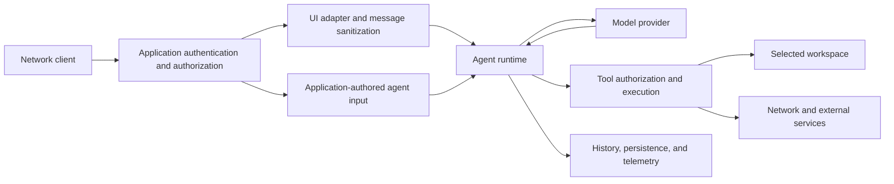

# Pydantic AI threat model

Working draft for maintainer review.

This document maps the security boundaries in Pydantic AI, its harness, and its CLI clients. It helps reviewers identify attacker-controlled inputs, the resources those inputs can reach, and which component owns each control. Component documentation defines the exact options and limitations.

## Scope and deployment profiles

The same agent can run inside applications with different authority. Evaluate a report against the affected profile.

| Profile | Authority and boundary |
|---|---|
| Server application using `Agent` | The application owns authentication, tenant identity, tool permissions, provider credentials, and access to stored state. |
| Server application using a UI adapter | Client-submitted protocol messages cross an adapter boundary before reaching the agent. The hosting application still owns HTTP and session security. |
| Realtime voice session | The server owns the session, tools, and provider credentials. A browser WebRTC call adds the browser as a peer on the provider session. |
| Local CLI or harness tools | Python tools and local commands use the authority of the launching process unless a configured execution backend provides isolation. |
| Sandboxed or remote workspace | The selected backend, provider, credentials, mounts, network settings, and lifetime define the execution boundary. |
| Durable agent | The application and execution engine own access to persisted workflow state, queues, credentials, and replay infrastructure. |

See [UI adapters](docs/ui/overview.md), [realtime deployment](docs/realtime/deployment.md), [workspaces](docs/workspace.md), [Pax](src/pydantic_ai_pax/README.md), and [durable execution](docs/durable_execution/overview.md).

Unlaunched packages: `pydantic-ai-pax` (Pax). Maintainers handle a report against an unlaunched package as a bug, not a vulnerability. The Pax rows below still describe its intended boundary.

Examples and documentation snippets show how to use an API; they are not hardened deployments. A flaw in one is a documentation bug for a public issue or pull request, unless the library code it calls breaks a documented boundary.

A vulnerability in a third-party dependency or in CPython belongs to that project. When a dependency publishes a fix, the repository lock raises that dependency's floor, and the published requirements keep admitting the patched release; applications install that release themselves. Pydantic AI code does not work around the vulnerability. A CPython vulnerability fixed only in a later Python release does not change the [supported Python versions](docs/version-policy.md#support-for-python-versions); an application running an affected version carries that vulnerability until it upgrades Python. A Pydantic AI check that relies on dependency or CPython behavior is still a library control, so a bypass of that check is a Pydantic AI vulnerability.

## Assets and adversaries

Review these assets:

- User conversations, tool results, memory, persisted run state, and deferred actions.
- Server instructions, provider identifiers, credentials, internal endpoints, and telemetry.
- Files, processes, network destinations, and external services reachable by tools or provider credentials.
- Availability and cost of model requests, tool execution, downloads, and shared resources.

An attacker may control a network request, client-submitted history, a URL, downloaded content, an MCP response, a repository file, or content the model uses to choose tool arguments. Treat model-generated arguments as untrusted inputs to the tool implementation.

Trusted application code chooses the agent's tools, dependencies, credentials, and execution backend. Installing executable plugins or granting tool access delegates authority. Schema validation and model instructions do not establish the caller's permission to exercise that authority.

## Data flow

The hosting application controls which clients may enter this flow. Adapters, tools, download transports, execution backends, and state stores enforce different controls after entry. Check each crossing in both directions: incoming data can select an operation or resource, and outgoing data can disclose protected information.

## Core boundaries

### UI history and server-state disclosure

Protocol-derived history is client-controlled. UI adapters sanitize that input before execution. Direct `message_history` or `conversation` supplied to an entry point is an application-authored path; an application accepting either from a client must apply the corresponding validation and authorization.

Review incoming fields that can select provider state, per-file provider options, instructions, uploaded files, download policy, tool calls, tool definitions, run identity, or a workspace. AG-UI frontend tool definitions are client-submitted: their names, descriptions, and schemas reach the model request and the schema processing that prepares it. Review outgoing fields that can reveal server instructions, internal endpoints, provider details, MCP App tool results the model does not see, or other users' state. Use explicit opt-in controls where an adapter supports trusting input or disclosing additional state. By default, every tool call and result reaches the client. A tool's `ui_visibility` withholds a result or the whole call, which holds only with server-held history: a client holding the history sends the placeholder back as the result. Sanitizing resets any `ui_visibility` stamp a client sends, so a call the run executes from that history is stamped from its tool's definition. See [Tool visibility](docs/ui/overview.md#tool-visibility).

Sanitization does not authenticate a client or prove that a submitted tool call or approval came from a genuine paused run. The application must authorize deferred actions and state access.

With `manage_message_history='server'`, only the client's new turn, the requests after its last response, crosses the adapter boundary and is sanitized; the `message_history` passed with it is application-authored and trusted. The client still chooses, by UI message id, whether its turn resubmits one of its own stored user prompts, which cuts the stored history just before that prompt: a rewind of its own conversation, as edit and regenerate are. It can't cut at any other request, add assistant content, or answer a tool call the stored history isn't waiting on: a tool result for one is dropped, and an approval or denial for one rejects the request before any tool runs. System content in its turn is stripped unless the application also sets `manage_system_prompt='client'`. An application that saves the run's full history over the stored one therefore lets the client drop its own later turns from that record; one that needs an append-only record must keep earlier versions itself. The application must still authorize the conversation (`conversation_id` or thread id) it loads the stored history for. The default `'client'` mode is unchanged.

Canonical guidance: [adapter trust model](docs/ui/overview.md), [server-held history](docs/ui/overview.md#keeping-the-history-on-the-server), [deferred tools](docs/deferred-tools.md), [MCP Apps](docs/mcp/client.md#mcp-apps), and the [approval provenance follow-up](https://github.com/pydantic/pydantic-ai/issues/6452).

### HTTP and browser-origin security

A UI adapter is mounted in an application that owns authentication, authorization, sessions, CORS, and CSRF protection. A JSON content-type check narrows accepted requests; applications using cookie authentication must also apply an appropriate CSRF policy.

A local web interface has its own browser-origin and host-access boundary. A browser visiting an unrelated site can still issue requests toward loopback services. The built-in web interface checks allowed hosts and JSON content types; those checks do not authenticate a user. Exposing that interface to untrusted clients requires application authentication. Evaluate the CLI web profile separately from an adapter mounted in a server application.

Canonical guidance: [UI deployment](docs/ui/overview.md) and [web interface](docs/web.md).

### Realtime sessions

A browser on a WebRTC call can send provider-native control events and read the shared conversation, including seeded history and its tool results. A client-secret flow also gives it a short-lived provider credential. Authorize tools against trusted dependencies, and seed a call only with history its participants may read.

Seeded `message_history` is trusted server-side state, as in a standard run, and history-processing capabilities do not run on it. Sanitize client-supplied history before seeding.

A sideband does not own the call. Closing it detaches the server while the browser's call stays up, and billed, until the browser hangs up or, where the provider supports it, the server does.

Retained session audio and images are capped by default, and the caps can be removed.

`append_voice_instructions()` gives GPT-Live's voice model instructions in the application's voice, so pass it only text the application wrote. A phone bridge's webhook and media stream take requests from anyone who can reach them: check Twilio's signatures with its SDK, and open a session only for a call the checked webhook answered.

Canonical guidance: [realtime deployment](docs/realtime/deployment.md), [steering GPT-Live's voice](docs/realtime/openai.md#voice-instructions), [seeding a session](docs/realtime/history.md#seeding-a-session), [retaining audio](docs/realtime/history.md#retaining-audio), and [realtime usage and limits](docs/realtime/observability.md#usage-and-limits).

### Google Interactions history

`GoogleInteractionsModel` sends the complete conversation with `store=False`; it does not continue stored interactions by ID. Signed thought and native-tool steps remain provider data, not evidence of application authorization. The application still authorizes deferred tool approvals and access to persisted history. Interactions remote MCP calls run at Google with the server URL and headers configured by the application; local download address checks do not govern those provider-side requests.

Generated media uses inline delivery. URI-only output raises an error before fetching a provider-selected URL; video URI delivery requires server-side storage.

Persisted step metadata in client-held history is replayed only into the step type its message part maps from, and replayed media is sent inline. A persisted file URI raises an error instead of being sent, so `sanitize_messages` file-reference rules cannot be bypassed through replay metadata. Remote MCP results replay as the server's MCP `CallToolResult`, serialized to JSON. In a live check, Google did not fetch URIs inside a replayed result.

Input `FileUrl` references are resolved by Google on both transports under its policies. Applications choosing local address and response-size checks set `force_download=True` for HTTP(S) inputs; the default follows the shared provider-native URL contract.

### URL fetching and provider file references

URLs can select resources reachable with the server's network access or a provider's credentials. Server-side request forgery (SSRF) review covers schemes, resolved addresses, redirects, alternate address forms, response size, and each transport that performs a fetch.

Local downloads use `safe_download` for address, redirect, and response-size checks. Private addresses are blocked by default, and metadata addresses remain blocked when local URLs are enabled. `WebFetch()` uses provider-native fetching by default; its bundled local fallback uses the library's downloader, and a custom local tool has its own behavior.

A provider-resolved uploaded-file identifier or cloud-storage URL can exercise provider credentials without using the library's local downloader. Review client-supplied references at the adapter boundary and local downloads at their transport boundary.

Applications that opt into local/private destinations must authorize those destinations. Native provider tools and custom tools have the behavior and credentials of their provider or implementation. A domain list passed to a provider-native tool applies only where that provider supports it ([tracking issue](https://github.com/pydantic/pydantic-ai/issues/9706)). Browser capabilities are separate fetch transports with their own address checks; `BrowserUse` does not resolve hostnames before navigation, so sensitive networks need its domain allowlist. `CDPBrowser` and `PlaywrightBrowser` apply one `EgressPolicy`. `CDPBrowser` enforces it in Chrome through CDP `Fetch` interception on every target, and a local proxy applies it to the WebSocket connections `CDPBrowser` opens. DNS rebinding stays open in `PlaywrightBrowser`, and on HTTP requests in `CDPBrowser`, because the browser resolves a name again before it connects. Under an enforced policy, `PlaywrightBrowser` removes the page APIs whose traffic neither guard sees (WebRTC, WebTransport, `WebSocketStream` and FedCM); workers, sandboxed iframes the full Chromium binary isolates, and documents loaded before attachment keep some of them. `CDPBrowser` gives the model raw CDP commands, so its `allowed_methods` list is an authority boundary: the default leaves out commands that reach beyond the tab, lift the egress guard, or take host file paths. That boundary binds the model only: Chrome's DevTools endpoint listens on a 127.0.0.1 port for the whole run and takes no authentication, so any local process, including a sandboxed tool that reaches the host's loopback, can send any command outside `allowed_methods`, the egress policy and the download denial ([tracking issue](https://github.com/pydantic/pydantic-ai/issues/14329)).

`PlaywrightBrowser(cdp_context='default')` hands the agent the browser's signed-in accounts and open tabs, so one prompt injection can act as any of them. Its loaded documents must pass the egress policy before the agent reads them. A tab it inherits that shows anything but an `http(s)` page, `about:blank` or Chromium's error page, such as the browser's own start page, or that holds a frame outside the web other than an inline `srcdoc`, `data:` or `blob:` one, such as the `chrome-extension://` UI a password manager injects, is kept from the agent, whatever the policy: it is left out at attachment, and when an adopted tab moves to such a page or gets such a frame, the call that finds it returns an error naming the page by its scheme and host only, since the rest of a `data:` URL is the document itself, and the agent stops using that tab. A frame that appears during a call can still be captured by that call's `snapshot` or `screenshot_on_navigate` image; the next call drops the tab. A `chrome://` page the agent opens itself follows the policy, which can admit one ([tracking issue](https://github.com/pydantic/pydantic-ai/issues/13698)). Connections opened before attachment bypass the request guards, as does a new WebSocket opened through the native `WebSocket` constructor that script running before attachment kept, and so do requests from service workers registered before attachment when `PLAYWRIGHT_DISABLE_SERVICE_WORKER_NETWORK` turns off Playwright's service-worker routing.

Canonical guidance: [web fetching](docs/capabilities/web-fetch.md), [multimodal input](docs/input.md), [adapter trust model](docs/ui/overview.md), [local download controls](pydantic_ai_slim/pydantic_ai/_ssrf.py), [Playwright egress](docs/harness/playwright.md#egress-and-ssrf), [Playwright default context](docs/harness/playwright.md#reusing-the-default-context), [CDP Browser egress](docs/harness/cdp-browser.md#egress-and-ssrf), and [BrowserUse safety](docs/harness/browser-use.md#sessions-and-safety).

### Tool actions, approvals, and prompt injection

Tool implementations must authorize the requested action using trusted application identity and policy. Pydantic validation checks the argument schema; a valid argument can still name an unauthorized account, file, URL, or operation.

Untrusted content can influence model decisions. Instructions, delimiters, model judgment, and an approval label are not substitutes for authorization in tool code. An approval mechanism protects only the operations it actually intercepts; preserve that control through delegated, resumed, background, Code Mode, and `ToolBridge` execution paths. A tool reached through `ToolBridge` that raises `ApprovalRequired` or `CallDeferred` itself is resolved only by a `HandleDeferredToolCalls` handler, which sees the tool's own name; otherwise the run fails with a `UserError` rather than deferring `tool_call`, so an approval of `tool_call` never covers whichever tool the model names. `ToolBridge` also delivers bridged tools' descriptions and schemas, including an MCP server's, as `tool_search` and `tool_describe` results rather than as tool definitions.

With Pydantic AI Harness's `SubAgents(forward_deferred_calls=True)`, a delegate's deferred calls reach the parent run's caller. The delegate's history waits server-side in the capability's `DeferredStateStore` (in memory by default), and the delegate call's `metadata` carries only the state's random ID, the delegate's name and its pending calls, the ones the caller is asked about. A resumed delegate accepts only a state in its store, saved by the same delegate call for the same sub-agent and task, and answers only to the calls the delegate asked about, so whoever supplies the answers can't substitute the history or the calls that run. Approving the delegate call without a state ID runs the task again and approves none of the delegate's calls. A resume takes the state out of the store before the delegate runs, so one set of answers resumes it at most once, even when the resumed delegation fails; a custom store shared by several processes must make that take atomic. A custom store holds delegate histories, including their instructions and tool results, so it needs the same protection as stored message history.

A `HandleDeferredToolCalls` handler that takes a resume token takes a decision from what the handler returns, or else from whoever resolves the token it hands to the handler: in process, any code that calls `resolve_external_event` with the token, such as your approval endpoint; on Temporal, anyone allowed to signal the workflow, through `pydantic_ai.durable_exec.temporal.resolve_external_event` or by sending the signal it sends; on AWS Lambda, anyone allowed to call `SendDurableExecutionCallbackSuccess` with the callback ID. The decision can approve calls, replace their arguments with `override_args`, supply external results the model is shown, set the `metadata` tools read as `tool_call_metadata`, and name who answered in `answered_by`, so tool code must not treat that metadata or `answered_by` as proof of who approved; Pydantic AI checks only its shape and that it names pending calls. In process and on AWS Lambda, treat the token as a bearer credential: an in-process token is unguessable, but anyone who learns it, from the message the handler sent or a log, can resolve it through an endpoint that does not check who is calling. On Temporal the token is not a credential: its event key is unique per wait but comes from the workflow's replay-safe random source and is in the workflow history, so anyone who can read the history can rebuild it. There, restrict who may signal the workflow through Temporal namespace authorization. Either way, authorize the approver in the code that resolves it. Durable engines that can't record the wait refuse it rather than wait in process: on replay, an unrecorded wait would ask again and could act on a different decision than the one the recorded history already reflects.

`DeferredToolRequests.validated_args` carries each deferred call's arguments as validation left them, including what a tool validation hook such as `after_tool_validate` added. It also holds each parameter's default. The requests are stored with a conversation and emitted in `DeferredToolRequestsEvent`, so a validation hook must not add a credential or another value the approver may not see. The AG-UI approval prompt, which reaches the client, shows only the arguments the model sent, each with its validated value, so a validation hook's rewrite of one of them reaches the client too. Read such values from dependencies, or add them in `before_tool_execute`.

`ToolCallJudge` and `ApprovalReviewer` are model-based filters, not security boundaries. A judge can block a call; a reviewer approval replaces the person's decision for the calls it covers. Both send the reviewed arguments, and optionally the conversation, to the reviewing model's provider.

`Permissions` rules are deterministic pattern filters, not security boundaries. An `'allow'` rule replaces the person's decision for the calls it matches, and trusts everything after its words. Deny rules match words and argument globs, not behavior, so a command that does the same thing another way gets past them. Calls to external tools, which the application runs itself, aren't checked.

A `wrap_*` hook that short-circuits skips that stage's `before_*` hooks, including policy hooks. Review where a mandatory control sits in the hook order.

On routes that can reach a host that encodes chat-template special tokens found in message content as control tokens, Pydantic AI breaks those tokens in user, tool and file text and in replayed model output, so that text can't open a real turn (`may_tokenize_special_tokens_in_content` in the model profile). It's an opt-out default. It doesn't cover system prompts, instructions or tool definitions, including tool descriptions from an MCP server, nor files a provider fetches itself, and it doesn't stop a model from following text shaped like a turn. See [Special tokens in content](docs/message-history.md#special-tokens-in-content).

On models without a mid-conversation system role, the application's mid-conversation instructions go out on the user channel as `<system>` blocks, next to text from the user, tools and files. That text goes out as written, not escaped, so it can contain a copy of `<system>`, of a `<pyai:…>` frame or of `<assistant_thinking>`. A copy gets a note in the application's voice saying who wrote it, and the system prompt explains the notes. The notes are a hint, not a boundary: open-weight models in particular don't reliably follow them. Prompts for a second model that flatten the conversation into a transcript, such as a judge's or a summarizer's, get no notes, nor do realtime sessions, and a few Pydantic AI Harness frames that aren't capability parts, such as `AskUser`'s answer note, still escape their bodies instead. See [Framework frames and content fidelity](docs/message-history.md#framework-frames-and-content-fidelity).

What a capability or the application tells the model mid-conversation is a `CapabilityPart`, and its voice comes from its `source`, never from where it was enqueued. Only an instruction part whose source has operator authority (`OperatorSource`, or a `CapabilitySource` or `WorkspaceSource` at that level) speaks in the application's voice. Every other part, including any data part and any part from a `UserSource`, `ToolResultSource` or `ModelSource`, goes out on the user channel behind a note saying who wrote it, and as above the note is a hint, not a boundary. A capability's `authority` ceiling, set on the class or with `with_authority()`, and a workspace's authority, carried by `OperatorText.from_workspace`, only ever lower what a part can reach. The ceiling covers a capability's instructions and what it sends mid-conversation, including its tools' `ToolReturn.content`, but not its tool names and descriptions or its tools' return values: a capability you don't trust, such as an MCP server, can still speak in the application's voice through those unless the application leaves them out. Below operator authority, a capability's instructions, its own and its toolsets' such as an MCP server's, never enter the agent's instructions: they go out as one framed data block, recorded in history as an `InstructionDeltaPart` that stores the authority, from which each model renders the part. Because the authority is read from the stored part, `sanitize_messages(strip_system_prompts=True)` strips a client-supplied `InstructionDeltaPart` whatever its `authority` says. A realtime session has no channel for that block, so it leaves a lowered capability's instructions out ([tracking issue](https://github.com/pydantic/pydantic-ai/issues/14458)). Writing `OperatorText(...)` is the capability author's assertion of operator authority, so re-wrapping text that came from content, such as `OperatorText(text.strip())` on a lower-authority workspace's file, raises it: pass the `WorkspaceSource` as the part's source instead. Client-held histories carry no capability parts in either direction: the UI adapters keep them on the server, even with `manage_system_prompt='client'`, and `sanitize_messages` drops any a client sends back, whatever `strip_system_prompts` says. A realtime session's live channel gets a capability part's rendered text with no lookalike notes, so it neutralizes the framing tags in a body from a source below operator authority instead. See [Capability parts](docs/capabilities/custom.md#capability-parts).

Canonical guidance: [function tools](docs/tools.md), [advanced tools](docs/tools-advanced.md), [deferred tools](docs/deferred-tools.md), [Handle Deferred Tool Calls](docs/capabilities/handle-deferred-tool-calls.md#the-answer), [dependencies](docs/dependencies.md), [hooks](docs/hooks.md#wrap-hooks), [Tool Call Judge](docs/harness/tool-call-judge.md#safety-boundary), [Approval Reviewer](docs/harness/approval-reviewer.md#safety-boundary), [Permissions rules](docs/harness/permissions.md#rules), [Code Mode](docs/harness/code-mode.md), and [Tool Bridge](docs/harness/tool-bridge.md#what-stays-native).

### MCP connections and agent configuration

MCP connections exchange tool arguments and content with a configured server. Local MCP is the default capability path; provider-native MCP is an explicit opt-in. The application chooses trusted server endpoints, credentials, and tools, and authorizes the operations it exposes. Transport authentication does not establish the identity of the application's own caller.

Agent specs can select configured capabilities and providers. Capability arguments include endpoints, such as an `MCP` server URL, which the agent host connects to with its own network access; the library does not restrict them to public addresses. YAML/JSON parsing and Pydantic validation establish the configuration's shape. The application must decide who can supply configuration that grants those capabilities or selects endpoints and resources.

Canonical guidance: [MCP capability](docs/capabilities/mcp.md), [MCP clients](docs/mcp/client.md), and [agent specs](docs/agent-spec.md#where-specs-come-from).

### Persistent state and tenant identity

The application must bind conversations, response identifiers, memory namespaces, deferred results, Code Mode REPL state, and workspace reattachment to the authorized user. An identifier supplied by a client is not proof of ownership.

Anthropic message threads (`anthropic_previous_message_id`) continue from the response ID in the message history. With `history_digest_key` set, that response's `history_digest` is an HMAC covering its ID and thread fingerprint, so a client can't continue another conversation's thread, or its own under other instructions or tools. Without the key, a client can compute the digest itself, so the application must not enable threads for client-held history.

A `Conversation` also carries the running usage that usage limits count from, its `conversation_id`, and pending deferred tool requests; whoever supplies it controls those values. UI adapters map a client-supplied ID (AG-UI's thread ID, Vercel AI's chat ID) onto `conversation_id`. Conversation-scoped search and stores keyed on that value trust it, so pass an authenticated one. Code Mode does not authenticate a saved REPL; load only state the application wrote to storage others cannot modify.

Treat storage backends and durable execution infrastructure according to the deployment's trust assumptions. Durable execution does not add an integrity or tenant-authorization guarantee to an otherwise untrusted state store. Persistence also does not roll back an external side effect after a crash. An engine can expose model and tool steps as directly submittable tasks: Render Workflows callers with Workflow API access bypass the entry function's checks. Engine-retained task state can include prompts, tool arguments, results, and dependencies.

Loading history must not change what a part grants. A value stored as tool output or other plain data must load as plain data, not as a `FileUrl`, an `UploadedFile` or another type that makes the server or a provider fetch with its own access. A third party that controls a tool result can otherwise plant a file reference that a later run resolves.

Canonical guidance: [message history](docs/message-history.md), [persistence](docs/persistence.md), [durable execution](docs/durable_execution/overview.md), [Render Workflows](docs/harness/render-workflows.md#execution-limits), [harness memory](docs/harness/memory.md), [conversation search scope](docs/harness/conversation-search.md#scope), [Code Mode REPL state](docs/harness/code-mode.md#keep-the-repl-across-runs), and [step persistence](docs/harness/step-persistence.md).

### Telemetry and secrets

Messages, tool arguments, results, files, and provider details can contain secrets. When instrumentation is enabled, its defaults include content. Text content, binary content, and model-request parameters have separate collection controls. Review redaction, access controls, and export destinations as part of the deployment.

Stock Pax's default-on `observability` plugin differs: it exports whenever it finds a Logfire credential or OTLP exporter configuration, including in the environment, leaves prompts, results, and files out unless `include_content` is on, and traces every agent in the process while loaded.

CLAI 2's background session naming is also on by default. A naming request carries excerpts of the session it names and the titles of other sessions in its workspace. While naming is on only by default, it uses only sessions held with the current model (the same model name, not merely the same provider; never a session imported from another agent, or a fork of one, whose model is unknown), judged when the request is made: the current conversation after a turn already sent it there, and those `/resume` queues. Saving `sessions.naming true` or choosing `sessions.naming_model` lets any untitled or stale session, from every workspace, and its siblings' titles, reach the naming model's provider, even one held with a local model. `sessions.naming false` turns naming off.

A setting that suppresses one content field does not establish that the same content is absent from every event, exception, or integration. Integrations that call their own models or telemetry services are additional export channels. Local conversation, credential, and tool-output spill stores also need their documented access protections.

Span attributes, both conversation IDs included, label telemetry; they don't prove who owns a conversation. Logfire copies the baggage of an incoming request onto each span by default. Pydantic AI removes only `pydantic_ai.root_conversation_id` from it, and only for the spans of an agent run, so an application that adds up cost or bills by span attributes for clients it doesn't trust should set `logfire.configure(distributed_tracing=False)` or drop the `baggage` header at its edge.

Configuration also carries secrets. Request settings such as extra headers and bodies, native-tool credentials, and identifiers derived from a URL can hold credentials, because a URL can carry one in its user info, path or query. Keep them out of traces, frontend events, and durable activity names. A credential must reach only the service it was issued for. A provider's `base_url` is part of that service: the provider sends its credentials there, OAuth subscription tokens included, and the Codex and ChatGPT providers inject theirs only over HTTPS and only to the `base_url` origin (host and port).

Canonical guidance: [Logfire](docs/logfire.md), [instrumentation](docs/capabilities/instrumentation.md), [Pax telemetry](src/pydantic_ai_pax/docs/reference.md#telemetry-and-references), [Pax storage and authentication](src/pydantic_ai_pax/README.md), and [tool output limits](docs/harness/tool-output-limits.md).

### Availability and resource lifetime

Review how untrusted input affects downloads, queued requests, model usage, tool runtime, persisted work, and background jobs. Distinguish application admission policy from library-owned allocation and cleanup.

Resource exhaustion is a bug, not a vulnerability, unless the same defect also gives code execution or a bypass of a documented security boundary. That covers denial of service through CPU, memory, event-loop blocking, or pool exhaustion, and allocations left unbounded; we fix it in a public issue or pull request. Review still looks for it, because untrusted input can make the library consume a resource other runs share, such as the event loop, process memory, or a concurrency pool, out of proportion to that input: work that grows super-linearly with it, an allocation that outlives its request, or an allocation left unbounded where only the library can bound it. Untrusted input includes client-submitted protocol fields, fetched content, model output, tool results, and text a guard inspects. Such a defect is a high-priority bug when the cost is significant at an input size the component's default cap admits or, where it has no cap, at 1 MB, [nginx's default request-body limit](https://nginx.org/en/docs/http/ngx_http_core_module.html#client_max_body_size): about a second or more of blocked event loop or CPU time, hundreds of megabytes of memory, or pool capacity that other runs wait on. Cost that grows linearly with input the application can bound is admission policy, and a report of it is a performance bug. Inputs the application itself authors are trusted: its code, configuration, agent specs, and tool definitions and schemas, including those from MCP servers it chooses. Client-submitted tool definitions, such as AG-UI frontend tools, are untrusted.

Usage limits, timeouts, and concurrency limits control different resources. Evaluate normal completion, exceptions, cancellation, partial consumption, and recovery against the documented lifetime of each allocation. Scope the consequence to the affected pool, process, backend, or service.

An output-length cap does not bound downloading, parsing, or conversion work performed before truncation. Review where each limit is applied. Per-run usage limits also do not establish tenant-wide admission or provider spend controls. Per-run usage limits bound one run's own consumption; a run that exceeds its own limit is a bug. `SpendLimits` refuses the next request once a recorded response spends a window; the crossing request and concurrent runs can exceed the ceiling, and an abandoned stream is not counted.

Canonical guidance: [agent usage limits](docs/agent.md), [timeouts](docs/timeouts.md), [model concurrency](docs/models/overview.md), [spend limits](docs/harness/spend.md#what-the-gate-guarantees), and [background tools](docs/harness/background-tools.md).

### Repository CI and agentic workflows

The repository's own workflows run pull-request content with repository credentials. A workflow triggered by `workflow_run`, or by `pull_request` on a same-repository branch, holds secrets and can hold a write token while it reads content the pull request's author wrote. A fork pull request's `pull_request` run holds neither, so a `pull_request` workflow that needs secrets or a write token skips fork pull requests; none triggers on `pull_request_target`. A `workflow_run` job, such as `PR Review Gates`, still holds secrets or a write token after a fork pull request's run; it runs only default-branch code and reads the pull request through the API. A same-repository branch can still come from an app that builds it out of outside text, so the labelling jobs and `PR Review Checks` run on an app's pull request only after a user with write access applies `trusted:ci-run`. A fork pull request runs its own copy of the `.github` guard and can make it pass, so `PR Review Gates` publishes the same verdict from default-branch code as the `Gate: .github changes by a maintainer` status. Such a job must not build, install, or run that content, and it must not give it to a model that holds a write tool, a shell, or a writable token. It also restores no cache on a pull request event, since such a run searches the pull request's own cache scope first, which the pull request's `CI` run can write. Model output from such a job is untrusted: a separate step validates it and publishes it with the narrowest token. A private report sent to a maintainer channel is model output too: it is escaped before sending, so it cannot add links or mentions. Treat every part of a pull request, its text included, as untrusted input to each job that reads it. When an OpenCode Go quota limit refuses one of these jobs' OpenCode runs, the job reruns on Z.AI's GLM Coding Plan, on one of its two accounts and then on the other, and Z.AI then receives the same content; see [OpenCode falls back from OpenCode Go to the GLM Coding Plan](.github/workflows/AGENTS.md#opencode-falls-back-from-opencode-go-to-the-glm-coding-plan). `PR Review Checks` runs the chain the `PR_REVIEW_MODEL_CHAIN` repository variable names instead, when a user with write access sets it. That chain can also send the content to OpenCode Zen's free tier, which runs without a key. An entry can name only a secret that `CHAIN_LINKS` pairs with the entry's own provider; see [`PR_REVIEW_MODEL_CHAIN` replaces the `PR Review Checks` chain](.github/workflows/AGENTS.md#pr_review_model_chain-replaces-the-pr-review-checks-chain). The OpenCode process in these jobs holds its provider key and, when the job exports telemetry, the write-only Logfire ingest token, but the model holds neither. Its only tools are read, grep and glob, `read_only_config` in `.github/scripts/douwebot_opencode_run.py` denies reads outside its working directory, and every caller that runs the model in a checkout runs `check_symlinks` to reject links that escape it. The same-repo `@claude` job in `.github/workflows/at-claude.yml` runs only on an issue or pull request opened by a user with write access, and `claude-code-action` builds its context only from comments by users with write access. The `durable-exec-label` job in `.github/workflows/bots.yml` leaves `needs-durable-exec-review` off for a durable-exec sign-off marker only when the marker is a line of its own in the newest marker comment by a `User`, never a bot, whose current repository permission is write, maintain or admin, and only while the marker's fingerprint equals that of the pull request's current changes to the core files it touches. The fingerprint covers the text and order of the pull request's added and removed lines in those files, not their position, so moving a signed-off changed line to another definition in the same file keeps the label off.

These workflows are not part of the published packages. Maintainers handle a weakness in one as an internal fix, not a library vulnerability.

Canonical guidance: [workflow rules](.github/workflows/AGENTS.md) and [securing `pull_request_target`](https://securitylab.github.com/resources/github-actions-preventing-pwn-requests/).

## Harness and CLI execution boundaries

| Surface | Existing control | Responsibility and limitation |
|---|---|---|
| File tools | Resolved-path containment checks and configured allow, deny, and read-only patterns. | These functional guardrails depend on the backend's path-resolution support and are subject to check/use races. Shell commands and Code Mode mounts can reach resources outside these checks. |
| Skill files | `Skills(read_files=True)` reads only a skill the model has loaded and only UTF-8 text files whose resolved path stays inside that skill's directory. Reads are capped at 50,000 characters and 10 MiB files, and a configured `scanner` withholds flagged text. | File contents reach the model as tool output, unscanned without a `scanner`; load only libraries you trust. A backend that cannot resolve symlinks is refused; containment is subject to check/use races. |
| Shell tools | Workspace selection, command filters, timeouts, output limits, and `secret_env` masking of tool results. | Command filters are not process isolation. Local execution uses the OS user's authority; detached jobs have a separate lifetime. `secret_env` masking replaces exact values only; log files and the `shell` tool's events stay raw. |
| `WindowsWorkspace` | Commands get only the variables Windows tools need to start. Each runs in a Job Object that a timeout ends, and a bare program name resolves only through `PATH`; batch files are refused as argv programs. A `shell=True` script reaches PowerShell through a file in a new temporary directory whose ACL is set to owner-only (with SYSTEM and Administrators) before the file is written, removed once the command exits, not on its command line. File operations refuse NTFS stream names and names with trailing dots or spaces. Detached jobs have owner-only directories, and a stop checks the wrapper's start time before `taskkill`. | It isolates nothing: PowerShell commands and file operations run with the OS user's full authority on the host. `Shell` offers no `run_command` and refuses `max_file_bytes` there. |
| Code Mode | A Monty sandbox with no host file, environment, or clock access by default, and per-snippet limits. | Nested calls run host tools with their authority. Mounts, and OS-access handlers that expose host resources, reach the agent's machine outside file-tool checks, even with a remote workspace. Eager and speculative execution start calls before `run_code` finishes streaming, so a control on `run_code` itself runs too late to stop them. |
| Computer use | `ComputerUse` acts only on the screen of the run's workspace. A read-only workspace gets no `computer` tool, since actions on the screen can change anything the workspace holds. A `before_tool_execute` hook can require approval for a call, and a call Gemini flags with a `safety_decision` waits for a person's approval in the tool itself. | Everything on the screen, secrets included, reaches the model and its provider in screenshots. Text on the screen can steer the model into acting, like any tool output. The workspace backend decides how well the screen is isolated. The first use of a display can install packages [with `apt-get`](docs/harness/computer-use.md#what-the-display-needs) as root or with passwordless `sudo`. A `before_tool_execute` approval can't stop it: with the built-in computer tool, the display can start while the first request is prepared, before any tool call. Put the packages in the image to avoid run-time installs. Google sends no safety decisions on streamed requests, so with `run_stream()`, the UI adapters or an event stream handler, flagged actions run without approval. |
| `DockerContainer` desktop | With `desktop=True`, the container's Xvfb listens only on its socket file, not on TCP or Linux's abstract socket, and the start fails when another X server already answers on its display through a shared network namespace. | The container's X server runs without `-auth`, so any program in the container can take screenshots of its screen and control it. A container on the host's network (`--network host`) can reach an X server on your machine through the abstract socket; the docs say not to combine it with `desktop`. The container shares your machine's kernel and is not a security boundary. |
| `DaytonaSandbox` desktop | Pydantic AI starts the desktop's VNC server only when `desktop=True` is set, and writes the Chromium `--no-sandbox` file only where Chromium's own sandbox can't run. | The VNC server has no password: anyone who holds a preview token for its port can see and control the desktop, and on a public sandbox anyone with the preview URL can. Where the snapshot's Chromium can't run its own sandbox, the desktop start adds `--no-sandbox` to Chromium through a file in `/etc/chromium.d/`, as root or with passwordless `sudo`, on created and attached sandboxes; the file stays after the run, so a page that breaks out of the renderer reaches the rest of the sandbox. Pax's `/computer-use` gives the model the `computer` tool only under `/permissions full`, checked again at each step, and while it is on, Pax gets a one-hour preview link to this desktop by itself and writes it into the terminal as the status row's `watch live` link, so a terminal recording or capture keeps it. See [Daytona desktop](docs/harness/daytona-sandbox.md#give-the-agent-a-desktop). |
| `OpenSandbox` desktop | A desktop start fails if another X server already uses display `:1` through a network the sandbox shares. Nothing else checks the network: with `desktop=True`, a sandbox on the Docker runtime's default `network_mode = "host"` starts its desktop. Setting `network_mode = "bridge"` under `[docker]` in the server's configuration gives each sandbox its own network. | On the host's network, the sandbox shares the host's X server sockets, so if the host or another sandbox starts an X server on display `:1` after the desktop starts, the agent's clicks and screenshots can reach that screen instead of its own. The sandbox's own X server asks for no login (it runs without `-auth`), so any program that can reach it can take screenshots and control it. See [the security model](docs/harness/opensandbox-sandbox.md#security-model). |
| Bubblewrap | Configured mounts, user namespace, temporary directory, and network restrictions. | `BubblewrappedWorkspace` is a best-effort convenience for trusted agents, not a security boundary: commands share the host kernel and run as the host user. By default, commands can read files and credentials available to the host user and signal other processes owned by that user. Files written in the working directory, such as Git hooks or a `Makefile`, run outside the wrapper if you run them later. Over SSH, each connection's login runs on the host before the wrapper starts; with the home directory as the working directory, only the default files a connection's login runs or reads are protected. Give the wrapper a project working directory and hide sensitive directories. For untrusted agents, use a separate OS user or a VM or microVM-backed sandbox. Mount and network configuration change exposure. |
| Local microVM | `SmolSandbox` and `BoxLiteSandbox` run a VM with its own kernel and filesystem, no host mounts, ports, or environment, and no network unless enabled. `BoxLiteSandbox` can limit network access to listed hosts. | The VM engine runs in the agent process with the OS user's authority; smolvm's environment variables can turn off its own confinement. Enabled network access reaches whatever the host can, including local and metadata addresses, unless a BoxLite allow-list limits it. `BoxLiteSandbox`'s `box_options` can add host mounts and published ports. Any process of that OS user can attach to a VM by its ID, and VMs persist until deleted. CLAI 2's `/sandbox local smol` and `/sandbox local boxlite` use these with network access and the user's GitHub token in the VM. Where smolmachines is not installed, as on Windows, `/sandbox local smol` drives the `smolvm` CLI instead: the engine runs in separate processes, and a VM CLAI 2 did not stop, as after a crash, keeps running, with network access and the user's GitHub token. |
| SSH and cloud workspaces | Commands and file operations run through the configured remote account or provider. | An SSH workspace has the remote account's full authority, and its working directory does not contain commands. Its logins and timeout cleanup run on the host, outside any sandbox wrapping it. For cloud sandboxes, provider isolation, network access, credentials, and cleanup define the boundary. |
| Plugins and MCP | Pax approves each project plugin declaration and pins its file's absolute path and contents, approves a project's hooks table as written with the contents of each program inside the project that a list command runs (a string command only as written), and trusts project MCP files by path and content. | Approved executable code and stdio servers run with the launching user's authority. An approval does not cover modules approved code imports or files it reads. A hook program is checked as each of its commands starts; a change between that check and the start is not caught. Remote tools receive arguments and return untrusted content. |
| Pax self-update | `/update` runs on request and installs from PyPI or, on the `main` channel, the `clai2-bleeding` prerelease built from `main`. | The install trusts that source and restarts Pax into the new code. The environment, including `CLAI_BLEEDING_URL`, can change the source. |
| Pax live-session socket | On POSIX, each Pax process serves a Unix socket and writes a discovery record in a private state directory: directories `0700`, record and socket `0600`. The socket answers only peers whose UID, read from the kernel, matches the process's; where the platform cannot read it, the connection is refused. Requests are capped at 64 KiB and replies at 1 MiB. | Any process running as the same user, including an agent's shell tool through `pax sessions`, receives each live session's ID, name, status, title, workspace path, conversation ID and model. It cannot open, change, or control a session. |
| Capability creation | Runs, authoring tool calls and `CapabilityCreation.load_active(workspace)` require a writable local workspace that gives `directory` `'operator'` authority. | Model-written Python is imported into the agent process. The host decides whether later runs load authored capabilities. `CapabilityStore.load_active()` checks no workspace, and `load_active(workspace)` checks only the workspace it is given. |
| Peer messaging | `Peers` reads peer text from a host-owned inbox; the host network authenticates senders and supplies their identity. Each message enters history as its own part, framed as peer data with provenance metadata, and cannot grant approval. `LocalPeerInbox` persists to a host-chosen path with `0700`/`0600` permissions. | A peer message steers the receiving run into any tool that does not require approval. A host that merges peer messages into one prompt part loses their provenance. `InMemoryPeerNetwork` does not authenticate; cross-process transports are the host's. |
| Delegation and persistence | Child histories, tool selection, state snapshots, and effect records. | Separate histories do not isolate shared dependencies or workspaces. Recovery requires application decisions about unfinished external effects. With task control, a child's reports, questions, and, through `check_task`, its latest text and tool-call arguments reach the parent model; the instructions call them untrusted task data, which does not stop them from steering the parent. |

`LocalWorkspace` and `WindowsWorkspace` do not establish a security isolation boundary. Bypasses of file-tool containment or allow, deny, and read-only patterns that remain within the workspace process's existing OS authority are correctness bugs rather than security vulnerabilities, including when command execution is disabled. Evaluate security reports against documented security boundaries and the configured backend's guarantees. A sandbox protects only its configured boundary; selecting one does not make every file inside it confidential from the agent.

A workspace's authority (`AuthorityWorkspace`, or `authority` and `path_authority` on a workspace capability) decides the channel a file-reading capability sends a file's text on, not what the agent can do in the workspace. `Skills` keeps a skill whose `SKILL.md` is below `'operator'` out of its catalog, which the model reads as the application's instructions, and offers it through `list_skills` and `load_skill`, whose results are tool output. A stock workspace runs at `'operator'`, so there a repository's skills still reach the model as instructions. See [workspace authority](docs/workspace.md#workspace-authority) and [Skills](docs/harness/skills.md#skills-from-files-you-didnt-write).

Code Mode pool creation, connection, and checkout errors go to the application caller, not the model.
When a remote sandbox's turns run as durable activities, the activity worker reads and writes the
configured mounts, and each turn's prints and result, cut to 1 MiB, are kept in workflow history before
any model-facing output limit applies. Errors from building or reaching the pool are recorded there by type only.
Values cross a turn as a pickle whose unpickler loads only listed builtin value types, so a turn read
back from history, including on replay, cannot import or call code.
Remote host-side execution failures omit error details from model retries because pool URLs and
credentials may appear in them. Sandbox diagnostics and nested tool results still reach the model;
applications must keep secrets out of those outputs.
Memory-limit failures discard the session because Monty does not guarantee heap integrity after a limit fires.

Canonical guidance: [filesystem security model](docs/harness/filesystem.md#security-model), [shell command controls](docs/harness/shell.md), [Code Mode](docs/harness/code-mode.md), [Docker container desktop](docs/harness/docker-container.md#give-the-agent-a-desktop), [Bubblewrap](docs/harness/bubblewrap-sandbox.md), [SmolSandbox](docs/harness/smol-sandbox.md#security-model), [BoxLiteSandbox](docs/harness/boxlite-sandbox.md#security-model), [SSH](docs/harness/ssh-workspace.md), [E2B](docs/harness/e2b-sandbox.md), [Modal](docs/harness/modal-sandbox.md), [Sprites](docs/harness/sprites-sandbox.md), [Daytona](docs/harness/daytona-sandbox.md), [Daytona desktop](docs/harness/daytona-sandbox.md#give-the-agent-a-desktop), [boxd](docs/harness/boxd-sandbox.md#security-model), [OpenSandbox](docs/harness/opensandbox-sandbox.md#security-model), [Kubernetes](docs/harness/kubernetes-sandbox.md#security-model), [plugins](src/pydantic_ai_pax/PLUGINS.md), [Pax updates](src/pydantic_ai_pax/README.md#updating), [Pax live sessions](src/pydantic_ai_pax/docs/reference.md#sessions), [capability creation](docs/harness/capability-creation.md#trust-boundary), [subagents](docs/harness/subagents.md), [peers](docs/harness/peers.md), and [step persistence](docs/harness/step-persistence.md).

Stock Pax is a broad local-execution profile: its default Coder has unrestricted file access and uses a local workspace unless configured otherwise. On Windows, that workspace is a `WindowsWorkspace`, and commands run in PowerShell. Launching from a directory does not contain its commands or file access. Stock defaults that matter for review:

- The nearest `.env`, searched from the launch directory up through its parents, loads at startup without approval. It can set any environment variable not already set, including credentials and endpoints, before Pax reads its settings or loads plugins. Setting `XDG_CONFIG_HOME` moves the settings, drop-in plugins, MCP trust records, and saved logins Pax uses.
- Repository instructions, project skills, and project agent definitions reach the model by default. Agent definitions get no tools or model choice of their own.
- Most tools, `shell` included, run through eager Code Mode by default, from `run_code` statements while the model is still writing. The REPL state is saved with the session.
- `!` commands run in the host shell, not the agent workspace, and their output is saved for the next prompt.
- Every folder starts untrusted: until you answer the interactive shell's first-run question with Yes, or enter `/trust yes`, the session's `LocalWorkspace` gives the folder's files `authority='none'`. The decision is kept in the user's settings database, by the repository's main checkout (a linked worktree only when the repository lists it, a nested repository on its own), never read from the repository, and only for the session in the home folder or `/`. `pax -p` and `pax --web` never ask, and a folder you never decided about stays untrusted. Trust changes only the voice capabilities that check workspace authority give the folder's text; it doesn't restrict file access or commands. Untrusted, instruction files and skills reach the model as the repository's data: the instructions only name the folder's own instruction file, for the model to read with its file tools. Agent folders don't check it yet.
- The agent's shell can run `pax`, so `pax config` and `pax plugins` refuse a change that could let the agent do more; such changes are `/` commands the user types. A process that writes the settings database directly or drives Pax's input is not stopped.
- Environment filtering covers selected credential names and does not isolate other secrets or files readable by the OS user.
- Terminal question routing remembers only an interaction preference, never tool authorization, and a custom text answer to an approval denies the call. With `input.questions=composer`, held tool calls require explicitly focused approval choices; generic send, steering, and queue actions do not approve them. See [Pax permissions](src/pydantic_ai_pax/docs/reference.md#permissions).
- A model's saved `base_url` receives its provider's credentials: saved keys, keyed profiles, and Codex sign-ins. Whoever can write the model settings can redirect them; `delegate_models` settings cannot set it. A model's saved `api_key` names a `/keys` entry, never the key itself; together with `base_url`, whoever can write the model settings can send any saved key, including one saved for an unrelated service, to that endpoint.
- `open_stock_agent` gives code and ACP hosts the same Coder and workspace defaults.
- When no OS keyring backend exists, saved credentials fall back to `0600` plaintext files under `$XDG_CONFIG_HOME/pydantic-ai-pax/`, and `pydantic_ai_pax.config.credential_store` logs a single warning per process when reading or writing one.

See the Pax docs on [environment variables](src/pydantic_ai_pax/docs/reference.md#environment-variables), [Code Mode](src/pydantic_ai_pax/README.md#code-mode-and-speculative-execution), [agent folders](src/pydantic_ai_pax/docs/reference.md#agent-folders), and [the stock agent in your own code](src/pydantic_ai_pax/docs/reference.md#the-stock-agent-in-your-own-code).

ACP integrations can delegate filesystem access and approvals to a client. Evaluate that client's authorization alongside the server's enabled tools; the client-backed filesystem toolset does not add a sandbox. See the [ACP client toolsets](src/pydantic_ai_harness/pydantic_ai_harness/experimental/acp/_client_toolsets.py).

## Published failure patterns

These precedents show what to examine when a component or control changes. Read each advisory for its affected versions and conditions. Advisories for resource exhaustion were published before it was handled as a bug (see [Availability and resource lifetime](#availability-and-resource-lifetime)); their rows still say what to review.

| Pattern | Review focus | Published examples |
|---|---|---|
| URL checks and network resolution disagree | Alternate address forms, hostname normalization, redirects, metadata access, and domain-list semantics. | [Metadata protection](https://github.com/pydantic/pydantic-ai/security/advisories/GHSA-cg7w-rg45-pc59), [domain-list bypass](https://github.com/pydantic/pydantic-ai/security/advisories/GHSA-22h6-qm39-v87j). |
| Limits apply after expensive work | Streaming download caps, conversion complexity, intermediate memory, and event-loop responsiveness. | [Download size](https://github.com/pydantic/pydantic-ai/security/advisories/GHSA-v2xh-2vp8-57h8), [conversion cost](https://github.com/pydantic/pydantic-ai/security/advisories/GHSA-v36g-jcw9-x7cw). |
| A shared allocation outlives its request | Release on completion, cancellation, consumer errors, and partial consumption, including cleanup from another task. | [Concurrency slot retention](https://github.com/pydantic/pydantic-ai/security/advisories/GHSA-6fqq-452j-qhrp). |
| Cost grows super-linearly with untrusted input | Reference and nesting expansion, repeated copying, charset decoding, regex backtracking, and formatting whose output multiplies its input. | [Quadratic processing](https://github.com/pydantic/pydantic-ai/security/advisories/GHSA-fpf4-vwcp-v4hp), [JSON formatting](https://github.com/pydantic/pydantic-ai/security/advisories/GHSA-m5vj-8mcw-82qx), [schema inlining](https://github.com/pydantic/pydantic-ai/security/advisories/GHSA-7494-925c-rrxv), [decision-model schemas](https://github.com/pydantic/pydantic-ai/security/advisories/GHSA-484x-x9m4-62cj), [UI message loading](https://github.com/pydantic/pydantic-ai/security/advisories/GHSA-r879-rxgj-3g75), [secret redaction](https://github.com/pydantic/pydantic-ai/security/advisories/GHSA-mfx5-pc32-32m8). |
| A browser reaches a privileged local endpoint | Origin, host, content type, and request-controlled UI assets. | [Cross-origin requests](https://github.com/pydantic/pydantic-ai/security/advisories/GHSA-h4xc-3qfq-jf93), [DNS rebinding](https://github.com/pydantic/pydantic-ai/security/advisories/GHSA-q2xc-rrxj-58x9), [UI asset selection](https://github.com/pydantic/pydantic-ai/security/advisories/GHSA-wjp5-868j-wqv7). |
| Client history changes execution or provider access | The surviving history tail, uploaded-file references, and authorization independent of client approval state. | [History sanitization](https://github.com/pydantic/pydantic-ai/security/advisories/GHSA-jpr8-2v3g-wgf9), [uploaded files](https://github.com/pydantic/pydantic-ai/security/advisories/GHSA-h7p7-w5gc-xj3w). |
| Redaction misses another export channel | Events, exceptions, status text, instructions, templates, and every integration that emits content. | [Retry content](https://github.com/pydantic/pydantic-ai/security/advisories/GHSA-3gh4-cghq-f8v4), [additional trace channels](https://github.com/pydantic/pydantic-ai/security/advisories/GHSA-4x9p-g9wm-8q7f). |
| A secret in configuration reaches another audience | Request settings, native-tool configuration, URL-derived identifiers, and credentials sent beyond the service they were issued for. | [MCP credentials in traces](https://github.com/pydantic/pydantic-ai/security/advisories/GHSA-xv4x-g8mx-ch56), [embedding request settings](https://github.com/pydantic/pydantic-ai/security/advisories/GHSA-jp94-mmr3-2pvv), [MCP identifiers in UI events](https://github.com/pydantic/pydantic-ai/security/advisories/GHSA-mgmv-r532-pg36). |
| A history round trip promotes data | Loading stored or client history into types that select files, provider state, or downloads. | [File references on reload](https://github.com/pydantic/pydantic-ai/security/advisories/GHSA-4cj4-hgwf-4hc4). |

## Proposed report-evaluation questions

Use the affected component's current documented boundary when evaluating a report.

1. What version, deployment profile, and configuration is affected?
2. What input can the attacker control, and what access is required?
3. Which implementation path carries that input to the protected resource?
4. What concrete confidentiality, integrity, or availability consequence can be reproduced?
5. Which library control or application responsibility governs that path?
6. Does the reproduction use a reasonable configuration consistent with documentation?
7. Does the proposed fix repair that boundary, or introduce a new guarantee?
8. Which regression test proves the boundary and the relevant completion/error paths?

Answer a report of a dependency or CPython vulnerability with the release that fixes it; see [Scope and deployment profiles](#scope-and-deployment-profiles).

A configuration-dependent report needs explicit deployment assumptions. For library scoring, use [FIRST's guidance for reasonable embedding scenarios](https://www.first.org/cvss/v3.1/user-guide#3-7-Scoring-Vulnerabilities-in-Software-Libraries-and-Similar). Severity scoring and the decision to publish an advisory require separate maintainer judgment.

## Keeping this model current

Update this document in the PR that adds an input path, transfers authority, changes a trust or disclosure default, or changes an execution backend's guarantee. Keep option-level details in their canonical component documentation.

When the new input path accepts client input, fetches a URL, exports telemetry, or changes an execution backend, the same PR extends the matching check in the `PR Review Checks` workflow: add the path to that check's trigger paths in [`.github/scripts/pr_review_checks.py`](.github/scripts/pr_review_checks.py).

For a change crossing a boundary, trace the incoming value to its authorization or validation and trace the outgoing value to its audience. Include a regression test for the specific control. Review adapter protocols, local/provider transports, execution backends, and cancellation or recovery paths that share the affected mechanism.
