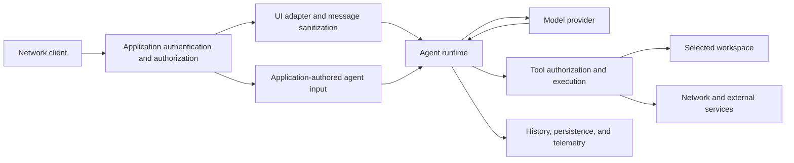

# Pydantic AI threat model

Working draft for maintainer review.

This document maps the security boundaries in Pydantic AI, its harness, and its CLI clients. It helps reviewers identify attacker-controlled inputs, the resources those inputs can reach, and which component owns each control. Component documentation defines the exact options and limitations.

## Scope and deployment profiles

The same agent can run inside applications with different authority. Evaluate a report against the affected profile.

| Profile | Authority and boundary |
|---|---|
| Server application using `Agent` | The application owns authentication, tenant identity, tool permissions, provider credentials, and access to stored state. |
| Server application using a UI adapter | Client-submitted protocol messages cross an adapter boundary before reaching the agent. The hosting application still owns HTTP and session security. |
| Realtime voice session | The server owns the session, tools, and provider credentials. A browser WebRTC call adds the browser as a peer on the provider session. |
| Local CLI or harness tools | Python tools and local commands use the authority of the launching process unless a configured execution backend provides isolation. |
| Sandboxed or remote workspace | The selected backend, provider, credentials, mounts, network settings, and lifetime define the execution boundary. |
| Durable agent | The application and execution engine own access to persisted workflow state, queues, credentials, and replay infrastructure. |

See [UI adapters](docs/ui/overview.md), [realtime deployment](docs/realtime/deployment.md), [workspaces](docs/workspace.md), [CLAI 2](src/pydantic_clai2/README.md), and [durable execution](docs/durable_execution/overview.md).

Examples and documentation snippets show how to use an API; they are not hardened deployments. A flaw in one is a documentation bug for a public issue or pull request, unless the library code it calls breaks a documented boundary.

A vulnerability in a third-party dependency or in CPython belongs to that project. When a dependency publishes a fix, the repository lock raises that dependency's floor, and the published requirements keep admitting the patched release; applications install that release themselves. Pydantic AI code does not work around the vulnerability. A CPython vulnerability fixed only in a later Python release does not change the [supported Python versions](docs/version-policy.md#support-for-python-versions); an application running an affected version carries that vulnerability until it upgrades Python. A Pydantic AI check that relies on dependency or CPython behavior is still a library control, so a bypass of that check is a Pydantic AI vulnerability.

## Assets and adversaries

Review these assets:

- User conversations, tool results, memory, persisted run state, and deferred actions.
- Server instructions, provider identifiers, credentials, internal endpoints, and telemetry.
- Files, processes, network destinations, and external services reachable by tools or provider credentials.
- Availability and cost of model requests, tool execution, downloads, and shared resources.

An attacker may control a network request, client-submitted history, a URL, downloaded content, an MCP response, a repository file, or content the model uses to choose tool arguments. Treat model-generated arguments as untrusted inputs to the tool implementation.

Trusted application code chooses the agent's tools, dependencies, credentials, and execution backend. Installing executable plugins or granting tool access delegates authority. Schema validation and model instructions do not establish the caller's permission to exercise that authority.

## Data flow

The hosting application controls which clients may enter this flow. Adapters, tools, download transports, execution backends, and state stores enforce different controls after entry. Check each crossing in both directions: incoming data can select an operation or resource, and outgoing data can disclose protected information.

## Core boundaries

### UI history and server-state disclosure

Protocol-derived history is client-controlled. UI adapters sanitize that input before execution. Direct `message_history` or `conversation` supplied to an entry point is an application-authored path; an application accepting either from a client must apply the corresponding validation and authorization.

Review incoming fields that can select provider state, per-file provider options, instructions, uploaded files, download policy, tool calls, run identity, or a workspace. Review outgoing fields that can reveal server instructions, internal endpoints, provider details, MCP App tool results the model does not see, or other users' state. Use explicit opt-in controls where an adapter supports trusting input or disclosing additional state.

Sanitization does not authenticate a client or prove that a submitted tool call or approval came from a genuine paused run. The application must authorize deferred actions and state access.

With `manage_message_history='server'`, only the client's new turn, the requests after its last response, crosses the adapter boundary and is sanitized; the `message_history` passed with it is application-authored and trusted. The client still chooses, by UI message id, whether its turn resubmits one of its own stored user prompts, which cuts the stored history just before that prompt: a rewind of its own conversation, as edit and regenerate are. It can't cut at any other request, add assistant content, or answer tool calls the stored history isn't waiting on, and system content in its turn is stripped unless the application also sets `manage_system_prompt='client'`. An application that saves the run's full history over the stored one therefore lets the client drop its own later turns from that record; one that needs an append-only record must keep earlier versions itself. The application must still authorize the conversation (`conversation_id` or thread id) it loads the stored history for. The default `'client'` mode is unchanged.

Canonical guidance: [adapter trust model](docs/ui/overview.md), [server-held history](docs/ui/overview.md#keeping-the-history-on-the-server), [deferred tools](docs/deferred-tools.md), [MCP Apps](docs/mcp/client.md#mcp-apps), and the [approval provenance follow-up](https://github.com/pydantic/pydantic-ai/issues/6452).

### HTTP and browser-origin security

A UI adapter is mounted in an application that owns authentication, authorization, sessions, CORS, and CSRF protection. A JSON content-type check narrows accepted requests; applications using cookie authentication must also apply an appropriate CSRF policy.

A local web interface has its own browser-origin and host-access boundary. A browser visiting an unrelated site can still issue requests toward loopback services. The built-in web interface checks allowed hosts and JSON content types; those checks do not authenticate a user. Exposing that interface to untrusted clients requires application authentication. Evaluate the CLI web profile separately from an adapter mounted in a server application.

Canonical guidance: [UI deployment](docs/ui/overview.md) and [web interface](docs/web.md).

### Realtime sessions

A browser on a WebRTC call can send provider-native control events and read the shared conversation, including seeded history and its tool results. A client-secret flow also gives it a short-lived provider credential. Authorize tools against trusted dependencies, and seed a call only with history its participants may read.

Seeded `message_history` is trusted server-side state, as in a standard run, and history-processing capabilities do not run on it. Sanitize client-supplied history before seeding.

A sideband does not own the call. Closing it detaches the server while the browser's call stays up, and billed, until the browser hangs up or, where the provider supports it, the server does.

Retained session audio and images are capped by default, and the caps can be removed.

Canonical guidance: [realtime deployment](docs/realtime/deployment.md), [seeding a session](docs/realtime/history.md#seeding-a-session), [retaining audio](docs/realtime/history.md#retaining-audio), and [realtime usage and limits](docs/realtime/observability.md#usage-and-limits).

### URL fetching and provider file references

URLs can select resources reachable with the server's network access or a provider's credentials. Server-side request forgery (SSRF) review covers schemes, resolved addresses, redirects, alternate address forms, response size, and each transport that performs a fetch.

Local downloads use `safe_download` for address, redirect, and response-size checks. Private addresses are blocked by default, and metadata addresses remain blocked when local URLs are enabled. `WebFetch()` uses provider-native fetching by default; its bundled local fallback uses the library's downloader, and a custom local tool has its own behavior.

A provider-resolved uploaded-file identifier or cloud-storage URL can exercise provider credentials without using the library's local downloader. Review client-supplied references at the adapter boundary and local downloads at their transport boundary.

Applications that opt into local/private destinations must authorize those destinations. Native provider tools and custom tools have the behavior and credentials of their provider or implementation. A domain list passed to a provider-native tool applies only where that provider supports it ([tracking issue](https://github.com/pydantic/pydantic-ai/issues/9706)). Browser capabilities are separate fetch transports with their own address checks; `BrowserUse` does not resolve hostnames before navigation, so sensitive networks need its domain allowlist.

Canonical guidance: [web fetching](docs/capabilities/web-fetch.md), [multimodal input](docs/input.md), [adapter trust model](docs/ui/overview.md), [local download controls](pydantic_ai_slim/pydantic_ai/_ssrf.py), [Playwright egress](docs/harness/playwright.md#egress-and-ssrf), and [BrowserUse safety](docs/harness/browser-use.md#sessions-and-safety).

### Tool actions, approvals, and prompt injection

Tool implementations must authorize the requested action using trusted application identity and policy. Pydantic validation checks the argument schema; a valid argument can still name an unauthorized account, file, URL, or operation.

Untrusted content can influence model decisions. Instructions, delimiters, model judgment, and an approval label are not substitutes for authorization in tool code. An approval mechanism protects only the operations it actually intercepts; preserve that control through delegated, resumed, background, and Code Mode execution paths.

`ToolCallJudge` and `ApprovalReviewer` are model-based filters, not security boundaries. A judge can block a call; a reviewer approval replaces the person's decision for the calls it covers. Both send the reviewed arguments, and optionally the conversation, to the reviewing model's provider.

A `wrap_*` hook that short-circuits skips that stage's `before_*` hooks, including policy hooks. Review where a mandatory control sits in the hook order.

Canonical guidance: [function tools](docs/tools.md), [advanced tools](docs/tools-advanced.md), [deferred tools](docs/deferred-tools.md), [dependencies](docs/dependencies.md), [hooks](docs/hooks.md#wrap-hooks), [Tool Call Judge](docs/harness/tool-call-judge.md#safety-boundary), [Approval Reviewer](docs/harness/approval-reviewer.md#safety-boundary), and [Code Mode](docs/harness/code-mode.md).

### MCP connections and agent configuration

MCP connections exchange tool arguments and content with a configured server. Local MCP is the default capability path; provider-native MCP is an explicit opt-in. The application chooses trusted server endpoints, credentials, and tools, and authorizes the operations it exposes. Transport authentication does not establish the identity of the application's own caller.

Agent specs can select configured capabilities and providers. YAML/JSON parsing and Pydantic validation establish the configuration's shape. The application must decide who can supply configuration that grants those capabilities or selects endpoints and resources.

Canonical guidance: [MCP capability](docs/capabilities/mcp.md), [MCP clients](docs/mcp/client.md), and [agent specs](docs/agent-spec.md).

### Persistent state and tenant identity

The application must bind conversations, response identifiers, memory namespaces, deferred results, Code Mode REPL state, and workspace reattachment to the authorized user. An identifier supplied by a client is not proof of ownership.

A `Conversation` also carries the running usage that usage limits count from, its `conversation_id`, and pending deferred tool requests; whoever supplies it controls those values. UI adapters map a client-supplied ID (AG-UI's thread ID, Vercel AI's chat ID) onto `conversation_id`. Conversation-scoped search and stores keyed on that value trust it, so pass an authenticated one. Code Mode does not authenticate a saved REPL; load only state the application wrote to storage others cannot modify.

Treat storage backends and durable execution infrastructure according to the deployment's trust assumptions. Durable execution does not add an integrity or tenant-authorization guarantee to an otherwise untrusted state store. Persistence also does not roll back an external side effect after a crash. An engine can expose model and tool steps as directly submittable tasks: Render Workflows callers with Workflow API access bypass the entry function's checks. Engine-retained task state can include prompts, tool arguments, results, and dependencies.

Canonical guidance: [message history](docs/message-history.md), [persistence](docs/persistence.md), [durable execution](docs/durable_execution/overview.md), [Render Workflows](docs/harness/render-workflows.md#execution-limits), [harness memory](docs/harness/memory.md), [conversation search scope](docs/harness/conversation-search.md#scope), [Code Mode REPL state](docs/harness/code-mode.md#keep-the-repl-across-runs), and [step persistence](docs/harness/step-persistence.md).

### Telemetry and secrets

Messages, tool arguments, results, files, and provider details can contain secrets. When instrumentation is enabled, its defaults include content. Text content, binary content, and model-request parameters have separate collection controls. Review redaction, access controls, and export destinations as part of the deployment.

Stock CLAI 2's default-on `observability` plugin differs: it exports whenever it finds a Logfire credential or OTLP exporter configuration, including in the environment, leaves prompts, results, and files out unless `include_content` is on, and traces every agent in the process while loaded.

A setting that suppresses one content field does not establish that the same content is absent from every event, exception, or integration. Integrations that call their own models or telemetry services are additional export channels. Local conversation, credential, and tool-output spill stores also need their documented access protections.

Canonical guidance: [Logfire](docs/logfire.md), [instrumentation](docs/capabilities/instrumentation.md), [CLAI 2 telemetry](src/pydantic_clai2/docs/reference.md#telemetry-and-references), [CLAI 2 storage and authentication](src/pydantic_clai2/README.md), and [tool output limits](docs/harness/tool-output-limits.md).

### Availability and resource lifetime

Review how untrusted input affects downloads, queued requests, model usage, tool runtime, persisted work, and background jobs. Distinguish application admission policy from library-owned allocation and cleanup.

Usage limits, timeouts, and concurrency limits control different resources. Evaluate normal completion, exceptions, cancellation, partial consumption, and recovery against the documented lifetime of each allocation. Scope the consequence to the affected pool, process, backend, or service.

An output-length cap does not bound downloading, parsing, or conversion work performed before truncation. Review where each limit is applied. Per-run usage limits also do not establish tenant-wide admission or provider spend controls. Per-run usage limits bound one run's own consumption. A run that exceeds its own limit is a bug, not a vulnerability, unless it exhausts a resource shared with other runs. `SpendLimits` refuses the next request once a recorded response spends a window; the crossing request and concurrent runs can exceed the ceiling, and an abandoned stream is not counted.

Canonical guidance: [agent usage limits](docs/agent.md), [timeouts](docs/timeouts.md), [model concurrency](docs/models/overview.md), [spend limits](docs/harness/spend.md#what-the-gate-guarantees), and [background tools](docs/harness/background-tools.md).

## Harness and CLI execution boundaries

| Surface | Existing control | Responsibility and limitation |
|---|---|---|
| File tools | Resolved-path containment checks and configured allow, deny, and read-only patterns. | These functional guardrails depend on the backend's path-resolution support and are subject to check/use races. Shell commands and Code Mode mounts can reach resources outside these checks. |
| Shell tools | Workspace selection, command filters, timeouts, and output limits. | Command filters are not process isolation. Local execution uses the OS user's authority; detached jobs have a separate lifetime. |
| Code Mode | A Monty sandbox with no host file, environment, or clock access by default, and per-snippet limits. | Nested calls run host tools with their authority. Mounts, and OS-access handlers that expose host resources, reach the agent's machine outside file-tool checks, even with a remote workspace. Eager and speculative execution start calls before `run_code` finishes streaming, so a control on `run_code` itself runs too late to stop them. |
| Bubblewrap | Configured mounts, user namespace, temporary directory, and network restrictions. | By default, commands can read files and credentials available to the host user and signal other processes owned by that user. Files written in the working directory run unsandboxed when later used outside the sandbox. Over SSH, each connection's login runs on the host before the sandbox starts; with the home directory as the working directory, only the files a command connection runs are protected. Give the sandbox a project working directory, hide sensitive directories, and use a separate OS user or cloud sandbox for untrusted agents. Mount and network configuration change exposure. |
| Local microVM | `SmolSandbox` and `BoxLiteSandbox` run a VM with its own kernel and filesystem, no host mounts, ports, or environment, and no network unless enabled. `BoxLiteSandbox` can limit network access to listed hosts. | The VM engine runs in the agent process with the OS user's authority; smolvm's environment variables can turn off its own confinement. Enabled network access reaches whatever the host can, including local and metadata addresses, unless a BoxLite allow-list limits it. `BoxLiteSandbox`'s `box_options` can add host mounts and published ports. Any process of that OS user can attach to a VM by its ID, and VMs persist until deleted. |
| SSH and cloud workspaces | Commands and file operations run through the configured remote account or provider. | An SSH workspace has the remote account's full authority, and its working directory does not contain commands. Its logins and timeout cleanup run on the host, outside any sandbox wrapping it. For cloud sandboxes, provider isolation, network access, credentials, and cleanup define the boundary. |
| Plugins and MCP | CLAI 2 approves each project plugin declaration and pins its file's absolute path, and trusts project MCP files by path and content. | Approved executable code and stdio servers run with the launching user's authority. Remote tools receive arguments and return untrusted content. |
| CLAI 2 self-update | `/update` runs on request and installs from PyPI or, on the `main` channel, the `clai2-bleeding` prerelease built from `main`. | The install trusts that source and restarts CLAI 2 into the new code. The environment, including `CLAI_BLEEDING_URL`, can change the source. |
| Capability creation | Runs require a writable local workspace. | Model-written Python is imported into the agent process. The host decides whether later runs load authored capabilities. |
| Delegation and persistence | Child histories, tool selection, state snapshots, and effect records. | Separate histories do not isolate shared dependencies or workspaces. Recovery requires application decisions about unfinished external effects. |

`LocalWorkspace` does not establish a security isolation boundary. Bypasses of file-tool containment or allow, deny, and read-only patterns that remain within the workspace process's existing OS authority are correctness bugs rather than security vulnerabilities, including when command execution is disabled. Evaluate security reports against documented security boundaries and the configured backend's guarantees. A sandbox protects only its configured boundary; selecting one does not make every file inside it confidential from the agent.

Canonical guidance: [filesystem security model](docs/harness/filesystem.md#security-model), [shell command controls](docs/harness/shell.md), [Code Mode](docs/harness/code-mode.md), [Bubblewrap](docs/harness/bubblewrap-sandbox.md), [SmolSandbox](docs/harness/smol-sandbox.md#security-model), [BoxLiteSandbox](docs/harness/boxlite-sandbox.md#security-model), [SSH](docs/harness/ssh-workspace.md), [E2B](docs/harness/e2b-sandbox.md), [Modal](docs/harness/modal-sandbox.md), [Sprites](docs/harness/sprites-sandbox.md), [Daytona](docs/harness/daytona-sandbox.md), [plugins](src/pydantic_clai2/PLUGINS.md), [CLAI 2 updates](src/pydantic_clai2/README.md#updating), [capability creation](docs/harness/capability-creation.md#trust-boundary), [subagents](docs/harness/subagents.md), and [step persistence](docs/harness/step-persistence.md).

On non-Windows platforms, stock CLAI 2 is a broad local-execution profile: its default Coder has unrestricted file access and uses a local workspace unless configured otherwise. Stock CLAI 2 does not provide an agent workspace on Windows. Launching from a directory does not contain its commands or file access. Stock defaults that matter for review:

- The nearest `.env`, searched from the launch directory up through its parents, loads at startup without approval. It can set any environment variable not already set, including credentials and endpoints, before CLAI 2 reads its settings or loads plugins. Setting `XDG_CONFIG_HOME` moves the settings, drop-in plugins, MCP trust records, and saved logins CLAI 2 uses.
- Repository instructions, project skills, and project agent definitions reach the model by default. Agent definitions get no tools or model choice of their own.
- Most tools, `shell` included, run through eager Code Mode by default, from `run_code` statements while the model is still writing. The REPL state is saved with the session.
- `!` commands run in the host shell, not the agent workspace, and their output is saved for the next prompt.
- Environment filtering covers selected credential names and does not isolate other secrets or files readable by the OS user.
- `open_stock_agent` gives code and ACP hosts the same Coder and workspace defaults.

See the CLAI 2 docs on [environment variables](src/pydantic_clai2/docs/reference.md#environment-variables), [Code Mode](src/pydantic_clai2/README.md#code-mode-and-speculative-execution), [agent folders](src/pydantic_clai2/docs/reference.md#agent-folders), and [the stock agent in your own code](src/pydantic_clai2/docs/reference.md#the-stock-agent-in-your-own-code).

ACP integrations can delegate filesystem access and approvals to a client. Evaluate that client's authorization alongside the server's enabled tools; the client-backed filesystem toolset does not add a sandbox. See the [ACP client toolsets](src/pydantic_ai_harness/pydantic_ai_harness/experimental/acp/_client_toolsets.py).

## Published failure patterns

These precedents show what to examine when a component or control changes. Read each advisory for its affected versions and conditions.

| Pattern | Review focus | Published examples |
|---|---|---|
| URL checks and network resolution disagree | Alternate address forms, hostname normalization, redirects, metadata access, and domain-list semantics. | [Metadata protection](https://github.com/pydantic/pydantic-ai/security/advisories/GHSA-cg7w-rg45-pc59), [domain-list bypass](https://github.com/pydantic/pydantic-ai/security/advisories/GHSA-22h6-qm39-v87j). |
| Limits apply after expensive work | Streaming download caps, conversion complexity, intermediate memory, and event-loop responsiveness. | [Download size](https://github.com/pydantic/pydantic-ai/security/advisories/GHSA-v2xh-2vp8-57h8), [conversion cost](https://github.com/pydantic/pydantic-ai/security/advisories/GHSA-v36g-jcw9-x7cw). |
| A shared allocation outlives its request | Release on completion, cancellation, consumer errors, and partial consumption, including cleanup from another task. | [Concurrency slot retention](https://github.com/pydantic/pydantic-ai/security/advisories/GHSA-6fqq-452j-qhrp). |
| A browser reaches a privileged local endpoint | Origin, host, content type, and request-controlled UI assets. | [Cross-origin requests](https://github.com/pydantic/pydantic-ai/security/advisories/GHSA-h4xc-3qfq-jf93), [DNS rebinding](https://github.com/pydantic/pydantic-ai/security/advisories/GHSA-q2xc-rrxj-58x9), [UI asset selection](https://github.com/pydantic/pydantic-ai/security/advisories/GHSA-wjp5-868j-wqv7). |
| Client history changes execution or provider access | The surviving history tail, uploaded-file references, and authorization independent of client approval state. | [History sanitization](https://github.com/pydantic/pydantic-ai/security/advisories/GHSA-jpr8-2v3g-wgf9), [uploaded files](https://github.com/pydantic/pydantic-ai/security/advisories/GHSA-h7p7-w5gc-xj3w). |
| Redaction misses another export channel | Events, exceptions, status text, instructions, templates, and every integration that emits content. | [Retry content](https://github.com/pydantic/pydantic-ai/security/advisories/GHSA-3gh4-cghq-f8v4), [additional trace channels](https://github.com/pydantic/pydantic-ai/security/advisories/GHSA-4x9p-g9wm-8q7f). |

## Proposed report-evaluation questions

Use the affected component's current documented boundary when evaluating a report.

1. What version, deployment profile, and configuration is affected?
2. What input can the attacker control, and what access is required?
3. Which implementation path carries that input to the protected resource?
4. What concrete confidentiality, integrity, or availability consequence can be reproduced?
5. Which library control or application responsibility governs that path?
6. Does the reproduction use a reasonable configuration consistent with documentation?
7. Does the proposed fix repair that boundary, or introduce a new guarantee?
8. Which regression test proves the boundary and the relevant completion/error paths?

Answer a report of a dependency or CPython vulnerability with the release that fixes it; see [Scope and deployment profiles](#scope-and-deployment-profiles).

A configuration-dependent report needs explicit deployment assumptions. For library scoring, use [FIRST's guidance for reasonable embedding scenarios](https://www.first.org/cvss/v3.1/user-guide#3-7-Scoring-Vulnerabilities-in-Software-Libraries-and-Similar). Severity scoring and the decision to publish an advisory require separate maintainer judgment.

## Keeping this model current

Update this document when a change adds an input path, transfers authority, changes a trust or disclosure default, or changes an execution backend's guarantee. Keep option-level details in their canonical component documentation.

For a change crossing a boundary, trace the incoming value to its authorization or validation and trace the outgoing value to its audience. Include a regression test for the specific control. Review adapter protocols, local/provider transports, execution backends, and cancellation or recovery paths that share the affected mechanism.
