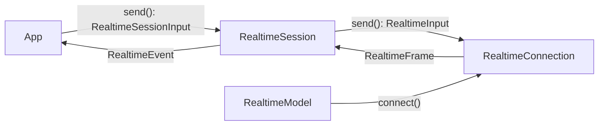

# `pydantic_ai.realtime`

Support for **realtime, bidirectional speech-to-speech models** (OpenAI Realtime, OpenAI GPT-Live,
Azure OpenAI, Gemini Live, xAI Grok Voice, and any other provider that streams audio in and out over
a persistent connection).

Unlike [`Model`][pydantic_ai.models.Model], which is request-response, a realtime model opens a
long-lived connection: you stream audio (or text/images) in, and consume audio, transcripts, and
tool calls as they arrive. The high-level entry point is
[`Agent.realtime()`][pydantic_ai.agent.Agent.realtime], followed by
[`AgentRealtime.session()`][pydantic_ai.agent.AgentRealtime.session], which wires the agent's tools and
instructions into a session and runs the tool loop for you. See the [Realtime guide](../realtime/overview.md)
for a walkthrough.

The flow of a session:



A [`RealtimeModel`][pydantic_ai.realtime.RealtimeModel] opens a
[`RealtimeConnection`][pydantic_ai.realtime.codec.RealtimeConnection] (the provider-specific transport).
A [`RealtimeSession`][pydantic_ai.realtime.RealtimeSession] wraps that connection: it translates the
low-level codec events into the shared message/part event vocabulary from
[`pydantic_ai.messages`][pydantic_ai.messages], builds ordinary
[`ModelMessage`][pydantic_ai.messages.ModelMessage] history, and executes tools automatically —
intercepting each [`ToolCall`][pydantic_ai.realtime.codec.ToolCall], running it, sending the
[`ToolResult`][pydantic_ai.realtime.codec.ToolResult] back, and emitting a
[`FunctionToolCallEvent`][pydantic_ai.messages.FunctionToolCallEvent] then a
[`FunctionToolResultEvent`][pydantic_ai.messages.FunctionToolResultEvent]. Every tool runs in the
background, so a slow one never blocks the session; whether the *model* keeps speaking meanwhile is
provider-specific (see [Concurrent tool execution](../realtime/tools.md#concurrent-tool-execution)).

## Overview

**Provider abstractions & session**

| Object | Role |
| --- | --- |
| [`RealtimeModel`][pydantic_ai.realtime.RealtimeModel] | Provider ABC; `connect()` opens a connection. |
| [`RealtimeModelSettings`][pydantic_ai.realtime.RealtimeModelSettings] | Settings shared by realtime providers. |
| [`TurnDetection`][pydantic_ai.realtime.TurnDetection] | Cross-provider automatic VAD sensitivity, padding, and silence configuration. |
| [`KnownRealtimeModelName`][pydantic_ai.realtime.KnownRealtimeModelName] / [`infer_realtime_model`][pydantic_ai.realtime.infer_realtime_model] | Provider-prefixed model IDs and inference. |
| [`RealtimeConnection`][pydantic_ai.realtime.codec.RealtimeConnection] | Provider ABC; `send()` content in, `frames()` of codec and lifecycle events out. |
| [`RealtimeSession`][pydantic_ai.realtime.RealtimeSession] | Wraps a connection with automatic concurrent tool dispatch. |

**Browser / WebRTC** — for browser voice agents, the media flows browser ↔ provider directly while the
backend runs a control-plane sideband (OpenAI and Azure OpenAI; see [Connecting a frontend](../realtime/deployment.md#browser-webrtc-server-sideband)):

| Object | Role |
| --- | --- |
| [`RealtimeModel.answer_webrtc_offer`][pydantic_ai.realtime.RealtimeModel.answer_webrtc_offer] | Relay the browser's SDP offer; return the SDP answer and a [`WebRTCAnswer`][pydantic_ai.realtime.WebRTCAnswer] / [`WebRTCSession`][pydantic_ai.realtime.WebRTCSession]. |
| [`RealtimeModel.create_client_secret`][pydantic_ai.realtime.RealtimeModel.create_client_secret] | Mint an ephemeral [`RealtimeClientSecret`][pydantic_ai.realtime.RealtimeClientSecret] for a browser client. |
| [`AgentRealtime.session(provider_session=…)`][pydantic_ai.agent.AgentRealtime.session] | Attach the sideband session to a [`RealtimeProviderSession`][pydantic_ai.realtime.RealtimeProviderSession] (e.g. a [`WebRTCSession`][pydantic_ai.realtime.WebRTCSession]) and run the agent. |

**Inputs** — [`RealtimeSession.send`][pydantic_ai.realtime.RealtimeSession.send] accepts session content
only, in the shared message vocabulary ([`RealtimeSessionInput`][pydantic_ai.realtime.RealtimeSessionInput]):
plain `str`, image/audio [`BinaryContent`][pydantic_ai.messages.BinaryContent] (including
[`BinaryImage`][pydantic_ai.messages.BinaryImage] and
[`BinaryAudio`][pydantic_ai.messages.BinaryAudio]), or a sequence of
these. A string solicits a response, while an image is context-only by default; use `respond` to
override either behavior. Turn-taking and interruption go through the dedicated
[`RealtimeSession`][pydantic_ai.realtime.RealtimeSession] methods (`commit_audio()`, `clear_audio()`,
`create_response()`, `interrupt()`), not `send()`. Use
[`RealtimeSession.enqueue()`][pydantic_ai.realtime.RealtimeSession.enqueue] to queue text or system
prompt parts for delivery after the active response, or once the model is idle.

**Consumption views** —
[`RealtimeSession.stream_audio()`][pydantic_ai.realtime.RealtimeSession.stream_audio] yields model
audio chunks ready for playback, while
[`RealtimeSession.stream_transcripts()`][pydantic_ai.realtime.RealtimeSession.stream_transcripts]
yields finalized speech from both speakers or live deltas with `delta=True`. These bounded views can
run concurrently with each other and with the session's raw event iterator.
[`RealtimeSession.wait_for_reply()`][pydantic_ai.realtime.RealtimeSession.wait_for_reply] waits
until the model has finished the reply it owes, spanning the whole of a tool-calling turn, and runs
alongside an active event iterator rather than competing with it.
[`RealtimeSession.wait_for_playback()`][pydantic_ai.realtime.RealtimeSession.wait_for_playback]
waits until the single audio view has accounted for all audio emitted so far, whether it was
played or discarded.
[`RealtimeSession.close()`][pydantic_ai.realtime.RealtimeSession.close] ends the session and every
live view; [`RealtimeSession.closed`][pydantic_ai.realtime.RealtimeSession.closed] exposes its state.
The session starts receiving at whichever comes first: the first outbound call, the first
`stream_audio()` or `stream_transcripts()` view, or the first `async for` over the session. It does
not start on entry, so a view created inside the session block — as every example here does — cannot
miss output the model produced before it subscribed. A fatal receive failure or a tool failure is
raised from active event iteration, which can go on after a tool failure; without an active
iterator, the views end and context exit raises it.
The next outbound session method raises an already-ended receive side's failure first, and the same
failure is never delivered twice.

The low-level [`RealtimeConnection.send`][pydantic_ai.realtime.codec.RealtimeConnection.send] accepts the
normalized [`RealtimeInput`][pydantic_ai.realtime.codec.RealtimeInput] — a `str` text turn, a
[`TextContext`][pydantic_ai.realtime.codec.TextContext] item added without soliciting a reply, a raw-PCM
[`BinaryAudio`][pydantic_ai.messages.BinaryAudio] chunk, or a
[`BinaryImage`][pydantic_ai.messages.BinaryImage] frame — which additionally includes the
turn-control verbs ([`CommitAudio`][pydantic_ai.realtime.codec.CommitAudio],
[`ClearAudio`][pydantic_ai.realtime.codec.ClearAudio],
[`CreateResponse`][pydantic_ai.realtime.codec.CreateResponse],
[`CancelResponse`][pydantic_ai.realtime.codec.CancelResponse], and
[`TruncateOutput`][pydantic_ai.realtime.codec.TruncateOutput]) that those session methods emit, plus
[`ToolResult`][pydantic_ai.realtime.codec.ToolResult] — which the session sends itself as each tool
completes.

**Connection events** — [`RealtimeCodecEvent`][pydantic_ai.realtime.codec.RealtimeCodecEvent], the low-level codec
vocabulary yielded by a connection:
[`AudioDelta`][pydantic_ai.realtime.codec.AudioDelta],
[`OutputTranscript`][pydantic_ai.realtime.codec.OutputTranscript],
[`InputTranscript`][pydantic_ai.realtime.codec.InputTranscript],
[`ToolCall`][pydantic_ai.realtime.codec.ToolCall],
[`ToolCallCancelled`][pydantic_ai.realtime.codec.ToolCallCancelled],
[`ResponseDone`][pydantic_ai.realtime.codec.ResponseDone],
[`RealtimeInputSpeechStartEvent`][pydantic_ai.realtime.RealtimeInputSpeechStartEvent],
[`RealtimeInputSpeechEndEvent`][pydantic_ai.realtime.RealtimeInputSpeechEndEvent],
[`RealtimeOutputSpeechStartEvent`][pydantic_ai.realtime.RealtimeOutputSpeechStartEvent],
[`RealtimeOutputSpeechEndEvent`][pydantic_ai.realtime.RealtimeOutputSpeechEndEvent],
[`RealtimeInputTranscriptionErrorEvent`][pydantic_ai.realtime.RealtimeInputTranscriptionErrorEvent],
[`RealtimeResponseInterruptedEvent`][pydantic_ai.realtime.RealtimeResponseInterruptedEvent],
[`RealtimeSessionReconnectEvent`][pydantic_ai.realtime.RealtimeSessionReconnectEvent],
[`ConversationCreated`][pydantic_ai.realtime.codec.ConversationCreated],
[`ConversationItemCreated`][pydantic_ai.realtime.codec.ConversationItemCreated],
[`InputRejected`][pydantic_ai.realtime.codec.InputRejected],
[`PartStartEvent`][pydantic_ai.messages.PartStartEvent],
[`PartEndEvent`][pydantic_ai.messages.PartEndEvent],
[`SessionUsage`][pydantic_ai.realtime.codec.SessionUsage],
and [`RealtimeSessionErrorEvent`][pydantic_ai.realtime.RealtimeSessionErrorEvent].

**Lifecycle events** — [`LifecycleEvent`][pydantic_ai.realtime.lifecycle.LifecycleEvent], which a connection
yields with its codec events, each [`RealtimeFrame`][pydantic_ai.realtime.lifecycle.RealtimeFrame] from
[`RealtimeConnection.frames()`][pydantic_ai.realtime.codec.RealtimeConnection.frames] holding what one provider
message made. They say what the codec events can't: where each response starts and ends
([`ResponseStarted`][pydantic_ai.realtime.lifecycle.ResponseStarted] /
[`ResponseEnded`][pydantic_ai.realtime.lifecycle.ResponseEnded]) and which inputs it answers (corrected with
[`AnswersRevised`][pydantic_ai.realtime.lifecycle.AnswersRevised] when the connection learns better), where each
spoken turn starts, joins the conversation, and gets the last of its audio and transcript
([`UserTurnStarted`][pydantic_ai.realtime.lifecycle.UserTurnStarted] /
[`UserTurnEnded`][pydantic_ai.realtime.lifecycle.UserTurnEnded] /
[`UserTurnClosed`][pydantic_ai.realtime.lifecycle.UserTurnClosed]), where each input joins it
([`InputAdded`][pydantic_ai.realtime.lifecycle.InputAdded]), and which inputs no response will answer
([`InputLost`][pydantic_ai.realtime.lifecycle.InputLost] /
[`ResponseRequestRefused`][pydantic_ai.realtime.lifecycle.ResponseRequestRefused]), and which tool calls' results
it won't answer either ([`ToolCallsAbandoned`][pydantic_ai.realtime.lifecycle.ToolCallsAbandoned]). The session
builds history, usage, and [`wait_for_reply()`][pydantic_ai.realtime.RealtimeSession.wait_for_reply] from them.

**Implementing a connection** — subclass [`RealtimeConnection`][pydantic_ai.realtime.codec.RealtimeConnection]
and implement [`send()`][pydantic_ai.realtime.codec.RealtimeConnection.send] and
[`frames()`][pydantic_ai.realtime.codec.RealtimeConnection.frames]. A protocol that identifies its responses,
turns, and inputs (as the OpenAI Realtime API does) is best translated into lifecycle events directly. One that
identifies none of them (as Gemini Live and OpenAI GPT-Live don't) can hand each input it sends and each
provider message it reads to an [`InferredLifecycle`][pydantic_ai.realtime.lifecycle.InferredLifecycle], which
works the lifecycle out from their order. Either way, a connection that names the output items its codec events
stream (their `item_id`) can say more about one:
[`OutputItemDetails`][pydantic_ai.realtime.lifecycle.OutputItemDetails] keeps what the provider says about it on
the part it makes, and [`OutputItemCut`][pydantic_ai.realtime.lifecycle.OutputItemCut] reports how much of it the
listener heard, which can come after its response ended and revises the copy history recorded. Here, a reply to a
text turn is a response that answers it:

```python
import asyncio
from collections.abc import AsyncIterator, Sequence

from pydantic_ai.realtime.codec import (
    OutputTranscript,
    RealtimeCodecEvent,
    RealtimeConnection,
    RealtimeInput,
    ResponseDone,
)
from pydantic_ai.realtime.lifecycle import InferredLifecycle, LifecycleEvent, RealtimeFrame


class EchoConnection(RealtimeConnection):
    """Says each text turn back: a stand-in for a protocol that identifies nothing."""

    def __init__(self) -> None:
        self._lifecycle = InferredLifecycle(transcribes=False)
        self._said: asyncio.Queue[str] = asyncio.Queue()

    async def send(self, content: RealtimeInput) -> Sequence[LifecycleEvent]:
        # Reports the input, and that it failed if writing it raises.
        with self._lifecycle.sending(content):
            if isinstance(content, str):
                self._said.put_nowait(content)  # (where a real connection writes to its transport)
        # Where it joined the conversation, which the protocol doesn't acknowledge.
        return self._lifecycle.take_pending()

    def frames(self) -> AsyncIterator[RealtimeFrame]:
        return self._lifecycle.frames(self._codec_events())

    async def _codec_events(self) -> AsyncIterator[RealtimeCodecEvent]:
        while True:  # (where a real connection reads its transport)
            text = await self._said.get()
            yield OutputTranscript(text=text, is_final=True)
            yield ResponseDone()


async def main():
    connection = EchoConnection()
    print(await connection.send('Hello!'))
    #> [InputAdded(input_id=0)]
    frames = connection.frames()
    for _ in range(2):
        print([type(event).__name__ for event in await anext(frames)])
        #> ['ResponseStarted', 'OutputTranscript']
        #> ['ResponseDone', 'ResponseEnded']
```

`frames()` ends once the connection is gone: an `InferredLifecycle` ends what was under way on it then, as
[`connection_lost()`][pydantic_ai.realtime.lifecycle.InferredLifecycle.connection_lost] does for a connection
that re-dials. A connection that reads each provider message itself passes its codec events to
[`frame_for()`][pydantic_ai.realtime.lifecycle.InferredLifecycle.frame_for] to get the frame to yield.

The inference assumes what most providers do: the user's words can be transcribed after the model started
answering them, output audio is the model speaking, and audio the model answers before any transcript of it came
is a spoken turn. A provider that departs from that gets a subclass overriding `InferredLifecycle`'s extension
points: [`transcripts_lag_replies`][pydantic_ai.realtime.lifecycle.InferredLifecycle.transcripts_lag_replies],
[`audio_starts_response`][pydantic_ai.realtime.lifecycle.InferredLifecycle.audio_starts_response],
[`untranscribed_audio_is_a_turn`][pydantic_ai.realtime.lifecycle.InferredLifecycle.untranscribed_audio_is_a_turn],
[`inputs_cut_off_replies`][pydantic_ai.realtime.lifecycle.InferredLifecycle.inputs_cut_off_replies],
and [`takes_turn()`][pydantic_ai.realtime.lifecycle.InferredLifecycle.takes_turn].

Which inputs a response answers settles each input's reply obligation, which is what
[`wait_for_reply()`][pydantic_ai.realtime.RealtimeSession.wait_for_reply] and
[`RealtimeTurnCompleteEvent`][pydantic_ai.realtime.RealtimeTurnCompleteEvent] wait for, so only the response that
answers an input may name it. A connection that can't tell yet names its best guess in `ResponseStarted.answers`
(with `basis='inferred'`) and corrects it with an
[`AnswersRevised`][pydantic_ai.realtime.lifecycle.AnswersRevised] once it can: `released` hands inputs the response
turned out not to answer to a later one, as `InferredLifecycle` does for a response an input cut off (with
`inputs_cut_off_replies`, telling it when the provider heard the user speak with
[`speech_heard()`][pydantic_ai.realtime.lifecycle.InferredLifecycle.speech_heard], where no
`RealtimeInputSpeechStartEvent` says so), and `claimed`
settles inputs sent while a response was under way that it answers after all, as GPT-Live does by speaking to text
in the reply it is giving. Neither moves anything in history.

A provider can also give up on tool calls before their results are in: Eleven Realtime does once it starts a reply to
the user, and GPT-Live when its delegated backend fails. The connection then names them in a
[`ToolCallsAbandoned`][pydantic_ai.realtime.lifecycle.ToolCallsAbandoned]: the tools keep running and their results
are recorded, but no reply to them is waited for, so the exchange ends with the reply that is under way. Unlike a
[`ToolCallCancelled`][pydantic_ai.realtime.codec.ToolCallCancelled], it doesn't stop them.

**Session events** — [`RealtimeEvent`][pydantic_ai.realtime.RealtimeEvent], yielded by a
session. The session translates codec events into the shared vocabulary from
[`pydantic_ai.messages`][pydantic_ai.messages]: content streams as
[`PartStartEvent`][pydantic_ai.messages.PartStartEvent] /
[`PartDeltaEvent`][pydantic_ai.messages.PartDeltaEvent] /
[`PartEndEvent`][pydantic_ai.messages.PartEndEvent] (carrying shared message parts including
[`SpeechPart`][pydantic_ai.messages.SpeechPart], [`TextPart`][pydantic_ai.messages.TextPart],
[`ToolCallPart`][pydantic_ai.messages.ToolCallPart], and
[`NativeToolReturnPart`][pydantic_ai.messages.NativeToolReturnPart]), tool execution as
[`FunctionToolCallEvent`][pydantic_ai.messages.FunctionToolCallEvent] /
[`FunctionToolResultEvent`][pydantic_ai.messages.FunctionToolResultEvent], deferred calls and their inline resolution as
[`DeferredToolRequestsEvent`][pydantic_ai.messages.DeferredToolRequestsEvent] /
[`DeferredToolResultsEvent`][pydantic_ai.messages.DeferredToolResultsEvent], enqueued-message delivery as
[`EnqueuedMessagesEvent`][pydantic_ai.messages.EnqueuedMessagesEvent], and the rest as the
control-plane events above (`RealtimeInputSpeechStartEvent`, `RealtimeInputSpeechEndEvent`,
`RealtimeOutputSpeechStartEvent`, `RealtimeOutputSpeechEndEvent`, `RealtimeInputTranscriptionErrorEvent`,
`RealtimeResponseInterruptedEvent`, `RealtimeSessionReconnectEvent`, and `RealtimeSessionErrorEvent`), plus
[`RealtimeTurnCompleteEvent`][pydantic_ai.realtime.RealtimeTurnCompleteEvent], which the
session synthesizes rather than reading off the wire. Usage updates are accumulated on the session and are not yielded.

The lower-level codec vocabulary is documented in
[`pydantic_ai.realtime.codec`](realtime/codec.md), and each provider in its own module:
[`pydantic_ai.realtime.openai`](realtime/openai.md), [`pydantic_ai.realtime.openai_live`](realtime/openai_live.md),
[`pydantic_ai.realtime.google`](realtime/google.md), [`pydantic_ai.realtime.xai`](realtime/xai.md),
[`pydantic_ai.realtime.azure`](realtime/azure.md), and [`pydantic_ai.realtime.elevenlabs_agents`](realtime/elevenlabs_agents.md).

::: pydantic_ai.realtime
