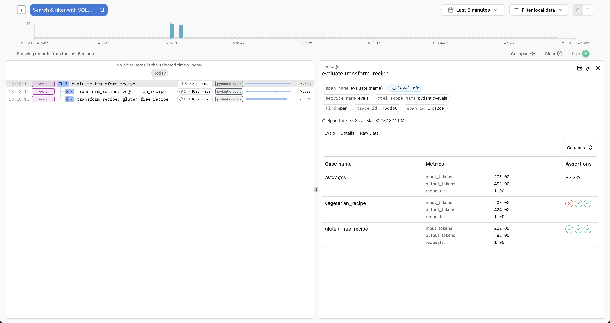
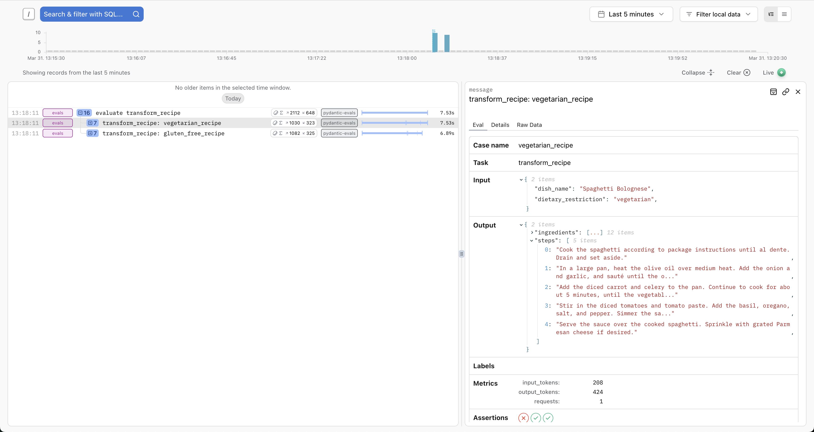
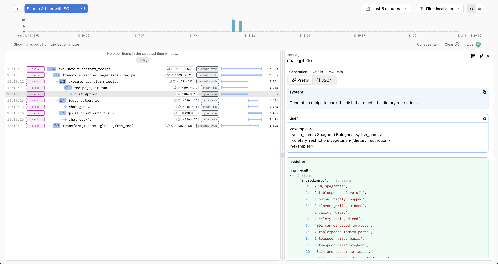

# Logfire Integration

Visualize and analyze evaluation results using Pydantic Logfire.

## Overview

Pydantic Evals uses OpenTelemetry to record traces of the evaluation process. These traces contain all the information from your evaluation reports, plus full tracing from the execution of your task function.

You can send these traces to any OpenTelemetry-compatible backend, including [Pydantic Logfire](https://logfire.pydantic.dev/docs/guides/web-ui/evals/).

## Installation

Install the optional logfire dependency:

```bash
pip install 'pydantic-evals[logfire]'
```

## Basic Setup

Configure Logfire before running evaluations:

```python {title="basic_logfire_setup.py"}
import logfire

from pydantic_evals import Case, Dataset

# Configure Logfire
logfire.configure(
    send_to_logfire='if-token-present',  # (1)!
)


# Your evaluation code
def my_task(inputs: str) -> str:
    return f'result for {inputs}'


dataset = Dataset(name='logfire_demo', cases=[Case(name='test', inputs='example')])
report = dataset.evaluate_sync(my_task)
```

1. Sends data to Logfire only if the `LOGFIRE_TOKEN` environment variable is set

That's it! Your evaluation traces will now appear in the Logfire web UI as long as you have the `LOGFIRE_TOKEN` environment variable set.

## What Gets Sent to Logfire

When you run an evaluation, Logfire receives:

1. **Evaluation metadata**
    1. Dataset name
    1. Number of cases
    1. Evaluator names
2. **Per-case data**
    1. Inputs and outputs
    1. Expected outputs
    1. Metadata
    1. Execution duration
3. **Evaluation results**
    1. Scores, assertions, and labels
    1. Reasons (if included)
    1. Evaluator failures
4. **Task execution traces**
    1. All OpenTelemetry spans from your task function
    1. Tool calls (for Pydantic AI agents)
    1. API calls, database queries, etc.

## Viewing Results in Logfire

### Evaluation Overview

Logfire provides a special table view for evaluation results on the root evaluation span:



This view shows:

- Case names
- Pass/fail status
- Scores and assertions
- Execution duration
- Quick filtering and sorting

### Individual Case Details

Click any case to see detailed inputs and outputs:



### Full Trace View

View the complete execution trace including all spans generated during evaluation:



This is especially useful for:

- Debugging failed cases
- Understanding performance bottlenecks
- Analyzing tool usage patterns
- Writing span-based evaluators

## Analyzing Traces

### Comparing Runs

Run the same evaluation multiple times and compare in Logfire:

```python
from pydantic_evals import Case, Dataset


def original_task(inputs: str) -> str:
    return f'original result for {inputs}'


def improved_task(inputs: str) -> str:
    return f'improved result for {inputs}'


dataset = Dataset(name='comparison', cases=[Case(name='test', inputs='example')])

# Run 1: Original implementation
report1 = dataset.evaluate_sync(original_task)

# Run 2: Improved implementation
report2 = dataset.evaluate_sync(improved_task)

# Compare in Logfire by filtering by timestamp or attributes
```

### CI Provenance

To let a run be compared with an earlier run of the same experiment, such as the latest run on a pull request's base branch, [`Dataset.evaluate`][pydantic_evals.dataset.Dataset.evaluate] records where the run came from. The experiment span (`evaluate {name}`) gets these [OpenTelemetry VCS and CI/CD attributes](https://opentelemetry.io/docs/specs/semconv/registry/attributes/vcs/), each only when its value is known:

| Attribute | Value |
|---|---|
| `vcs.ref.head.revision` | The commit under test. For a pull request or merge request this is its head commit, not the merge commit that CI builds |
| `vcs.ref.head.name` | The branch or tag under test |
| `vcs.ref.head.type` | `branch` or `tag` |
| `vcs.ref.base.name` | The target branch of the pull request or merge request |
| `vcs.change.id` | The pull request number or merge request IID |
| `vcs.provider.name` | `github` or `gitlab` |
| `vcs.repository.url.full` | The repository URL |
| `cicd.pipeline.run.url.full` | The URL of the CI run |

GitHub Actions and GitLab CI are detected from their environment variables. On GitHub Actions, pull request details come from the event payload file at `GITHUB_EVENT_PATH`. If it can't be read, the commit is left out rather than reported as the merge commit. On `pull_request_target` events, which check out the base branch by default, the commit and branch are left out. Anywhere else, the commit and branch come from the `git` checkout in the current directory. Detecting provenance never fails the evaluation.

These environment variables control the provenance attributes:

| Environment variable | Effect |
|---|---|
| `PYDANTIC_EVALS_CI_METADATA=false` | Disables the provenance attributes, including the two overrides below |
| `PYDANTIC_EVALS_GIT_COMMIT_SHA` | Sets `vcs.ref.head.revision`, overriding what was detected |
| `PYDANTIC_EVALS_GIT_BRANCH` | Sets `vcs.ref.head.name`, overriding what was detected |

### Debugging Failed Cases

Find failed cases quickly:

1. Search for `service_name = 'my_service_evals' AND is_exception` (replace with the actual service name you are using)
2. View the full span tree to see where the failure occurred
3. Inspect attributes and logs for error messages

## Span-Based Evaluation

Logfire integration enables powerful span-based evaluators. See [Span-Based Evaluation](../evaluators/span-based.md) for details.

Example: Verify specific tools were called:

```python
import logfire

from pydantic_evals import Case, Dataset
from pydantic_evals.evaluators import HasMatchingSpan

logfire.configure(send_to_logfire='if-token-present')


def my_agent(inputs: str) -> str:
    return f'result for {inputs}'


dataset = Dataset(
    name='logfire_demo',
    cases=[Case(name='test', inputs='example')],
    evaluators=[
        HasMatchingSpan(
            query={'name_contains': 'search_tool'},
            evaluation_name='used_search',
        ),
    ],
)

report = dataset.evaluate_sync(my_agent)
```

The span tree is available in both:

- Your evaluator code (via `ctx.span_tree`)
- Logfire UI (visual trace view)

## Troubleshooting

### No Data Appearing in Logfire

Check:

1. **Token is set**: `echo $LOGFIRE_TOKEN`
2. **Configuration is correct**:
   ```python {test="skip"}
   import logfire

   logfire.configure(send_to_logfire=True)  # Force sending
   ```
3. **Network connectivity**: Check firewall settings
4. **Project exists**: Verify project name in Logfire UI

### Traces Missing Spans

If some spans are missing:

1. **Ensure logfire is configured before imports**:
   ```python
   import logfire

   logfire.configure()  # Must be first
   ```

2. **Check instrumentation**: Ensure your code has enabled all instrumentations you want:
   ```python
   import logfire

   logfire.instrument_pydantic_ai()
   logfire.instrument_httpx(capture_all=True)
   ```

## Best Practices

### 1. Configure Early

Always configure Logfire before running evaluations:

```python
import logfire

from pydantic_evals import Case, Dataset

logfire.configure(send_to_logfire='if-token-present')


# Now import and run evaluations
def task(inputs: str) -> str:
    return f'result for {inputs}'


dataset = Dataset(name='logfire_demo', cases=[Case(name='test', inputs='example')])
dataset.evaluate_sync(task)
```

### 2. Use Descriptive Service Names And Environments

```python
import logfire

logfire.configure(
    service_name='rag-pipeline-evals',
    environment='development',
)
```

### 3. Review Periodically

- Check Logfire regularly to identify patterns
- Look for consistently failing cases
- Analyze performance trends
- Adjust evaluators based on insights

## Next Steps

- **[Span-Based Evaluation](../evaluators/span-based.md)** - Use OpenTelemetry spans in evaluators
- **[Logfire Documentation](https://logfire.pydantic.dev/docs/guides/web-ui/evals/)** - Complete Logfire guide
- **[Metrics & Attributes](metrics-attributes.md)** - Add custom data to traces
