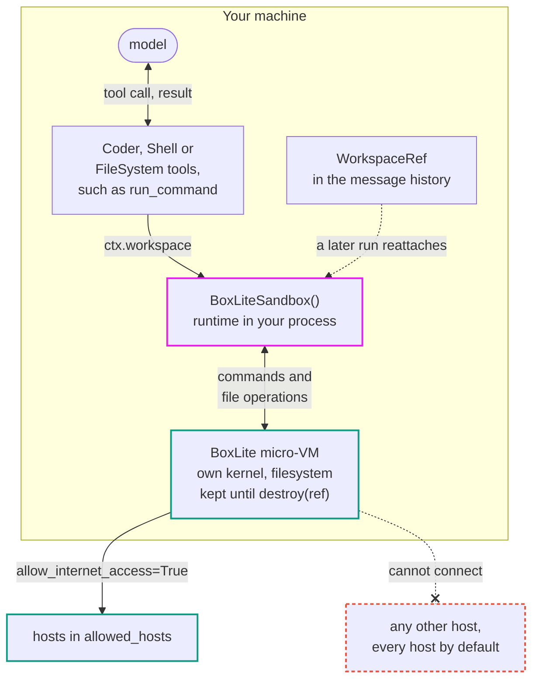

# BoxLite Sandbox

Run your agent's commands and file edits in a [BoxLite](https://github.com/boxlite-ai/boxlite) micro-VM on your own machine, isolated from your files and processes, without a cloud account.

[Source](https://github.com/pydantic/pydantic-ai/tree/main/src/pydantic_ai_harness/pydantic_ai_harness/boxlite_sandbox/)

> While Pydantic AI Harness is on 0.x releases, the API may change between minor releases; when it does, deprecation warnings and release-note migration guidance tell you (or your agent) exactly how to upgrade. See the [version policy](index.md#version-policy).



## Install

<span id="platforms"></span>

```bash
pip/uv-add "pydantic-ai-harness[coder,boxlite,anthropic]"
```

The `boxlite` extra installs [BoxLite's Python SDK](https://github.com/boxlite-ai/boxlite/tree/main/sdks/python), which runs VMs in your process, with no daemon. It needs Python 3.14 or older on one of:

- macOS 14 or newer on Apple silicon.
- Linux on x86_64 or aarch64 with glibc 2.28 or newer. The user running the agent needs read and write access to `/dev/kvm`.

The examples also use `Coder` and an Anthropic model, hence the `coder` and `anthropic` extras and `ANTHROPIC_API_KEY`; swap them for your own tools and model provider.

## Quick start

<span id="choose-the-tools"></span>

```python {names="defined"}
from pydantic_ai import Agent
from pydantic_ai_harness.boxlite_sandbox import BoxLiteSandbox
from pydantic_ai_harness.coder import Coder

agent = Agent('{{ anthropic:large }}', capabilities=[BoxLiteSandbox(image='python:3.12-slim'), Coder()])
result = agent.run_sync('Write a script that prints the first 10 primes, and run it.')
```

`Coder`'s shell and file tools now run in a VM with its own kernel and filesystem. For a narrower agent, use [`Shell`](shell.md), [`FileSystem`](filesystem.md) or your own tools on [`ctx.workspace`](../workspace.md#using-the-workspace-in-tools).

- `Coder` creates it when the run starts, to load the repository's instructions, even if no tool is called. Pass `Coder(repo_context=False)` to wait for the first tool call.
- Its disk stays in BoxLite's home directory after the run. The box stops when your process exits, but nothing deletes it. See [Clean up](#clean-up).
- It has no network access. Pass `allow_internet_access=True`, and `allowed_hosts` to reach only what it needs. See [Network access](#network-access).
- Commands run as the image's user, usually `root`, in `/workspace`, which is created if missing.
- Without an `image`, the box runs Alpine Linux, which has BusyBox but no Python, git or ripgrep. An `image` is any OCI image with a POSIX `/bin/sh`; BoxLite pulls it the first time.
- One process at a time can use BoxLite's home directory (`~/.boxlite`, or `BOXLITE_HOME`). Another process gets `WorkspaceUnavailableError` until the first one exits.

## Continue in the same box

<span id="reattach-later"></span>

Pass the message history, and the next run works in the same box, booting it again if stopped:

```python {names="defined"}
from pydantic_ai import Agent
from pydantic_ai_harness.boxlite_sandbox import BoxLiteSandbox
from pydantic_ai_harness.coder import Coder

agent = Agent('{{ anthropic:large }}', capabilities=[BoxLiteSandbox(image='python:3.12-slim'), Coder()])
result = agent.run_sync('Write a script that prints the first 10 primes, and run it.')

followup = agent.run_sync('Now make it print the first 100.', message_history=result.all_messages())
ref = result.workspace.ref  # or store this, and pass `workspace=ref` to a later run
```

`result.workspace.ref` is a `WorkspaceRef` holding the box's name. Store it to continue later or to delete the box.

If the box has been deleted, the run raises `WorkspaceUnavailableError`. Pass `workspace='new'` to start over. [Workspaces](../workspace.md#continuing-in-the-same-workspace) covers how runs find their workspace.

## Prepare a box before the run

To seed files or install packages before the agent starts, create the backend yourself, work in it through `Workspace`, and pass it to the run:

```python {names="defined"}
import asyncio

from pydantic_ai import Agent
from pydantic_ai.workspaces import Workspace
from pydantic_ai_harness.boxlite_sandbox import BoxLiteSandbox, BoxLiteSandboxBackend
from pydantic_ai_harness.coder import Coder

agent = Agent('{{ anthropic:large }}', capabilities=[BoxLiteSandbox(), Coder()])


async def main() -> None:
    backend = BoxLiteSandboxBackend(
        image='python:3.12-slim',
        allow_internet_access=True,
        allowed_hosts=['pypi.org', 'files.pythonhosted.org'],
    )
    try:
        workspace = Workspace(backend)
        await workspace.write_text('calc.py', 'def add(a, b):\n    return a - b\n')
        install = await workspace.run(['pip', 'install', 'pytest'], timeout=300)
        if install.exit_code != 0:
            raise RuntimeError(f'pip install failed: {install.stderr}')
        result = await agent.run('Fix the bug in calc.py.', workspace=backend)
        print(result.output)
    finally:
        ref = backend.ref  # set once the box exists
        if ref is not None:
            await BoxLiteSandbox().destroy(ref)


if __name__ == '__main__':
    asyncio.run(main())
```

The `finally` deletes the box even when setup or the run fails. To keep it, store `backend.ref` instead.

`BoxLiteSandbox`'s settings don't apply to a backend you pass as `workspace=`. Give the backend its own.

For features the workspace API doesn't cover, such as `copy_in`, `snapshot` or `stop`, `backend.get_sandbox()` returns the SDK's `boxlite.Box`.

## Give the agent a desktop

Pass `desktop=True` and add [`ComputerUse`](computer-use.md):
`capabilities=[BoxLiteSandbox(desktop=True, allow_internet_access=True), ComputerUse()]`. The screen is 1280x800;
pass a size such as `desktop=(1440, 900)` for another.

Without an `image`, a new box runs `debian:bookworm-slim`, and its first start installs [the display's programs](computer-use.md#what-the-display-needs), with no web browser. That needs `allow_internet_access=True` ([what that lets the box reach](#network-access)), with `deb.debian.org` in any `allowed_hosts`. Creating a new box without it raises `UserError`; for a box without network access, pass an `image` that has the programs. To install a browser, pass `box_options={'disk_size_gb': 4}`: the default disk is too small.

The agent can type only ASCII: an action that types or presses a character such as `é` fails, and the model is told why.

## Clean up

Delete a box and its disk with the ref you stored. A box that is already gone returns quietly:

```python {names="defined"}
from pydantic_ai.workspaces import WorkspaceRef
from pydantic_ai_harness.boxlite_sandbox import BoxLiteSandbox


async def delete_box(ref: WorkspaceRef) -> None:
    await BoxLiteSandbox().destroy(ref)
```

A failed run returns no result, so delete its box in an `on_run_error` hook:

```python
from typing import Any

import anyio

from pydantic_ai import Agent, RunContext
from pydantic_ai.capabilities import Hooks
from pydantic_ai.run import AgentRunResult
from pydantic_ai_harness.boxlite_sandbox import BoxLiteSandbox
from pydantic_ai_harness.coder import Coder

hooks = Hooks()


@hooks.on.run_error
async def delete_failed_run_box(ctx: RunContext[None], *, error: BaseException) -> AgentRunResult[Any]:
    if ctx.workspace.ref is not None:
        # Shielded so a deadline around the run can't cut the delete short, bounded so a hung call can't hang it.
        with anyio.move_on_after(30, shield=True):
            await BoxLiteSandbox().destroy(ctx.workspace.ref)
    raise error


agent = Agent('{{ anthropic:large }}', capabilities=[BoxLiteSandbox(image='python:3.12-slim'), Coder(), hooks])
```

### Find a lost box

If your program stops before it stores the ref, for example after a crash or Ctrl-C, the box is left behind. To find it:

- List boxes with `await boxlite.Boxlite.default().list_info()`.
- Or search your logs for `Creating BoxLite box <id>`, logged at INFO by the `pydantic_ai_harness` logger.

Then delete it: `await BoxLiteSandbox().destroy(WorkspaceRef(provider='boxlite', id='<id>'))`.

## Network access

```python {names="defined"}
from pydantic_ai import Agent
from pydantic_ai_harness.boxlite_sandbox import BoxLiteSandbox
from pydantic_ai_harness.coder import Coder

sandbox = BoxLiteSandbox(
    image='python:3.12-slim',
    allow_internet_access=True,
    allowed_hosts=['pypi.org', 'files.pythonhosted.org'],
)
agent = Agent('{{ anthropic:large }}', capabilities=[sandbox, Coder()])
result = agent.run_sync('Install requests and check that it imports.')
```

With `allow_internet_access=True` alone, the box can connect anywhere this machine can, including your local network and services and a cloud metadata endpoint.

`allowed_hosts` limits it to the hostnames, IP addresses and CIDR ranges you list. BoxLite's [network options](https://github.com/boxlite-ai/boxlite/tree/main/sdks/python#boxliteboxoptions) describe how it matches them.

## Other BoxLite options

`box_options` passes any other [`boxlite.BoxOptions`](https://github.com/boxlite-ai/boxlite/tree/main/sdks/python#boxliteboxoptions) argument to a new box. This one mounts the current directory into the box read-only:

```python {names="defined"}
from pathlib import Path

from pydantic_ai import Agent
from pydantic_ai_harness.boxlite_sandbox import BoxLiteSandbox
from pydantic_ai_harness.coder import Coder

sandbox = BoxLiteSandbox(
    image='python:3.12-slim',
    box_options={'volumes': [(str(Path.cwd()), '/project', True)]},
)
agent = Agent('{{ anthropic:large }}', capabilities=[sandbox, Coder()])
result = agent.run_sync('Summarize what the code in /project does.')
```

Other common ones:

- `ports`, to reach a server the agent starts.
- `secrets`, for BoxLite to add credentials to the box's HTTPS requests to the hosts you name.
- `disk_size_gb` and `user`.

`BoxLiteSandbox` sets `image`, `cpus`, `memory_mib`, `network`, `working_dir`, `env`, `auto_delete` and the deprecated `auto_remove` itself. Passing one of those in `box_options` raises `UserError`.

Runtime-wide settings, such as private registry logins or BoxLite's home directory, go to `boxlite.Boxlite.init_default(boxlite.Options(...))`, called before the first box is used.

## Use a box you already have

Pass one of these as `workspace=`:

- `BoxLiteSandboxBackend(sandbox=box)`, with a `boxlite.Box` from `boxlite.Boxlite.default()`.
- `BoxLiteSandboxBackend(ref=WorkspaceRef(provider='boxlite', id=...))`, with the box's name, or its id if it has none.

Give the backend its own `working_dir=` and `env=`. The backend never deletes the box.

## Security model

The VM is the boundary. It has its own kernel and filesystem. Unless `box_options` adds `volumes` or `ports`, nothing from this machine is mounted into it and no ports are published. None of your environment variables reach it. Commands run as the image's user, `root` on most images, so anything the agent runs can change anything in the box.

- The BoxLite runtime runs in your process with your OS user's permissions, and keeps its state in its home directory.
- `image` is pulled by tag; pin a digest, such as `python:3.12-slim@sha256:...`, to get the same image every time.
- `cpus` and `memory_mb` cap one box. Nothing limits how many boxes a process creates.

### Which boxes a run can use

Whoever passes a ref runs commands in the box it names. BoxLite can open any box on this machine by name, including ones other tools made with your folders mounted. So:

- **Refs reaching `BoxLiteSandbox`** (message history, `workspace=ref`, `backend(ref)`, `destroy(ref)`) only open boxes `BoxLiteSandbox` created, named `pydantic-ai-` and 32 hex digits. Any other name raises `ValueError`. Durable execution rebuilds the workspace from its ref, so it only works with boxes `BoxLiteSandbox` created.
- **`BoxLiteSandboxBackend(...)` built by your code** opens any box of this process's default BoxLite runtime, because your code chose it. A box from another runtime raises `UserError`. A later run given only its message history raises `ValueError`; pass the backend again, or `workspace='new'`.
- **The name doesn't prove origin**: any program running as your OS user can create a box with such a name. Only pass refs your application stored itself, and don't build `BoxLiteSandboxBackend(ref=...)` from user input.

## Configuration

| Option | What it does |
| --- | --- |
| `image` | OCI image for a new box. Default: `None`, BoxLite's default, Alpine Linux, or `debian:bookworm-slim` with `desktop`. |
| `cpus` | vCPUs for a new box. Default: `None`, BoxLite's default. |
| `memory_mb` | Memory for a new box in MiB. Default: `None`, BoxLite's default. |
| `allow_internet_access` | Whether a new box has outbound network access, from this machine's network. Default: `False`. |
| `allowed_hosts` | With `allow_internet_access`, the only hostnames, IP addresses and CIDR ranges a new box can connect to. Default: `None`, any. |
| `working_dir` | Absolute directory commands start in and relative paths resolve against, created if missing. Default: `/workspace`. `None` uses the box's own, `/` on Alpine. |
| `env` | Environment variables every command gets, on top of the image's. Default: `None`. Nothing from your machine's environment reaches the box. The agent's commands can read these, so leave out secrets it shouldn't see. |
| `authority` | Who wrote the box's files: `'none'` for files nobody on your side wrote, such as a cloned third-party repository, or `'user'` for the user's own. Capabilities that put a file into the prompt give it no more [authority](../workspace-custom.md#workspace-authority) than this. Default: `'operator'`, files you wrote. |
| `path_authority` | An `authority` level for specific directories and files, overriding `authority` under them. The longest matching path wins. Paths are box paths, relative to the working directory or absolute, and `~` isn't expanded. Default: `None`. |
| `box_options` | Other `boxlite.BoxOptions` arguments for a new box, such as `volumes`, `ports`, `secrets` or `disk_size_gb`. Default: `None`. |
| `desktop` | Give the box a graphical display for [`ComputerUse`](computer-use.md): `True` for 1280x800, or its `(width, height)`. The size applies when the display first starts. Default: `False`. |

`image`, `cpus`, `memory_mb`, the network settings and `box_options` only shape a new box. `working_dir` and `env` apply to every command, including after you reattach.

## Limits

<span id="how-commands-run"></span>

- On an unsupported platform, or Python 3.15, importing `pydantic_ai_harness.boxlite_sandbox` raises `ImportError`.
- A host that can't run VMs raises `WorkspaceUnavailableError` on first use. On Linux, check `ls -l /dev/kvm` first.
- On Ubuntu 24.04, AppArmor stops BoxLite's VM engine from starting until you install `bubblewrap` and the AppArmor profile from BoxLite's [troubleshooting guide](https://github.com/boxlite-ai/boxlite/blob/main/docs/guides/troubleshooting.md).
- Files move 64 KiB per command, so large files are slow.
- Images need the usual file utilities, which BusyBox has.
- A command whose output passes 10 MiB is stopped with `WorkspaceOutputLimitError`. Redirect large output to a file.
- On a timeout, the command and the processes it started are killed. Jobs that outlive their command, like a [Shell](shell.md) background job, keep running. In an image without `setsid`, only the command itself is killed.
- The BoxLite SDK needs asyncio. Under Trio, operations raise `UserError`.

## Telemetry

`BoxLiteSandbox` emits no spans of its own. Core's [instrumentation](../capabilities/instrumentation.md) records `pydantic_ai.workspace.provider` (`boxlite`) and `pydantic_ai.workspace.id` on the agent run span, and each command or file operation runs inside its tool call's span.

## API reference

::: pydantic_ai_harness.boxlite_sandbox.BoxLiteSandbox

::: pydantic_ai_harness.boxlite_sandbox.BoxLiteSandboxBackend
