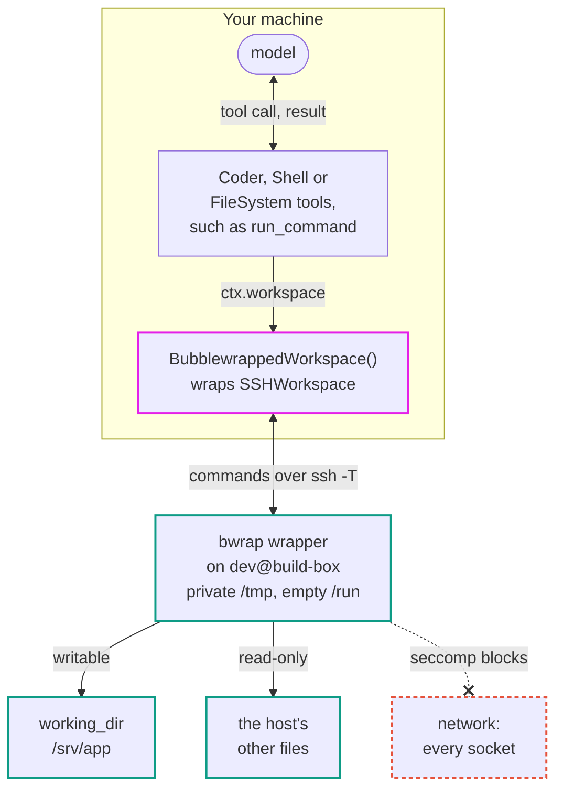

# Bubblewrapped Workspace

Run your agent's commands in a Linux [bubblewrap](https://github.com/containers/bubblewrap) (`bwrap`) wrapper on the host they already run on, over SSH or locally.

[Source](https://github.com/pydantic/pydantic-ai/tree/main/src/pydantic_ai_harness/pydantic_ai_harness/bubblewrap_sandbox/)

> While Pydantic AI Harness is on 0.x releases, the API may change between minor releases; when it does, deprecation warnings and release-note migration guidance tell you (or your agent) exactly how to upgrade. See the [version policy](index.md#version-policy).

!!! warning "Best effort, not a security boundary"
    `BubblewrappedWorkspace` is a best-effort convenience that keeps a trusted agent from accidentally changing files outside its working directory. It is **not a security boundary** and **not a sandbox for untrusted code or untrusted agents**: commands share the host kernel and run as the host user. For untrusted agents, use a VM or microVM-backed sandbox such as [E2B](e2b-sandbox.md), [Modal](modal-sandbox.md), [Daytona](daytona-sandbox.md), [BoxLite](boxlite-sandbox.md), or [Smol](smol-sandbox.md).

    Do **not** set the working directory to your home directory (or a directory containing it): files there such as shell startup files, or configuration under a non-default `$XDG_CONFIG_HOME`, can be changed by the agent and run later outside the wrapper (only the default startup locations listed below are mounted read-only).



## Install

```bash
pip/uv-add "pydantic-ai-harness[coder,anthropic]"
```

The workspace's host must run Linux with `bwrap` installed (the `bubblewrap` package) and user namespaces allowed; otherwise commands raise `WorkspaceUnavailableError`. The `coder` extra is there because the examples use `Coder`; the wrapper itself doesn't need it. The `anthropic` extra is there because the examples use an Anthropic model; swap it for your model provider's extra.

## Quick start

`BubblewrappedWorkspace` wraps another workspace capability and runs its commands in `bwrap` on that workspace's host. Wrap [`SSHWorkspace`](ssh-workspace.md) to confine commands on a remote host, or `LocalWorkspace` to confine them on this one:

```python {test="skip"}
from pydantic_ai import Agent
from pydantic_ai_harness import BubblewrappedWorkspace, Coder, SSHWorkspace

agent = Agent(
    '{{ anthropic:large }}',
    capabilities=[BubblewrappedWorkspace(SSHWorkspace('dev@build-box', working_dir='/srv/app')), Coder()],
)
result = agent.run_sync('Run the test suite and fix the first failure.')
```

## What the wrapper allows

Inside the wrapper, commands see the host's files read-only, a private `/tmp` and no network, and can write only to the working directory. `/run` is empty, because host daemons such as Docker listen on sockets there, and a read-only mount doesn't stop a connection. `bwrap` must be able to give the wrapper its own user namespace, and the wrapper has no capabilities.

When the working directory contains the host account's home directory, as an `SSHWorkspace` without a `working_dir` does, the files the host runs or reads when the next SSH connection logs in, before the command starts, are mounted read-only: `~/.ssh`, `~/.pam_environment`, and the startup files a login shell runs or commonly sources for a command (`~/.bashrc`, `~/.bashrc.d`, `~/.cargo/env`, `~/.local/bin/env`, `~/.zshenv`, `~/.cshrc`, `~/.tcshrc` and `~/.config/fish`). Missing ones are created first, empty. If one of them is a symlink, the wrapper doesn't start, because a command could replace the link. Neither finding the home directory (`cd -P` and `pwd -P` on an absolute `$HOME`) nor creating a missing `~/.ssh` (`/bin/mkdir`) searches `PATH`; without an absolute home the wrapper does not start. `bwrap_args` come after these mounts and can still replace them.

Without the network, a seccomp filter blocks the same system calls as the [Codex CLI](https://github.com/openai/codex)'s Linux sandbox does without network access: commands can't connect to, serve or accept on any socket, including Unix sockets the host has elsewhere on disk and the wrapper's own loopback, and can't use `ptrace` or `io_uring`. Commands can still create stream socket pairs, which language runtimes use between their own processes. Unlike Codex, Unix datagram sockets are blocked too, because a datagram can be addressed to any socket file without connecting first. So a test suite that starts a local server needs `network=True`, and so does Python's `forkserver` start method for `multiprocessing` (the default on Linux since Python 3.14), which listens on a socket: `multiprocessing.get_context('spawn')` or `'fork'` work without it. The filter covers x86_64 and aarch64 hosts; a 32-bit program in the wrapper is stopped when it makes a system call.

Pass `network=True` to share the host's network: commands can reach it, including services on the host's loopback and anything the host can reach, and can listen on the host's ports. The DNS configuration under `/run` comes back with it, and there is no seccomp filter.

Add `bwrap` arguments with `bwrap_args=`: they come after the defaults, so `['--bind', path, path]` makes another directory writable and `['--tmpfs', path]` hides one, such as `~/.ssh`. The program that starts `bwrap`, and `base64` when the filter loads, is taken from a `PATH` directory outside the working directory.

Commands share the host's process list rather than getting their own, so a command started in the background, such as a [Shell](shell.md) background job or a dev server, keeps running after the call that started it, and after the agent run, until something stops it. Later calls can check on it or stop it. On timeout or cancellation, what stops is up to the wrapped backend. `LocalWorkspaceBackend` and `SSHWorkspaceBackend` stop the command and its foreground descendants; SSH cleanup is best effort if the host stalls or becomes unreachable. The E2B and Modal backends do the same only when the image has `setsid`, and otherwise stop just the command itself, so its children may keep running. Jobs deliberately detached into their own session keep running on every backend. The cost is that wrapped commands can see the host's processes and their command lines, and signal the host user's own. A call's `env` values are `bwrap --setenv` arguments, so they show up in that process list while the command runs.

File methods such as `write_text`, and so the [FileSystem](filesystem.md) and [Coder](coder.md) file tools, run in the wrapper too, as shell commands, so they see what commands see: they can't write outside the working directory, even through a symlink a command swapped in after a path check. Only when the wrapped workspace is read-only, and so runs no commands, are its files read from the host directly. The run's ref is the wrapped workspace's, and its `backend` is the wrapped backend.

The wrapped workspace must run commands without a controlling terminal. `BubblewrapWorkspace` omits `bwrap --new-session` so the backend can stop foreground descendants on timeout or cancellation; with a controlling terminal, kernels permitting `TIOCSTI` could let wrapped commands inject input into the host terminal. `LocalWorkspaceBackend` starts a new session and `SSHWorkspaceBackend` uses `ssh -T`. `E2BSandboxBackend` and `ModalSandboxBackend` run commands through their providers' non-PTY command APIs, so no terminal is attached, with or without `setsid` in the image. All four satisfy this requirement; custom backends must do so too.

### What it doesn't stop

The wrapper keeps an agent from accidentally changing the host outside its working directory. It is not a boundary against an agent trying to harm the host user:

- Commands can read every file the host user can, such as SSH keys and cloud credentials, and show them to the model. Hide those directories with `bwrap_args=['--tmpfs', path]`.
- Commands can signal, and so stop, the host user's other processes.
- Anything a command writes in the working directory, such as Git hooks, a `Makefile` or an `.envrc`, runs outside the wrapper if you later run it there.
- With the home directory writable, so are the files only an interactive login runs, such as `~/.profile` and `~/.bash_profile`, and other per-user configuration (including fish configuration when `$XDG_CONFIG_HOME` is set to a non-default location). Give the wrapper a project directory as its `working_dir` instead.
- The wrapped workspace's own settings, `bwrap_args`, and the host's `bwrap` outside the working directory are trusted.

For an agent you don't trust, give it its own user on the host, or use a VM or microVM-backed sandbox such as [E2B](e2b-sandbox.md), [Modal](modal-sandbox.md), [Daytona](daytona-sandbox.md), [BoxLite](boxlite-sandbox.md), or [Smol](smol-sandbox.md).

## Use the workspace directly

The capability builds a `BubblewrapWorkspace`, a [`WrapperWorkspace`](../workspace.md#read-only-access) you can also use directly, around any workspace:

```python {test="skip"}
from pydantic_ai.workspaces import CommandResult, Workspace
from pydantic_ai_harness import BubblewrapWorkspace, SSHWorkspaceBackend


async def run_tests() -> CommandResult:
    workspace = BubblewrapWorkspace(Workspace(SSHWorkspaceBackend('dev@build-box', working_dir='/srv/app')))
    # `bwrap` runs `make test` on build-box
    return await workspace.run(['make', 'test'])
```

## Telemetry

`BubblewrappedWorkspace` emits no spans of its own. The run's workspace is the wrapped one's, so core's [instrumentation](../capabilities/instrumentation.md) records its `pydantic_ai.workspace.provider` and `pydantic_ai.workspace.id` on the agent run span, and each wrapped command runs inside its tool call's span.

## API reference

::: pydantic_ai_harness.bubblewrap_sandbox.BubblewrappedWorkspace

::: pydantic_ai_harness.bubblewrap_sandbox.BubblewrapWorkspace
