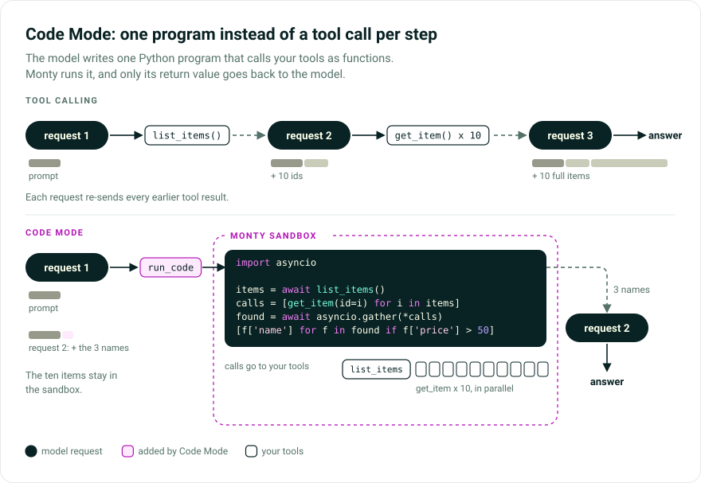

# Code Mode

Code Mode lets the model call your tools from one sandboxed Python program instead of one tool call per model turn. [`CodeMode`][pydantic_ai_harness.CodeMode] puts them behind a `run_code` tool: the model writes code that calls them as functions, with loops, conditionals, variables, and `asyncio.gather`, and the [Monty](https://github.com/pydantic/monty) sandbox runs it.

[Source](https://github.com/pydantic/pydantic-ai/tree/main/src/pydantic_ai_harness/pydantic_ai_harness/code_mode/)

> While Pydantic AI Harness is on 0.x releases, the API may change between minor releases; when it does, deprecation warnings and release-note migration guidance tell you (or your agent) exactly how to upgrade. See the [version policy](index.md#version-policy).



## The problem

Standard tool calling often needs a model turn per dependent batch of tool calls: fetching 10 items and then processing them can take many turns, adding latency, cost, and context, and every intermediate result grows the history.

## The solution

`CodeMode` wraps eligible tools into a single `run_code` tool and dispatches each call its code makes through Pydantic AI to the host tool.

| Standard tool calling | Code mode |
|---|---|
| Dependent tool batches across model turns | Many dependent calls in one `run_code` |
| Parallel only when the model emits a batch | Parallelism expressed in Python |
| No local computation | Filter, transform, aggregate in code |
| Large conversation history | Compact -- fewer messages |

Durable execution integrations can record nested calls for deterministic replay.

## Code Mode or IPython Code Mode

[IPython Code Mode](ipython-code-mode.md) offers the same `run_code` tool on a persistent IPython kernel instead of Monty. Pick by where the agent runs:

| | Code Mode | [IPython Code Mode](ipython-code-mode.md) |
|---|---|---|
| Built for | Production and web-facing agents | Local agents you trust to do whatever the code asks |
| Safe in a webserver | Yes | No, unless the agent runs in a sandbox |
| Python | The Monty subset, with time and memory limits | Full CPython, with any installed package |
| Filesystem and network | Only through `mount`, `os_access`, and tools | Unrestricted, with the agent process's permissions |
| State | Per run, plus an optional `repl_store` | A kernel per run, or one `IPythonKernel` kept across runs |

!!! warning "Use Code Mode for anything web-facing"
    IPython Code Mode runs model-written code with the permissions of the user running the agent. Do not run it in a webserver, or anywhere it handles untrusted input, without a sandbox around the agent.

## Installation

Install the `codemode` extra for the Monty sandbox (`code-mode` is an alias):

```bash
pip/uv-add "pydantic-ai-harness[codemode]"
```

## Usage

Add `CodeMode()` to `capabilities` and register tools as usual; eligible tools become callable inside `run_code`:

```python
from pydantic_ai import Agent
from pydantic_ai_harness import CodeMode

agent = Agent('{{ anthropic:medium }}', capabilities=[CodeMode()])


@agent.tool_plain
def get_weather(city: str) -> dict:
    """Get current weather for a city."""
    return {'city': city, 'temp_f': 72, 'condition': 'sunny'}


result = agent.run_sync("What's the weather in Paris and Tokyo, in Celsius?")
print(result.output)
```

The model then writes one `run_code` snippet like this (exact code varies), running both lookups in parallel:

```python
import asyncio

paris, tokyo = await asyncio.gather(
    get_weather(city='Paris'),
    get_weather(city='Tokyo'),
)
paris_c = round((paris['temp_f'] - 32) * 5 / 9, 1)
tokyo_c = round((tokyo['temp_f'] - 32) * 5 / 9, 1)
{'paris': paris_c, 'tokyo': tokyo_c}
```

## Selective tool sandboxing

`tools` is a Pydantic AI [`ToolSelector`][pydantic_ai.tools.ToolSelector]: matching tools become callables inside `run_code`, and the rest stay regular tool calls. The default, `tools='all'`, sandboxes every eligible regular tool.

```python
from pydantic_ai_harness import CodeMode

# By name -- only these tools are available inside run_code
CodeMode(tools=['search', 'fetch'])

# By predicate -- (ctx, tool_def) -> bool | Awaitable[bool]
CodeMode(tools=lambda ctx, td: td.name != 'dangerous_tool')

# By metadata -- combine with SetToolMetadata or a toolset's .with_metadata()
CodeMode(tools={'code_mode': True})
```

Framework control tools, undiscovered deferred tools, native fallbacks, and other code-execution tools stay native, including `Shell`'s `run_command` and `start_command` (so the model never quotes shell inside Python) and `CapabilityCreation`'s `author_capability` (its argument is a whole module); their other tools, such as `read_file`, are folded in. To fold a code-execution tool anyway, set `FOLD_INTO_CODE_MODE` (`'fold_into_code_mode'`, from `pydantic_ai_harness.code_mode`) to `True` in its metadata, for example from `prepare_tools`; it keeps its `code_arg_name`, so instrumentation and other capabilities still treat it as code.

### Metadata-based selection

Metadata lets the decision travel with a shared toolset: its author tags tools safe to call from generated code, and each agent opts in with `CodeMode(tools={...})`. A tool matches when its `ToolDefinition.metadata` contains all the selector's key-value pairs, extra keys allowed and nested dictionaries matched by deep inclusion:

```python
from pydantic_ai import Agent
from pydantic_ai.toolsets import FunctionToolset
from pydantic_ai_harness import CodeMode


def search(query: str) -> str:
    """Search the web."""
    return f'results for {query}'


def fetch(url: str) -> str:
    """Fetch a URL."""
    return f'contents of {url}'


search_tools = FunctionToolset(tools=[search, fetch]).with_metadata(code_mode=True)

agent = Agent(
    '{{ anthropic:medium }}',
    toolsets=[search_tools],
    capabilities=[CodeMode(tools={'code_mode': True})],
)
```

`search` and `fetch` leave the model-facing tool list and become functions inside `run_code`; untagged tools stay regular tool calls.

## Tool Search interaction

Tools marked `defer_loading=True` ([Tool Search](../tools-advanced.md#tool-search)) stay out of `run_code` until discovered; Tool Search handles discovery, and `dynamic_catalog` decides how they're offered meanwhile. `CodeMode` follows reveal state with [`RunContext.is_tool_available`][pydantic_ai.tools.RunContext.is_tool_available] and folds a tool into `run_code` once the model discovers it or loads the deferred capability that owns it. The tool keeps `defer_loading=True` (its author's request); only its availability for the run changes.

With the default `dynamic_catalog=True`, discoveries append to the conversation instead of rewriting it, so the prompt cache survives: the catalog of sandboxed-tool signatures lives in the instructions, not `run_code`'s description, as a dynamic [`InstructionPart`][pydantic_ai.messages.InstructionPart] with id `toolset:code_mode:catalog` and [`on_change='append'`](../agent.md#appending-instruction-changes). A Tool Search discovery also names the new functions in a short system prompt part sent through [`ctx.enqueue`][pydantic_ai.tools.RunContext.enqueue]; loading a capability appends only the catalog. Deferred tools that `run_code` will take over aren't declared until found (with the local `search_tools` or by loading their capability), then are callable only from `run_code`. Earlier requests' tool definitions and instructions stay as sent.

The catalog puts tool definitions, including MCP-supplied names, descriptions, and schemas, into the instructions. Tool definitions are trusted operator configuration the model already receives with the same authority, so this grants nothing new; connect only MCP servers you trust. The discovery announcement names functions only by Python identifier, keeping the found tool names in its metadata.

To keep the cache intact, a callable `tools` selector must give the same answer for a tool before and after it's revealed: one that sandboxes a tool only once revealed declares it natively first, then drops the declaration, moving the cached prefix as with `dynamic_catalog=False`.

The catalog is keyed by toolset id `code_mode`, which `CodeModeToolset` takes only with `dynamic_catalog=True`. Another toolset with id `code_mode` that contributes instructions makes the run raise a [`UserError`][pydantic_ai.exceptions.UserError] for the duplicate id; rename it.

If a `tools` selector sandboxes some deferred tools and keeps others native, the local `search_tools` searches both and the provider's native tool search isn't sent. Neither is declared before it's found: a sandboxed tool joins the catalog, and a native one is added like any `search_tools` result (on Anthropic and OpenAI Responses, appended to the conversation). The native ones are then found by local keyword matching (or your `strategy` callable), not the provider's server-side search.

The `'bm25'` and `'regex'` strategies have no local `search_tools`, so only the provider's native search finds deferred tools; a deferred tool that `run_code` will take over is declared natively until it moves into `run_code`, as with `dynamic_catalog=False`.

`dynamic_catalog=False`, the default in earlier releases, keeps the catalog in `run_code`'s description:

```python
from pydantic_ai_harness import CodeMode

CodeMode(dynamic_catalog=False)
```

Tool definitions are part of the cached prompt prefix, so each discovery grows that description and invalidates the cache from that point on; turns without a discovery stay cache-warm. Deferred tools are declared to the provider's native tool search where there is one.

To keep a Tool Search corpus fully native (not callable from `run_code`), exclude its members, which carry `with_native` set to the managing native tool:

```python
from pydantic_ai_harness import CodeMode

CodeMode(tools=lambda ctx, td: td.with_native is None)
```

## Return values

The snippet's last expression is its return value, so no `print()` is needed. An assignment returns nothing, so put the name on the last line:

```python
result = await get_weather(city='Paris')
result
```

Use `print()` for supplementary logging; printed text is returned alongside the result:

| Scenario | Return |
|---|---|
| Non-`None` final expression with no print output | Last expression value |
| Final assignment or `None` result with no print output | `{}` |
| Print output with no final expression or a `None` result | `{'output': '<printed text>'}` |
| Print output with a plain, non-`None` final expression | `{'output': '<printed text>', 'result': <last expression>}` |
| Multimodal final expression with no print output | Returned natively for model processing |
| Print output with a multimodal final expression | List with printed text followed by native multimodal content |

When a nested tool returns a [`ToolReturn`](../tools-advanced.md#advanced-tool-returns), the snippet gets its `return_value`. Its `content`, such as a screenshot, never enters the sandbox: it goes to the model with the `run_code` result, in call order, as for a direct tool call.

Printed output over 10 MiB makes `run_code` return a model retry.

`resource_limits` defaults to 30 seconds of execution time and a 256 MiB heap. `max_duration_secs` applies per snippet, stopping runaway loops; time awaiting nested tools doesn't count. A snippet that hits it is stopped and its session reset, losing variables, imports, and definitions; the retry says so and reports the nested calls already made.

Sleep isn't execution time and has its own per-snippet allowance of `max_duration_secs`; a sleep past it raises `TimeoutError` without waiting and keeps the session. The allowance applies even in a Temporal workflow, where the execution-time limit is off; only `resource_limits='unlimited'` removes it.

Monty also caps cumulative suspensions with `max_suspensions` (default 1,000 per session, shared by consecutive snippets). External calls, OS callbacks, name lookups, and future resolutions each count, so it isn't a tool-call count. Once it's exhausted, host interactions fail, though pure Python on existing state may work, and `run_code` returns the started calls with restart guidance: check partial results first, since `restart: true` discards REPL state and replaying completed calls repeats side effects. Nothing restarts or replays automatically.

`max_tool_calls` caps nested tool calls per `run_code` call (default 100). The budget is reserved before each call is scheduled, and a call past it fails at its call site in the sandbox. A snippet that catches the error can still return completed results. Otherwise the model retry gives the number of nested calls started and, per call, its arguments and whether it returned, did not finish (a tool can apply a change before it stops), or was denied. Arguments and results are previewed and the list is capped, saying how many entries it omitted, so a large payload can't inflate the retry; the exact total tells the model calls are missing. Nothing stops the model from calling those tools again.

To override the limits:

```python
from pydantic_ai_harness import CodeMode

CodeMode(
    resource_limits={'max_duration_secs': 10, 'max_memory': 134_217_728, 'max_suspensions': 10_000},
    max_tool_calls=25,
)
```

Pass `resource_limits='unlimited'` only when another execution boundary supplies equivalent limits: it removes the time and memory caps, but Monty's default suspension budget stays, since suspensions can't be unlimited.

Nested calls also count toward the run's [`tool_calls_limit`](../agent.md#usage-limits), along with the `run_code` call making them. Each is checked before it runs, counting pending calls, and one that would exceed the limit ends the run with [`UsageLimitExceeded`][pydantic_ai.exceptions.UsageLimitExceeded], as a top-level call does, even if the snippet catches it.

In a Temporal workflow, `CodeMode` disables `max_duration_secs`, even an explicit override: `run_code` is replayed in workflow code, where measuring elapsed time could make replay diverge from the recorded workflow. The memory and suspension caps still apply. Put time-bounded work behind a Temporal activity.

## Concurrent tool calls

Sandboxed tools render as `async def` functions, so code can start several calls and await them with `asyncio.gather`. Whether they overlap follows the run's [parallel execution mode](../tools-advanced.md#parallel-tool-calls-concurrency):

- `'parallel'` (the default) and `'parallel_ordered_events'` run gathered calls concurrently. `'parallel_ordered_events'`, the `DBOSDurability` default, only orders result events of top-level tool calls, which nested calls don't emit.
- `'sequential'` runs them one at a time, in the order the code started them.

A `sequential=True` tool renders as a plain `def` and runs alone in every mode, after the calls started before it finish.

Durable engines that record nested calls as steps number them as they start, so if a tool or a hook such as `before_tool_execute` awaits before its step starts, concurrent calls can start steps in a different order on recovery. Pass `parallel_execution_mode='sequential'` to the durability capability to prevent this.

## REPL state

Variables, imports, and function definitions persist between `run_code` calls in one agent run; `restart: true` in the tool call resets them. If a worker crash or host-side execution failure invalidates the session, the model retry reports the reset and the nested calls already started, and the next snippet must recreate its state.

### Keep the REPL across runs

Each agent run starts a fresh REPL. To keep it across a conversation's runs, pass a `repl_store` with async `load` and `save` methods ([`CodeModeReplStore`][pydantic_ai_harness.code_mode.CodeModeReplStore]): a run that calls `run_code` loads the stored state (Monty's opaque REPL dump) before its first snippet and saves the REPL when it ends. Key it by `ctx.conversation_id`, which stays the same across runs when you pass `conversation_id` or the previous run's `message_history`:

```python
from pydantic_ai import Agent, RunContext
from pydantic_ai_harness import CodeMode


class InMemoryReplStore:
    def __init__(self) -> None:
        self.states: dict[str, bytes] = {}

    async def load(self, ctx: RunContext) -> bytes | None:
        return self.states.get(ctx.conversation_id or '')

    async def save(self, ctx: RunContext, state: bytes | None) -> None:
        key = ctx.conversation_id or ''
        if state is None:
            self.states.pop(key, None)
        else:
            self.states[key] = state


agent = Agent('{{ anthropic:medium }}', capabilities=[CodeMode(repl_store=InMemoryReplStore())])
```

- A run that never calls `run_code` neither loads nor saves.
- `restart: true` skips the saved state. The run then saves its new REPL, or calls `save(ctx, None)` if the restarted snippet failed before creating one.
- A restored REPL keeps the limits it was saved under, so the state records the resolved `resource_limits`. A state saved under other limits, or one Monty can't load (truncated, or from an incompatible version), is dropped with a logged warning and the run starts fresh.
- Monty doesn't authenticate a dump. Return only states your application saved, from storage no one else can write to.
- A timeout, worker crash, or cancelled snippet that resets the REPL leaves the pre-run state stored, unless a later snippet builds a new REPL to save. A cancelled run still saves an idle REPL.
- Store errors are logged as warnings and don't fail the run: a failed `load` starts a fresh REPL, and a failed `save` keeps the stored state. A run whose `load` failed doesn't save (unless it used `restart: true`), so the next run can still restore that state. A `save` running past 10 seconds is cancelled, but work it handed to a thread may finish, so write atomically.
- Restored state skips the type check a fresh REPL's first snippet gets, since the checker doesn't know the restored names.
- The dump holds every live value, so it can be large; to bound it, have `save` drop an oversized state and forget the old one. With `monty_sandbox`, a server that keeps sessions returns a record ID that lives as long as the server keeps it, and a server that keeps nothing fails every save with a logged warning.
- The store isn't used under durable execution, where its I/O would run in replayed workflow code.

## Eager execution

By default, no code runs until the model finishes writing the `run_code` call. With `eager=True`, each statement runs as soon as it has streamed:

```python
from pydantic_ai import Agent
from pydantic_ai_harness import CodeMode

agent = Agent('{{ openai:medium }}', capabilities=[CodeMode(eager=True)])
```

Here the first `fetch_item` call starts once its line is complete, while the rest streams; without eager mode, neither starts until the whole snippet arrives:

```python
first = await fetch_item(item_id=1)
second = await fetch_item(item_id=2)
[first, second]
```

It is still one `run_code` call: one REPL session, one tool-call limit, one combined result. Hooks on nested tools such as `fetch_item` still run, but hooks around `run_code` run only once the call is fully written, so they can't approve or change lines that already ran.

Resource limits still apply, but `max_duration_secs` and the sleep allowance count per fragment: each eager fragment and the remaining code get their own, so an eager call can run longer in total. Memory is shared by the session.

Limitations:

- Side effects from code that already ran can't be undone.
- With a [parallel `InputGuardrail`](guardrails.md#parallel-input-guards), nested calls from eager statements wait for its verdict, so a blocked prompt runs no tool.
- If the model later requests `restart: true`, some work may run again.
- If the model changes an earlier line while streaming, `CodeMode` resets the REPL and asks it to resend the code.
- Eager mode trusts the provider to keep the streamed `run_code` part and its tool name; if a provider removes or renames it, work already run can't be undone.
- Eager execution applies only when `run_code` is a response's first tool call. Later tool calls wait for normal dispatch, so they run in the order requested.
- Eager mode needs asyncio, like the sandbox executor, and is disabled under durable execution such as Temporal or DBOS.
- If a statement is interrupted (for example, the call failed validation), the session restarts and the next snippet must recreate its state.
- Nested tools called from eager statements must cooperate with asyncio cancellation. When a run ends or a streamed call is invalidated, `CodeMode` cancels in-flight work and waits a bounded time (currently 5 seconds) for it; work still running is abandoned and can't start further tool calls.
- Tools called from statements that ran early are traced before the `run_code` span opens.

## Speculative execution

`speculate` starts side-effect-free tool calls while the model is still writing `run_code`. As `code` streams in, each call to a named tool whose arguments are all keyword literals starts once its line has streamed, even inside an unfinished `if` arm or `with` body. The finished snippet then takes the in-flight result instead of calling the tool cold, overlapping tool latency with generation ([speculative programmatic tool calling](https://alexzhang13.github.io/blog/2026/spec-ptc/)).

### Choose tools that are safe to run early

A speculated call can run for a branch the snippet never takes. Read-only is necessary but not sufficient, since reading changing state early can give a different answer: choose tools whose results and external interactions are acceptable at launch time, even if unused. Unused requests still incur API charges, consume rate limits, and send arguments to external services; cancellation doesn't undo a sent request.

This example speculates two lookups over fixed data. It needs provider credentials such as `OPENAI_API_KEY`; real network lookups have more latency to overlap:

```python {names="defined"}
from pydantic_ai import Agent
from pydantic_ai_harness import CodeMode


def lookup_author(*, title: str) -> str:
    """Find a book's author in a fixed catalog."""
    return {'Frankenstein': 'Mary Shelley'}.get(title, 'Unknown')


def lookup_year(*, title: str) -> int | None:
    """Find a book's publication year in a fixed catalog."""
    return {'Frankenstein': 1818}.get(title)


code_mode = CodeMode(speculate=['lookup_author', 'lookup_year'])
agent = Agent(
    '{{ openai:medium }}',
    capabilities=[code_mode],
    tools=[lookup_author, lookup_year],
)
result = agent.run_sync(
    'Use run_code to look up the author and publication year of Frankenstein. '
    'Call both tools independently with the literal keyword argument title="Frankenstein".'
)
print(result.output)
print(code_mode.speculation_stats)
```

The model writes the snippet, so the prompt doesn't guarantee launches. Unclaimed calls are cancelled when the snippet succeeds. A snippet that fails before running (a syntax or type error) keeps its launches for the retry; whatever that leaves unclaimed is cancelled when the next model step starts.

`speculate='declared'` trusts tools' own declarations instead of a name list: `Tool(..., metadata={'read_only': True})`, or an MCP server's `readOnlyHint`. `idempotent` doesn't count, since an idempotent delete still deletes. A declaration is the author's claim, not a proof, so `'declared'` gives tool authors the trust an explicit list places in you.

```python
from pydantic_ai import Agent, Tool
from pydantic_ai_harness import CodeMode


def search(query: str) -> str:
    """Look something up."""
    return f'results for {query}'


agent = Agent(
    '{{ openai:medium }}',
    capabilities=[CodeMode(speculate='declared')],
    tools=[Tool(search, metadata={'read_only': True})],
)
```

### Understand execution order

At execution, Code Mode also launches eligible literal calls not yet in flight (within the launch limit and ordering barriers), so they overlap instead of waiting on each `await`. Calls in both arms of an `if`/`else` can start; the taken arm claims its result and the other is discarded.

Lookahead stops at a known tool call that isn't eligible, including a `sequential` tool. If `update_record` isn't eligible and `search` is:

```python {test="skip"}
await update_record(key='status', value='ready')
await search(query='status')  # Runs after the update, not speculatively ahead of it.
```

Code can also reach an ineligible tool without naming it, for example through an earlier snippet's helper. If a call to an ineligible tool, native or inside `run_code`, starts or finishes after a launch, the launch is discarded as wasted and the dispatch runs the tool normally as a miss. Sandbox writes through `mount` or `os_access` don't move this boundary, so don't make a tool eligible if it reads state those writes change.

An earlier blocking read must itself be eligible for later calls to overlap it. Streamed `run_code` parts after another model tool call wait for normal dispatch. Eligibility is a trust decision, not an analysis of arbitrary Python side effects.

Limitations:

- Only calls with literal keyword arguments start early; one using an earlier statement's result waits for it.
- Calls are found in the streamed text, so one in a string literal or comment can start too, and is discarded when the snippet finishes.
- `sequential` tools never speculate, and nothing speculates when the run's parallel execution mode is `sequential`.
- With a [parallel `InputGuardrail`](guardrails.md#parallel-input-guards), a speculated call waits for the guard's verdict, so a blocked prompt runs none of them.
- Hooks on a speculated tool run when it starts, not when claimed. As with eager mode, hooks, approval, and guardrails on `run_code` can't stop a call already started.
- At most `max_tool_calls` calls (never more than 32) start early per `run_code` call; later ones run cold. Unclaimed launches are extra work, not reserved from the `max_tool_calls` dispatch budget.
- Under a `tool_calls_limit`, a call counts once it starts early, even if never claimed; a launch the limit refused runs cold if the snippet asks for it.
- Speculated tools must cooperate with asyncio cancellation. Cleanup requests cancellation and waits up to five seconds per streamed call; a tool that suppresses cancellation can outlive the run, since the timeout doesn't forcibly stop it.
- `speculate` puts runs in streaming mode, and is disabled under durable execution such as Temporal or DBOS.

`speculate` composes with `eager=True`: eager runs finished statements, and speculation starts calls not yet reached (branch arms, calls after a slow statement), which eager statements also claim.

### Check whether speculation helps

`CodeMode.speculation_stats` counts launches across all runs of that capability instance (zero when speculation is off); snapshot it before and after for one run. Successful `run_code` returns can also carry a `speculation` entry in history-only metadata, next to `tool_calls` and `tool_returns`, without changing model-visible content.

| Metric | Scope | Meaning |
| --- | --- | --- |
| `launched` | Capability instance | Calls started early, while streaming or executing. |
| `adopted` | Capability instance | Launch outcomes a dispatch consumed, including tool errors. |
| `evicted` | Capability instance | Unclaimed launches discarded or sent a cancellation request. |
| `hits` | `run_code` return | Dispatches that consumed a launch outcome. |
| `misses` | `run_code` return | Eligible dispatches that found no usable launch and ran normally. |
| `wasted` | `run_code` return | Unclaimed launches discarded when this call succeeded. |
| `hidden_ms` | `run_code` return | Sum of launch-to-settlement durations for adopted calls. |

`hidden_ms` isn't end-to-end time saved: calls overlap, and it includes waiting for a launch still running when claimed or for a parallel `InputGuardrail` verdict. Compare total latency and external request cost with speculation on and off. Neither `evicted` nor `wasted` proves an unused call completed, stopped, or avoided its cost.

The lifecycle is also emitted as [capability events](../capabilities/overview.md#capability-events) in the `code_mode` namespace, for UIs and other capabilities to follow live:

- `SpeculativeCodeUpdateEvent`: the decoded snippet so far, with its closed-statement boundary.
- `SpeculativeCallLaunchedEvent`: the launching statement's line span, with `phase` `streaming` or `execution`.
- `SpeculativeCallSettledEvent`: only while the stream is flowing; a call that finishes later reports on its claimed or evicted event.
- `SpeculativeCallClaimedEvent`, `SpeculativeCallMissedEvent`, `SpeculativeCallEvictedEvent`: once the snippet runs.

### Why isn't a call speculating?

- Is the tool exposed inside `run_code`, not kept native?
- Is its original name allowlisted, or does it carry a trusted read-only declaration?
- Does the call use only literal keyword arguments, not variables or positional arguments?
- Does an earlier ineligible tool call block lookahead, or an earlier model tool call defer it?
- Is the tool `sequential`, or is the run's execution mode sequential?
- Is durable execution active, or was the per-call launch limit reached?

Otherwise, inspect the generated code and launch events: oversized streamed arguments and exhausted parser-work budgets also stop stream scanning, as speculation is an optimization, not a guarantee.

## Remote workers

Set `monty_sandbox` to a Monty server's root URL to run sandboxed code on a remote worker instead of a local subprocess:

```python
from pydantic_ai import Agent
from pydantic_ai_harness import CodeMode

agent = Agent(
    '{{ anthropic:medium }}',
    capabilities=[CodeMode(monty_sandbox='https://sandbox.example.com')],
)
```

Each worker is a gRPC stream calling a fixed method at the server root, so a URL with a path, query, or fragment raises a `UserError` when the run starts. Earlier releases' `ws://` and `wss://` URLs still work (Monty reads them as `http://` and `https://`) once any path, such as `/monty`, is removed.

A URL connects without a key. To send metadata such as an `authorization` header, or set other pool options, pass a sync or async function returning a `pydantic_monty.AsyncMontyRemote`; Code Mode builds a pool from it each run. Put credentials there, not in the model's instructions or tool arguments:

```python {test="skip"}
from pydantic_monty import AsyncMontyRemote

from pydantic_ai import Agent
from pydantic_ai_harness import CodeMode


def sandbox_pool() -> AsyncMontyRemote:
    return AsyncMontyRemote(
        'https://sandbox.example.com',
        metadata=lambda: {'authorization': 'Bearer my-key'},
    )


agent = Agent('{{ anthropic:medium }}', capabilities=[CodeMode(monty_sandbox=sandbox_pool)])
```

The pool's `request_timeout` (default 10 seconds) adds a per-turn transport deadline, on top of `max_duration_secs` outside Temporal; inside a workflow only the transport deadline applies, since Code Mode disables the execution timer for deterministic replay.

Use `https://` unless the network is trusted: the connection carries your agent's tool calls and results.

Only code execution moves to the worker. Tools, `mount` directories, `os_access`, and `print` output stay in your process, and REPL state persists across `run_code` calls as it does locally.

Run the server on `pydantic-monty>=1.5.0`; earlier servers speak WebSockets, which this client no longer uses. The `run_code` description lists the modules Monty 1.5 can import.

### Error handling

Pool creation, connection, and session checkout errors (bad credentials, an invalid server URL, a pool factory exception) propagate to the code calling the agent, not to the model as [`ModelRetry`][pydantic_ai.exceptions.ModelRetry], since it can't fix sandbox configuration. A checkout refused with `caller_cap`, `capacity`, or `worker_unavailable` is first retried once after a short backoff. In a Temporal workflow, the exception reaches workflow code and follows the [workflow failure policy](#temporal-durability), not the model retry policy.

Errors the model can act on are returned as model retries:

- Syntax, type, and ordinary runtime errors include the sandbox's diagnostic.
- Execution time limits, including a pool's `request_timeout` and a remote `turn_timeout`, reset the session and ask for less work per call.
- Remote `session_timeout` and `idle_timeout` errors explain that the session ended and state is lost.
- A sandbox memory-limit error, or a `MemoryError` without a traceback, resets the session and asks the model to use less memory, for example with smaller batches; other `MemoryError`s from the snippet or a nested tool keep it. Errors indistinguishable from a memory-limit failure also reset it, since Monty doesn't guarantee heap integrity after the limit fires, even if the worker survives. So does exceeding the 10 MiB printed-output cap, which Monty reports with the same diagnostic.
- A worker crash, lost connection, or unexpected execution failure reports the session reset. Remote host-side error details, which can contain pool URLs or credentials, are left out of model retries; the original exception stays the retry's cause.

After a reset, the model must re-run imports and recreate state. The retry lists nested calls already started, so the model can avoid repeating side effects; Code Mode doesn't replay them.

## Temporal durability

Install both integrations:

```bash
pip/uv-add "pydantic-ai-harness[codemode,temporal]"
```

Construct the named agent and its stable-ID toolsets outside the workflow, with [`TemporalDurability`][pydantic_ai.durable_exec.temporal.TemporalDurability] alongside `CodeMode`:

```python
from pydantic_ai import Agent
from pydantic_ai.durable_exec.temporal import TemporalDurability
from pydantic_ai_harness import CodeMode

agent = Agent(
    '{{ openai:medium }}',
    name='coding-agent',
    capabilities=[CodeMode(), TemporalDurability()],
)
```

Follow the [Pydantic AI Temporal guide](../durable_execution/temporal.md) to call the plain agent from a workflow and register its activities with `PydanticAIPlugin` and either `__pydantic_ai_agents__` or `AgentPlugin`.

`PydanticAIPlugin` passes `pydantic_monty` through Temporal's workflow sandbox, but `run_code` still executes in workflow code and re-executes on replay. This works with local workers and `monty_sandbox`, whose worker must be reachable whenever the workflow replays. Model requests and, by default, nested tool calls are activities, and `asyncio.gather` can schedule nested tool activities concurrently. The REPL is process-local state for one run, not durable storage: replay rebuilds it by re-running the recorded snippets against recorded activity results.

Setup errors keep their types in workflow code. `PydanticAIPlugin` treats `UserError` as a workflow failure; others, such as `RuntimeError` and `MontyRefusedError`, fail only the workflow task (Temporal's default), which Temporal retries, so a client awaiting the result waits while setup keeps failing. The error is in task history and worker logs, not a model retry. To end the workflow, catch the expected exceptions and raise `temporalio.exceptions.ApplicationError(..., non_retryable=True)` from them.

Keep workflow-side code deterministic. `mount` reads and writes, `os_access` callbacks, and host-clock calls run again on replay, and changed results can change which activities the workflow schedules, causing a `NondeterminismError`. Put external reads, writes, clock access, and other side effects in wrapped tools so Temporal records them as activities; replay may not flag changed arguments to an activity at the same history position, so replay validation is no substitute. Activity timeouts cover nested tools, not pure computation in `run_code`, and Temporal fails a workflow task that doesn't yield within 2 seconds, so move heavy computation into a tool. Clock, environment, and randomness calls reach `os_access` on the workflow's thread, so a handler can answer `datetime.now()` with `workflow.now()` and stay replay-safe. File calls are answered by Monty from the mounts first and reach the handler on another thread.

## Observability

With [Logfire](https://pydantic.dev/logfire) or any OpenTelemetry backend, each `run_code` span fans out into spans for its nested tool calls ([setup](../logfire.md#using-logfire)).

Suspension-limit retries reuse the `run_code` error span and nested tool spans rather than a separate capability span. Monty has no typed exhaustion marker, so a tool error with the same wording gets conditional guidance, not a definitive exhaustion event.

The `run_code` tool return also carries metadata with every nested call, keyed by call id:

```python
from pydantic_ai import Agent
from pydantic_ai.messages import ToolReturnPart
from pydantic_ai_harness import CodeMode

agent = Agent('{{ anthropic:medium }}', capabilities=[CodeMode()])


@agent.tool_plain
def get_weather(city: str) -> dict:
    """Get current weather for a city."""
    return {'city': city, 'temp_f': 72}


result = agent.run_sync("What's the weather in Paris?")

for msg in result.all_messages():
    for part in msg.parts:
        if isinstance(part, ToolReturnPart) and part.tool_kind == 'code_mode.run_code':
            metadata = part.metadata or {}
            tool_calls = metadata['tool_calls']  # dict[str, ToolCallPart]
            tool_returns = metadata['tool_returns']  # dict[str, ToolReturnPart]
```

## Recognizing `run_code` calls

`run_code` declares the `'code_mode.run_code'` [tool kind](../tools-advanced.md#typed-tool-parts), so its call parts are promoted to `RunCodeCallPart` (from `pydantic_ai_harness.code_mode`). Hooks and history processors can match them with `isinstance` instead of by tool name, and read the code from `code`, or all arguments, validated as `RunCodeArgs`, from `typed_args`:

```python
from dataclasses import dataclass, field
from typing import Any

from pydantic_ai import Agent, RunContext, ToolDefinition
from pydantic_ai.capabilities import AbstractCapability, ValidatedToolArgs, WrapToolExecuteHandler
from pydantic_ai.messages import ToolCallPart
from pydantic_ai_harness import CodeMode
from pydantic_ai_harness.code_mode import RunCodeCallPart


@dataclass
class RecordSnippets(AbstractCapability[Any]):
    snippets: list[str] = field(default_factory=list)

    async def wrap_tool_execute(
        self,
        ctx: RunContext[Any],
        *,
        call: ToolCallPart,
        tool_def: ToolDefinition,
        args: ValidatedToolArgs,
        handler: WrapToolExecuteHandler,
    ) -> Any:
        if isinstance(call, RunCodeCallPart) and call.code is not None:
            self.snippets.append(call.code)
        return await handler(args)


agent = Agent('{{ anthropic:medium }}', capabilities=[CodeMode(), RecordSnippets()])
```

`run_code` calls recorded before `CodeMode` declared this kind load as plain [`ToolCallPart`][pydantic_ai.messages.ToolCallPart]s; `ToolCallPart.narrow_type(part, tool_kind='code_mode.run_code')` promotes one.

## In practice

Asked for the most-discussed Hacker News story across three feeds, with its thread, submitter profile, and follow-up coverage, an agent with an MCP server and web search uses two `run_code` calls: one fetches the feeds in parallel and dedupes, filters, and ranks them in Python; the other batches `hn_get_thread`, `hn_get_user`, and `duckduckgo_search`.

<!-- Trace screenshot removed until it is Tinified: https://github.com/pydantic/pydantic-ai/issues/8824 -->

**[See the full Logfire trace ->](https://logfire-us.pydantic.dev/public-trace/84bcf123-2106-49da-9f6f-5c26395339bb?spanId=7650806a0785b946)**

## Filesystem and OS access

Sandboxed code starts with no access to the host's files, environment, or clock; `mount` and `os_access` add controlled access.

### `mount` -- share host directories

Use `mount` for real files, such as analyzing a dataset and writing a report back, editing a checkout, or processing documents; sandboxed `pathlib` code reads and writes under the mounted path.

Mounts are directories on the machine running the agent, not the run's workspace. With a remote sandbox such as `ModalSandbox`, `Shell` and `FileSystem` act in the sandbox while mounted `pathlib` code still uses the host. Use the workspace tools for files the model shares with its commands.

```python
from pydantic_ai import Agent
from pydantic_monty import MountDir
from pydantic_ai_harness import CodeMode

workspace = MountDir(virtual_path='/work', host_path='/tmp/agent-workspace', mode='read-write')
# The agent can read /work/data.csv and write /work/summary.md back to the host:
agent = Agent('{{ anthropic:medium }}', capabilities=[CodeMode(mount=workspace)])
```

`MountDir` defaults to copy-on-write `mode='overlay'`: the sandbox reads host files and sees its own writes during the current `run_code` call, but Monty discards them before the next call and they do **not** reach the host. Use `mode='read-write'` when later calls need the writes, or `mode='read-only'` to forbid writes. `mount` also accepts a list of `MountDir`.

### `os_access` -- answer the sandbox's OS calls yourself

Use `os_access` for environment variables, the current time, or filesystem behavior you control. Pass an OS implementation (`AbstractOS`) or a callback that decides each call, to inject only needed secrets, pin "now" for reproducible runs, or route file access to your own store.

```python
from pydantic_ai import Agent
from pydantic_monty import OSAccess
from pydantic_ai_harness import CodeMode

# Give the agent a fixed set of environment values:
agent = Agent(
    '{{ anthropic:medium }}',
    capabilities=[CodeMode(os_access=OSAccess(environ={'API_BASE': 'https://api.example.com'}))],
)
```

A callback receives each OS call:

```python
from pydantic_ai import Agent
from pydantic_monty import NOT_HANDLED
from pydantic_ai_harness import CodeMode

allowed_env = {'API_KEY': 'sk-...'}


def my_os(*, name, args, kwargs, **_):
    if name == 'os.getenv':
        # Allow-listed keys resolve; any other key reads as None, like an unset variable.
        return allowed_env.get(args[0])
    # Refuse everything else: NOT_HANDLED makes the call fail in the sandbox.
    return NOT_HANDLED


agent = Agent('{{ anthropic:medium }}', capabilities=[CodeMode(os_access=my_os)])
```

The callback takes keyword arguments and may be `async`. The deprecated positional form, `my_os(name, args, kwargs)`, works until the next breaking release.

The return value decides the call's fate:

- **Any value**, including `None`, `''`, or `0`, is the result the sandbox sees. `os.getenv` returning `None` looks like an unset variable and the code keeps running: this is how you *hide* something.
- **`NOT_HANDLED`** raises in the sandbox and gives the model a retry. This *refuses* outright, so use it to block, not to say "no value"; returning it for a key the agent reasonably expects burns retries.

!!! warning "Host access depends on the configuration"
    `mount` exposes selected host directories. The built-in `OSAccess` uses an isolated in-memory filesystem and environment but the host clock by default; a custom handler or `CallbackFile` can expose other host resources. Both parameters are fixed when the capability is built, so construct `CodeMode` per request to scope any granted access to that request.

## Sandbox restrictions

Code runs inside [Monty](https://github.com/pydantic/monty), a sandboxed Python subset:

- No third-party imports. Allowed stdlib modules: `sys`, `typing`, `asyncio`, `math`, `json`, `re`, `unicodedata`, `datetime`, `time`, `random`, `os`, `pathlib`, `collections`, `itertools`, `functools`, `dataclasses`, `copy`, `base64`, `binascii`, `bisect`, `csv`, `decimal`, `fnmatch`, `hashlib`, `os.path`, `tomllib`, `annotationlib` (each must be imported before use).
- `asyncio.gather(...)` takes positional awaitables but no keyword arguments. Other task creation and wait APIs are unavailable.
- No clock or randomness by default: `datetime.datetime.now()`, `datetime.date.today()`, `time.time()`, and unseeded `random` fail unless an `os_access` handler implements them (the built-in `OSAccess` does). `time.sleep` and `asyncio.sleep` really wait, up to the sleep allowance in [Return values](#return-values); in a Temporal workflow a sleep is a durable timer.
- No `import *`.
- Filesystem I/O needs an `os_access` handler or a `mount`; `os.getenv` / `os.environ` need an `os_access` handler.
- Tools requiring approval or with deferred (`CallDeferred`) execution are sandboxed like any other; without a `HandleDeferredToolCalls` (or equivalent) capability to resolve them inline, calling one from `run_code` raises an error the model sees as a retry.
- Tool results arrive in the JSON shape of their generated stub, which comes from the tool's JSON schema: `Decimal`, `UUID`, and `datetime` arrive as strings, and mapping keys are stringified (`{1: 'a'}` arrives as `{'1': 'a'}`). `bytes` and `bytearray` cross unchanged, since Monty carries binary natively, though the stub declares `str`.
- A sandboxed tool can't be named after a Python builtin such as `list`, `open`, or `print`, since code would call the builtin; `CodeMode` raises `UserError`. Rename the tool, or prefix a toolset whose names you don't control with `toolset.prefixed(...)`.
- A tool without a return schema is callable, but its signature shows `-> Any`, so the model must guess the result's shape; `CodeMode` lists such tools in one `CodeModeReturnSchemaWarning` (a `UserWarning` subclass) per run. Add a return annotation or an MCP `outputSchema`, or for a server that isn't yours, use `warnings.filterwarnings('ignore', category=CodeModeReturnSchemaWarning)`.

## Agent spec (YAML/JSON)

`CodeMode` works with Pydantic AI's [agent spec](../agent-spec.md) for defining agents in YAML or JSON:

```yaml
# agent.yaml
model: {{ anthropic:medium }}
capabilities:
  - CodeMode: {}
```

```python
from pydantic_ai import Agent
from pydantic_ai_harness import CodeMode

agent = Agent.from_file('agent.yaml', custom_capability_types=[CodeMode])
result = agent.run_sync('...')
print(result.output)
```

Pass `custom_capability_types` so the spec loader can instantiate `CodeMode`. The YAML can also pass arguments:

```yaml
capabilities:
  - CodeMode:
      tools: ['search', 'fetch']
      max_retries: 5
```

## Further reading

- [Code mode: make your agents 2x faster and 2x cheaper on long tasks](https://pydantic.dev/articles/why-code-mode-is-the-future) (Pydantic)
- [Tool use via code](https://www.anthropic.com/engineering/code-execution-with-mcp) (Anthropic)
- [Code mode in production](https://blog.cloudflare.com/code-mode/) (Cloudflare)
- [Pydantic AI capabilities](../capabilities/overview.md)

## API reference

::: pydantic_ai_harness.CodeMode

::: pydantic_ai_harness.code_mode.CodeModeReplStore
