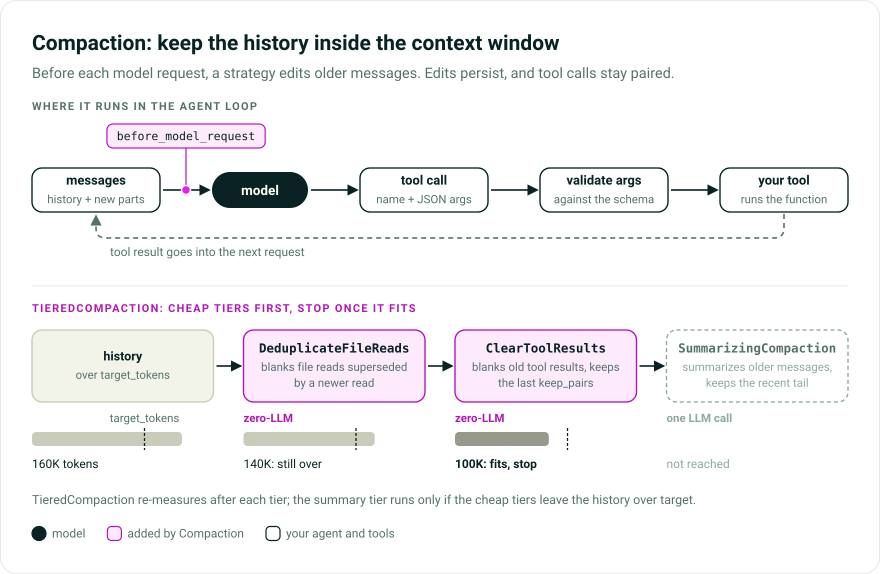

# Compaction

Compaction keeps an agent's conversation history within a model's context window. Each strategy is a capability that edits the message history just before a model request. The edits **persist** into the run's history, so a trim, clear, or summary carries forward instead of being recomputed every turn.

Every strategy keeps tool calls **paired** with their returns: core does not validate this, and a provider rejects an orphaned call or return. Only `SummarizingCompaction` and `RelevanceCompaction` (and `TieredCompaction` when it escalates to one) call a model.

On OpenAI and Anthropic, core also ships [provider-native compaction](../capabilities/compaction.md), where the provider summarizes server-side. These strategies work with every model and keep the logic and its costs under your control.

[Source](https://github.com/pydantic/pydantic-ai/tree/main/src/pydantic_ai_harness/pydantic_ai_harness/compaction/)

> While Pydantic AI Harness is on 0.x releases, the API may change between minor releases; when it does, deprecation warnings and release-note migration guidance tell you (or your agent) exactly how to upgrade. See the [version policy](index.md#version-policy).



## The problem

A long run accumulates tool outputs, file reads, and reasoning until the history outgrows the window and the next request fails. Pick a strategy by where the bloat is and what you can spend reclaiming it.

## The menu

| Component | Cost | What it does | Reach for it when |
|---|---|---|---|
| `ClampOversizedMessages` | zero-LLM | Head/tail-truncates one oversized part (response text, tool-call args) | One runaway generation exceeds the context cap |
| `SlidingWindowCompaction` | zero-LLM | Drops the oldest whole messages down to a tail | Only the recent turns matter |
| `ClearToolResults` | zero-LLM | Blanks old tool *results* in place, keeping the last `keep_pairs` | Tool outputs dominate and can be re-fetched |
| `DeduplicateFileReads` | zero-LLM | Blanks file reads superseded by a newer read of the same file | The agent re-reads files and only the latest version matters |
| `SummarizingCompaction` | one LLM call | Summarizes older messages, keeping the recent tail | Old context matters but must shrink; use behind the cheap tiers |
| `RelevanceCompaction` | one judge request per new step, plus an optional summary | Keeps, reduces, or drops each older step by a judge model's answers | Some old tool results are needed verbatim, others are dead weight |
| `TieredCompaction` | escalates | Runs cheap passes first, summarizes only if still over `target_tokens` | The sensible default: pay for a summary only when needed |
| `FallbackCompaction` | depends on chain | Tries the next strategy when one raises | Summarization can fail and truncation must keep the run alive |
| `CompactOnRequest` | depends on strategy | Gives the model a tool to request compaction before its next request | The model knows when a phase of work ends better than a size trigger |
| `WarnNearLimits` | zero-LLM | Injects an URGENT/CRITICAL warning as limits approach | The agent should wrap up rather than have its history rewritten |
| `ReportContextUsage` | zero-LLM | Reports context usage to your application; never edits history | You want a live context gauge in a UI |

Compaction updates the persisted run history and replaces the current request view, discarding earlier request-only edits even when `ClampOversizedMessages` has nothing to shorten. List request-only injectors such as `Memory` after compaction so they apply to the compacted request.

## Triggers

Size-based strategies trigger on `max_messages`, `max_tokens` (estimated as in [What counts toward the fraction](#what-counts-toward-the-fraction)), or `max_fraction`. Exceptions: `DeduplicateFileReads` runs on every request when no trigger is set (it is cheap and near-lossless), `TieredCompaction` triggers and stops on one `target_tokens` / `target_fraction` budget, and `ClampOversizedMessages` triggers per *part* (`max_part_tokens` / `max_part_chars`), since its failure is one oversized part, not a large total.

### `max_fraction`: one setting for every model

An absolute `max_tokens` fits one model: at `180_000`, a 1M-context model compacts at a fifth of its capacity and pays for needless summaries; at `1_000_000`, a 128K model never compacts before the provider rejects the request. `max_fraction` resolves per request against the model's real window:

```python
from pydantic_ai import Agent
from pydantic_ai_harness import SummarizingCompaction

agent = Agent(
    '{{ anthropic:medium }}',
    capabilities=[SummarizingCompaction(max_fraction=0.9, keep_messages=20)],
)
```

That compacts at 900K on a 1M model and at 115K on a 128K one. `WarnNearLimits` has `max_context_fraction` and `TieredCompaction` has `target_fraction`. `max_tokens` and `max_fraction` are mutually exclusive, so it is always clear which budget applies.

The window is the model's [`context_window`](../models/overview.md#inspecting-a-models-profile): its profile's value (including `profile={'context_window': ...}`), else the one [`genai-prices`](https://github.com/pydantic/genai-prices) records. A `FallbackModel` reports the smallest window among its models, since any may answer. `resolve_context_window` is exported. Nothing is cached, and only a window the model or registry states counts as real.

The model consulted is `ModelRequestContext.model`, the one the request goes to; if a capability ordered earlier replaces it, the budget follows.

### When the window does not resolve

Local endpoints, bespoke deployments, registry models without a recorded window, and a `FallbackModel` with no windowed model resolve to nothing. The fraction is then taken of `fallback_context_window`, by default a conservative 200K (`DEFAULT_CONTEXT_WINDOW`): compacting early costs one summary, overestimating costs the request. Every capability that takes a fraction accepts it, and it is used only when resolution fails:

```python
from pydantic_ai import Agent
from pydantic_ai_harness import SummarizingCompaction

agent = Agent(
    'ollama:qwen3',
    capabilities=[SummarizingCompaction(max_fraction=0.9, fallback_context_window=40_000)],
)
```

`TestModel` (`model_id` `test:test`) does not resolve, so `max_fraction=0.9` becomes a 180,000-token trigger that a test may never reach. Pass `context_window=` or `fallback_context_window=` in tests.

### When the window resolves to the wrong number

`fallback_context_window` cannot help when resolution succeeds with the wrong number:

- **The registry entry is wrong.** Harness cannot validate `genai-prices`. Measured against 0.1.3:

  | model id | registry records | real window |
  |---|---|---|
  | `anthropic:claude-sonnet-4-5` | 1,000,000 | 200,000 |
  | `anthropic:claude-opus-4-6` | 200,000 | 1,000,000 |

  An over-recorded window breaks a run: on `anthropic:claude-sonnet-4-5`, `max_fraction=0.9` gives a 900,000-token trigger for a 200,000-token window, so compaction never fires and the provider rejects the request. **Pass `context_window=200_000` explicitly on `claude-sonnet-4-5`.** `claude-sonnet-5`'s recorded 1,000,000 matches Anthropic's documentation; check other Sonnet ids against it. An under-recorded window is safe but compacts early.
- The registry records the maximum a model accepts. Where that is gated (a beta header, a pricing tier), ordinary requests get less, and the fraction never triggers before the provider rejects the request.
- A self-hosted or proxied endpoint reports a model id whose registry entry describes someone else's deployment.

`context_window` overrides resolution on every capability that takes a fraction:

```python
from pydantic_ai import Agent
from pydantic_ai_harness import SummarizingCompaction

agent = Agent(
    '{{ openai:small }}',  # served by a local endpoint with a smaller window than the registry records
    capabilities=[SummarizingCompaction(max_fraction=0.9, context_window=32_000)],
)
```

### What counts toward the fraction

Token counts anchor on the provider-reported usage of the latest model response, which covers everything billed for that request, including instructions, tool definitions, and `FilePart` payloads. When billed usage sums several model requests, the anchor is the input tokens of the one that measures the context, plus the output: the first request of a [Google long decode](../models/google.md#long-decode) (its billed input re-counts earlier requests' output), or the last sampling pass of an [Anthropic response that reports its passes](../models/anthropic.md#server-side-tool-loops) (its billed input re-counts each pass's context).

Messages after the anchor, or a history with no anchor, are estimated with `tokenizer` or a ~4-characters-per-token heuristic. The estimate cannot see `FilePart` payloads and counts a file in a tool return as its `See file <identifier>.` reference. Instruction replacement and withdrawal records count their full rendered system text; superseded updates before a new instruction baseline are excluded. Instructions changed since the anchor replace the old set in the estimate rather than adding to it, since a request sends one. Tool schemas newly revealed for the pending request are estimated conservatively, since the anchor does not cover them.

**If you already set an absolute `max_tokens`, re-check it.** Besides user and system prompts, tool returns, response text, and tool calls, the estimator now counts `ThinkingPart` / `CompactionPart` content, retry content, `NativeToolCallPart` / `NativeToolReturnPart`, and the latest `ModelRequest.instructions`, so a history measures higher (it can be several times the old count on a thinking-heavy, tool-calling history, depending on how much of it is thinking blocks, retries, and instructions) and an unchanged `max_tokens` compacts earlier. What each strategy clears is unchanged.

### What counts toward `keep_tokens`

The retained tail is measured per message with `estimate_message_tokens`, in provider-counted tokens. A response counts at least its reported `output_tokens`, which includes thinking some providers return as an empty, signature-only part. Messages between two responses with usage share the difference of their `input_tokens`, exactly what the provider counted for them. A multi-request response enters that difference with the input tokens of the request that measures its context, as above; Anthropic's last pass also read the response's earlier passes, which the difference credits to the preceding messages, so the tail measures high. `tokenizer` or the heuristic applies before the first such response, after the last, where the history did not grow between two (as across an earlier compaction), and with no provider usage. Instructions are not part of the tail.

**If you set `keep_tokens`, re-check it.** The heuristic alone, used before, can see a third of a thinking-heavy history's real tokens or less, so a budget kept several times what it named. It now keeps the named amount, so fewer messages.

## Reporting usage: `ReportContextUsage`

`ReportContextUsage` reports how full the context is, for a gauge such as `context: 73%`, using the strategies' estimator and resolved window. It never edits history:

```python
from pydantic_ai import Agent
from pydantic_ai_harness import ReportContextUsage, SummarizingCompaction
from pydantic_ai_harness.compaction import ContextUsageEvent

agent = Agent(
    '{{ anthropic:medium }}',
    capabilities=[
        SummarizingCompaction(max_fraction=0.9, keep_messages=20),
        ReportContextUsage(),
    ],
)


@agent.on_event(ContextUsageEvent)
async def show(ctx, event):
    print(f'{event.fraction:.0%}')
```

Each reading carries `used_tokens`, `window_tokens`, `fraction`, and `resolved` (`False` when the window is the fallback, so the percentage is a guess). `used_tokens` follows [the accounting above](#what-counts-toward-the-fraction). Register the monitor *after* a compaction capability to see the history after same-cycle compaction (it subtracts the rewrite's heuristic reclaim and keeps the anchor's fixed provider overhead), or before it to see what triggered compaction. `on_usage` still works but is deprecated; move its callback body to a `ContextUsageEvent` subscription.

## Compacting outside a run: `compact_now`

A strategy's `compact` needs a `RunContext`, which an application doesn't have *between* runs, such as when a user types `/compact`. `compact_now` builds a throwaway one so a command handler can run the agent's strategy:

```python {test="skip"}
from pydantic_ai_harness import SummarizingCompaction
from pydantic_ai_harness.compaction import compact_now

strategy = SummarizingCompaction(max_fraction=0.9, keep_messages=20)
history = await compact_now(
    strategy,
    history,
    model='{{ anthropic:medium }}',
    focus='the auth refactor, not the earlier CSS work',
)
```

`compact_now` applies no trigger, so an unconditional `compact` runs at any history size. A strategy's own stop condition still applies: `TieredCompaction` returns a history already under its target unchanged; pass the tier directly to run it regardless.

`focus` steers `SummarizingCompaction` and `RelevanceCompaction` through the exported `SupportsFocus` protocol's `with_focus`; rule-based strategies that drop or blank content ignore it. `TieredCompaction` is focusable when any of its tiers is, so the focus reaches the summarizing tier.

A compaction that changes the history emits the in-run `compact_messages` span; pass `tracer=` to record it, otherwise it goes to a no-op tracer.

Pass `conversation_id=` so the `SummarizingCompaction` summary run is recorded under that conversation (its messages and `gen_ai.conversation.id` span attribute) instead of a fresh id. Inside a run, it takes the parent run's `conversation_id`.

## The recommended default: `TieredCompaction`

Summarization turns input tokens into output tokens, which cost more and are generated serially; the zero-LLM strategies touch only the cheaper input side. `TieredCompaction` runs its tiers in order, re-measures after each, and stops once the history fits `target_tokens`, so order tiers cheap to expensive:

```python
from pydantic_ai import Agent
from pydantic_ai.messages import ToolCallPart
from pydantic_ai_harness import ClearToolResults, DeduplicateFileReads, SummarizingCompaction, TieredCompaction


def my_file_key(call: ToolCallPart) -> str | None:
    if call.tool_name != 'read_file':
        return None
    return call.args_as_dict().get('path')


agent = Agent(
    '{{ openai:small }}',
    capabilities=[
        TieredCompaction(
            tiers=[
                DeduplicateFileReads(file_key=my_file_key),
                ClearToolResults(max_tokens=1, keep_pairs=3),
                SummarizingCompaction(max_messages=1, keep_messages=20),  # model inherits the run's
            ],
            target_tokens=120_000,
        )
    ],
)
```

`TieredCompaction` calls each tier's `compact` directly, so a tier's own `max_*` trigger is ignored; set it to anything valid, such as `ClearToolResults(max_tokens=1)`. Any object with `async def compact(messages, ctx) -> list[ModelMessage]` (the `CompactionStrategy` protocol) can be a tier.

## `FallbackCompaction`: recover when a strategy fails

`TieredCompaction` advances when a tier does not reclaim enough; `FallbackCompaction` advances when a strategy raises an exception in `fallback_on`, by default `ModelAPIError` and `FallbackExceptionGroup` (raised when every model in a `FallbackModel` fails). When its own trigger runs the chain, it also advances past a `SummarizingCompaction` whose result [isn't smaller](#a-summary-that-isnt-smaller), and leaves the history unchanged if no strategy shrinks it. Each attempt gets a fresh list of the original message objects, so a failed strategy's list changes do not reach the next; strategies must still not mutate message objects (the `CompactionStrategy` contract). If every strategy fails, the last exception is re-raised. Other exceptions, cancellation, and other `BaseException` subclasses pass through immediately; `fallback_on` accepts only `Exception` subclasses.

Register it with `Agent(..., capabilities=[fallback])`, here falling back from summarization to deterministic truncation:

```python
from pydantic_ai_harness import FallbackCompaction, SlidingWindowCompaction, SummarizingCompaction

fallback = FallbackCompaction(
    max_fraction=0.85,
    fallback_chain=[
        SummarizingCompaction(max_messages=1, keep_tokens=20_000),
        SlidingWindowCompaction(max_messages=1, keep_tokens=20_000),
    ],
)
```

Its optional `max_tokens` or `max_fraction` trigger runs the chain when estimated context tokens exceed it; with neither, its request hook does nothing. `context_window`, `fallback_context_window`, and `tokenizer` work as on the other strategies. The hook preserves pinned parts, persists the result, and emits a `compact_messages` span when history changes. Direct `compact()` and `compact_now()` calls ignore the threshold, so it also works inside other composing strategies and for manual compaction. The chain calls each child's `compact()` directly, bypassing the child's trigger.

### Background compaction (experimental)

Set `background_start` to start the chain's first strategy before the trigger fires, so a summary is usually ready when compaction is due and the run does not wait for it.

```python
from pydantic_ai_harness import FallbackCompaction, SlidingWindowCompaction, SummarizingCompaction

compaction = FallbackCompaction(
    max_fraction=0.85,
    background_start=0.85,
    fallback_chain=[
        SummarizingCompaction(max_messages=1, keep_tokens=20_000),
        SlidingWindowCompaction(max_messages=1, keep_tokens=20_000),
    ],
)
```

- **Start.** Before each model request and at the end of each run, once the context passes `background_start` of the trigger (here 85% of the 85% threshold), the first strategy compacts a copy of the history in a background task, blocking neither. It requires a `max_tokens` or `max_fraction` trigger. A run that ends already over the trigger starts none; its next request compacts normally.
- **Hold.** The result is held, not applied, so the history and its prompt cache stay unchanged until compaction is due.
- **Swap.** When the trigger fires, the chain waits for a pending result and swaps it in: the compacted copy replaces the messages it was made from, followed verbatim by every message added since. Pairs stay intact: the copy keeps them paired, and the added messages start where a model request or a run did.
- **Fall back.** The held result is dropped and the chain runs normally when the history no longer starts with the copy (rewritten, rewound, or compacted another way), the request goes to another model, the strategy raised or was cancelled, or the swapped-in history would still exceed the trigger. Instructions are not compared: the summary is written from the messages alone.
- **Lifetime.** Each conversation (`RunContext.conversation_id`) holds at most one, which can outlive the run that started it until it is used, replaced, or cancelled. Below the start, one whose conversation was rewritten (same first message) or moved to another model is cancelled at the next check; a run whose history starts elsewhere, such as a side run with an empty `message_history` under the same conversation ID, leaves it alone. Otherwise it is kept until you call `discard_background_compaction(conversation_id)`, as you should for a conversation that will not continue (such as a finished delegated task), or until it is the oldest of eight held and another starts. `aclose()` cancels them all; call it when done with the instance.
- **Outside a run.** `take_background_compaction(messages, model=..., conversation_id=...)` waits for the held result and returns the history with it swapped in, or `None` when it does not apply, so you can fall back to `compact_now`. Call `discard_background_compaction(conversation_id)` when rewriting the history another way. `background_conversations` lists the conversations holding one.
- **Usage.** The work runs on the starting run's context, so a summary call counts toward that run's usage and limits like a blocking one; if it finishes after the run ended, its usage is added to that run's `RunUsage` then. An unused result still cost its tokens.

Only the first strategy runs in the background, so put the model-backed one first. A `with_focus()` copy holds nothing. Background compaction is not a durable operation, so a durable workflow or flow run with `background_start` set raises `UserError` before its first request.

## `CompactOnRequest`: let the model choose the moment

A size trigger can fire mid-sub-task and summarize away the file the model was about to edit, or stay quiet after a phase whose output is no longer needed. `CompactOnRequest` gives the model a `compact_context(focus=None)` tool and runs your strategy before the next model request of the same run:

```python
from pydantic_ai import Agent
from pydantic_ai_harness import CompactOnRequest, SummarizingCompaction, TieredCompaction

agent = Agent(
    '{{ openai:small }}',
    capabilities=[
        # Automatic size-based compaction stays as is.
        TieredCompaction(tiers=[SummarizingCompaction(max_messages=1)], target_fraction=0.8),
        CompactOnRequest(
            # The strategy's own trigger is required but bypassed: `compact` is called directly.
            SummarizingCompaction(max_messages=1, keep_messages=6),
            min_tokens=30_000,  # refuse requests that would save little
            max_per_run=2,
        ),
    ],
)
```

The tool only records the request and acknowledges it. Compaction runs in the next `before_model_request`, with the same `messages` and context automatic compaction gets; the tool call and return, as the newest messages, stay paired in the kept tail, so the model sees that it asked. The model's `focus` reaches the strategy through `with_focus` if it implements `SupportsFocus` (`SummarizingCompaction`, `RelevanceCompaction`, `TieredCompaction`, `FallbackCompaction`), and is ignored otherwise.

The tool return tells the model when a request is refused:

- the history is below `min_tokens`, estimated the way the token triggers estimate;
- `max_per_run` requests were already accepted in the run;
- a request is already scheduled, such as from two parallel calls in one response.

`CompactOnRequest` runs after the agent's automatic compaction capabilities, wherever you list it. If one already compacted for this request, the model's request is dropped rather than compacting twice, and does not count against `max_per_run`.

Under durable execution, the guards run in a capability hook, not the tool function, because the tool may run in an activity that sees neither the history nor the run's state. The strategy runs as the `compact` durable operation of `CompactOnRequest`, so a replay reuses the recorded history instead of calling the summarizer again. Under Temporal that operation is an activity whose run context omits `tracer` and `capabilities`, so strategies that read them fail there: `RelevanceCompaction`, and `receipts=True` on `SummarizingCompaction` or `SlidingWindowCompaction`. For the same reason, receipts recorded inside the activity, or skipped on a DBOS replay, add no `compaction.receipt` span events.

## `ClampOversizedMessages`: surviving a runaway generation

A response of repeated whitespace or a tool call with a giant payload can make one part so large the *next* request exceeds the context cap. No other strategy reaches it: the offender is the newest message (`SlidingWindowCompaction` drops the oldest) and not a tool *result* (all `ClearToolResults` touches), `WarnNearLimits` never edits history, and summarizing hits the same cap.

`ClampOversizedMessages` truncates the part in place to a head and tail slice joined by a `[clamped: removed N of M characters]` marker. Degenerate generations are low-entropy repetition, so little is lost.

```python
from pydantic_ai import Agent
from pydantic_ai_harness import ClampOversizedMessages

agent = Agent(
    '{{ openai:medium }}',
    capabilities=[ClampOversizedMessages(max_part_tokens=50_000, keep_head_chars=2_000, keep_tail_chars=2_000)],
)
```

A part is clamped only when oversized *and* the clamp shrinks it, so keep `keep_head_chars + keep_tail_chars` well below the per-part threshold. A clamped part loses its item ID (`TextPart.id`, `ToolCallPart.id`), since the OpenAI Responses API would use its stored copy of an item sent with its ID and ignore the clamped content.

It clamps two kinds of part in each `ModelResponse`:

- **Response text** (`TextPart`): the critical case, a runaway text part.
- **Tool-call args** (`ToolCallPart`), when `clamp_tool_call_args=True` (the default), such as a runaway `write_plan`. The args become `{"_clamped": "<head>...<tail>"}` so they stay valid function arguments; the call already executed, so only the history copy shrinks. Set `clamp_tool_call_args=False` to clamp response text only. Core's framework-typed `search_tools` and `load_capability` calls are never clamped: their typed args are validated when persisted history is restored (for example a `StepPersistence` resume), which the `_clamped` object would fail.

Request-side parts (user prompts, tool *returns*, system prompts) are out of scope: user input should not be rewritten, and oversized tool returns are for [`ToolOutputLimits`](tool-output-limits.md), which reduces a return when the tool produces it. `ClearToolResults` keeps the newest `keep_pairs` results intact, and with `keep_pairs=0` blanks a fresh return rather than shrinking it.

Use it as the first tier of `TieredCompaction`, before `ClearToolResults`:

```python
from pydantic_ai_harness import ClampOversizedMessages, ClearToolResults, TieredCompaction

TieredCompaction(
    tiers=[
        ClampOversizedMessages(max_part_tokens=50_000),
        ClearToolResults(max_tokens=1, keep_pairs=3),
    ],
    target_tokens=120_000,
)
```

## `ClearToolResults`: the cheap first tier

Tool outputs usually dominate context, and the agent can re-run a tool to get the data again. `ClearToolResults` replaces the oldest tool *results* with a short placeholder, keeping the newest `keep_pairs` call/return pairs intact and every call paired. A retried return, which asks the model to call again, isn't a result: it is never cleared or counted toward `keep_pairs`, and `DeduplicateFileReads` doesn't let a retried read supersede an earlier one.

Core's framework-typed `search_tools` and `load_capability` returns are left intact (a small token floor): their structured content is re-parsed later, and rewriting it via `dataclasses.replace` would bypass validation and corrupt the part. [`FileSystem`](filesystem.md)'s typed `read_file` results (`ReadFileReturnPart`) are cleared and keep their type, unless their `metadata` is neither `None` nor a `dict`: clearing marks the `metadata`, so a result that can't hold the mark stays uncleared.

```python
from pydantic_ai import Agent
from pydantic_ai_harness import ClearToolResults

agent = Agent(
    '{{ openai:small }}',
    capabilities=[ClearToolResults(max_tokens=100_000, keep_pairs=3)],
)
```

`clear_tool_inputs=True` also blanks the cleared calls' arguments, and those calls lose their item ID as a [clamped part](#clampoversizedmessages-surviving-a-runaway-generation) does. A `load_capability` call keeps its argument, which Pydantic AI reads to know which capability is loaded. `exclude_tools` names tools whose results are never cleared.

With `max_messages`, the count starts after the last cleared result, since clearing removes no messages. Clearing thus happens in batches: the next clear waits until more than `max_messages` messages follow the last cleared result, and the requests in between extend the cached prefix instead of rewriting it. Right after a clear, about `2 * keep_pairs` messages (the kept pairs) follow the last cleared result and each tool step adds two, so the next clear comes after about `(max_messages - 2 * keep_pairs) / 2` tool steps; at or below `2 * keep_pairs`, it clears on every request.

## `DeduplicateFileReads`: drop superseded reads

When a file is read more than once, only the latest read keeps its content; earlier reads are blanked, keeping pairing. There is no default `file_key`, since identifying a file read is agent-specific and a wrong guess would drop live data. Pass a callable mapping a `ToolCallPart` to a stable key, or `None` for a call that is not a file read:

```python
from pydantic_ai import Agent
from pydantic_ai.messages import ToolCallPart
from pydantic_ai_harness import DeduplicateFileReads


def file_key(call: ToolCallPart) -> str | None:
    if call.tool_name != 'read_file':
        return None
    return call.args_as_dict().get('path')


agent = Agent('{{ openai:medium }}', capabilities=[DeduplicateFileReads(file_key=file_key)])
```

With no `max_messages` or `max_tokens` trigger, it runs on every request, usually what you want for a cheap, near-lossless pass.

## `SlidingWindowCompaction`: keep only the recent tail

Once the history exceeds its trigger, `SlidingWindowCompaction` discards the oldest whole messages down to a tail, keeping tool calls paired.

```python
from pydantic_ai import Agent
from pydantic_ai_harness import SlidingWindowCompaction

agent = Agent(
    '{{ openai:medium }}',
    capabilities=[SlidingWindowCompaction(max_messages=80, keep_messages=40)],
)
```

`preserve_first_user_message=True` (the default) keeps the first user turn, besides system prompts, even outside the window, so the agent keeps the original task. `keep_messages=0` still keeps the newest message, the request being answered. Pass `keep_tokens` instead of `keep_messages` to retain a minimum amount of original text rather than a message count.

### Token retention after automatic compaction

`max_tokens` decides when compaction runs; a positive `keep_tokens` decides how much original recent history survives. `SlidingWindowCompaction` and `SummarizingCompaction` include the whole message that crosses the target, extending backward for matching tool calls and tool-specific retry responses.

For example, with `max_tokens=170_000` and `keep_tokens=50_000`, a 190k-token history of 139k older tokens, a recent 48k-token message, and a 3k-token newest tail keeps the 51k-token suffix. `SummarizingCompaction` summarizes the older prefix; `SlidingWindowCompaction` discards it.

The suffix is measured as in [What counts toward `keep_tokens`](#what-counts-toward-keep_tokens), falling back to `tokenizer` or the character-based estimate over message-part text, system-prompt parts included. Attached `ModelRequest.instructions` don't count toward the target. A history below the target is left unchanged without a summary call. `keep_tokens=0` is a zero-token target, not a minimum-retention floor; `None` uses `keep_messages`.

Whole messages and tool dependencies can overshoot the target. Summaries, receipts, reinserted pins, and retained older user turns are added on top without displacing the protected suffix; receipts inside it stay unchanged. This does not guarantee the request fits the window: check the remaining budget and stop, switch models, or lower the target if needed. Set the same target on each fallback that must preserve it.

A large message can keep the suffix plus summary above `max_tokens`. Until newer messages meet the target without it, everything before the suffix is already accounted for (an earlier summary, receipts, pins, and verbatim messages such as the preserved first user turn), so `SummarizingCompaction` leaves the history unchanged without a summary call instead of re-summarizing its own summary every request. The request still goes out above the trigger; `ClampOversizedMessages` can shorten an oversized message.

## `SummarizingCompaction`: compress, do not discard

`SummarizingCompaction` replaces older messages with one structured summary from a dedicated model call, keeping the recent tail and tool-call pairing. It is the expensive tier, so put it behind the cheaper passes (see `TieredCompaction`).

```python
from pydantic_ai import Agent
from pydantic_ai_harness import SummarizingCompaction

agent = Agent(
    '{{ anthropic:large }}',
    capabilities=[
        SummarizingCompaction(
            model='{{ anthropic:medium }}',
            max_messages=60,
            keep_messages=20,
        )
    ],
)
```

`model` takes a model name or `Model`; `None` inherits the agent's model. It must write text: if the agent runs one that can't, such as TypeSafe's Jev decision model, set `model=` to a language model, or the first compaction raises a `UserError` saying so.

An empty or whitespace-only summary is retried within the summary run's output retries; exhausting them raises `UnexpectedModelBehavior` instead of writing an empty summary. Retries count against the nested run's [usage limits](#usage-accounting), raising `UsageLimitExceeded` if that budget runs out first. To fall back on either failure, set `FallbackCompaction`'s `fallback_on=(UnexpectedModelBehavior, UsageLimitExceeded)`, preferably with a fallback that makes no model requests. This does not raise the parent run's limits.

`model_settings` merges over the summary model's defaults without mutating the model or the dictionary. `summarization_capabilities` attaches capabilities to the summary agent; the outer agent's capabilities do not run on the summary call. `incremental=True` (the default) updates the newest existing summary as an anchor (see [below](#anchored-incremental-summarization-and-the-cross-model-bridge)). `keep_messages=0` still keeps the newest message, the request being answered.

The summary is a [`CompactionPart`][pydantic_ai.messages.CompactionPart] in its own `ModelRequest`, after the unchanged original system prompts and, when `preserve_first_user_message` keeps it, the first user turn. Provider models receive it as user-voice text inside `<conversation_summary>`, saying a separate summarization model wrote it (a `FunctionModel` gets the part itself), never as part of the system prompt, since a model wrote it from history that can include tool output. As a compaction part it is a compaction boundary, which would reset [tool discoveries](#tool-search-discoveries-across-compaction) and on-demand capability loads before it, so the strategy [records them again after it](#on-demand-capabilities-across-compaction). [`WarnOnCacheBusts`](warn-on-cache-busts.md) reports its cache drop as `compacted`.

The part's model-invisible `metadata` carries `{'pydantic-ai-harness.compaction.summary.v1': True}`; that marker plus no provider data identifies the strategy's own summaries, so a `CompactionPart` your application wrote is left alone. Being on the part, not the message, it survives Pydantic AI merging the summary's request with neighbors, as does `'pydantic-ai-harness.compaction.summary.created_at'`, the ISO 8601 write time (the merged request keeps a neighbor's timestamp, possibly an older preserved prompt's). An older history with the summary in a system prompt starting `Summary of previous conversation:` still works: that summary anchors the next one and is replaced by it.

`summary_prompt` is the user-turn template and must contain a `{messages}` placeholder and no other replacement field (otherwise it emits a `HarnessDeprecationWarning`, and will raise `ValueError` in a future release). `instructions` sets the internal agent's static instructions, sent in the system prompt; override it when the summarizer endpoint requires a fixed leading instruction.

The default `summary_prompt` asks for fixed section headings. Its `## Intent` section asks for the user's goal and only constraints or preferences the user stated: an instruction in a tool result or fetched content is not the user's, and a summary that keeps one must say where it came from. A custom `summary_prompt` replaces all of this, so without its own rule a summarizer can list a request planted in a tool result as a user constraint; only the `<harness_data>` instruction below is still added.

The messages fill the template as a transcript with one `<message>` element per part (user prompt, system prompt, response text, tool call, tool return), tagged with its role and, for tool calls and returns, the tool name. Retry feedback (the correction a rejected tool call or output got) is a `role="retry_feedback"` element with the retry's `cause` and, for a tool call, the tool name, so the summary records the correction, not the rejected call, as what happened; feedback answering no tool call is shown as the model saw it. Text resembling the transcript's tags or a Pydantic AI framing tag (`<system>`, `<context>`, `<tool_result>` and the rest), in any case or spacing, is escaped, so a tool return can't leave its message or end the transcript early. After escaping, each tool return and retry feedback is capped at `tool_return_max_chars` (default 500) characters with the same truncation marker as kept user turns; raise it, or set `None` to render them whole, when the summarizer's window can absorb them.

Content a harness capability added on the user channel, with a `TextContent.metadata` `origin` starting with `pydantic-ai-harness.`, is not a user message: today a [`BackgroundTools`](background-tools.md) result, [`TrajectoryJudge`](trajectory-judge.md) feedback, or a [`Memory`](memory.md) snapshot (including one an older release marked with a plain string). It renders as a `<harness_data origin="...">` element, capped like a tool return, not as `role="user"`. When the transcript holds such content, and only then, the summary request also tells the summarizer not to treat it as the user's requests or standing constraints. `max_tokens` and `keep_tokens` decide when compaction runs and what is retained; they do not cap the summary-request payload.

The summary request is non-streaming unless `event_stream_handler` is set. Pass a handler to watch the summary being written, or `drain_summary_events` to stream without handling events, for a summarizer endpoint that rejects non-streaming requests:

```python
from pydantic_ai import Agent
from pydantic_ai_harness.compaction import SummarizingCompaction, drain_summary_events

agent = Agent(
    '{{ openai:medium }}',
    capabilities=[
        SummarizingCompaction(max_messages=60, event_stream_handler=drain_summary_events),
    ],
)
```

Some endpoints reject non-streaming requests and others reject streaming ones, so this is a choice, not a default. The handler receives the summary run's own `RunContext` and event stream; the outer `Agent.run(...)` handler is not inherited and never sees the summary's token deltas.

### A summary that isn't smaller

System prompts, the first user turn, the recent tail, pinned parts and receipts are kept, so with a short summarized span or a long summary, the result can be larger than the original. On its own trigger, `SummarizingCompaction` keeps the result only if it is estimated smaller, using the `tokenizer` of the capability whose trigger fired (`FallbackCompaction`'s inside a chain) or the ~4-characters-per-token estimate. Otherwise the request goes out unchanged, any receipt the attempt wrote is dropped, and a `compact_messages` span with `compaction.skipped` set to `not_smaller` records the attempt and its estimated size. The summary call's usage still counts, and while the trigger stays exceeded, each next request in the run makes another summary call. Inside `FallbackCompaction` the next strategy runs instead, so a `SlidingWindowCompaction` after the summarizer bounds both the history and that cost. A direct `compact()`, `compact_now()`, or a `TieredCompaction` tier returns the summary either way.

### Usage accounting

The summary call's usage, tokens **and** the request, is added to the run's `ctx.usage`, so a `UsageLimits` request limit can catch a runaway compaction and request or iteration limiters count compaction calls. The nested summary run inherits the parent usage limits, with a finite request limit reduced by one so it can't spend the slot approved for the pending parent request. It is filed under the parent run's `conversation_id`, so its requests, spans, and cost group with that conversation.

With a durable-execution capability attached, the summary call runs as a contributed durable operation, so replay uses the recorded summary instead of calling the model again; with `model` unset, it uses the run's model. Durable execution recovers the operation by the capability's stable default `id`. Overriding it orphans recorded operations of in-flight workflows, so keep it fixed once a workflow is live.

## `RelevanceCompaction`: keep what the task still needs

`RelevanceCompaction` asks a judge model about each older step of the history, then keeps it verbatim, reduces it, or drops it. Use it when some older tool results are needed exactly (code, error text) and others are dead weight, so one summary would lose the exact parts.

```python
from pydantic_ai import Agent
from pydantic_ai_harness.compaction import RelevanceCompaction, SummarizingCompaction

agent = Agent(
    '{{ anthropic:large }}',
    capabilities=[
        RelevanceCompaction(
            'system-one:nimble',
            summarizer=SummarizingCompaction(model='{{ anthropic:small }}', max_messages=1),
            max_fraction=0.8,
        )
    ],
)
```

The judge, `model`, is required. A [decision model](../models/decision.md), such as `system-one:<model>` on [System One](../models/system-one.md) (including models Ollama runs locally) or TypeSafe's `typesafe:jev-latest`, answers with a probability; any model with structured output fills the same two fields, so a `FallbackModel` from a decision model to a language model also works.

A *step* is a model response plus the requests answering it: its tool results, retry feedback, and the next user prompt. Steps are kept or removed whole, so a tool call never loses its result. Everything before the first response (system prompt, first user message, an earlier summary) and the most recent `keep_tokens` (default 8,000) are never judged. Pinned content survives even when its step is removed.

Each remaining step is judged in one request with two questions:

- `needed_verbatim`: "Will the agent need the exact content of this earlier step, such as code, file contents, identifiers, numbers, commands or error text, to finish the current task?"
- `still_matters`: "Does this earlier step record a fact, decision, change, result or user instruction that still matters for the current task?"

The judge sees the current task (the first and latest user prompts, plus any `focus` passed to `compact_now`), the recent conversation, and the step with its tool results. A step longer than `judge_step_tokens` (default 2,000) is shown by its start and end; the task and recent conversation are each clamped to `judge_context_tokens` (default 500). These defaults fit the 8,192-token input of small local decision models, since code and JSON take about twice the tokens the ~4-characters-per-token estimate suggests. The judge is told all of it is untrusted data, and text resembling the prompt's own tags is escaped.

Steps are chosen by rank against a token budget, not by a fixed probability threshold: a judge's probabilities shift together with the shape of the request, but its ordering holds. The history is compacted to `target_tokens` (or `target_fraction`), by default half the trigger:

1. Steps are kept verbatim in order of `needed_verbatim` while they fit the target.
2. The rest are reduced in order of `still_matters`: with a `summarizer`, written into one summary after the head of the history, up to `summary_input_tokens` (default 30,000) of steps per compaction; without one, each tool result is cut to its first `truncated_result_chars` (default 300) characters plus a note that the tool can be called again, while that fits the target.
3. Whatever is left is dropped, except a step holding a user prompt: without a summarizer it is cut, and with one it is summarized while it fits `summary_input_tokens` and kept verbatim otherwise.

The `summarizer` is a `SummarizingCompaction` used for its model, prompts and settings; its trigger and `keep_*` fields are ignored, so any trigger such as `max_messages=1` works. With its `incremental=True` (the default) the earlier summary is updated; with `incremental=False` it is re-summarized with the steps. `receipts=True` adds a [receipt](#compaction-receipts) when steps were summarized or dropped.

Up to `judge_concurrency` (default 8) judge requests run at once. Judgements are remembered on the instance by task and step content, so a later compaction with the same task judges only new steps. A compaction's judge requests count as one request against a `UsageLimits` request limit, checked before any is sent; their tokens are added to run usage and checked against token and cost limits on return. On a laptop running Ollama, one judge request for a step of a few thousand tokens took 5 to 10 seconds, so a long history's first compaction can take minutes.

A judge error propagates, like a summary error. Wrap the strategy in `FallbackCompaction` to fall back to one that makes no model requests:

```python
from pydantic_ai_harness.compaction import FallbackCompaction, RelevanceCompaction, SlidingWindowCompaction

compaction = FallbackCompaction(
    max_fraction=0.8,
    fallback_chain=[
        RelevanceCompaction('system-one:nimble', max_fraction=0.8),
        SlidingWindowCompaction(max_messages=1, keep_tokens=20_000),
    ],
)
```

As a `TieredCompaction` tier, set `target_tokens` explicitly: the tier's `compact` uses its own target, and half of a trigger that only satisfies the constructor means nothing.

With a durable-execution capability attached, the judgements and summary run as the durable operations `judge` and `summarize` under the stable default `id`, `relevance_compaction`, so replay reuses them instead of calling the models again.

The two-question split and concurrent per-step requests come from [fast-jev-compaction](https://github.com/tamaratran/fast-jev-compaction) (MIT), which compacts Claude Code transcripts with TypeSafe's Jev; its measurements also motivated showing the judge each step's content and ranking steps. No code is shared.

## `WarnNearLimits`: warn instead of rewrite

`WarnNearLimits` never edits history. As the run nears a configured limit, it adds an URGENT, then CRITICAL, warning to each request so the model wraps up. Each warning is a [request-scoped system prompt](../message-history.md#request-scoped-system-prompts): the model sees it only with its own request, and it stays in the message history, so earlier requests are sent unchanged and the prompt cache and earlier reasoning stay valid. Warnings older versions sent as user prompts are left out of requests when a saved history still holds them; they are recognized by part metadata, not text, so a user prompt quoting a warning is never removed.

```python
from pydantic_ai import Agent
from pydantic_ai_harness import WarnNearLimits

agent = Agent(
    '{{ google:medium }}',
    capabilities=[WarnNearLimits(max_iterations=40, max_context_tokens=100_000)],
)
```

Warnings start at `warning_threshold` (default `0.7` of the limit) and turn CRITICAL for iterations once the remaining request count drops to `critical_remaining_iterations` (default `3`). It warns on whichever of `max_iterations`, `max_context_tokens` (or `max_context_fraction`), and `max_total_tokens` are set; narrow that with `warn_on`.

## Cache tradeoff

Clearing, deduplicating, clamping, and summarizing rewrite message content, invalidating the provider's prompt cache from the edit onward, so the next request pays a cache write. `ClearToolResults`' `min_clear_tokens` skips a clear that reclaims too little to be worth it. For `ClampOversizedMessages` the bust is unavoidable: the alternative is a failed request.

## Tracing

With core instrumentation active (the `Instrumentation` capability, `agent.instrument`, or `Agent.instrument_all()`), a strategy emits a `compact_messages` span on the run's tracer when it compacts in `before_model_request` (`ClampOversizedMessages` only when it clamps a part). `TieredCompaction` emits one span for the whole escalation, since it drives each tier's `compact` directly. An automatic summary discarded for not being smaller also emits one, with `compaction.skipped`. Without instrumentation the tracer is a no-op.

The span name is always `compact_messages`, with the strategy as an attribute, to keep span cardinality low:

| Attribute | Type | Meaning |
|---|---|---|
| `gen_ai.conversation.compacted` | bool | `true` when the history was compacted, absent on a skipped attempt |
| `compaction.strategy` | str | Strategy class name, such as `SummarizingCompaction` |
| `compaction.messages_before` | int | Message count before compaction |
| `compaction.messages_after` | int | Message count after compaction |
| `compaction.tokens_before` | int | Estimated token count before compaction |
| `compaction.tokens_after` | int | Estimated token count after compaction |
| `compaction.model_requested` | bool | `true` when the model asked through `CompactOnRequest`; absent otherwise |
| `compaction.background` | str | Only with `background_start`: `used`, `stale`, or `failed`, what became of the background result |
| `compaction.skipped` | str | `not_smaller` when an automatic summary was discarded for not being smaller; the `*_after` attributes then describe the discarded result. Absent otherwise |

Only `gen_ai.conversation.compacted` comes from the OpenTelemetry GenAI semantic convention; the rest are harness-specific. Token counts use the strategy's `tokenizer`, else the ~4-chars-per-token heuristic. Raw message content is not recorded.

`SummarizingCompaction` runs its summarizer as a nested `Agent` named `summarizing_compaction`, so under `Agent.instrument_all()` (or `logfire.instrument_pydantic_ai()`) filter on `agent_name = summarizing_compaction` to track summarization usage and cost separately.

`FallbackCompaction` with `background_start` also emits a `background_compaction` span around the background work, with `compaction.strategy` and `compaction.messages_before`. It ends with the work, possibly after the run that started it, and records a failure. The summary run inside it is the same `summarizing_compaction` agent run.

`RelevanceCompaction` adds a `select compaction steps` span inside `compact_messages`, recording the step count and how many were judged rather than remembered (`relevance_compaction.steps`, `relevance_compaction.steps_judged`), each tier's steps and tokens (`relevance_compaction.keep.steps`, `relevance_compaction.keep.tokens`, and likewise for `reduce` and `drop`), and one `relevance_compaction.step` event per step with its position, size, both answers, whether it was remembered, and its tier. No message content is recorded. The judge's own runs are not instrumented, because their prompts carry the conversation.

## Compaction receipts

Compaction is a memory wipe the model cannot veto and often cannot detect, which invites *resumption drift*: the model confabulates continuity with history it no longer has. With receipts on, a boundary-crossing strategy appends a short, deterministic note saying how much was compacted, that what survives is secondhand, and, with a handle provider attached, where the persisted run history is.

```python
from pydantic_ai_harness import SlidingWindowCompaction, SummarizingCompaction

SummarizingCompaction(max_messages=60, keep_messages=20, receipts=True)
SlidingWindowCompaction(max_messages=80, keep_messages=40, receipts=True)
```

The receipt text has no timestamp, so it is a pure function of the compaction; the message part keeps its ordinary request timestamp.

`SummarizingCompaction`'s receipt says the summary above is secondhand; `SlidingWindowCompaction`'s says the dropped context is gone. `ClearToolResults`, `DeduplicateFileReads`, and `ClampOversizedMessages` blank in place, keep every message, and cross no boundary, so they emit none.

`SlidingWindowCompaction` counts its receipt toward `keep_messages` (`keep_messages=40` keeps the receipt and 39 messages), but the receipt never takes the last slot: `keep_messages=1` keeps the receipt and the newest message.

Attach a capability exposing `compaction_transcript_handle() -> str | None` (the `TranscriptHandleProvider` protocol), such as `StepPersistence`, which returns its `run_id`, and the receipt gains a `Persisted run handle: <handle>` line. Each receipt is also a `compaction.receipt` event on the `compact_messages` span, with `compaction.receipt.strategy`, `compaction.receipt.messages_dropped`, `compaction.receipt.tokens_dropped`, `compaction.receipt.by`, and `compaction.receipt.handle` when a handle was found.

The handle points to the **persisted run**, not a pristine transcript: compaction's edits persist, so the run's latest snapshot holds the *compacted* history and does not recover what was dropped. A store keeping per-step snapshots may still hold pre-compaction steps, subject to its retention (`max_snapshots_per_run` on the shipped stores); check it before promising an agent it can read the original.

The receipt's `by` attribution uses the bridge prefix's coarse family heuristic, with [the same approximations](#anchored-incremental-summarization-and-the-cross-model-bridge).

Receipts are opt-in (`receipts=False` by default) because they add a message the model reads.

## Pinning: content that survives compaction

`pin` marks content that every shipped strategy must preserve verbatim:

```python
from pydantic_ai_harness.compaction import pin

# In a ModelRequest placed in the run's message history (by a capability or the user):
pinned = pin('Durable task state the model must never lose across compaction.')
```

A pinned part is never summarized away or dropped; a strategy that would discard it re-injects it verbatim near the top of the surviving history. `is_pinned` checks for the marker, which lives in model-invisible `TextContent.metadata`, so the content stays ordinary user context that compaction can tell apart from user turns.

`Planning` does not need pinning: when compaction removes or clears the plan tools' results showing the latest plan, the next request records the plan from its store. Pinning is for durable task state and scratchpads that live *in* the history.

## On-demand capabilities across compaction

Pydantic AI counts an [on-demand capability](../capabilities/on-demand.md) as loaded while its load record is in the history after the latest compaction: the model's `load_capability` exchange, or the [`CapabilityLoadDeltaPart`][pydantic_ai.messages.CapabilityLoadDeltaPart] a [load from code](../capabilities/on-demand.md#loading-from-code) leaves. Removing that record would unload the capability (its tools leave the request and its instructions stop) while the summary may still say it's loaded.

So when `SummarizingCompaction`, `SlidingWindowCompaction` or `RelevanceCompaction` removes a load, it records it again the way a load from code is recorded, right after the summary (or before the kept messages when there's none): a `CapabilityLoadDeltaPart` naming the capability, then the [`ToolAvailabilityDeltaPart`][pydantic_ai.messages.ToolAvailabilityDeltaPart] revealing its tools, if any. This is a framework record of what's loaded, not a `load_capability` call the model never made. The capability stays loaded, its tools stay in the request, and Pydantic AI restates its current instructions in the system voice. Summaries leave out every load record, the model's own exchanges included: the re-recorded records, never the summary, say what is loaded. Only capabilities the run still registers as on-demand are recorded; `compact_now`, with no run to ask, records every load, and the next run ignores loads of capabilities it doesn't register.

Set `preserve_loaded_capabilities=False` on the strategy to let them unload. It then leaves a note in the same place naming the unloaded capabilities, so the model can reload what it needs instead of hitting a refused tool call. The note is user-channel content with `TextContent.metadata` `{'origin': 'pydantic-ai-harness.compaction.unloaded-capabilities.v1', 'capabilities': [...]}`, so a later summary treats it as data, not the user's words.

`ClearToolResults`, `DeduplicateFileReads` and `ClampOversizedMessages` keep every message and its load records, so loads survive them. Provider-native compaction (`OpenAICompaction`, `AnthropicCompaction`) runs no harness strategy, so it still unloads them.

## Tool search discoveries across compaction

A tool found through [tool search](../tools-advanced.md#tool-search) stays discovered while its discovery record is in the history after the latest compaction: the model's `search_tools` exchange, the provider's native search result, or a [`ToolReturn.tools`][pydantic_ai.messages.ToolReturn] reveal. When `SummarizingCompaction`, `SlidingWindowCompaction` or `RelevanceCompaction` removes that record, it re-records the discovery as a [`ToolAvailabilityDeltaPart`][pydantic_ai.messages.ToolAvailabilityDeltaPart] naming the tools, where it records capability loads. This framework record of what the model was shown, not a search it never made, keeps native and local search results alike, and the tools stay callable without searching again. A tool revealed by a capability load is left to that load, so `preserve_loaded_capabilities=False` unloads it with its capability. Provider-native compaction still drops discoveries, so the model searches again.

## Keeping user messages (`keep_user_messages`)

User turns carry the most signal per token, and losing them is the main driver of resumption drift. `SummarizingCompaction(keep_user_messages=True)` keeps the newest user turns from the summarized prefix next to the summary, superseding `preserve_first_user_message`, which keeps only the first.

```python
from pydantic_ai_harness import SummarizingCompaction

SummarizingCompaction(max_tokens=120_000, keep_messages=20, keep_user_messages=True)
```

In message-count mode, kept turns share the `keep_messages` tail budget, so at most that many kept user and tail messages survive together, except that one tail slot is reserved for the request being answered when kept turns would otherwise take it; retained copies don't grow each cycle. With a positive `keep_tokens`, the original suffix takes precedence: `keep_messages` caps only the additional older user turns, which don't shrink the retained tail. With `keep_tokens=0`, kept user copies must fit a zero-token budget, and the newest tail message still survives.

Each kept turn is cut to `keep_user_messages_max_chars` (default 20k) with an explicit truncation marker, per part and shared across a multi-part prompt's text items; images, audio, and cache points pass through. A kept copy is recognized by a marker on its text items, never by request metadata, which isn't trusted as provenance, so a turn marked only there is summarized and bounded like any other. Copies kept by releases before 2.60 carry only that request-level marker, as does a copy whose text items had non-dict metadata, so the first compaction after upgrading summarizes them once more and keeps them again.

Harness-added content on the user channel, such as a background tool's result, isn't a user turn: `keep_user_messages` and `preserve_first_user_message` don't carry it over from the summarized prefix (including from a turn an earlier compaction kept), and it is summarized as data, not user intent. The unsummarized recent suffix is kept as is, harness content included.

Kept user turns and any receipt become adjacent `ModelRequest`s after the summary. Providers that require one request per turn, such as Bedrock Converse and Gemini, never see that: after the `before_model_request` hooks, Pydantic AI merges adjacent requests into one turn (`_merge_consecutive_messages`) before dispatch, so `keep_user_messages` needs no provider-specific handling.

## Anchored incremental summarization and the cross-model bridge

With `incremental=True` (the default), a prior summary is not re-summarized, since summaries of summaries decay. It is fed back in a `<previous-summary>` block with an *update* instruction: keep still-true details, remove stale ones, merge in new facts, under a fixed structure.

!!! note "Behavior change: `incremental=True` is the default"
    Every existing `SummarizingCompaction` user gets a different summary-call prompt from this release on: once a prior summary exists, the summarizer is asked to *update* it under `<previous-summary>` rather than regenerate one, so summaries read differently. Set `incremental=False` to keep regenerating from scratch.

`bridge_prefix=True` prepends a one-line note to the summary only when the summarizer's model family differs from the history's (from its `model_name` and the summarizer config), marking a cross-model handoff so the resuming model builds on the summary rather than confabulating that it did the work. It never fires in the common same-model case, and defaults to `False` because the note is prompt content.

The family is a coarse approximation: drop any `provider:` prefix, then take the token before the first `-` or `/`. That separates `gpt` from `claude` on ordinary ids (`openai:gpt-5.6-luna` -> `gpt`, `google:gemini-3.6-flash` -> `gemini`) but misreads some: `us.anthropic.claude-sonnet-4-5-v1:0` becomes `0`, `ollama/llama3` becomes `ollama`, and a `fallback:` model *string* reads as its last listed model rather than its first (a `FallbackModel` object is read correctly, from its first model). Bridge and receipt attribution are best-effort: a misread family can suppress a bridge note or add one between same-family models, but never changes what compaction keeps or drops.

## Out of scope

These strategies compress or drop context *inside* the window. Moving large tool outputs *out* of it, to a file the agent (or a subagent) can query on demand, is the job of [tool output limits](tool-output-limits.md). `SummarizingCompaction`'s `tool_return_max_chars` only tunes how much of each return the summarizer reads (`None` renders returns whole); prefer tool output limits when a payload must stay queryable in full.

## API reference

The recommended default is `TieredCompaction`; the other strategies below work standalone or as its tiers.

::: pydantic_ai_harness.compaction.TieredCompaction

::: pydantic_ai_harness.compaction.ClampOversizedMessages

::: pydantic_ai_harness.compaction.ClearToolResults

::: pydantic_ai_harness.compaction.DeduplicateFileReads

::: pydantic_ai_harness.compaction.SlidingWindowCompaction

::: pydantic_ai_harness.compaction.SummarizingCompaction

::: pydantic_ai_harness.compaction.RelevanceCompaction

::: pydantic_ai_harness.compaction.CompactOnRequest

::: pydantic_ai_harness.compaction.WarnNearLimits

::: pydantic_ai_harness.compaction.ReportContextUsage

::: pydantic_ai_harness.compaction.ContextUsage

::: pydantic_ai_harness.compaction.pin

::: pydantic_ai_harness.compaction.is_pinned

::: pydantic_ai_harness.compaction.reinject_pinned

::: pydantic_ai_harness.compaction.TranscriptHandleProvider
