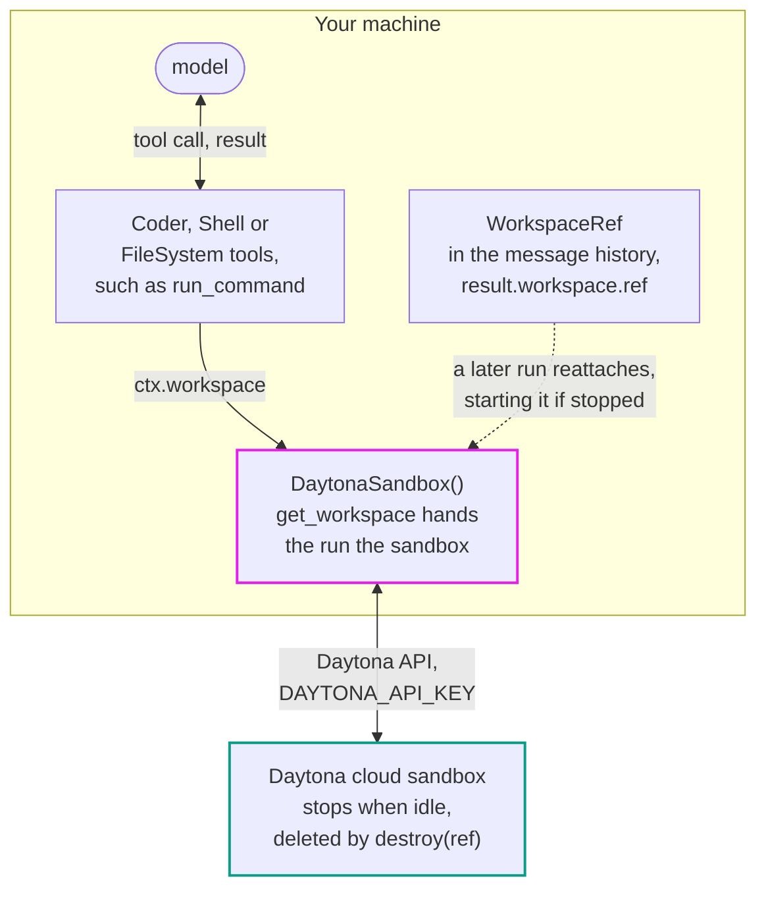

# Daytona Sandbox

Run your agent's commands and file edits in an isolated [Daytona](https://www.daytona.io) cloud sandbox instead of on your machine.

[Source](https://github.com/pydantic/pydantic-ai/tree/main/src/pydantic_ai_harness/pydantic_ai_harness/daytona_sandbox/)

> While Pydantic AI Harness is on 0.x releases, the API may change between minor releases; when it does, deprecation warnings and release-note migration guidance tell you (or your agent) exactly how to upgrade. See the [version policy](index.md#version-policy).



## Install

```bash
pip/uv-add "pydantic-ai-harness[coder,daytona,anthropic]"
```

Set `DAYTONA_API_KEY` to an API key from your Daytona dashboard. The examples also use `Coder` and an Anthropic model, hence the `coder` and `anthropic` extras and `ANTHROPIC_API_KEY`; swap them for your own tools and model provider.

## Quick start

<span id="choose-the-tools"></span>

```python {names="defined"}
from pydantic_ai import Agent
from pydantic_ai_harness.coder import Coder
from pydantic_ai_harness.daytona_sandbox import DaytonaSandbox

agent = Agent('{{ anthropic:large }}', capabilities=[DaytonaSandbox(), Coder()])
result = agent.run_sync('Clone https://github.com/pydantic/pydantic-ai and summarize how capabilities work.')
```

`Coder`'s shell and file tools now run in the sandbox. For a narrower agent, use [`Shell`](shell.md), [`FileSystem`](filesystem.md) or your own tools on [`ctx.workspace`](../workspace.md#using-the-workspace-in-tools).

- **`Coder` creates it when the run starts**, to load the repository's instructions, even if no tool is called. Pass `Coder(repo_context=False)` to wait for the first tool call.
- **It keeps its disk, and costs money, until you delete it.** Daytona stops it when idle but never deletes it. See [Clean up](#clean-up).
- **Commands run as the non-root `daytona` user in `/home/daytona`.** Pass `working_dir='/home/daytona/project'` to give the agent a project directory; it is created on a new sandbox.
- **The default snapshot has git, Python and `rg`**, but not your project's dependencies. Build a Daytona snapshot with them and pass `snapshot='my-snapshot'`, or install them [before the run](#prepare-a-sandbox-before-the-run). An unknown snapshot fails on first use with `WorkspaceUnavailableError`.

## Continue in the same sandbox

<span id="reattach-later"></span>

Pass the message history, and the next run works in the same sandbox, starting it again if Daytona stopped it:

```python {names="defined"}
from pydantic_ai import Agent
from pydantic_ai_harness.coder import Coder
from pydantic_ai_harness.daytona_sandbox import DaytonaSandbox

agent = Agent('{{ anthropic:large }}', capabilities=[DaytonaSandbox(), Coder()])
result = agent.run_sync('Clone https://github.com/pydantic/pydantic-ai and summarize how capabilities work.')

followup = agent.run_sync(
    'Which capability would you add next, and where would it live?',
    message_history=result.all_messages(),
)
ref = result.workspace.ref  # or store this, and pass `workspace=ref` to a later run
```

If the sandbox has been deleted, the run raises `WorkspaceUnavailableError`; pass `workspace='new'` to start over. [Workspaces](../workspace.md#continuing-in-the-same-workspace) covers how runs find their workspace.

The ref holds no credentials: the process that reattaches needs `DAYTONA_API_KEY` or a `client=` too.

Already have a `daytona.AsyncSandbox`? Pass `workspace=DaytonaSandboxBackend(sandbox=sandbox, working_dir=..., env=...)` to a run; `DaytonaSandbox`'s settings don't apply to it. A backend's `get_sandbox()` returns its `daytona.AsyncSandbox` for Daytona features the workspace API doesn't cover; on a backend with no sandbox yet, it creates one, which Daytona bills.

## Prepare a sandbox before the run

To seed files before the agent starts, build the backend yourself, write through a `Workspace`, and pass the backend to the run:

```python {names="defined"}
from pydantic_ai import Agent
from pydantic_ai.workspaces import Workspace
from pydantic_ai_harness.coder import Coder
from pydantic_ai_harness.daytona_sandbox import DaytonaSandbox, DaytonaSandboxBackend

agent = Agent('{{ anthropic:large }}', capabilities=[DaytonaSandbox(), Coder()])


async def run_in_prepared_sandbox() -> str:
    backend = DaytonaSandboxBackend(working_dir='/home/daytona/project')
    try:
        await Workspace(backend).write_text('TASK.md', 'Add a `--version` flag to cli.py.\n')
        result = await agent.run('Do the task in TASK.md.', workspace=backend)
        return result.output
    finally:
        await backend.aclose()
        ref = backend.ref  # set once the sandbox exists
        if ref is not None:
            await DaytonaSandbox().destroy(ref)
```

The run leaves a backend you built open, so close it with `aclose()`; that closes the client it opened from `DAYTONA_API_KEY`, not the sandbox. A `client=` or `sandbox=` you passed is never closed. To keep the sandbox, store `backend.ref` instead of destroying it.

## Clean up

Delete a sandbox with the ref you stored. This doesn't start a stopped sandbox:

```python {names="defined"}
from pydantic_ai.workspaces import WorkspaceRef
from pydantic_ai_harness.daytona_sandbox import DaytonaSandbox


async def delete_sandbox(ref: WorkspaceRef) -> None:
    await DaytonaSandbox().destroy(ref)
```

A failed run returns no result, so delete its sandbox in an `on_run_error` hook:

```python
from typing import Any

import anyio

from pydantic_ai import Agent, RunContext
from pydantic_ai.capabilities import Hooks
from pydantic_ai.run import AgentRunResult
from pydantic_ai_harness.coder import Coder
from pydantic_ai_harness.daytona_sandbox import DaytonaSandbox

hooks = Hooks()


@hooks.on.run_error
async def delete_failed_run_sandbox(ctx: RunContext[None], *, error: BaseException) -> AgentRunResult[Any]:
    if ctx.workspace.ref is not None:
        # Shielded so a deadline around the run can't cut the delete short, bounded so a hung call can't hang it.
        with anyio.move_on_after(30, shield=True):
            await DaytonaSandbox().destroy(ctx.workspace.ref)
    raise error


agent = Agent('{{ anthropic:large }}', capabilities=[DaytonaSandbox(), Coder(), hooks])
```

A sandbox you don't delete is stopped after 15 idle minutes (`auto_stop_interval=`; `0` keeps it running), keeps its disk, and is archived after 7 days. A sandbox from a VM snapshot is paused after 60 idle minutes instead, and is never archived. Either way a later run starts it again.

### Find a lost sandbox

If your program stops before it stores the ref, for example after a crash or Ctrl-C, the sandbox is left behind. To find it:

- List your sandboxes in Daytona. Sandboxes Pydantic AI creates have the label `created-by=pydantic-ai`.
- Or search your logs for `Created Daytona sandbox <id>`, logged at INFO by the `pydantic_ai_harness` logger.

Then delete it: `await DaytonaSandbox().destroy(WorkspaceRef(provider='daytona', id='<id>'))`.
## Keep a token out of the sandbox

Pass `secrets` to give a new sandbox Daytona [Secrets](https://www.daytona.io/docs/en/secrets), as a map from environment variable name to Secret name. The variable holds a placeholder, and Daytona swaps in the real value as requests leave for the Secret's `hosts`. Create the Secret once, then use it:

```python {test="skip"}
from daytona import AsyncDaytona, CreateSecretParams

from pydantic_ai_harness.daytona_sandbox import DaytonaSandbox


async def create_github_secret(token: str) -> None:  # a GitHub token, such as the output of `gh auth token`
    async with AsyncDaytona() as daytona:
        await daytona.secret.create(
            CreateSecretParams(
                name='github-token',
                value=token,
                hosts=['github.com', 'api.github.com', 'uploads.github.com'],
            )
        )


sandbox = DaytonaSandbox(secrets={'GH_TOKEN': 'github-token'})
```

`gh` then works as the token's owner, while `echo $GH_TOKEN` in the sandbox prints the placeholder. For `git push`, have git send the placeholder as its password:

```bash
git config --global credential.https://github.com.helper '!f() { echo username=x-access-token; echo "password=$GH_TOKEN"; }; f'
```

- Always set `hosts` on the Secret. Without them, Daytona sends the real value to any host.
- Daytona swaps the value only in HTTPS request headers, including git's password. Request bodies, query strings and plain HTTP keep the placeholder. Use `https://` remotes, not `git@github.com:owner/repo.git`.
- The agent can't see the token, but it can use it for anything the token allows.
- An attached sandbox keeps the Secrets it was created with. To swap the token, call `daytona.secret.update` with the Secret's ID; running sandboxes pick it up within seconds.
- To change which Secrets a running sandbox has, call `update_secrets` on `await backend.get_sandbox()`. It replaces the whole set, new variables reach only commands started after it, and a sandbox created without Secrets must restart first.

## Configuration

| Option | What it does |
| --- | --- |
| `client` | A `daytona.AsyncDaytona` to share across runs on one event loop, or to configure its API URL or target. Default: `None`, a client each run opens from `DAYTONA_API_KEY` and closes when it ends. You close a client you pass. |
| `snapshot` | Daytona snapshot a new sandbox starts from. Default: `None`, Daytona's default. An unknown snapshot fails on first use. |
| `auto_stop_interval` | Idle minutes before Daytona stops a new sandbox; `0` disables it. Default: `None`, Daytona's default: 15 minutes for a container, while a VM pauses after 60 minutes instead. |
| `allow_internet_access` | Whether a new sandbox can reach the internet. Default: `True`. When `False`, Tier 3 and 4 organizations block everything, while lower tiers keep package registries, GitHub and AI APIs reachable, so there it is not an exfiltration boundary. See [Daytona's network limits](https://www.daytona.io/docs/en/network-limits/). |
| `working_dir` | Absolute directory commands start in and relative paths resolve against. Default: `None`, `/home/daytona`. Created on a new sandbox; on an attached one it must exist. |
| `env` | Environment variables every command gets. Default: `None`; nothing from your machine reaches the sandbox. The agent's commands can read these, so leave out secrets it shouldn't see. |
| `secrets` | Daytona's `secrets` for a new sandbox, passed to `AsyncDaytona.create` unchanged: environment variable name to the name of an existing organization Secret. Default: `None`. An attached sandbox keeps the ones it was created with. See [Keep a token out of the sandbox](#keep-a-token-out-of-the-sandbox). |
| `authority` | Who wrote the sandbox's files, for capabilities that check [authority](../workspace-custom.md#workspace-authority): `'none'` for files nobody on your side wrote, such as a cloned third-party repository, `'user'` for the user's own. Default: `'operator'`. |
| `path_authority` | Levels for some directories and files, overriding `authority` under them; the longest matching path wins. Paths are sandbox paths, relative to the working directory or absolute; `~` isn't expanded. Default: `None`. |

`client`, `working_dir`, `env`, `authority` and `path_authority` also apply when you reattach, and `destroy` uses `client`; the other options only shape a new sandbox.

## Limits

<span id="what-a-timeout-stops"></span>

- A timeout or cancellation stops the command, not the sandbox. If Daytona doesn't confirm the stop, the command may still be running; inspect or delete the sandbox. `WorkspaceTimeoutError` carries the last 4 KiB of each stream.
- Output is collected when the command exits, so output a background child writes afterwards is lost. Redirect it to a file; `Shell.start_command` does this for you.
- A command whose output passes 10 MiB raises `WorkspaceOutputLimitError` once it exits. Redirect large output to a file.
- `timeout=None` removes the command deadline, not Daytona's idle stop.
- The Daytona SDK needs asyncio; under Trio, every operation raises `UserError`.

## Durable execution

Add `TemporalDurability()` next to `DaytonaSandbox()` and install the `temporal` extra; [Workspaces](../workspace.md#durable-execution) covers what changes. Each activity opens its own Daytona client and closes it when its operation ends.

## Telemetry

`DaytonaSandbox` emits no spans of its own. Core's [instrumentation](../capabilities/instrumentation.md) records `pydantic_ai.workspace.provider` and `pydantic_ai.workspace.id` on the agent run span, and each command or file operation runs inside its tool call's span.

## API reference

::: pydantic_ai_harness.daytona_sandbox.DaytonaSandbox

::: pydantic_ai_harness.daytona_sandbox.DaytonaSandboxBackend
