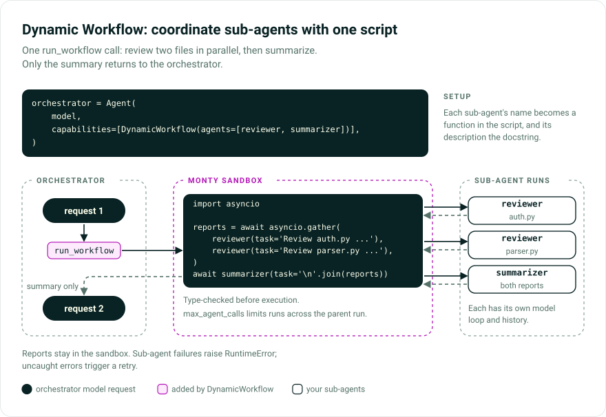

# Dynamic Workflow

Coordinate sub-agents in parallel, chain their results, or retry them in one tool call. Use
`DynamicWorkflow` when this coordination can run as Python rather than needing the orchestrator's
judgment after each step. On success, intermediate results stay out of the orchestrator's context unless the
script returns or prints them.

> While Pydantic AI Harness is on 0.x releases, the API may change between minor releases; when it does, deprecation warnings and release-note migration guidance tell you (or your agent) exactly how to upgrade. See the [version policy](index.md#version-policy).



## The idea

`DynamicWorkflow` gives the orchestrator one tool, `run_workflow`. The model writes a Python script
that runs in the [Monty](https://github.com/pydantic/monty) sandbox, with each named sub-agent
available as an async function. Like [Code Mode](code-mode.md), it replaces repeated tool calls
with code; unlike Code Mode, it calls whole agents rather than individual tools.

## How this relates to Subagents

Use [`SubAgents`](subagents.md) for occasional delegations or when the parent needs to judge each
result before continuing. Use `DynamicWorkflow` for scripted fan-out, chaining, voting, or retries.
Both accept the same agents. Start with `SubAgents` if you are unsure.

## Installation

The script runs inside the Monty sandbox, so install the extra:

```bash
pip/uv-add "pydantic-ai-harness[dynamic-workflow]"
```

## Your first workflow

Two sub-agents, one orchestrator:

```python
from pydantic_ai import Agent
from pydantic_ai_harness import DynamicWorkflow

reviewer = Agent('{{ openai:medium }}', name='reviewer', description='Reviews code for bugs.')
summarizer = Agent('{{ openai:medium }}', name='summarizer', description='Summarizes findings.')

orchestrator = Agent(
    '{{ openai:medium }}',
    capabilities=[DynamicWorkflow(agents=[reviewer, summarizer])],
)
```

Each agent's `name` becomes its sandbox function name and must be a valid Python identifier.
Its `description` tells the model when to call it.

## What the model does with it

The model can review two files concurrently, then summarize both reports:

```python
import asyncio

reports = await asyncio.gather(
    reviewer(task='Review auth.py for bugs:\n<file contents>'),
    reviewer(task='Review parser.py for bugs:\n<file contents>'),
)
await summarizer(task='Summarize these review findings:\n' + '\n\n'.join(reports))
```

Call sub-agents with `await` and a keyword-only `task`. `asyncio.gather` runs calls concurrently;
the last expression supplies the tool result.

Each call is an isolated `Agent.run` with its own model loop, history, tools, and output.
Include all required context in `task`: calls do not remember earlier runs. Each run costs tokens;
use the [budgets below](#keeping-it-safe-budgets) to limit usage.

## Sub-agents can return structured data

A sub-agent returns whatever its `output_type` produces. The default is a string, but give a sub-agent a Pydantic model and the script receives a `dict`:

```python
from pydantic import BaseModel


class Score(BaseModel):
    value: int
    reason: str


critic = Agent('{{ openai:medium }}', name='critic', description='Scores an answer 0-10.', output_type=Score)
```

Inside the script the model reads the fields by subscript, the way it would read a JSON object:

```python
result = await critic(task='Score this answer: ...')
result['value']  # not result.value
```

The catalog the model sees renders each output type as a `TypedDict`, so it knows the fields and reads them by subscript on its own.

Sub-agents cannot pause for [tool approval](../deferred-tools.md) or a
[pending model response](../batch.md#ending-a-run-while-it-waits). These output types are omitted
from the catalog; returning `DeferredToolRequests` or `PendingModelResponse` raises `RuntimeError`.
Pending requests are cancelled best effort; a batch is cancelled only when no other request in it
is waiting.

## How results come back

The value of the script's last expression becomes the tool result -- the model does not `print()` it.

| The script... | The model receives |
| --- | --- |
| ends in a value, no print | that value directly (or `{}` if it is `None`) |
| prints and ends in a value | `{"output": "<printed text>", "result": <value>}` |
| prints and ends in `None` | `{"output": "<printed text>"}` |

`print()` is for debug logging; it stringifies, so let the last expression carry the real result.

## Choosing sub-agent models

By default each sub-agent uses the model it was constructed with. Set `inherit_model=True` when the host passes a per-run model override to the parent agent (for example from a `/model` command) and every sub-agent dispatch should follow that resolved parent model. Leave it `False` when a sub-agent is deliberately pinned to a different model.

## Keeping it safe: budgets

A sub-agent is non-deterministic, costs tokens, and can fan out into more sub-agents. `DynamicWorkflow` gives you a hard count ceiling, token budgets, and a guard against runaway sandbox scripts.

### `max_agent_calls` -- an exact count

```python
DynamicWorkflow(agents=[...], max_agent_calls=50)  # 50 is the default
```

A hard, host-enforced ceiling on the number of sub-agent runs in one parent run. It is one budget shared across every `run_workflow` call in that run, and it holds exactly even when the script fans out with `asyncio.gather`. When the budget runs out, the workflow stops calling sub-agents and returns a terminal result with bounded previews of up to the 20 most recent completed results. This is the only knob that bounds the number of runs exactly.

### `sub_agent_usage_limits` and `forward_usage` -- bounding cost

`sub_agent_usage_limits` is a `UsageLimits` applied to each sub-agent run. `forward_usage` controls whether the whole tree shares one usage counter:

| `forward_usage` | Counter | What the limit means |
| --- | --- | --- |
| `True` (default) | the parent's `usage` is shared across the tree | a tree-wide cap. Under concurrent fan-out it is best-effort: several sub-agents can pass the check before any of them adds to the count. |
| `False` | each sub-agent run counts on its own | per-run limits. A per-run `total_tokens_limit` of `T` with `max_agent_calls` of `N` bounds the tree to roughly `N * T` tokens. |

Without `sub_agent_usage_limits`, sub-agents sharing the counter (`forward_usage=True`) run under the `usage_limits` you pass to the parent `run()`, so the parent's budget bounds the whole tree. With `forward_usage=False` they fall back to Pydantic AI's default `request_limit` of 50 per run. For an exact ceiling on the number of runs, use `max_agent_calls`.

### `resource_limits` -- guarding the script itself

These limits guard the orchestration script's own memory, not the sub-agents it calls. The default backstop is 256 MB with no time limit. Printed output is collected separately with Monty's 10 MiB default cap.

```python
DynamicWorkflow(agents=[...], resource_limits={'max_duration_secs': 30})
```

`max_duration_secs` counts sandbox execution time, excluding waits for sub-agents. Set it to
stop CPU-bound loops that never call a sub-agent and therefore bypass the agent budgets.
A partial limits dict overrides only the named caps. Pass `'unlimited'` to remove sandbox resource
limits; the separate 10 MiB print cap remains.

### Workflows do not nest

A sub-agent cannot start its own workflow: a sub-agent that has the `DynamicWorkflow` capability is not offered `run_workflow` while it runs inside a workflow. The practical rule: do not give the sub-agents in your catalog the `DynamicWorkflow` capability. They are the leaves of the orchestration, not orchestrators.

## Renaming a sub-agent: `WorkflowAgent`

By default a sub-agent shows up under its own `name` and `description`. To give it a different name or description for one workflow without editing the agent itself, wrap it in a `WorkflowAgent`:

```python
from pydantic_ai_harness.dynamic_workflow import WorkflowAgent

DynamicWorkflow(
    agents=[
        WorkflowAgent(
            reviewer,
            name='check',
            description='Checks one code change and returns actionable review findings.',
        ),
    ],
)
```

Now the model calls `check(task=...)`. Passing a bare agent is shorthand for wrapping it in a `WorkflowAgent` with no overrides.

## Adding sub-agents mid-run: `reveal()`

The catalog is fixed when a run starts, which keeps it in the prompt-cache prefix across turns. To make a new sub-agent available during a run (say once a fixer agent has been provisioned), keep a reference to the `DynamicWorkflow` instance and call `reveal()`:

```python
workflow = DynamicWorkflow(agents=[reviewer])
orchestrator = Agent('{{ openai:medium }}', capabilities=[workflow])

# later, from the host or from another tool:
workflow.reveal(fixer)
```

The new agent becomes callable on the next step, announced by a system message containing its
signature. The tool description stays fixed to preserve the prompt-cache prefix. If compaction or
a history processor removes the announcement, it is sent again.

`reveal()` is append-only. Missing names, invalid identifiers, reserved keywords, and collisions
raise `UserError` immediately.

## Loading it only when needed: `defer_loading`

`DynamicWorkflow` carries a fair amount of instruction text, and most turns do not need it. Keep it collapsed to a one-line entry until the model actually loads it:

```python
DynamicWorkflow(
    agents=[reviewer, summarizer],
    id='workflow',
    defer_loading=True,
)
```

`defer_loading=True` needs a stable `id`. See [on-demand capabilities](../capabilities/on-demand.md) for the full picture.

## What runs in the sandbox

The script runs in Monty, a subset of Python. Knowing the edges matters:

- No third-party libraries.
- Importable standard-library modules include `sys`, `typing`, `asyncio`, `math`, `json`, `re`, `unicodedata`, `datetime`, `time`, and `random`. Import what you use. There is no filesystem or environment access.
- No clock or randomness: `datetime.datetime.now()`, `datetime.date.today()`, `time.time()`, and
  unseeded `random` fail. `time.sleep` and `asyncio.sleep` really wait; with `max_duration_secs` set,
  a script may sleep for at most that long in total.
- `asyncio.gather(...)` runs sub-agents concurrently with positional awaitables but no keyword
  arguments, including `return_exceptions=True`. Other task creation and wait APIs are unavailable.

Before a script runs it is statically type-checked against the sub-agent signatures. An ordinary, statically provable mistake such as a misspelled function, a positional `task`, or a wrong-typed argument costs one retry but no sub-agent budget or sandbox execution. Values typed as `Any` can reach runtime validation; they are still rejected before a sub-agent runs.

!!! warning "An uncaught error aborts the whole script"
    A sub-agent failure surfaces as `RuntimeError`. The script can catch it with `try`/`except RuntimeError`; an uncaught failure aborts the whole script and the model retries it. If a script fails after some sub-agents already finished, the retry prompt lists bounded previews of up to the 20 most recent completed results. The model can reuse an untruncated preview as a plain value instead of paying for the same call again.

## Running inside a Temporal workflow

Attach `TemporalDurability` to the orchestrating agent alongside `DynamicWorkflow`, and to each
sub-agent whose model requests should run as activities, then register every agent with its own
`AgentPlugin`. The script runs in workflow code, like [Code Mode's `run_code`](code-mode.md#temporal-durability),
and is re-executed during replay against the recorded sub-agent results.
Unlike Code Mode, a `max_duration_secs` you set still applies inside the workflow, so a script that
runs close to it can stop at a different point on replay and cause a `NondeterminismError`.

## Observability

The [Logfire](https://pydantic.dev/logfire) trace is the best way to see what a workflow did. Each sub-agent run appears nested under the `run_workflow` span, and the span carries the exact `code` argument the model wrote, so you can read the script it actually ran. To watch sub-agent runs inside the one tool call, set `event_stream_handler` on each sub-agent `Agent`.

## API

```python
DynamicWorkflow(  # all parameters are keyword-only
    agents=[...],  # Sequence[AbstractAgent | WorkflowAgent], required
    tool_name='run_workflow',
    max_agent_calls=50,
    max_retries=3,
    forward_usage=True,
    inherit_model=False,  # True -> sub-agents run with the parent run's resolved model
    sub_agent_usage_limits=None,  # UsageLimits per sub-agent run; None -> parent run's limits when forwarding usage
    resource_limits=None,  # None -> backstop (256 MB, no time cap);
    # 'unlimited' -> sandbox limits off; a dict merges onto the backstop
    id=None,  # required when defer_loading=True
    description=None,  # one-line catalog entry shown while deferred
    defer_loading=False,
)

workflow.reveal(agent)  # AbstractAgent | WorkflowAgent; validates before appending

WorkflowAgent(
    agent,  # AbstractAgent, required, positional
    name=None,  # sandbox function name; falls back to agent.name
    description=None,  # function docstring; None falls back to agent.description, '' hides it
)
```

`DynamicWorkflowToolset` and `WorkflowResourceLimits` are also exported from the module for advanced use.

Source: [`pydantic_ai_harness/dynamic_workflow/`](https://github.com/pydantic/pydantic-ai/tree/main/src/pydantic_ai_harness/pydantic_ai_harness/dynamic_workflow/).

## Further reading

- [Code Mode](code-mode.md) -- the same sandbox, calling the agent's own tools instead of sub-agents.
- [Subagents](subagents.md) -- one-delegation-per-tool-call sub-agents, without the scripted choreography.
- [Dynamic Workflows: feature that enabled the Bun rewrite](https://pydantic.dev/articles/dynamic-workflows) (Pydantic) -- how `DynamicWorkflow` brings the pattern to any Pydantic AI agent.
- [Rewriting Bun in Rust](https://bun.com/blog/bun-in-rust) (Bun) -- the same pattern at scale, via Claude Code's dynamic workflows.
- [Capabilities](../capabilities/overview.md) and [on-demand capabilities](../capabilities/on-demand.md).
