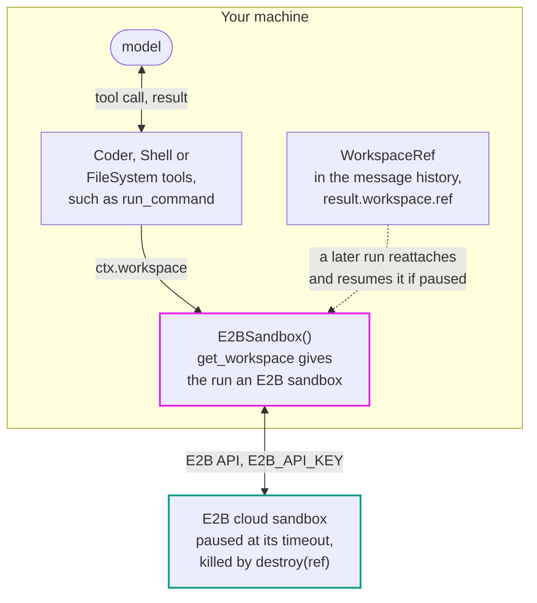

# E2B Sandbox

Run your agent's commands and file edits in an isolated [E2B](https://e2b.dev) cloud sandbox instead of on your machine.

[Source](https://github.com/pydantic/pydantic-ai/tree/main/src/pydantic_ai_harness/pydantic_ai_harness/e2b_sandbox/)

> While Pydantic AI Harness is on 0.x releases, the API may change between minor releases; when it does, deprecation warnings and release-note migration guidance tell you (or your agent) exactly how to upgrade. See the [version policy](index.md#version-policy).



## Install

```bash
pip/uv-add "pydantic-ai-harness[coder,e2b,anthropic]"
```

Set `E2B_API_KEY` to your E2B API key. The examples also use `Coder` and an Anthropic model, so they need the `coder` and `anthropic` extras and `ANTHROPIC_API_KEY`. Swap them for your own tools and model provider.

## Quick start

<span id="choose-the-tools"></span>

```python {names="defined"}
from pydantic_ai import Agent
from pydantic_ai_harness.coder import Coder
from pydantic_ai_harness.e2b_sandbox import E2BSandbox

agent = Agent('{{ anthropic:large }}', capabilities=[E2BSandbox(), Coder()])
result = agent.run_sync('Clone https://github.com/pydantic/pydantic-ai and summarize how capabilities work.')
```

`Coder`'s shell and file tools now run in the sandbox. For a narrower agent, use [`Shell`](shell.md), [`FileSystem`](filesystem.md) or your own tools on [`ctx.workspace`](../workspace.md#using-the-workspace-in-tools).

- `Coder` creates it when the run starts, to load the repository's instructions, even if no tool is called. Pass `Coder(repo_context=False)` to wait for the first tool call.
- It keeps running, and billing, after the run. See [Clean up](#clean-up).
- It pauses after 1 hour, and the next run resumes it. That is `sandbox_timeout=3600`, the most E2B's Hobby plan allows. On a Pro plan, pass up to `sandbox_timeout=86400`.
- Pass `idle_timeout=600` to pause it about 10 minutes after its last command or file operation instead. Each operation extends its lifetime as it starts, up to `sandbox_timeout` from the run's first use; under durable execution, from each activity's first use. Model turns count as idle, and one command must finish within it, so use minutes. A later run with `idle_timeout` shortens a longer lifetime to `idle_timeout`. On a Pro plan, `E2BSandbox(sandbox_timeout=86400, idle_timeout=600)` keeps a busy run's sandbox for up to a day and pauses a finished one after 10 minutes.
- Commands start in `/home/user`. Pass `working_dir='/home/user/project'` to keep the project out of the home directory. It is created on a new sandbox.
- The default template has Python and git, but not your project's dependencies or ripgrep. A template is the image a new sandbox starts from. Bake them into your own E2B [template](https://e2b.dev/docs/template/quickstart) and pass `template='my-template'`, or install them [before the run](#prepare-a-sandbox-before-the-run).

## Continue in the same sandbox

<span id="reattach-later"></span>

Pass the message history, and the next run works in the same sandbox, resuming it if paused:

```python {names="defined"}
from pydantic_ai import Agent
from pydantic_ai_harness.coder import Coder
from pydantic_ai_harness.e2b_sandbox import E2BSandbox

agent = Agent('{{ anthropic:large }}', capabilities=[E2BSandbox(), Coder()])
result = agent.run_sync('Clone https://github.com/pydantic/pydantic-ai and summarize how capabilities work.')

followup = agent.run_sync(
    'Which capability would you add next, and where would it live?',
    message_history=result.all_messages(),
)
ref = result.workspace.ref  # or store this, and pass `workspace=ref` to a later run
```

The history records the sandbox as a `WorkspaceRef`, or "ref": the provider's name and the sandbox's ID. `result.workspace.ref` is the same ref, for continuing without the history.

If the sandbox has been killed, the run raises `WorkspaceUnavailableError`. Pass `workspace='new'` to start over. [Workspaces](../workspace.md#continuing-in-the-same-workspace) covers how runs find their workspace.

The ref holds no credentials, so the process that reattaches needs `E2B_API_KEY` or a `client=` too.

Already have an `e2b.AsyncSandbox`? Pass `workspace=E2BSandboxBackend(sandbox=sandbox, working_dir=..., env=..., idle_timeout=...)` to a run. `E2BSandbox`'s settings don't apply to it.

## Prepare a sandbox before the run

To seed files or install packages before the agent starts, create the backend yourself, work in it through `Workspace`, and pass it to the run:

```python {names="defined"}
import asyncio

from pydantic_ai import Agent
from pydantic_ai.workspaces import Workspace
from pydantic_ai_harness.coder import Coder
from pydantic_ai_harness.e2b_sandbox import E2BSandbox, E2BSandboxBackend

agent = Agent('{{ anthropic:large }}', capabilities=[E2BSandbox(), Coder()])


async def main() -> None:
    backend = E2BSandboxBackend(working_dir='/home/user/project')
    try:
        workspace = Workspace(backend)
        await workspace.write_text('calc.py', 'def add(a, b):\n    return a - b\n')
        install = await workspace.run(['pip', 'install', 'pytest'], timeout=300)
        if install.exit_code != 0:
            raise RuntimeError(f'pip install failed: {install.stderr}')
        result = await agent.run('Fix the bug in calc.py.', workspace=backend)
        print(result.output)
    finally:
        ref = backend.ref  # set once the sandbox exists
        if ref is not None:
            await E2BSandbox().destroy(ref)


if __name__ == '__main__':
    asyncio.run(main())
```

The `finally` kills the sandbox even when setup or the run fails. To keep it, store `backend.ref` instead.

## Give the agent a desktop

Pass `desktop=True` and add [`ComputerUse`](computer-use.md):
`capabilities=[E2BSandbox(desktop=True), ComputerUse()]`. The screen is 1280x800; pass a size such as
`desktop=(1440, 900)` for another. The size applies when the screen first starts.

A new sandbox uses E2B's `desktop` template, a desktop with a terminal and Google Chrome. Your own `template` needs [the display's programs](computer-use.md#what-the-display-needs), which the first use installs if it can, and `startxfce4`, which it doesn't. Without `startxfce4`, the screen stays black until a program opens a window.

- When `sandbox_timeout` runs out, a run that is still going fails. Set it longer than your longest task.
- The agent can type only ASCII: an action that types or presses a character such as `é` fails, and the model is told why.
- The Print key opens XFCE's screenshot dialog instead of reaching the app.

## Clean up

Kill a sandbox with the ref you stored. This works on a paused sandbox too, without resuming it:

```python {names="defined"}
from pydantic_ai.workspaces import WorkspaceRef
from pydantic_ai_harness.e2b_sandbox import E2BSandbox


async def kill_sandbox(ref: WorkspaceRef) -> None:
    await E2BSandbox().destroy(ref)
```

A failed run returns no result, so kill its sandbox in an `on_run_error` hook:

```python
from typing import Any

import anyio

from pydantic_ai import Agent, RunContext
from pydantic_ai.capabilities import Hooks
from pydantic_ai.run import AgentRunResult
from pydantic_ai_harness.coder import Coder
from pydantic_ai_harness.e2b_sandbox import E2BSandbox

hooks = Hooks()


@hooks.on.run_error
async def terminate_failed_run(ctx: RunContext[None], *, error: BaseException) -> AgentRunResult[Any]:
    if ctx.workspace.ref is not None:
        # Shielded so a deadline around the run can't cut the kill short, bounded so a hung call can't hang it.
        with anyio.move_on_after(30, shield=True):
            await E2BSandbox().destroy(ctx.workspace.ref)
    raise error


agent = Agent('{{ anthropic:large }}', capabilities=[E2BSandbox(), Coder(), hooks])
```

A sandbox you don't kill pauses when its `sandbox_timeout` runs out, or its `idle_timeout` if you set one. See [E2B's sandbox lifecycle](https://docs.e2b.dev/sandbox).

### Find a lost sandbox

If your program stops before it stores the ref, for example after a crash or Ctrl-C, the sandbox is left behind. To find it:

- Search your logs for `Created E2B sandbox <id>`, logged at INFO by the `pydantic_ai_harness` logger.
- If the run stopped before E2B replied, there's no log line. Look in the E2B dashboard.

Then kill it: `await E2BSandbox().destroy(WorkspaceRef(provider='e2b', id='<id>'))`.

## Use different credentials for each user

`E2BSandbox(client=E2B(api_key=...))` sets one client for the capability. When each user has their own E2B account, supply the workspace from a capability of your own that builds the client from the run's `deps`:

```python {names="defined"}
from dataclasses import dataclass

from e2b import E2B
from pydantic_ai import Agent, RunContext
from pydantic_ai.capabilities import AbstractCapability
from pydantic_ai.workspaces import WorkspaceBackend, WorkspaceRef
from pydantic_ai_harness.coder import Coder
from pydantic_ai_harness.e2b_sandbox import E2BSandboxBackend


@dataclass
class User:
    e2b_api_key: str


@dataclass
class UsersE2B(AbstractCapability[User]):
    def get_workspace(self, ctx: RunContext[User], *, ref: WorkspaceRef | None) -> WorkspaceBackend | None:
        if ref is not None and ref.provider != 'e2b':
            return None
        if not ctx.deps.e2b_api_key:  # E2B would fall back to `E2B_API_KEY`
            raise ValueError('This user has no E2B API key.')
        return E2BSandboxBackend(client=E2B(api_key=ctx.deps.e2b_api_key), ref=ref)


agent = Agent('{{ anthropic:large }}', deps_type=User, capabilities=[UsersE2B(), Coder()])
```

- E2B's client falls back to `E2B_API_KEY` when its key is empty, so check for a key first, as above, or a user without one runs on that account.
- Destroy a user's sandbox with that user's key: `await E2BSandbox(client=E2B(api_key=user.e2b_api_key)).destroy(ref)`. With another account's client, the sandbox isn't found and `destroy` returns without an error, so the sandbox keeps billing.
- Under [Temporal](../durable_execution/temporal.md), `deps` are stored in the workflow's history. Put a user ID there, and look the key up in `get_workspace` on the worker.

## Keep a token out of the sandbox

Pass `network` to have E2B add a token to the sandbox's requests itself, so the token is never inside the sandbox. `network` takes E2B's own network options and passes them on unchanged. Here `gh` and `git push` work as the token's owner, while `echo $GH_TOKEN` in the sandbox prints `placeholder`:

```python {names="defined"}
import base64

from pydantic_ai_harness.e2b_sandbox import E2BSandbox

token = '...'  # a GitHub token, such as the output of `gh auth token`
basic = base64.b64encode(f'x-access-token:{token}'.encode()).decode()
sandbox = E2BSandbox(
    env={'GH_TOKEN': 'placeholder'},  # `gh` sends a token only when one is set; the proxy replaces it
    network={
        'rules': {
            'github.com': [{'transform': {'headers': {'Authorization': f'Basic {basic}'}}}],  # git over HTTPS
            'api.github.com': [{'transform': {'headers': {'Authorization': f'token {token}'}}}],  # gh
            'uploads.github.com': [{'transform': {'headers': {'Authorization': f'token {token}'}}}],
        }
    },
)
```

E2B adds the header as each request leaves the sandbox, replacing any header with the same name. This E2B feature is in [public beta](https://docs.e2b.dev/sandbox/internet-access), so it may change.

- Only HTTPS requests get the header. Use `https://` remotes, not `git@github.com:owner/repo.git`.
- If you also set `allow_out` or `allow_internet_access=False`, add each host in `rules` to `allow_out`, or its requests are blocked.
- The agent can't see the token, but it can use it for anything the token allows.
- List only hosts that never send request headers back in a response, or a command could read the token there.
- An attached sandbox keeps its rules. To change them, for example to swap the token, call `update_network` on `await backend.get_sandbox()`. It replaces all network options at once.
- To keep the token out of the request that creates the sandbox too, save the whole header value as an E2B secret and use `e2b.Secret.fill(name)` as the value.

## Preview a dev server

With `Shell`, have the agent start the server with `start_command`, such as `npm run dev -- --host 0.0.0.0 --port 3000`. Then get its public hostname from the sandbox. Here `capability` is the agent's `E2BSandbox`:

```text
sandbox = await capability.backend(ref).get_sandbox()
url = f'https://{sandbox.get_host(3000)}'
```

With `idle_timeout`, the sandbox pauses about `idle_timeout` after the run's last use, since serving the preview isn't use. Call `await sandbox.set_timeout(seconds)` to keep it up longer.

The preview is public. Stop it with `stop_command` while the workspace is attached, and kill the sandbox when you're done.

## Configuration

| Option | What it does |
| --- | --- |
| `client` | An `e2b.E2B` for the API key and connection settings. Default: `None`, which reads `E2B_API_KEY` and the rest of the environment. |
| `template` | E2B template name or ID for a new sandbox. Default: `None`, E2B's `base`. An unknown template fails on first use. |
| `allow_internet_access` | Whether a new sandbox can reach the internet. Default: `True`. |
| `sandbox_timeout` | Seconds until E2B pauses the sandbox, set on create and on reattach. Default: `3_600`. Without `idle_timeout`, a value over your plan's limit raises `WorkspaceUnavailableError`. With it, the limit isn't checked up front, and the sandbox pauses at your plan's limit even while busy. |
| `idle_timeout` | Seconds without a command or file operation before E2B pauses the sandbox. Each operation extends its lifetime, up to `sandbox_timeout` from the run's first use. Model turns count as idle, so use minutes. Default: `None`, the fixed `sandbox_timeout` lifetime. |
| `working_dir` | Absolute directory commands start in and relative paths resolve against. Default: `None`, `/home/user` on the default template. Created on a new sandbox. On an attached one, it must already exist. |
| `env` | Environment variables every command gets. Default: `None`. Nothing from your machine reaches the sandbox. The agent's commands can read these, so leave out secrets it shouldn't see. The default locale is POSIX. Pass `{'LC_ALL': 'C.UTF-8'}` for tools that should count characters rather than bytes. |
| `network` | E2B's network options for a new sandbox, passed to `Sandbox.create` unchanged. Default: `None`. See [Keep a token out of the sandbox](#keep-a-token-out-of-the-sandbox). It can't be set from an [agent spec](../agent-spec.md). |
| `authority` | Who wrote the sandbox's files. A capability that puts a file's text in the prompt gives it no more [authority](../workspace-custom.md#workspace-authority) than this. Default: `'operator'`, your own files. Use `'user'` for the user's files, and `'none'` for files nobody on your side wrote, such as a cloned third-party repository. |
| `path_authority` | Levels for some directories and files, overriding `authority` under them. The longest matching path wins. Paths are in the sandbox, relative to the working directory or absolute, and `~` isn't expanded. Default: `None`. |
| `desktop` | Give the sandbox a screen for [`ComputerUse`](computer-use.md): `True` for 1280x800, or a `(width, height)`. The size applies when the screen first starts. Without a `template`, a new sandbox uses E2B's `desktop` template. Default: `False`. |

`template`, `allow_internet_access` and `network` only shape a new sandbox. The other options also apply when you reattach, and `destroy` uses `client`.

## Limits

<span id="what-a-timeout-stops"></span>

- E2B's file service runs as root, so Unix permissions don't restrict file tools. Commands run as `user`.
- Concurrent writes to one path can interleave, and a reader can see a partial file. Write to separate paths.
- A background process that keeps the command's stdout or stderr open keeps `run()` waiting. Redirect its output to a file. `Shell.start_command` does this for you.
- A command whose output passes 10 MiB is stopped with `WorkspaceOutputLimitError`. Redirect large output to a file.
- On a timeout, the command's process group is stopped. Custom templates need `/bin/bash`, `/bin/sh` and `setsid` for that. Without `setsid`, only the command itself is stopped.
- Stopping is best effort. If E2B can't be reached, the command may keep running, so keep the ref to inspect or kill the sandbox.
- The E2B SDK needs asyncio. Under Trio, every operation raises `UserError`.

## Durable execution

Add `TemporalDurability()` next to `E2BSandbox()` and install the `temporal` extra. [Workspaces](../workspace.md#durable-execution) covers what changes. A durable run creates its sandbox when it starts.

## Telemetry

`E2BSandbox` traces starting or reconnecting to the sandbox as `workspace create` or `workspace attach`, under the call that needed it, and `destroy(ref)` called inside a run as `workspace destroy`; see [workspace spans](../logfire.md#workspace-spans). Core's [instrumentation](../capabilities/instrumentation.md) also records the sandbox on the agent run span as `pydantic_ai.workspace.provider` and `pydantic_ai.workspace.id`, and each command or file operation a tool makes runs inside that tool call's span; operations at run start, such as `RepoContext` loading repo instructions, run in the agent run span. Creating a sandbox also logs `Created E2B sandbox <id>` at INFO on the `pydantic_ai_harness.e2b_sandbox._backend` logger, so the id is on record even if the run ends before it is stored.

## Further reading

- [Run Pydantic AI coding agents in E2B sandboxes](https://pydantic.dev/articles/pydantic-ai-e2b-sandboxes) (Pydantic): a coding agent in an E2B sandbox

## API reference

::: pydantic_ai_harness.e2b_sandbox.E2BSandbox

::: pydantic_ai_harness.e2b_sandbox.E2BSandboxBackend
