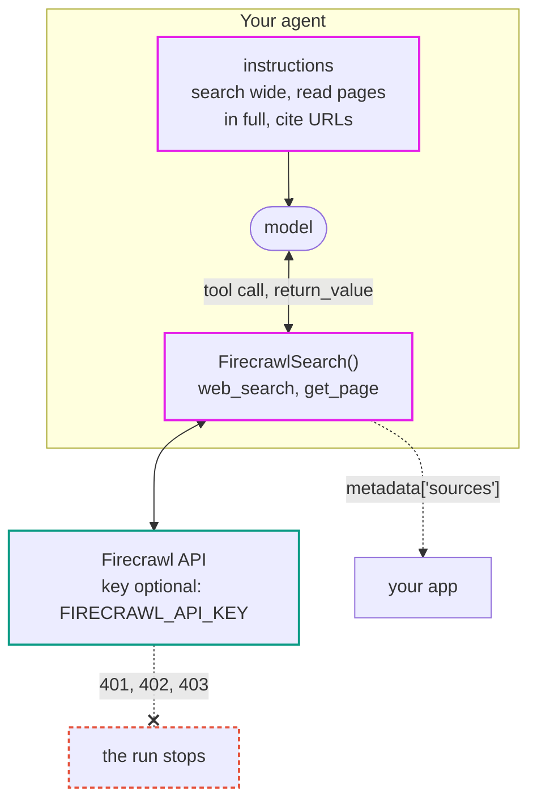

# Firecrawl Search

`FirecrawlSearch` gives an agent web research tools backed by the
[Firecrawl](https://www.firecrawl.dev) API: search that returns query-relevant
highlights of each hit, or each hit's full page, and page scraping for digging
into a specific URL.

[Source](https://github.com/pydantic/pydantic-ai/tree/main/src/pydantic_ai_harness/pydantic_ai_harness/firecrawl/)

> While Pydantic AI Harness is on 0.x releases, the API may change between minor releases; when it does, deprecation warnings and release-note migration guidance tell you (or your agent) exactly how to upgrade. See the [version policy](index.md#version-policy).



## Usage

Nothing to install and nothing to configure to get started: Firecrawl's search
and scrape endpoints accept keyless requests, and this capability talks to them
over `httpx2`, which `pydantic-ai-harness` already depends on. The examples use
an Anthropic model, so set `ANTHROPIC_API_KEY` for them.

```python {title="firecrawl_search.py" test="skip" lint="skip"}
from pydantic_ai import Agent
from pydantic_ai_harness import FirecrawlSearch

agent = Agent('{{ anthropic:medium }}', capabilities=[FirecrawlSearch()])
result = agent.run_sync('What changed in the EU AI Act this year? Cite your sources.')
print(result.output)
```

The capability adds two tools:

- `web_search(query)`: the matching pages, each with title, URL, and the
  passages Firecrawl's [search highlights](https://docs.firecrawl.dev/features/search-highlights)
  pick as relevant to the query, collapsed onto one line. When Firecrawl has no
  highlight for a page, the site's own description stands in. A result without
  a URL, or whose URL has whitespace inside, is left out.
- `get_page(url)`: one page scraped as markdown, with its title and final URL.

Both return a [`ToolReturn`][pydantic_ai.messages.ToolReturn] whose `metadata['sources']` lists the URLs and titles behind
the result, so an application can render citations from [`ToolReturnPart.metadata`][pydantic_ai.messages.ToolReturnPart] without parsing
the text.

## Configuration

```python {title="firecrawl_search_configured.py" test="skip" lint="skip"}
from pydantic_ai import Agent
from pydantic_ai_harness import FirecrawlSearch

agent = Agent(
    '{{ anthropic:medium }}',
    capabilities=[
        FirecrawlSearch(
            max_results=10,
            extraction_mode='full_page',
            max_text_chars=5_000,
            include_domains=['docs.python.org'],
        )
    ],
)
```

| Field | Default | What it does |
|---|---|---|
| `max_results` | `5` | How many results `web_search` returns, from 1 to 100. Sent to Firecrawl as `limit`. |
| `extraction_mode` | `'highlights'` | `'highlights'` returns query-relevant passages per result; `'full_page'` also scrapes every result and returns its markdown. |
| `max_text_chars` | `10_000` | Budget for each `web_search` result body and for the page `get_page` returns; longer text is truncated and marked, with the marker counted against the budget. A budget too small to hold the marker ends the text with `…` instead. |
| `include_domains` | `[]` | If non-empty, search results only come from these domains. Mutually exclusive with `exclude_domains`. |
| `exclude_domains` | `[]` | Search results never come from these domains. |
| `guidance` | `None` | Replaces the default research instructions, including their untrusted-content rule; `''` contributes none. |
| `native` | `False` | Use the model's native web search where it has one, with Firecrawl's `web_search` as the fallback. |
| `client` | `None` | A `FirecrawlClient` to use instead of the default HTTP client. |

`'full_page'` costs more than `'highlights'`: Firecrawl scrapes and bills each
result, and every result's markdown lands in the context window. The default
keeps a survey of several sources cheap and leaves full pages to `get_page`.
In `'full_page'` mode, a result Firecrawl could not scrape falls back to its
highlight.

The domain lists apply to `web_search` only. Firecrawl turns them into `site:`
operators, which some self-hosted search backends treat as hints, so results
outside them are also dropped before the model sees them. `get_page` reads any
public `http(s)` URL the model passes; it refuses other schemes and private,
loopback, and link-local IP addresses. It does not resolve hostnames, since the
scraper does that, so a self-hosted deployment still needs its own egress
rules to keep the scraper away from internal hosts.

## Authentication

Firecrawl accepts keyless search and scrape requests, so nothing is required to
get started. An API key raises rate limits and draws on your Firecrawl credits:

```bash
export FIRECRAWL_API_KEY='fc-...'
```

Set `FIRECRAWL_API_URL` to point at a self-hosted Firecrawl deployment. It must
be `https`, except against loopback for local development, and carry no query or
fragment: the endpoint path is appended to it. A key with whitespace or control
characters inside is rejected with a `UserError`.

To configure either explicitly rather than through the environment, pass a
client:

```python {title="firecrawl_client.py" test="skip" lint="skip"}
from pydantic_ai_harness.firecrawl import FirecrawlSearch, HttpFirecrawlClient

FirecrawlSearch(client=HttpFirecrawlClient(api_key='fc-...'))
```

Any object satisfying the [`FirecrawlClient`][pydantic_ai_harness.firecrawl.FirecrawlClient] protocol works, which is also how tests
substitute a fake.

To reuse connections, or to send requests through a proxy, custom TLS, or a
retrying transport, pass your own `httpx2.AsyncClient` as
`HttpFirecrawlClient(http_client=...)`. Its timeouts apply alongside the
90-second request deadline, and it stays open for you to close. Without one,
each request opens and closes its own client. Requests never follow redirects,
whatever the client is configured to do, so the API key stays with the
configured host.

For a proxy, a self-hosted deployment, or a `FirecrawlClient` of your own, this
is what the default client sends. `search` posts
`{"query": ..., "limit": ..., "highlights": true}` to `/v2/search`, adding `includeDomains` or
`excludeDomains` when set and `"scrapeOptions": {"formats": ["markdown"]}` in
`'full_page'` mode, and returns the response's `data.web` list; the toolset
reads each result's `url`, `title`, `description`, and `markdown`. `scrape`
posts `{"url": ..., "formats": ["markdown"]}` to `/v2/scrape` and returns the
response's `data` object; the toolset reads its `markdown` and the `title`,
`url`, and `statusCode` in its `metadata`. Requests carry
`Authorization: Bearer ...` when a key is set. Each request must finish within
90 seconds, and a response body over 10 MiB is abandoned before parsing.

## Errors

Any HTTP error status other than `401`, `402`, and `403` becomes [`ModelRetry`][pydantic_ai.exceptions.ModelRetry], as do
network failures, a request past its deadline, and a `2xx` whose body is too
large, not JSON, or not `success: true` with a `data` object, so the model can
wait, rephrase, or try another URL rather than abort the run. A `get_page` call
for a URL it refuses, or whose page reports an error status, such as a `404`,
or has no content is a `ModelRetry` too. A `401`, `402`, or `403` propagates as
`httpx2.HTTPStatusError`: a rejected key or an exhausted account is
configuration the model cannot fix.

## Multiple instances

Two instances register the same tool names and share the default `id`
(`firecrawl_search`), so two that differ raise an error. To run a second setup
in one agent, give it a distinct `id` and wrap it in core's [`PrefixTools`][pydantic_ai.capabilities.PrefixTools]
capability, which puts a prefix in front of its tool names.

Core `WebSearch`, `ExaSearch`, `YouSearch`, and `KeenableSearch` name their
tools the same way -- `web_search`, plus `get_page` for the harness ones -- and
an agent cannot have two tools with the same name, so adding one of them next
to `FirecrawlSearch` fails on the agent's first run. Give an agent one web
search capability, or wrap the extra one in [`PrefixTools`][pydantic_ai.capabilities.PrefixTools] to rename its tools.

To use the provider's native search where there is one and Firecrawl's
elsewhere, set `native=True`. `get_page` stays Firecrawl's on every model. To
use Firecrawl as the fallback of core [`WebSearch`](../capabilities/web-search.md) instead, with
its native options and no `get_page`, pass its tool:

```python {title="firecrawl_fallback.py" test="skip" lint="skip"}
from pydantic_ai.capabilities import WebSearch
from pydantic_ai_harness import FirecrawlSearch

WebSearch(local=FirecrawlSearch().web_search_tool())
```

## Durable execution

Under [durable execution](../durable_execution/overview.md), each Firecrawl request is recorded, so a
recovered run reuses the result instead of making the request again. Temporal
and Prefect record each tool call in its own activity or task. DBOS runs
function tools in workflow code, so there the request runs as its own step.

The records are named after the capability's `id`, which defaults to
`firecrawl_search`, so durable execution needs no configuration. Changing an
`id` renames the records, which in-flight runs then cannot find.

## Agent spec (YAML/JSON)

`FirecrawlSearch` works with Pydantic AI's [agent spec](../agent-spec.md), so you can
declare it in a config file instead of Python:

```yaml
# agent.yaml
model: {{ anthropic:medium }}
capabilities:
  - FirecrawlSearch:
      max_results: 10
      extraction_mode: full_page
```

```python
from pydantic_ai import Agent
from pydantic_ai_harness import FirecrawlSearch

agent = Agent.from_file('agent.yaml', custom_capability_types=[FirecrawlSearch])
```

The `client` field is not spec-serializable; spec-loaded instances always build
the default [`HttpFirecrawlClient`][pydantic_ai_harness.firecrawl.HttpFirecrawlClient], which reads `FIRECRAWL_API_KEY` and `FIRECRAWL_API_URL`
from the environment.

## Telemetry

`FirecrawlSearch` emits no spans of its own. Core's tool-call spans cover each
search and page read.

## API reference

::: pydantic_ai_harness.FirecrawlSearch

::: pydantic_ai_harness.firecrawl.FirecrawlSearchToolset

::: pydantic_ai_harness.firecrawl.HttpFirecrawlClient

::: pydantic_ai_harness.firecrawl.FirecrawlClient

::: pydantic_ai_harness.firecrawl.FirecrawlSource
