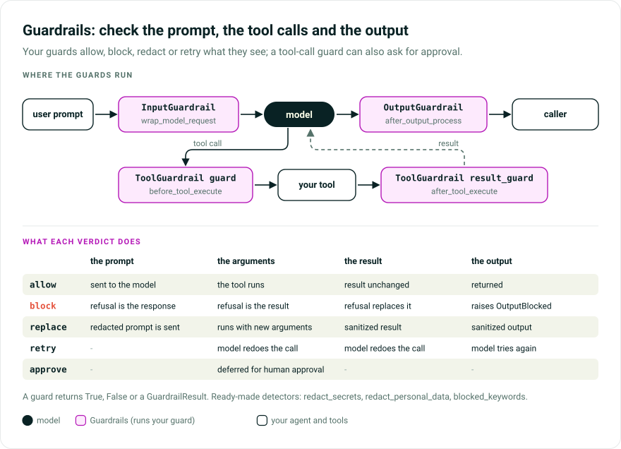

# Input, Output & Tool Guardrails

Guardrails run a callable you supply on the user prompt before the model sees it, on each tool call and its result, and on the final output before the caller sees it. Use them to redact secrets or PII, cheaply refuse off-topic prompts, vet or approve tool calls, or require citations. The callable allows, blocks, redacts, retries, or (for tool calls) defers for approval.

> While Pydantic AI Harness is on 0.x releases, the API may change between minor releases; when it does, deprecation warnings and release-note migration guidance tell you (or your agent) exactly how to upgrade. See the [version policy](index.md#version-policy).



## How it works

`InputGuardrail`, `OutputGuardrail`, and `ToolGuardrail` each wrap a `guard` callable that inspects a value and returns one of five outcomes. At the run's two edges:

| Outcome | `InputGuardrail` | `OutputGuardrail` |
|---|---|---|
| **allow** | send the prompt to the model | return the output to the caller |
| **block** | skip the model call; a refusal message becomes the response | raise `OutputBlocked` |
| **replace** | rewrite the prompt sent to the model (redaction) | substitute a sanitized output |
| **retry** | -- (not valid for input) | send the output back to the model to try again |
| **approve** | -- (not valid for input) | -- (not valid for output) |

`ToolGuardrail` uses the same outcomes on both sides of a tool call; see [Tool calls](#tool-calls). A guard that raises an exception instead propagates it as a hard failure. Input `block` refuses gracefully because it spends no tokens. Output `block` raises because the model already produced something you do not want exposed, so the caller must decide what to do next.

## Usage

`pydantic_ai_harness` exports the three capabilities, `GuardrailResult`, the `InputGuardrailFunc` and `OutputGuardrailFunc` aliases, and the `GuardrailError`, `InputBlocked`, and `OutputBlocked` exceptions. Import `ToolCallInfo`, `ToolResultInfo`, `ToolBlocked`, the tool guard aliases, and `detectors` from `pydantic_ai_harness.guardrails`:

```python
from pydantic_ai import Agent
from pydantic_ai_harness import GuardrailResult, InputGuardrail, OutputGuardrail


def no_secrets(prompt: str) -> bool:
    return 'api_key' not in prompt.lower()


def no_pii(output: object) -> GuardrailResult:
    if 'SSN' in str(output):
        return GuardrailResult.block('The response contained personal data.')
    return GuardrailResult.allow()


agent = Agent(
    '{{ openai:medium }}',
    capabilities=[
        InputGuardrail(guard=no_secrets),
        OutputGuardrail(guard=no_pii),
    ],
)
```

A guard returns `True` (allow), `False` (block), or a `GuardrailResult`, and may be async, for example to call a moderation API. Any other return value is read for truthiness with a `HarnessDeprecationWarning`, so a classifier label such as `'unsafe'` lets the value through; a future release will raise `UserError`. Wrap NumPy or tensor score comparisons in `bool(...)`.

`OutputGuardrail` receives the output unchanged, not stringified. A typed output arrives as the Pydantic model instance, so read a field or call `output.model_dump_json()`; `str(MyModel(...))` gives a repr that hides field contents from regex checks.

`InputGuardrail` checks the run's prompt. A run without one, such as `agent.run(None)`, checks the latest user prompt in its history, skipping `SubAgents` background-task reports, which it recognizes by their metadata. History passed in `message_history` is trusted as the caller's own, metadata included. Load untrusted client history with a [UI adapter](../ui/overview.md), which never puts client metadata on message content, or [`sanitize_messages`][pydantic_ai.messages.sanitize_messages], which resets `TextContent.metadata` on user prompts.

## Several guards at once

`InputGuardrail.guard` and `OutputGuardrail.guard` take one callable or a sequence run in order; `ToolGuardrail`'s `guard` and `result_guard` take one callable each. In a chain:

| Verdict | Effect on the chain |
|---|---|
| `allow` | move on to the next guard |
| `replace` | the rest of the chain inspects the substituted value |
| `block` / `retry` | the chain ends there, since neither leaves a value to judge |

Since `replace` threads forward, put a redactor first and every later guard sees the cleaned text.

```python
from pydantic_ai import Agent
from pydantic_ai_harness import InputGuardrail
from pydantic_ai_harness.guardrails.detectors import blocked_keywords, redact_secrets

agent = Agent(
    '{{ openai:medium }}',
    capabilities=[InputGuardrail(guard=[redact_secrets, blocked_keywords(['internal-only'])])],
)
```

Unlike two separate `InputGuardrail` capabilities, a chain has one place in the capability list and one set of spans, and threads a redaction into the next check.

A redaction reaches the message history only if the chain finishes: a later `block` ends it before the cleaned prompt is written back, so the original stays in the history. Put the redactor last when that matters, at the cost of earlier checks seeing the original text.

An empty sequence, a set (no order), or an iterator (spent after one run) raises `UserError` when the guardrail first runs, not at construction: on the first model request for `InputGuardrail`, on the final output for `OutputGuardrail`.

## Ready-made detectors

`pydantic_ai_harness.guardrails.detectors` holds plain functions returning a `GuardrailResult`, so they go into a chain beside your own guards:

```python
from pydantic_ai_harness.guardrails import detectors

detectors.redact_secrets  # rewrites vendor API keys, tokens, and whole private-key blocks out of text
detectors.redact_personal_data  # rewrites emails, card numbers, IBANs, US SSNs
detectors.blocked_keywords(['internal-only'])  # refuses text containing any of them
```

The redactors rewrite rather than refuse: an agent that quoted a key back has still done the work, and blocking would lose it while leaving the key in the history. They are `secret_data()` and `personal_data()` with defaults; call the factories to narrow or extend them:

```python
from pydantic_ai_harness.guardrails.detectors import secret_data

secret_data(only=['aws_access_key', 'private_key'])
secret_data(extra={'internal_ticket': r'INT-\d{4}'})
secret_data(placeholder='***')  # the default is `[redacted:{name}]`, which says what it removed
```

Detectors read text. Replacing a model-instance output with a scrubbed string would change its type, so `for_text` makes you choose:

```python
from pydantic_ai_harness import OutputGuardrail
from pydantic_ai_harness.guardrails.detectors import for_text, redact_secrets

OutputGuardrail(guard=for_text(redact_secrets))  # raises on a non-string output
OutputGuardrail(guard=for_text(redact_secrets, on_other='allow'))  # skips it deliberately
```

A tool result guard receives `ToolResultInfo`, not a bare value. `for_tool_result_text` adapts a detector to a string result or to the text channels of a [`ToolReturn`][pydantic_ai.messages.ToolReturn]:

```python
from pydantic_ai_harness import ToolGuardrail
from pydantic_ai_harness.guardrails.detectors import for_tool_result_text, redact_secrets

ToolGuardrail(result_guard=for_tool_result_text(redact_secrets))
```

It checks a string `return_value` and all text in `content`, which core sends as a separate user-prompt part. Adjacent text parts are also scanned joined, so a secret split across two parts is caught; a `CachePoint` does not separate parts, an image or document does. If sanitizing the joined text differs from sanitizing each part, the span becomes one part with the first part's metadata, and a `CachePoint` between merged parts moves ahead of it; otherwise each part keeps its metadata. `ToolReturn` metadata, kind, and non-text parts are kept.

A non-text result raises by default. `on_other='allow'` skips the whole result, including the `content` of a `ToolReturn` whose `return_value` is not a string; if that `content` may be sensitive, keep the default and apply the detector to a field instead.

On the input side, a multimodal prompt reaches the guard rendered as text, and `InputGuardrail` refuses a `replace` for it rather than drop the attachments (see [Redaction](#redaction-replace)). Guard the output when prompts can carry attachments.

**Where a shape is not enough.** `email` matches anything shaped like an address:

```python
from pydantic_ai_harness.guardrails.detectors import redact_personal_data

redact_personal_data('git clone git@github.com:pydantic/pydantic-ai.git')
# replaces `git@github.com`, leaving a command that no longer runs
```

An input guard rewrites the prompt in place, so the model receives the broken command. On an agent that handles code or paths, use `personal_data(only=['us_ssn', 'credit_card', 'iban'])`, or put the detector on the output. Other pattern limits:

- `credit_card` matches 13 to 19 digits in any grouping, starting with 2 to 6 and passing Luhn. Some digit runs pass by chance, so a list of numbers can lose a value.
- `iban` matches a country code and two check digits, allows spaces only where the printed form puts them, and verifies the ISO 7064 mod-97 check digits.
- An AWS *secret* access key is not in the defaults: forty prefix-less base64 characters would match ordinary base64. Pass a pattern anchored on the name beside it (`aws_secret_access_key = ...`) through `extra=` if keys reach your agent that way.
- `only=` selects patterns without reordering them: `iban` always runs before `credit_card`, so a spaced account number is not labelled a card.
- `private_key` matches real newlines or the escaped `\n` of a JSON or `.env` file, and covers a block pasted without its `END` marker.

**What these do not do.** A regex finds credentials by shape. It does not find prompt injection, which is ordinary language, or understand context, so a redactor will sometimes take a string that only looks like a key. Use detectors as one layer among other controls.

## `GuardrailResult`

Construct a `GuardrailResult` with its classmethods, not the raw fields:

```python
from pydantic_ai_harness import GuardrailResult

GuardrailResult.allow()  # let the value through
GuardrailResult.block('reason')  # refuse; omit the reason to use a default message
GuardrailResult.replace('cleaned')  # substitute a sanitized value and continue
GuardrailResult.retry('instruction')  # ask the model to redo the output or the tool call
GuardrailResult.approve()  # ToolGuardrail arguments only: defer the call for human approval
```

The block or retry message is built when the guard decides, so it can carry the guard's reasoning.

## Redaction (`replace`)

`GuardrailResult.replace(value)` sanitizes instead of refusing: `InputGuardrail` rewrites the prompt sent to the model, `OutputGuardrail` the output returned to the caller. The replacement is not validated against `output_type`, so for a structured output return the same type, such as `output.model_copy(update=...)`.

```python
import re

from pydantic_ai import Agent
from pydantic_ai_harness import GuardrailResult, InputGuardrail, OutputGuardrail
from pydantic_ai_harness.guardrails.detectors import for_text

EMAIL_RE = re.compile(r'[\w.+-]+@[\w-]+(?:\.[\w-]+)+')


def scrub_emails(text: str) -> GuardrailResult:
    cleaned = EMAIL_RE.sub('[email]', text)
    return GuardrailResult.replace(cleaned) if cleaned != text else GuardrailResult.allow()


agent = Agent(
    '{{ openai:medium }}',
    capabilities=[
        InputGuardrail(guard=scrub_emails),  # before the model sees it
        OutputGuardrail(guard=for_text(scrub_emails)),  # before the caller sees it
    ],
)
```

Input `replace` raises `UserError` in three cases. Under `parallel=True`, the model call has already started with the original prompt. On a multimodal prompt (`agent.run_sync(['describe this', BinaryContent(...)])`), which the guard sees rendered as text, one string written back would drop the attached images, documents and audio; this includes a text copy sent to the model whose history original is multimodal. On a run resuming from a request with several prompt parts, the guard screens them together, as `ctx.prompt` reports them, and one replacement cannot be written back over them. Return `allow` or `block` for those prompts, or guard the output.

## Retry (`retry`)

From an `OutputGuardrail`, `GuardrailResult.retry(instruction)` sends a bad output back to the model with the instruction as the retry prompt. It uses Pydantic AI's normal retry mechanism and counts against the run's output-retry budget.

```python
from pydantic_ai_harness import GuardrailResult, OutputGuardrail


def has_citations(output: object) -> bool:
    return 'Source:' in str(output)


def must_cite_sources(output: object) -> GuardrailResult:
    if not has_citations(output):
        return GuardrailResult.retry('Include at least one source citation.')
    return GuardrailResult.allow()


OutputGuardrail(guard=must_cite_sources)
```

## Accessing run context

A guard may take a [`RunContext`][pydantic_ai.tools.RunContext] first for run state, such as `deps` for tenant- or role-aware policy or message history. It is detected from the signature:

- A required second positional parameter, or `*args` alongside another parameter, means `RunContext` comes first.
- If the second parameter has a default, the first one's annotation decides: `RunContext` (also in a union or `Annotated`) means the run context, any other type the guarded value. No annotation, `Any`, `object`, or an unresolvable type still gets `RunContext`, with a `HarnessDeprecationWarning` unless the unresolved annotation names `RunContext`.
- Keyword-only parameters are left to the guard. A guard that needs only the prompt declares no `RunContext`.

```python
from dataclasses import dataclass

from pydantic_ai import RunContext
from pydantic_ai_harness import InputGuardrail


@dataclass
class MyDeps:
    tier: str


def tenant_policy(ctx: RunContext[MyDeps], prompt: str) -> bool:
    return ctx.deps.tier == 'pro' or 'advanced-feature' not in prompt


InputGuardrail(guard=tenant_policy)
```

## Parallel input guards

Run sequentially, a slow guard (an LLM classifier, a network call) adds its latency to every turn. `parallel=True` runs it concurrently with the model call, so it adds no latency when it allows, and cancels the model call as soon as it blocks.

```python
from pydantic_ai_harness import InputGuardrail


async def slow_async_classifier(prompt: str) -> bool:
    return 'internal-only' not in prompt  # stands in for an LLM or moderation API call


InputGuardrail(guard=slow_async_classifier, parallel=True)
```

Parallel mode trades tokens for latency: if the guard blocks after the model has responded, those tokens are spent, while sequential mode never calls the model. Keep fast local checks (regex, keyword lookup) sequential. `replace` is not available under `parallel=True`.

Tools wait for the verdict: the guard holds the model request until it decides, and tool dispatch starts after it. A request that raises first, such as a `ModelRetry` from an `after_model_request` hook or a model error before streaming, also waits, and a block takes its place. In a streamed run, a block that lands after the whole response has streamed (as after that `ModelRetry`) is raised as `SkipModelRequest` (see [Streaming](#streaming)). [`CodeMode`](code-mode.md#eager-execution) with `eager=True` or `speculate` starts nested tool calls while the model streams; each waits for the verdict, so a blocked prompt runs none of them and an allowed one releases them at once.

## Hard-fail path

`block` is graceful. To make the caller handle an exception, raise from the guard:

```python
from pydantic_ai_harness import InputBlocked
from pydantic_ai_harness.guardrails.detectors import redact_secrets


def contains_credentials(prompt: str) -> bool:
    return redact_secrets(prompt).action != 'allow'


def strict_guard(prompt: str) -> bool:
    if contains_credentials(prompt):
        raise InputBlocked('credentials detected')
    return True
```

Guard exceptions propagate as-is: raise `InputBlocked`, `OutputBlocked`, `ToolBlocked` (with `tool_name` and an optional `reason`), or your own types. Under Temporal your own types fail the guard's activity instead; see [Durable execution](#durable-execution).

## Tool calls

`InputGuardrail` screens only the user prompt, on a run's first model request, so tool arguments and results pass unchecked without a `ToolGuardrail`. A `ToolGuardrail`'s `guard` sees the validated arguments before the tool runs; `result_guard` sees the return value before the model does. `result_guard` also screens the message of a `ModelRetry` or `ToolFailed` raised while the tool runs, including inside `CodeMode`, since that text reaches the model; a screened failure stays a failure. Capabilities ordered inside this one (another `position='innermost'` capability) run in the same screening window, so their raw retries are screened too, except one from an error hook, which this guard's error hook closes the window on; those ordered outside pass through. A `ToolGuardrail` `retry` verdict is the guard's own instruction and is never screened.

```python
import re
from pathlib import Path

import httpx
from pydantic_ai import Agent
from pydantic_ai_harness import GuardrailResult, ToolGuardrail
from pydantic_ai_harness.guardrails import ToolCallInfo, ToolResultInfo

WORKSPACE = Path('/workspace')
SECRET_RE = re.compile(r'\bsk-[A-Za-z0-9_-]{20,}')


def stay_in_the_workspace(call: ToolCallInfo) -> GuardrailResult:
    if call.name == 'write_file':
        # Resolve first: a prefix test on the raw string accepts `/workspace/../etc/passwd`.
        target = Path(str(call.args['path'])).resolve()
        if not target.is_relative_to(WORKSPACE):
            return GuardrailResult.block(f'{target} is outside the workspace.')
    return GuardrailResult.allow()


def scrub_secrets(info: ToolResultInfo) -> GuardrailResult:
    # Text only: replacing a structured result or `ToolReturn` with a string changes its type.
    if not isinstance(info.result, str):
        return GuardrailResult.allow()
    cleaned = SECRET_RE.sub('[redacted]', info.result)
    return GuardrailResult.replace(cleaned) if cleaned != info.result else GuardrailResult.allow()


agent = Agent(
    '{{ openai:medium }}',
    capabilities=[ToolGuardrail(guard=stay_in_the_workspace, result_guard=scrub_secrets)],
)


@agent.tool_plain
def write_file(path: str, content: str) -> str:
    Path(path).write_text(content, encoding='utf-8')
    return f'wrote {path}'


@agent.tool_plain
def fetch_page(url: str) -> str:
    return httpx.get(url).text
```

The outcomes map onto Pydantic AI control flow:

| Outcome | `guard` (arguments) | `result_guard` (result) |
|---|---|---|
| **allow** | run the tool | return the result unchanged (the guard gets the tool's own object: use `replace`, don't mutate it) |
| **block** | skip execution; the refusal message becomes the tool result (`SkipToolExecution`) | the refusal message replaces the result |
| **replace** | run the tool with substituted arguments (a mapping); the message history keeps the model's original arguments. Keys are not checked against the tool's signature: an unknown one raises a bare `TypeError` naming neither the tool nor the guard | substitute a sanitized result |
| **retry** | ask the model to redo the call (`ModelRetry`) | same, but the tool has already run, so its side effects happened and the retry runs it again |
| **approve** | defer the call for human approval (`ApprovalRequired`) | -- (the tool has already run) |

`block` is graceful at both stages: the agent sees the refusal as the tool result and can explain or try another approach. To fail the run, raise `ToolBlocked`.

Both guards get `args` as a read-only `MappingProxyType` over a deep copy made per guard call, so large arguments are copied every time. For several tool checks, stack `ToolGuardrail` capabilities: they share the innermost tier in list order, so argument guards run first to last and result guards last to first.

### Human in the loop

`approve` uses Pydantic AI's approval round trip: a call raising [`ApprovalRequired`][pydantic_ai.exceptions.ApprovalRequired] is held back, the run ends with a [`DeferredToolRequests`][pydantic_ai.tools.DeferredToolRequests] output, and you resume it with the human's answers. Guard approvals and tools marked `requires_approval=True` arrive in the same place.

```python
from pydantic_ai import Agent, DeferredToolRequests, DeferredToolResults, ToolDenied
from pydantic_ai.messages import ToolCallPart
from pydantic_ai_harness import GuardrailResult, ToolGuardrail
from pydantic_ai_harness.guardrails import ToolCallInfo


def operator_says_yes(call: ToolCallPart) -> bool:
    return input(f'Run {call.tool_name}({call.args})? [y/N] ') == 'y'


def confirm_production(call: ToolCallInfo) -> GuardrailResult:
    if call.args.get('env') == 'prod':
        return GuardrailResult.approve()
    return GuardrailResult.allow()


agent = Agent(
    '{{ openai:medium }}',
    capabilities=[ToolGuardrail(guard=confirm_production)],
    output_type=[str, DeferredToolRequests],
)


@agent.tool_plain
def deploy(env: str) -> str:
    return f'deployed to {env}'


deferred = await agent.run('deploy the new build')
if isinstance(deferred.output, DeferredToolRequests):
    results = DeferredToolResults(
        approvals={
            call.tool_call_id: True if operator_says_yes(call) else ToolDenied('not on a Friday')
            for call in deferred.output.approvals
        }
    )
    final = await agent.run(message_history=deferred.all_messages(), deferred_tool_results=results)
```

A denial reaches the model as the tool result. On the resumed run the guard runs again and `approve` is a no-op for a call the human cleared, but every other verdict applies, so a changed policy can still block an approved call. An `InputGuardrail` also runs again: with no new prompt, it screens the most recent prompt in the history.

Two shapes of approval:

| | Deferred (`GuardrailResult.approve()`) | In-process (an async guard) |
|---|---|---|
| The run | ends, then resumes from `message_history` | stays open; the tool call awaits |
| Fits | HTTP APIs, queues, durable execution, anything that cannot hold a process open | CLIs, TUIs, desktop apps, a websocket to an operator |
| Human answer | `DeferredToolResults` (`True`, `ToolDenied`, or `ToolApproved(override_args=...)`) | whatever the guard returns |

For the in-process shape, an async guard awaits the human directly:

```python
import asyncio
from collections.abc import Mapping
from typing import Any

from pydantic_ai_harness import GuardrailResult, ToolGuardrail
from pydantic_ai_harness.guardrails import ToolCallInfo


async def operator_approves(name: str, args: Mapping[str, Any]) -> bool:
    answer = await asyncio.to_thread(input, f'Allow {name}({dict(args)})? [y/N] ')
    return answer == 'y'


async def ask_the_operator(call: ToolCallInfo) -> GuardrailResult:
    if await operator_approves(call.name, call.args):
        return GuardrailResult.allow()
    return GuardrailResult.block('The operator declined this action.')


ToolGuardrail(guard=ask_the_operator)
```

Without a guard, use `requires_approval=True` on a tool, or `ApprovalRequiredToolset` for a synchronous predicate over a toolset. Use `ToolGuardrail` when the decision is async, needs `deps`, or sits alongside other verdicts.

Two fields narrow what a guard sees:

```python
from pathlib import Path

from pydantic_ai_harness import ToolGuardrail
from pydantic_ai_harness.guardrails import ToolCallInfo


def stay_in_the_workspace(call: ToolCallInfo) -> bool:
    return Path(str(call.args.get('path', '/workspace'))).resolve().is_relative_to('/workspace')


ToolGuardrail(
    guard=stay_in_the_workspace,
    tools=['write_file', 'run_shell'],  # guard only these; None (default) guards every tool
    hidden=['delete_everything'],  # withhold these from the model entirely
)
```

A hidden tool is dropped from the definitions sent to the model, so it costs no tokens and a call to it is rejected as an unknown tool; a blocked tool stays visible and the model learns it was refused. `hidden` is a static name list; for policy that depends on `deps` or arguments, use `guard`.

After a successful run, `ToolGuardrail` warns about each `hidden` name no offered tool matched, and each unmatched `tools` name when `guard` or `result_guard` is set. It waits for the run's end because a dynamic toolset may offer a tool only on later steps. This catches typos like `tools=['send_monye']`, which leaves the intended tool unguarded, or a misspelled `hidden` name, which leaves the tool visible.

### What a tool guard does not see

Three kinds of call never reach the execution hooks, so neither guard sees them:

- **Output tools**, which produce structured output. Use `OutputGuardrail`.
- **External and deferred tools**, which the run hands back to your application in `DeferredToolRequests` before any execution hook runs, so check their arguments where your application executes them. `hidden` still covers them, since it works on tool definitions.
- **Provider-side builtin tools** such as web search, which run at the provider and return builtin call/return parts.

## Streaming

`OutputGuardrail` inspects only the final output. Under `run_stream()` partial chunks reach the caller first, and `block` or `replace` cannot un-send them; use `run()` or `run_sync()` when no output may be exposed unscreened. `retry` is not supported under `run_stream()`, since Pydantic AI does not retry output during streaming, and surfaces as [`UnexpectedModelBehavior`][pydantic_ai.exceptions.UnexpectedModelBehavior]. `InputGuardrail` behaves the same in streamed and non-streamed runs, except with `parallel=True`: chunks sent before the guard blocks reach the caller before the block message replaces them, and a block after the whole response has streamed raises `SkipModelRequest`.

## Durable execution

In a durable workflow or flow (Temporal, DBOS, Prefect), each guard chain is a durable operation, checkpointed as `<agent>__capability__<id>.guard` (and `.result_guard` for a `ToolGuardrail` result guard). Replay reuses the recorded verdict, so a classifier is paid for once and cannot decide differently on recovery.

- The guarded value and the verdict cross the engine's serializer, so keep them serializable.
- On a JSON transport such as Temporal, a structured output or tool result (including a `ToolReturn`) reaches the guard as plain JSON data, so serialize it with `pydantic_core.to_json(value)`, not a model method. A replacement of the original value's type is rebuilt as that type.
- Under Temporal the guard's `RunContext` carries only its serialized fields, without `messages` or `prompt`.
- `GuardrailError`, `InputBlocked`, `OutputBlocked`, `ToolBlocked`, `ApprovalRequired` and `ModelRetry` raised by a guard reach the run on every engine; only these exact types are carried, not subclasses. Under Temporal any other exception type, including a subclass, fails the activity, which is retried under its retry policy (unbounded by default).

Each guardrail on a durable-capable agent needs an explicit, distinct `id`, which addresses its operations: `InputGuardrail(guard=no_secrets, id='input-guard')`. Without one, Pydantic AI refuses to bind the agent and names the fix. Outside durable execution `id` is optional.

## Tracing

`replace` and `block` record spans on the active OpenTelemetry tracer (`guardrail redacted input`, `guardrail blocked output`, and so on) with `guardrail.*` attributes, visible in [Logfire](https://pydantic.dev/logfire). The replacement value and the refusal `message` are attached only when `RunContext.trace_include_content` is enabled, since they can quote guarded content. The value a redaction removed is never recorded. `retry` records no guardrail span; its retry appears as a normal model request.

Tool spans add a `guardrail.tool` attribute. `approve` records `guardrail deferred tool args` with `guardrail.tool_call_id`, to correlate with the `DeferredToolRequests` your application answers, and `guardrail.arguments` under the same `trace_include_content` rule. A deferred call never executes, so no `execute_tool` span records it; this span is the record of the request.

`OutputGuardrail` declares `position='outermost', wrapped_by=[Instrumentation]`, so an enclosing `Instrumentation` span captures its spans whatever the list order.

## Capability ordering

`InputGuardrail` declares `position='innermost'`, so capabilities that rewrite the user prompt (a prompt rewriter, a history processor) run first and the guard sees the rewritten text. A `UserPromptPart` another capability adds to the request only, such as a `SystemReminders` reminder or a `Planning` plan, is neither screened nor rewritten. When an outer capability sends the model a copy of the prompt part, a redaction also reaches the original in the message history, which later steps replay:

- Every copy with the same text gets the same replacement.
- For a copy with changed text, the guard runs again on the original's text, so a guard with side effects or per-call cost runs twice for that request. Only a redaction from that call is written to the history; `allow` leaves the original, and `block` blocks the run before anything is rewritten.
- For a request rebuilt with a new prompt part, only the part sent to the model is rewritten.

`ToolGuardrail` is also `position='innermost'`: last among argument hooks, so it sees arguments after every other capability modified them, and first among result hooks, so it sees the raw result before a capability such as [`ToolOutputLimits`](tool-output-limits.md) truncates or offloads it.

## Relationship to `pydantic-ai-shields`

[`pydantic-ai-shields`](https://github.com/vstorm-co/pydantic-ai-shields), a community package by [Vstorm](https://vstorm.co/), ships each detector as its own capability. Here they are functions, so several can run as one chain, share a redaction, and sit beside your own guard.

Two of its capabilities have no equivalent. `PromptInjection` matches phrases like "ignore previous instructions", which misses paraphrased or translated instructions and can flag text quoting an attack; for untrusted content, see [Prompt Injection Defender](prompt-injection-defender.md) for tool results and [Artifact Scanning](artifact-scanning.md) for persisted memory and skills. `NoRefusals` blocks the model from declining, a policy on what an agent may say rather than a check on data.

## API

```python {test="skip"}
InputGuardrailFunc = (
    Callable[[str], bool | GuardrailResult | Awaitable[bool | GuardrailResult]]
    | Callable[[RunContext[AgentDepsT], str], bool | GuardrailResult | Awaitable[bool | GuardrailResult]]
)
OutputGuardrailFunc = (
    Callable[[object], bool | GuardrailResult | Awaitable[bool | GuardrailResult]]
    | Callable[[RunContext[AgentDepsT], object], bool | GuardrailResult | Awaitable[bool | GuardrailResult]]
)
ToolGuardrailFunc = (
    Callable[[ToolCallInfo], bool | GuardrailResult | Awaitable[bool | GuardrailResult]]
    | Callable[[RunContext[AgentDepsT], ToolCallInfo], bool | GuardrailResult | Awaitable[bool | GuardrailResult]]
)
ToolResultGuardrailFunc = (
    Callable[[ToolResultInfo], bool | GuardrailResult | Awaitable[bool | GuardrailResult]]
    | Callable[[RunContext[AgentDepsT], ToolResultInfo], bool | GuardrailResult | Awaitable[bool | GuardrailResult]]
)


@dataclass(frozen=True, kw_only=True)
class GuardrailResult:
    action: Literal['allow', 'block', 'replace', 'retry', 'approve']
    message: str | None = None
    replacement: object = ...  # unset by default, so `replace(None)` is valid
    # classmethods: allow(), block(message=None), replace(value), retry(message), approve()


@dataclass
class InputGuardrail(AbstractCapability[AgentDepsT]):
    guard: InputGuardrailFunc[AgentDepsT] | Sequence[InputGuardrailFunc[AgentDepsT]]
    parallel: bool = False


@dataclass
class OutputGuardrail(AbstractCapability[AgentDepsT]):
    guard: OutputGuardrailFunc[AgentDepsT] | Sequence[OutputGuardrailFunc[AgentDepsT]]


@dataclass
class ToolGuardrail(AbstractCapability[AgentDepsT]):
    guard: ToolGuardrailFunc[AgentDepsT] | None = None
    result_guard: ToolResultGuardrailFunc[AgentDepsT] | None = None
    tools: Sequence[str] | None = None
    hidden: Sequence[str] = field(default_factory=tuple)


@dataclass(frozen=True, kw_only=True)
class ToolCallInfo:
    name: str
    args: Mapping[str, Any]
    tool_call_id: str


@dataclass(frozen=True, kw_only=True)
class ToolResultInfo(ToolCallInfo):
    result: object
```

Each guard takes the inspected value (the prompt, the output, or a `ToolCallInfo` or `ToolResultInfo`), optionally preceded by a `RunContext`. `GuardrailError` is the base of `InputBlocked`, `OutputBlocked`, and `ToolBlocked`.

Source: [`pydantic_ai_harness/guardrails/`](https://github.com/pydantic/pydantic-ai/tree/main/src/pydantic_ai_harness/pydantic_ai_harness/guardrails/).
