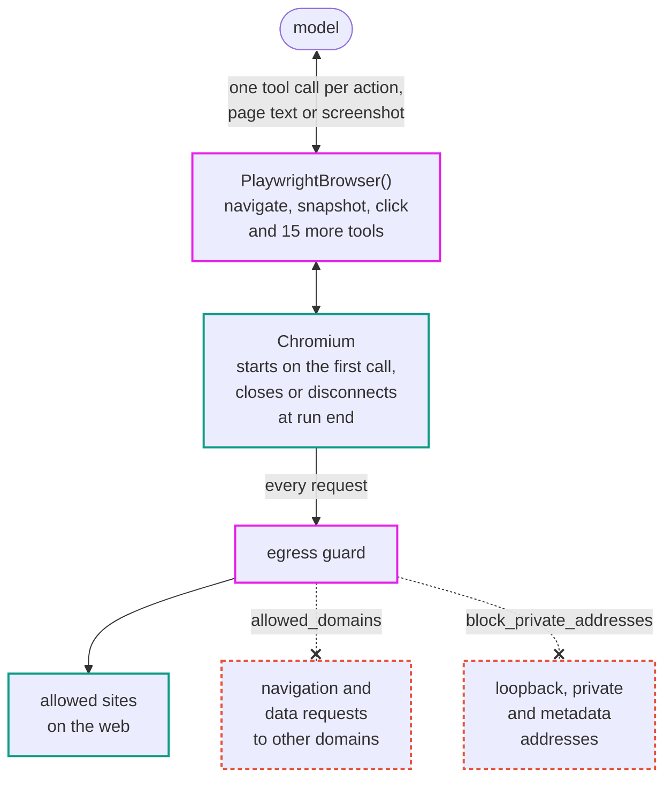

# Playwright Browser

`PlaywrightBrowser` gives an agent a real, stateful Chromium browser via async
[Playwright](https://playwright.dev/python/): navigate, click, type, scroll,
move through history, extract page text, run JavaScript, and screenshot.

Reach for it when the lighter web tools fall short. A web search tool answers a
research question without loading a page, and a web-fetch tool handles a known
static URL. This capability covers what neither can reach: pages behind login or session cookies,
JavaScript-rendered SPAs, and interactive multi-step flows.

[Source](https://github.com/pydantic/pydantic-ai/tree/main/src/pydantic_ai_harness/pydantic_ai_harness/playwright/)

!!! note "Which browser capability?"
    This page covers driving the browser from the host model: typed,
    deterministic actions, one tool call at a time. To hand an open-ended goal
    to an autonomous agent that drives the browser for you, see
    [Browser Use](browser-use.md). For one raw Chrome DevTools Protocol tool
    that code calls in loops, see [CDP Browser](cdp-browser.md). Give an agent
    one of them: each capability runs its own browser, so a session opened by
    one is not visible to the others.



## Installation

The `playwright` extra pulls in Playwright, and Chromium is a separate binary
download:

```bash
pip/uv-add "pydantic-ai-harness[playwright]"
```

```bash
py-cli playwright install chromium
```

If the Chromium binary is missing at runtime, the browser tool returns the
`playwright install chromium` hint as its result rather than ending the run, so
an agent that can run a shell can install the browser and carry on; the failure
is not remembered, so the next call launches. The process also gets a
`BrowserUnavailableWarning`, since a developer watching a terminal sees neither
the tool result nor the trace. Set `auto_install_chromium=True` to fetch the
binary automatically on the first miss instead.

## Usage

```python
from pydantic_ai import Agent
from pydantic_ai_harness.playwright import PlaywrightBrowser

agent = Agent('{{ anthropic:medium }}', capabilities=[PlaywrightBrowser()])
result = await agent.run('Open https://example.com and tell me the page title.')
```

`PlaywrightBrowser` is a [capability](../capabilities/overview.md): it registers the
browser toolset, injects short when-to-use guidance into the system prompt, and
manages the Chromium lifecycle for the run.

## Tools

| Tool | Signature | Returns |
|---|---|---|
| `navigate` | `(url, timeout_ms=None)` | page URL, title, and visible text (truncated) |
| `snapshot` | `(timeout_ms=None)` | the accessibility tree with `aria-ref` handles (truncated) |
| `click` | `(selector, timeout_ms=None)` | page text after the click; `selector` is a CSS selector, an `aria-ref=` handle, or `'x,y'` pixel coordinates |
| `type_text` | `(selector, text, sequential=False, timeout_ms=None)` | page text after typing (replaces the field value, does not submit); `sequential=True` sends real key presses |
| `press_key` | `(key, selector=None, timeout_ms=None)` | page text after the key press; `key` is a Playwright key name (`Enter`, `Escape`, `Tab`, `Control+a`) |
| `select_option` | `(selector, values, timeout_ms=None)` | page text after choosing options in a `<select>` |
| `hover` | `(selector, timeout_ms=None)` | page text after hovering, revealing hover-only menus |
| `wait_for` | `(selector=None, text=None, gone=False, timeout_ms=None)` | page text once the element/text appears -- or, with `gone=True`, once it is gone -- in the page or any frame; pass exactly one of `selector`/`text` |
| `screenshot` | `(full_page=False, timeout_ms=None)` | a note with the page URL, plus the PNG as image content |
| `get_text` | `(selector=None, timeout_ms=None)` | the element's text, or the full page's visible text |
| `scroll` | `(direction, x=None, y=None, timeout_ms=None)` | where the page now sits, and its text; `direction` is up/down/left/right (one screenful) or top/bottom |
| `go_back` | `(timeout_ms=None)` | the previous page's text |
| `go_forward` | `(timeout_ms=None)` | the next page's text |
| `execute_js` | `(script, timeout_ms=None)` | the JavaScript result (string as-is, objects as JSON, `null` as `undefined`) |
| `console_messages` | `(errors_only=False)` | console output and uncaught script errors, oldest first |
| `tabs` | `(action='list', index=None)` | the open tabs, or a confirmation plus the active tab's text; `action` is `list`/`select`/`close`/`new` |
| `handle_next_dialog` | `(accept, prompt_text=None)` | a confirmation of how the next `alert`/`confirm`/`prompt` will be answered |
| `network_requests` | `(url_contains=None, errors_only=False)` | requests the page made with their status, including ones the egress policy refused |

Every page action accepts an optional `timeout_ms` to override both defaults for
that one call. An override has to be greater than 0: `0` disables the deadline
entirely, which stays available as a capability default but not as an argument
the model picks.

A deadline bounds the whole tool call, not each Playwright call inside it. One
`navigate` waits on a goto, a load state, a title, a body read and possibly a
screenshot; each stage gets what is left of the budget rather than the whole
number again, so `timeout_ms` is the longest the call can take.

Two defaults rather than one, because the two failures differ. An action that
misses (`click`, `get_text`, `wait_for`) is normally a selector matching nothing,
and `action_timeout_ms` (5s) turns that into a fast, readable failure instead of
a wait long enough to read as a hung agent. A page load legitimately takes
longer, so navigation, load settling, and starting or attaching to the browser
use `navigation_timeout_ms` (60s).

`snapshot` returns the page's accessibility tree, the low-cost structured way for
the model to read the page and obtain `aria-ref=eN` handles. Targeting an element
by its `aria-ref=` handle (passed to `click` or `type_text`) is more reliable than
a model-authored CSS selector. The snapshot includes iframe content (see
[Embedded content](#embedded-content-iframes)). Reach for `screenshot` only when
a visual check is needed (charts, layout).

`type_text` fills a field but does not submit it; `press_key('Enter')` does. A
native `<select>` does not open as page content, so `select_option` operates it
rather than `click`. `type_text` sets the value in one step and dispatches no key
events, which is faster and enough for an ordinary form; pass `sequential=True`
for a field that reacts to each keystroke -- autocomplete and type-ahead widgets,
masked or formatted inputs, and editors that ignore a value set directly.

`wait_for` waits for content to arrive; `wait_for(gone=True)` waits for it to go
away, which is how a spinner or an overlay is waited out when what replaces it is
not known in advance.

Every tool acts on the active tab. A `target="_blank"` link, a sign-in popup or a
payment step opens a second one, which stays open rather than being closed:
`tabs('list')` shows what is open and `tabs('select', index)` moves there. A
session keeps up to eight tabs: past that, a tab the page opens is closed and
recorded, while `tabs('new')` is refused and asks the model to close one first.
A page dialog (`alert`, `confirm`, `prompt`) blocks the page until it is
answered, and is dismissed unless `handle_next_dialog(accept=True)` was called
before the action that opened it -- that call covers one dialog, not the rest of
the run.

`screenshot` (and the optional `screenshot_on_navigate` attachment) return the
image as [`BinaryContent`][pydantic_ai.messages.BinaryContent]
rather than a base64 string, so vision models see the image natively instead of
a wall of base64 in the text context. A capture over 5 MB (typically a full-page
screenshot of a long page) is returned as a bounded error instead of image
content, because model providers reject oversized images and the failure would
otherwise abort the run; capture the viewport or scroll and capture sections
instead.

Browser tool failures -- a timeout, a selector that matches no element, a
navigation error, or a browser that closed mid-run -- are returned to the model
as error strings it can act on (retry, try another selector, navigate again),
not raised to abort the agent run.

## Options

| Option | Default | Purpose |
|---|---|---|
| `headless` | `True` | Run Chromium without a visible window (suits servers and CI). |
| `allowed_domains` | `None` | Egress allowlist for navigation and data requests; `None` allows every public host (see [Egress](#egress-and-ssrf)). |
| `policy` | `None` | Full `EgressPolicy`, for rules the two shorthands cannot express. Mutually exclusive with them. |
| `block_private_addresses` | `True` | Refuse private, loopback, link-local and other reserved addresses, whether written as an IP or reached through a hostname that resolves to one (see [Egress](#egress-and-ssrf)). |
| `screenshot_on_navigate` | `False` | Attach a screenshot to every `navigate` result. |
| `max_content_tokens` | `4000` | Approximate token budget for every textual tool result. |
| `action_timeout_ms` | `5000` | Default deadline for element actions (click, type, read, wait). `0` disables it. |
| `navigation_timeout_ms` | `60000` | Default deadline for navigation and load settling, and for starting or attaching to the browser. `0` disables it. |
| `chromium_sandbox` | `True` | Run the launched Chromium with its renderer sandbox. Turn it off only where the sandbox cannot start (a container without the kernel privileges it needs). Ignored when attaching over CDP (`cdp_url`). |
| `auto_install_chromium` | `False` | Fetch Chromium automatically when the binary is missing. |
| `storage_state` | `None` | Playwright storage state (cookies + localStorage) loaded at launch; see [Authenticated sites](#authenticated-sites). |
| `cdp_url` | `None` | Attach to a Chromium already running at this CDP endpoint, or at the one a function of the run context returns, instead of launching one; see [Attaching to a running browser](#attaching-to-a-running-browser). |
| `cdp_context` | `'new'` | Choose `'new'` for an isolated context or `'default'` for the default context's sign-ins and tabs. Only `'default'` requires a CDP endpoint and excludes `storage_state`. |

## Two of them

`PlaywrightBrowser` declares the default `id` `'playwright_browser'`. The `id` keys the capability's instructions, so they
can be addressed, and lets `defer_loading=True` work without one. Two `PlaywrightBrowser`s on one agent that
share it are one browser stated twice: they become one when they agree, and the agent raises a
`UserError` when it's built if they differ. Merging them instead could widen the egress one of them was given. To keep two, give each its own `id` and wrap them
in [PrefixTools](../capabilities/prefix-tools.md), since both register the same browser tools.

Earlier releases declared no default `id`, so two always failed on the tool name when the run
started. Two identical ones now become one, and two that differ fail when the agent is built.

## Authenticated sites

Pass `storage_state` to start the browser already logged in. It is a Playwright
[storage state](https://playwright.dev/python/docs/auth) object -- cookies plus
localStorage -- loaded into the browser context at launch, so the first
navigation is already authenticated.

Capture it once, in your own code, by logging in with a visible browser:

```python
from playwright.async_api import async_playwright


async def capture_state() -> object:
    async with async_playwright() as pw:
        browser = await pw.chromium.launch(headless=False)
        context = await browser.new_context()
        page = await context.new_page()
        await page.goto('https://example.com/login')
        # Log in by hand in the window that opened. The capture waits for a page
        # only a signed-in session reaches, so it runs after the login rather than
        # racing it; the deadline is long because a person is typing.
        await page.wait_for_url('https://example.com/account', timeout=300_000)
        state = await context.storage_state()
        await browser.close()
        return state
```

`playwright codegen https://example.com --save-storage=auth.json` writes the same
structure to a file, which you load with `json.loads(Path('auth.json').read_text())`.
Either way, hand the object to the capability:

```python
from pydantic_ai import Agent
from pydantic_ai_harness.playwright import PlaywrightBrowser

state = ...  # captured above

agent = Agent(
    '{{ anthropic:medium }}',
    capabilities=[
        PlaywrightBrowser(storage_state=state, allowed_domains=['example.com']),
    ],
)
```

The option takes an object rather than a path because agents commonly run in
shared environments where the local filesystem is not somewhere to put anything
durable: where the state lives is your decision, not the capability's. For the
same reason `PlaywrightBrowser.from_spec` does not accept `storage_state` --
a spec would carry the cookies into whatever stores it. Set it on the
constructed capability instead.

The capability runs headless by default and does not drive the login flow
itself: you capture the state out of band. The usual pattern is to log in once
with a visible browser, then reuse the state for headless runs.

Treat the state as credential material: it can impersonate the account. Keep it
out of source control and out of logs, store it with restrictive permissions if
you do persist it, and discard it when the session expires. This mirrors
Playwright's own [auth-guide](https://playwright.dev/python/docs/auth) warning.
Prefer a minimal-scope state (log in to only the target site when capturing it)
over reusing a full browser profile.

## Attaching to a running browser

Set `cdp_url` to connect to a Chromium that is already running at a
[Chrome DevTools Protocol](https://playwright.dev/python/docs/api/class-browsertype#browser-type-connect-over-cdp)
endpoint instead of launching one:

```python
from pydantic_ai import Agent
from pydantic_ai_harness.playwright import PlaywrightBrowser

agent = Agent(
    '{{ anthropic:medium }}',
    capabilities=[PlaywrightBrowser(cdp_url='http://localhost:9222')],
)
```

No local Chromium binary is involved, so the install hint and
`auto_install_chromium` do not apply. This is what managed-browser providers and
benchmark harnesses expect: they start a browser and hand you its endpoint.

By default (`cdp_context='new'`), each run creates an isolated context with its
own `storage_state` and egress guards. Use a browser dedicated to the agent;
CDP endpoints can contain authentication tokens and must be kept secret.

### Reusing the default context

Set `cdp_context='default'` to reuse the browser's sign-ins, tabs, and in-memory
state. Pydantic AI selects the first page or opens one if none exists. A missing
default context or more than eight tabs returns a tool error. This mode cannot
be combined with `storage_state`.

This is the higher-risk mode: the agent can act as every account signed in to
that browser, and one prompt injection reaches all of them. Attach it to a
profile dedicated to the agent, never your everyday browser, and set
`allowed_domains` when the agent reads pages you do not control.

Loaded tab and frame URLs must pass the policy's navigation and subframe rules
before handlers are attached and before page operations. Chromium's error page
and `srcdoc`, `data:` and `blob:` subframes load no document a request could
carry, so they are not put to the policy. On refusal, close or
navigate the blocked tab in the provider browser and retry; Pydantic AI leaves it
unchanged. A frame that reports no URL yet gets one second to load; if it still
has none, the call returns a tool error asking the model to retry. The check runs
on every call, but a document that passed is not checked again until its frame
navigates, and one call spends at most five seconds on it. A context with more
documents than that allows gets a tool error asking the model to retry, and each
retry picks up from the documents already checked.

Only tabs showing an `http(s)` page, `about:blank` or Chromium's error page are
adopted. Any other tab, such as the browser's own `chrome://newtab/` start page,
an extension page, or a `file:`, `data:` or `blob:` document, is left out
whatever the policy: Pydantic AI does not list, read, navigate or close it, or
count it toward the eight tabs, and opens a blank tab when no other is left. The
same goes for a tab holding a frame outside the web, other than an inline
`srcdoc`, `data:` or `blob:` one: extensions such as password managers inject
their own UI into the pages they run on as a `chrome-extension://` frame, so give
the agent a profile whose extensions do not. When a tab moves to such a page, or
gets such a frame, while attached, such as a site's `blob:` receipt popup, the
call that finds it returns a tool error naming the page by its scheme
and host only, since the rest of a `data:` URL is the document itself, and the
agent stops using that tab, which stays open in the browser. The next call works
on another tab, or on a new blank one. A frame that appears during a call, such
as an extension's menu injected when the agent clicks into a login field, can
still be captured by that call's `snapshot` or `screenshot_on_navigate` image;
the next call drops the tab. A `chrome://` page the agent opens itself through
`navigate` follows the policy instead: under a policy that admits it, `navigate`
returns its text before the next call drops the tab
([#13698](https://github.com/pydantic/pydantic-ai/issues/13698)).

While attached, the session refuses new service-worker registrations, and
Playwright leaves the browser's download and emulation settings as they are.
Playwright routes service-worker requests through the request guards, including
those of workers registered before attachment, unless
`PLAYWRIGHT_DISABLE_SERVICE_WORKER_NETWORK` is set. Connections opened before
attachment bypass the guards, and so does a new WebSocket opened through the
browser's own `WebSocket` constructor if script that ran before attachment kept
a reference to it. A page loaded before attachment can still register a worker
until it navigates. Those documents also keep the page APIs the session removes
under an enforced policy (see [Egress and SSRF](#egress-and-ssrf)) until they
navigate.

### Provisioning a browser per run

Pass a function of the run context, sync or async, as `cdp_url` to create or
resume a provider browser for each run, for example one per user:

```python
from dataclasses import dataclass, field

from pydantic_ai import Agent, RunContext
from pydantic_ai_harness.playwright import PlaywrightBrowser


@dataclass
class Deps:
    user_id: str
    browser_ids: list[str] = field(default_factory=list[str])


async def browser_for_user(ctx: RunContext[Deps]) -> str:
    # Create or resume the provider's browser for this user's profile here.
    browser_id = f'browser-{ctx.deps.user_id}'
    ctx.deps.browser_ids.append(browser_id)
    return f'wss://browsers.example.com/{browser_id}'


agent = Agent(
    '{{ anthropic:medium }}',
    deps_type=Deps,
    capabilities=[PlaywrightBrowser(cdp_url=browser_for_user, cdp_context='default')],
)


async def main():
    deps = Deps(user_id='alice')
    try:
        await agent.run('Check my open orders.', deps=deps)
    finally:
        for browser_id in deps.browser_ids:
            print(f'Delete or sleep {browser_id} here.')
```

The first browser tool call of a run calls the function, and its endpoint is
reused for the rest of that run, including connection retries; a run without
browser calls never calls it. `navigation_timeout_ms` bounds an async call: one
that times out is a tool error, and the next browser call tries again. An
exception the function raises ends the run. At run end the capability only
disconnects, so record what the function created on the run's deps as soon as
the provider returns it, and delete or sleep it once `agent.run` returns, as
above. A spec cannot carry a function, so `from_spec` takes only an endpoint
string.

## Lifecycle

Each run gets a
[`PlaywrightBrowserSession`][pydantic_ai_harness.playwright.PlaywrightBrowserSession]
that starts or connects to Chromium on the first browser-tool call. A run with no browser use starts neither a
driver nor a browser. On success, error, or cancellation, a locally launched
browser is closed; a CDP connection is disconnected. The caller decides when to
retain, sleep, or delete the provider browser and save its profile.

Locally launched browsers and `cdp_context='new'` have an isolated context per
run. Runs using `'default'` against the same browser share its pages and state;
the caller must coordinate concurrent access.

Use `PlaywrightBrowserSession` directly for the same guards, tab tracking, and
dialog handling without an agent:

```python
from pydantic_ai_harness.playwright import PlaywrightBrowserSession

async with PlaywrightBrowserSession() as session:
    page = await session.ensure_page()  # Chromium starts here, not on entry
    await page.goto('https://example.com')
```

The session takes the same `cdp_url` and `cdp_context` options as the
capability, with the same checks. A `cdp_url` function passed to the session
takes no arguments, since the session has no run context.

`PlaywrightBrowserToolset` is exported on the same basis: pass it a session to
get the eighteen tools without the capability's hooks. The policy lives on the
session and only there, so the guard the session installs and the checks the
tools run cannot diverge: they are two layers of one decision, applied at
different moments.

## Embedded content (iframes)

Page-level selectors stop at the frame boundary, so an embedded schedule,
checkout step, or chat widget is not reachable through a CSS selector, and a page
that is mostly an embed can look almost empty. The capability closes that gap in
three places:

- Tools that return page text (`navigate`, `click`, `get_text` without a
  selector, and the rest) append the text of each child frame that has any,
  inside the same token budget.
- `wait_for` watches the page and every child frame at once; the first match
  wins.
- `snapshot` includes frame content, and its refs carry the frame they came
  from (`f1e4` rather than `e4`). Passing such a ref to `click`, `type_text`,
  `hover` or `get_text` resolves inside that frame -- the one handle that reaches
  embedded content.

The sweep over child frames is bounded, so one unresponsive embed cannot consume
the action's deadline; whatever the other frames returned is kept.

## Debugging a run

Three things make a browser agent hard to follow: the page is invisible, a
missing element looks the same as a slow one, and the interesting failures happen
between tool calls.

- Set `headless=False` to watch the run in a real window.
- Every browser operation opens an OpenTelemetry span named `browser <action>`
  (`browser click`, `browser navigate`), carrying `browser.action`,
  `browser.timeout_ms`, `browser.outcome`, and the resulting `url.full`. What the
  page did during that operation is attached as span events: console output,
  uncaught script errors, responses, requests the egress policy refused, dialogs
  the page opened, and tabs it opened. The spans go to the run's own tracer, so an agent
  instrumented for [Logfire](../logfire.md) reports them with everything
  else.
- The agent can read the same log through `console_messages` and
  `network_requests`, which is often how it recovers from a page that renders
  from an API rather than from HTML. Only what identifies a request is recorded,
  never a response body. A busy page produces more entries than fit the token
  budget, and it is the oldest that are dropped, so the failure that prompted the
  call survives; `network_requests(errors_only=True)` narrows it further.
  Recorded URLs keep their host, path and
  parameter names but lose `user:password@` credentials and the values of
  credential-bearing parameters (`token`, `code`, `signature`, and the rest),
  since those reach both the model and the telemetry backend.
- A wait that seems to hang is usually an action timeout. `action_timeout_ms`
  defaults to 5s so the failure arrives quickly; lower it further while
  debugging, and read the timeout value in the error string to tell a slow page
  from a wrong selector.

Logfire's default scrubbing redacts values matching patterns such as `session`,
`auth`, `cookie` and `credit card`, which match page content more often than you
would expect -- a conference site whose every heading says "session" comes back
as `[Scrubbed due to 'session']`, and a pricing page as
`[Scrubbed due to 'credit card']`. Keep tool results readable by scrubbing them
selectively:

```python {test="skip"}
import re

import logfire

# The words Logfire redacts on that are ordinary vocabulary on a public page.
page_words = {'session', 'cookie', 'credit card', 'auth'}


def keep_browser_results(match: logfire.ScrubMatch) -> str | None:
    # 'tool_response' is the same attribute under instrumentation version 2
    if match.path[:2] not in {('attributes', 'gen_ai.tool.call.result'), ('attributes', 'tool_response')}:
        return None
    matched = re.sub(r'[._\- ]+', ' ', match.pattern_match.group(0)).strip().lower()
    return match.value if matched in page_words else None


logfire.configure(scrubbing=logfire.ScrubbingOptions(callback=keep_browser_results))
```

Returning `match.value` keeps the original text; returning `None` leaves the
redaction in place. The callback is given the attribute, not the tool that
produced it, so it cannot be limited to the browser's results -- narrowing on the
word that triggered the redaction is what keeps `password`, `api_key` and `jwt`
redacted whichever tool returned them.

## Limitations

- A session keeps up to eight tabs open; a page that opens more has the extras
  closed, which is recorded in the event log.
- Uploads and downloads are not exposed: a new context refuses downloads (with
  `cdp_context='default'` the browser's own setting applies), and there is no tool
  to put a file into a page. Both need an artifact contract between the
  page and the host filesystem, tracked in
  [#590](https://github.com/pydantic/pydantic-ai-harness/issues/590).
- CSS selectors cannot reach content inside iframes; reading and acting there
  goes through `snapshot` refs (see
  [Embedded content](#embedded-content-iframes)).
- Durable execution is rejected at construction, whether through a durability
  capability (e.g. `TemporalDurability`) or a deprecated wrapper agent (e.g.
  `TemporalAgent`): a live Chromium page cannot survive activity replay or
  worker restart.
- The model targets elements by `aria-ref=` handle (from `snapshot`), CSS
  selector, or pixel coordinates.

## Egress and SSRF

By default the browser refuses addresses that are not globally routable --
`169.254.169.254` (the cloud metadata endpoint), `127.0.0.1`, `::1`, `localhost`
and `*.localhost` names, and the RFC 1918 private ranges -- even when no
allowlist is set. A hostname is resolved first, so pointing a name at one of
those addresses does not get past it. Set `block_private_addresses=False` when
the agent should reach a local app or an internal dashboard.

With `allowed_domains=None` (the default) the agent can reach any public URL.
When the agent may act on untrusted input, set `allowed_domains` to an explicit
allowlist. Each entry matches its exact host and any subdomain -- `example.com`
reaches `api.example.com` -- compared in the ASCII form Chromium itself uses, so
an internationalized host and its `xn--` spelling get the same verdict. An entry
written as a wildcard (`*.example.com`) raises at construction: it would match no
host at all, while reading like a configured allowlist.

How far the allowlist reaches depends on what the request is for:

| Request | Bounded by `allowed_domains` |
|---|---|
| Top-level navigation | yes |
| `fetch`, XHR, EventSource, WebSocket, `sendBeacon` | yes |
| Images, stylesheets, scripts, fonts, media | no |
| Sub-frame documents | no |

Data requests are included because a script on a permitted page can otherwise
read from, or post to, anywhere; passive subresources and sub-frame documents are
not, because a page whose assets are aborted renders as a broken page and a
permitted site's identity-provider and payment steps live in frames. The
private-address block ignores that split entirely: it applies to every frame and
every resource type. WebSocket connections, which a network route never sees, get
their own guard, applying the same policy the table above describes.

Some page APIs open connections or send requests that neither guard sees: WebRTC
(`RTCPeerConnection`), WebTransport, `WebSocketStream`, and FedCM, whose requests
the browser sends itself. Under an enforced policy, which
`block_private_addresses=True` makes the default, every context the session uses
gets an init script that removes `RTCPeerConnection`, `webkitRTCPeerConnection`,
`WebTransport`, `WebSocketStream`, `IdentityCredential` and `IdentityProvider`,
and rejects a `navigator.credentials.get` call that carries `identity`. A browser
the session launches also starts with
`--disable-blink-features=FedCm,WebSocketStream`. A session with nothing to
enforce keeps them all.

These paths stay outside the policy:

- **Workers.** The init script does not reach dedicated, nested or shared workers.
  A worker can open a WebTransport connection, and in a browser reached over
  `cdp_url`, a `WebSocketStream`.
- **Sandboxed iframes Chromium isolates.** The full Chromium binary runs a
  sandboxed iframe in a process of its own and gives it `WebTransport` back. This
  affects `headless=False` and `cdp_url` browsers, not the default headless
  launch.
- **Documents loaded before attachment** under `cdp_context='default'` keep every
  API the script removes until they navigate.

Where these paths matter, enforce egress outside the browser with a firewall or a
filtering proxy that also covers UDP.

A host that is not already an address is resolved before the private-address block
classifies it, so a name pointing at an internal address (`169.254.169.254.nip.io`
and similar wildcard DNS services) is refused rather than followed. That lookup runs
for every kind, matching the literal check, so a spelling does not decide the
verdict; answers are cached, which makes it a lookup per distinct host rather than
per request. `resolved_kinds` sets which kinds are looked up. A host that
`allowed_domains` or `blocked_domains` already refuses by name is refused with
that reason and not looked up.

A lookup that does not answer within two seconds is a refusal, not an allow:
whoever controls a name controls whether its lookup answers, so a stall would
otherwise be a way past the block. The cost of that is small when the failure is
honest, since a name this process cannot resolve is one the browser is about to
fail on too. None of this is proof against DNS rebinding: Chromium resolves the
name a second time before it connects, and a record that changes in between
defeats it. The policies
are independent and deny wins -- an allowlisted
private address is still refused until you opt out of `block_private_addresses`.

Enforcement is at two layers: a network route guard aborts a refused request
before it leaves (covering clicks, `execute_js`, and history moves, not just
`navigate`), and each tool re-checks the resulting URL and bounces to
`about:blank` so disallowed content never reaches the model. Service workers are
blocked in a new browser context so their traffic cannot slip past the route
guard; [Reusing the default context](#reusing-the-default-context) covers what an
inherited context leaves outside it.

### Rules the two fields cannot express

`EgressPolicy` is the whole policy, and `PlaywrightBrowser(policy=...)` takes one
instead of the `allowed_domains` / `block_private_addresses` shorthands. Its
fields cover a denylist (`blocked_domains`, which wins over everything and reaches
every request kind), apex-only matching (`include_subdomains=False`), and which
kinds the allowlist bounds (`allowlist_reach`).

```python
from typing import get_args

from pydantic_ai_harness.playwright import EgressPolicy, PlaywrightBrowser, RequestKind

# Nothing leaves for a host outside the list, whatever the request is for.
locked_down = EgressPolicy(
    allowed_domains=['example.com'],
    allowlist_reach=frozenset(get_args(RequestKind)),
)

browser = PlaywrightBrowser(policy=locked_down)
```

For a decision the fields do not describe, subclass and override `refuse`. It is
given the URL, the kind, Playwright's own `resource_type`, the method, and whether
the request is the main frame's own document:

```python
from pydantic_ai_harness.playwright import EgressPolicy, EgressRequest


class FontsFromAnywhere(EgressPolicy):
    def refuse(self, request: EgressRequest) -> str | None:
        if request.resource_type == 'font':
            return None
        return super().refuse(request)
```

Returning `None` allows the request; returning a string refuses it and records
that string as the reason, which the model can read through `network_requests`.
An override that narrows what `refuse` allows should override `describe` too:
`describe` is what the model is told about its reach, and it reads only the
fields.

The built-in policy does not look up a host its domain lists refuse, but an
override of `refuse` may permit such a host, so a policy that overrides `refuse`
has every host looked up as before. If your override refuses some hosts by name,
also override `needs_resolution` to return `False` for them, so they are not
looked up.

Neither policy is a general security boundary. Microsoft's own playwright-mcp
disclaims its origin filter the same way. A page can still signal outward through
the request kinds the allowlist leaves alone -- an image or script URL carries
whatever the page puts in it -- and a hostname is classified on the answer this
process gets, while Chromium resolves it again before connecting, so a record
that changes in between (DNS rebinding) still wins. That, and the proxy-based
enforcement mode which is what closes it, are tracked in
[#415](https://github.com/pydantic/pydantic-ai-harness/issues/415).

For untrusted-input scenarios, run the browser in a container or VM with an
egress firewall, or front it with a proxy, and pair it with the harness's
tool-approval hooks for consequential actions. Treat these as defense in depth,
not a guarantee.

## Further reading

- [Browser automation with Pydantic-AI + Playwright](https://techcommunity.microsoft.com/blog/azuredevcommunityblog/browser-automation-with-pydantic-ai--playwright/4547971) (Microsoft) -- this
  capability driving a manual QA pass over a live site, wired to Microsoft
  Foundry models, with the run's OpenTelemetry traces.
- [Browser Use](browser-use.md) and [CDP Browser](cdp-browser.md) -- the other
  browser capabilities. Each runs its own browser, so give an agent one of them.
- [Playwright for Python](https://playwright.dev/python/) -- the automation
  library underneath, and the reference for selector syntax.
- [Capabilities](../capabilities/overview.md)

## API reference

::: pydantic_ai_harness.playwright.PlaywrightBrowser

::: pydantic_ai_harness.playwright.PlaywrightBrowserSession
