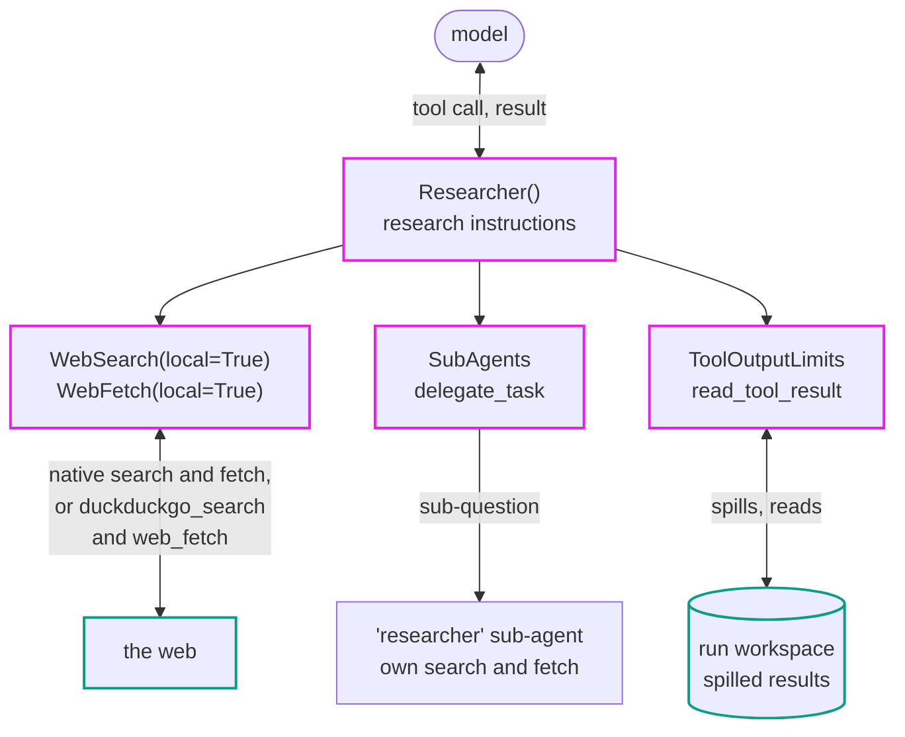

# Researcher

`Researcher` gives a Pydantic AI agent a compact stack for broad web research with source-backed answers.
It is a regular [combined capability](https://pydantic.dev/docs/ai/capabilities/custom/#composition-and-middleware-semantics) made from the [capabilities](https://pydantic.dev/docs/ai/capabilities/overview/) below, so you can use it as-is or take it apart.

> While Pydantic AI Harness is on 0.x releases, the API may change between minor releases; when it does, deprecation warnings and release-note migration guidance tell you (or your agent) exactly how to upgrade. See the [version policy](index.md#version-policy).



## Usage

Install the local search and fetch fallbacks (DuckDuckGo search, page-to-Markdown fetching):

```bash
pip/uv-add "pydantic-ai-harness[researcher]"
```

Then ask it a question:

```python
from pydantic_ai import Agent
from pydantic_ai.capabilities import LocalWorkspace
from pydantic_ai_harness import Researcher

agent = Agent('{{ openai:medium }}', capabilities=[LocalWorkspace('.'), Researcher()])

result = agent.run_sync('What changed in the last three major releases of Django?')
print(result.output)
```

The same agent works with every Pydantic AI interface: [`agent.to_cli_sync()`](https://pydantic.dev/docs/ai/cli/) for terminal chat, [`agent.to_web()`](https://pydantic.dev/docs/ai/web/) for a browser chat UI.
It works under [durable execution](../workspace.md#durable-execution) too: pass `Researcher()` next to `TemporalDurability()`, `DBOSDurability()`, or `PrefectDurability()` when you construct the agent, and keep the workspace attached for its tool-result spills.

Or skip the file entirely and run the exported [`researcher_agent`](#api-reference) with [`clai`](https://pydantic.dev/docs/ai/cli/#custom-agents) (the Pydantic AI CLI), via [`uvx`](https://docs.astral.sh/uv/guides/tools/):

```bash
uvx --with 'pydantic-ai-harness[researcher]' clai -a pydantic_ai_harness.researcher:researcher_agent -m {{ openai:medium }}
```

## What's inside

It combines these capabilities, in order:

- Concise default research instructions: see [Instructions](#instructions) below
- Core [`WebSearch(local=True)`](https://pydantic.dev/docs/ai/capabilities/web-search/): the provider's native web search when the model supports it, with a local DuckDuckGo fallback when it doesn't
- Core [`WebFetch(local=True)`](https://pydantic.dev/docs/ai/capabilities/web-fetch/): read the pages behind the results, native where supported with a local fallback, so claims can be checked against their sources
- [`SubAgents`](subagents.md): delegation, with a focused web `researcher` sub-agent by default
- [`ToolOutputLimits`](tool-output-limits.md): bounds how much context any single tool result can consume, spilling oversized results to files in the run's workspace

Pass `subagents=[]` to disable delegation, or supply your own `SubAgent` entries.

Oversized tool results are stored in the run's [workspace](https://pydantic.dev/docs/ai/core-concepts/workspace/), under `.pydantic-ai-harness/tool-output/` (git-ignored), so a run without one fails at its start. `LocalWorkspace('.')` keeps them in the current directory and a sandbox capability keeps them in the sandbox. To run without a workspace, pass `Researcher(store=LocalFileOverflowStore())`; spills then stay on the machine running the agent, including for its default delegate. A custom delegate needs its own store configured.

### Instructions

`Researcher` comes with short default research instructions (`DEFAULT_RESEARCHER_INSTRUCTIONS`, written out in full in the [blown-out equivalent](#blown-out-equivalent) below). Pass `instructions='...'` to replace them with your own, or `instructions=None` to get only the abilities, with no default instructions at all.

### Extending it

- **Research in a specific format**: give the agent a typed [`output_type`](https://pydantic.dev/docs/ai/output/): a Pydantic model of findings, each with its source link, and the researcher returns structured data instead of prose.
- **Exa search**: swap in [`Exa Search`](exa-search.md) as the search backend.
- **Fan out**: add [`Dynamic Workflow`](dynamic-workflow.md) so the agent can spawn typed researcher sub-agents in parallel and combine their structured results.

## Blown-out equivalent

<!-- Keep this in sync with pydantic_ai_harness/researcher; it intentionally shows the complete picture. -->

```python
from pydantic_ai import Agent
from pydantic_ai.capabilities import LocalWorkspace, WebFetch, WebSearch
from pydantic_ai_harness import SubAgent, SubAgents, ToolOutputLimits

instructions = """\
Search broadly before drawing conclusions.
Read the sources that support each important claim.
Prefer primary and authoritative sources.
Cite every factual claim with a direct source link.
Distinguish sourced facts from your own inference.
"""

sub_researcher = SubAgent(
    Agent(
        name='researcher',
        description='Research a focused sub-question on the web and report back with findings and source links',
        capabilities=[WebSearch(local=True), WebFetch(local=True), ToolOutputLimits()],
    )
)

agent = Agent(
    '{{ openai:medium }}',
    instructions=instructions,
    capabilities=[
        LocalWorkspace('.'),  # where oversized tool results are spilled
        WebSearch(local=True),  # native provider search, DuckDuckGo fallback on models without it
        WebFetch(local=True),  # read the pages behind the results, native or local
        SubAgents(agents=[sub_researcher], agent_folders=None),
        ToolOutputLimits(),  # spills oversized results to the workspace
    ],
)
```

See the [source](https://github.com/pydantic/pydantic-ai/tree/main/src/pydantic_ai_harness/pydantic_ai_harness/researcher/).

## API reference

::: pydantic_ai_harness.researcher.Researcher

::: pydantic_ai_harness.researcher.researcher_agent
