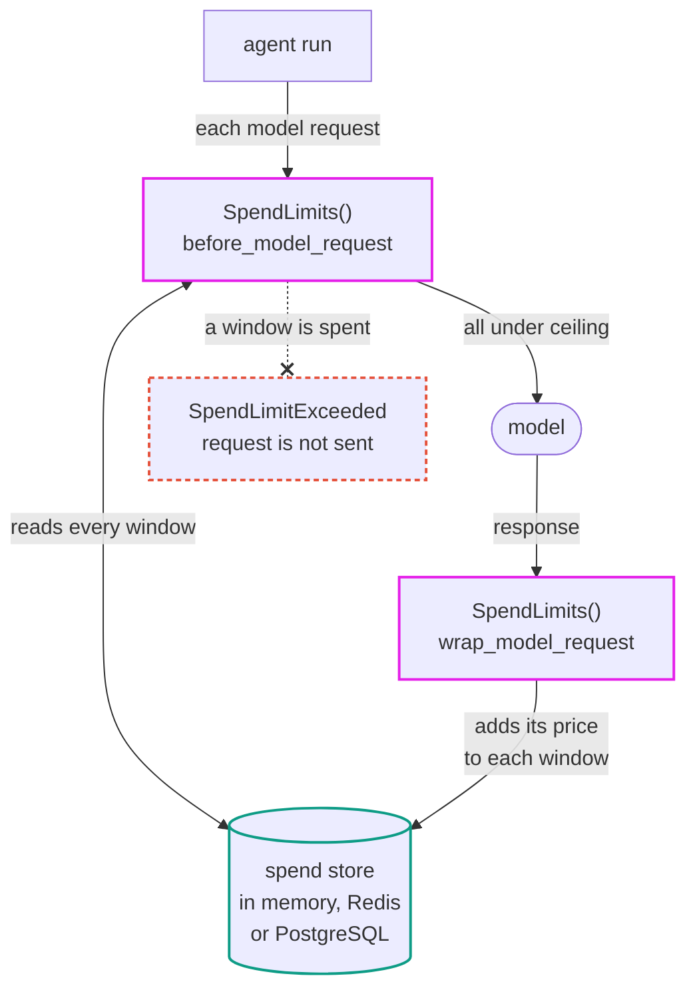

# Spend

Track what an agent costs, and stop it when a budget is gone.



> While Pydantic AI Harness is on 0.x releases, the API may change between minor releases; when it does, deprecation warnings and release-note migration guidance tell you (or your agent) exactly how to upgrade. See the [version policy](index.md#version-policy).

## The problem

A loop that calls a model until a condition it never reaches keeps calling until something stops it. Pydantic AI's `UsageLimits` caps tokens, requests and cost for a single `run()`. It does not cover a period longer than one run, a per-tenant share of an allowance, or a counter that several worker processes share: with a daily ceiling spread across a queue's workers, each worker sees only its own spend.

Provider usage APIs aggregate usage after the fact and are read by polling, so they reflect requests only once those have been made. That is enough to reconcile a bill, not to refuse the next request of a runaway loop.

## The solution

`SpendLimits` adds each response's price to every configured window and refuses the next request once a window is spent. When `price` is unset or returns `None`, complete responses are priced with [`ModelResponse.cost()`][pydantic_ai.messages.ModelResponse.cost], while responses with omitted usage contribute any known `response.usage.cost` subtotal.

```python
from decimal import Decimal

from pydantic_ai import Agent
from pydantic_ai_harness import SpendLimits
from pydantic_ai_harness.spend_limits import Budget

agent = Agent(
    '{{ openai:medium }}',
    capabilities=[SpendLimits(budgets=[Budget(usd=Decimal('100'), window='day')])],
)
```

Past $100 in a UTC day, the next request raises `SpendLimitExceeded`.

## Budgets

A budget is a ceiling, a period, and optionally a partition. They compose, so several apply at once:

```python
from decimal import Decimal

from pydantic_ai_harness import SpendLimits
from pydantic_ai_harness.spend_limits import Budget

SpendLimits(
    budgets=[
        Budget(usd=Decimal('5'), window='run'),  # one runaway run
        Budget(usd=Decimal('100'), window='day'),  # the whole deployment, per day
        Budget(usd=Decimal('2000'), window='month', warn_at=0.8),
        Budget(usd=Decimal('10'), window='day', scope=lambda ctx: ctx.deps.tenant_id, name='tenant'),
    ]
)
```

| Field | Meaning |
|---|---|
| `usd` / `tokens` | ceilings; set either, both, or neither |
| `window` | `run`, `conversation`, `day`, `month`, `total` |
| `scope` | derives a partition key from the run, so tenants count separately; typed against the agent's `deps` |
| `warn_at` | fraction past which `BudgetStatus.warning` is set; never blocks |
| `name` | distinguishes budgets sharing a window and scope |
| `retain` | how long the counter is kept after its last write; `'window default'`, `'forever'`, or a `timedelta` |

A window rolls over by producing a different store key rather than by resetting a counter, so a new day is a new key and nothing has to run at midnight. A `total` counter never expires. `run` and `conversation` buckets never roll over either, so expiry there hands back the ceiling rather than starting a new period -- but each mints a key per run or per conversation, so they carry a long horizon (24 hours and 30 days) instead, past which the counter is dropped rather than kept forever. A conversation resumed past its horizon therefore starts from zero again, so set `retain='forever'` where a conversation ceiling has to hold for as long as the conversation does, and clean the keys up some other way.

Budgets that share a `name`, `window`, and `scope` share one counter, which is how a single window carries both a USD and a token ceiling. The response is added to that counter once, not once per budget. Two budgets that share a `name` and `window` but declare *different* `scope` callables are refused at construction: they are different dimensions -- per tenant and per user, say -- and nothing stops the two returning the same string, which would merge them into one counter. Give them different names, or pass the same callable to both. Budgets that do share a counter must also agree on `retain`: one counter has one expiry, and the accrual writes whichever of them is listed first, so disagreeing would let declaration order decide when a `'forever'` ceiling rolls over.

`Budget` is generic in the agent's dependency type, so a `scope` is checked against it: pass the capability to an `Agent` with a `deps_type` and a scope reaching for a field those deps do not have is a type error rather than an `AttributeError` on the first request.

A budget with no ceiling is a counter. It accumulates and reports and never refuses anything, which is how per-tenant accounting with no cap is expressed:

```python
from pydantic_ai_harness import SpendLimits
from pydantic_ai_harness.spend_limits import Budget

SpendLimits(budgets=[Budget(window='month', scope=lambda ctx: ctx.deps.tenant_id, name='chargeback')])
```

## What the gate guarantees

Once a recorded response spends a window, `SpendLimits` refuses the next request.

Not: that spend stays under the ceiling. The request that crosses the line completes, and concurrent runs can each pass the check before any of them records anything. A stream the caller stops part-way is charged for the usage the provider had reported by then, which can fall short of what it bills, since many providers report output tokens only with a stream's last event. Reconcile against the provider's own numbers when you need exact totals.

## Reading the numbers

```python
from decimal import Decimal

from pydantic_ai import Agent
from pydantic_ai_harness import SpendLimits
from pydantic_ai_harness.spend_limits import Budget, SpendRecordedEvent

limits = SpendLimits(budgets=[Budget(usd=Decimal('100'))])
agent = Agent('{{ anthropic:medium }}', capabilities=[limits])

@agent.on_event(SpendRecordedEvent)
async def show(ctx, event):
    print(f'{event.model} cost ${event.usd}')
```

`SpendRecordedEvent` is emitted after each response `SpendLimits` records, including one that `on_unpriced='raise'` is about to reject. Its flat payload carries the response usage and serializable budget readings. A response a `FallbackModel` rejected is recorded too (see [Composition](#composition)), so it gets its own event and `on_spend` call, carrying that attempt's model and usage, and its event has `failed_attempt` set to `True`. Under durable execution, orchestration can deliver it again even though the journaled accrual ran only once, so keep a listener that writes an audit record or emits a billing event idempotent.

Migration: `on_spend` remains supported but is deprecated. Move its callback body to a `SpendRecordedEvent` subscription; the same idempotency requirement applies to it.

`status()` reads the same numbers without a run, which is what a cost display in a UI wants:

```python {names="defined"}
from pydantic_ai_harness import SpendLimits


async def report(limits: SpendLimits[None]) -> None:
    for status in await limits.status(scope='acme'):
        print(status.budget.name, status.spent.usd, status.exhausted)
```

Without a run context, budgets on a `run` or `conversation` window are omitted, and so is a budget declaring a `scope` unless `scope=` names the partition to read. Pass `ctx` inside a run and every budget resolves.

Set `expose_tools=True` to give the agent a `get_spend` tool. It is off by default: a tool costs schema tokens on every request, and most applications want the number on a screen rather than in the model's context.

## Reacting to a threshold

Spend events are reporting signals, not approval points: they can follow the response carrying the final answer.

The seam that runs before a request rather than after a response is `before_model_request`. A small capability of your own can read `status(ctx)` there and hold the run until someone decides:

```python {names="defined"}
import asyncio
from dataclasses import dataclass
from decimal import Decimal

from pydantic_ai import Agent
from pydantic_ai.capabilities import AbstractCapability
from pydantic_ai.models import ModelRequestContext
from pydantic_ai.tools import RunContext

from pydantic_ai_harness import SpendLimits
from pydantic_ai_harness.spend_limits import Budget

limits = SpendLimits[None](budgets=[Budget(usd=Decimal('100'), warn_at=0.8)])
approvals: asyncio.Queue[bool] = asyncio.Queue()


@dataclass
class ApproveBeforeSpending(AbstractCapability[None]):
    async def before_model_request(
        self, ctx: RunContext[None], request_context: ModelRequestContext
    ) -> ModelRequestContext:
        if any(status.warning for status in await limits.status(ctx)) and not await approvals.get():
            raise RuntimeError('spending past the warning threshold was not approved')
        return request_context


agent = Agent('{{ openai:medium }}', deps_type=type(None), capabilities=[limits, ApproveBeforeSpending()])
```

The gate reads numbers `SpendLimits` has already accrued, because the previous response was counted inside `wrap_model_request` before this request was prepared. It gates the first request of a run too, which is what carries a threshold crossed by an earlier run into the next one. A capability listed after it can still skip the request with `SkipModelRequest`, so an approval taken here is not proof that a request followed.

That pause holds a coroutine, so it lasts as long as the process does and no longer. To pause across processes, gate the spending at a tool call instead: [deferred tool calls](../deferred-tools.md) end the run with a serializable request for approval, and a later run resumes it with the deferred tool results. Or stop the run and resume it later from its message history, as described below.

For a ceiling that expands rather than stops, `budgets` is read fresh on every request, so replacing it after a refusal lets the work continue against the larger ceiling. The counter is keyed on `name`, `window`, `scope` and the period the window is currently in, never on the ceiling, so what is already spent carries over.

A refusal can land mid-run, after tool calls have already run and been paid for. Re-running the original prompt would repeat that work and any side effects it had, so resume from what the refused run produced instead: `capture_run_messages` holds the partial history, and a run given that history and no new prompt continues from the request that was refused.

```python {names="defined"}
import dataclasses
from decimal import Decimal

from pydantic_ai import Agent, capture_run_messages

from pydantic_ai_harness import SpendLimits
from pydantic_ai_harness.spend_limits import Budget, SpendLimitExceeded

limits = SpendLimits[None](budgets=[Budget(usd=Decimal('1'), name='daily')])
agent = Agent('{{ openai:medium }}', deps_type=type(None), capabilities=[limits])


async def ask(prompt: str, ceiling: Decimal) -> str:
    with capture_run_messages() as messages:
        try:
            return (await agent.run(prompt)).output
        except SpendLimitExceeded:
            (budget,) = limits.budgets
            limits.budgets = [dataclasses.replace(budget, usd=ceiling)]
            resumable = list(messages)
    return (await agent.run(message_history=resumable)).output
```

Assigning `budgets` does not repeat the checks the constructor runs over budget combinations, so keep a replacement to the same names, windows, and scopes. It also raises the ceiling for every run sharing this `SpendLimits`, not just the one that was refused, and nothing lowers it again.

## Sharing a counter across processes

The default store keeps counters in the process, which catches a runaway loop inside one worker and does nothing for a budget spread across a queue. `RedisSpendStore` is the shared counter for Redis, and `PostgresSpendStore`, below, the one for PostgreSQL:

```python
from decimal import Decimal

from redis.asyncio import Redis

from pydantic_ai_harness import SpendLimits
from pydantic_ai_harness.spend_limits import Budget, RedisSpendStore

store = RedisSpendStore(Redis.from_url('redis://localhost'))
limits = SpendLimits(budgets=[Budget(usd=Decimal('100'), window='day')], store=store)
```

It adds no dependency: `RedisClient` is a protocol of the two coroutines used, so any compatible client satisfies it. Amounts are stored as integer billionths of a dollar rather than through `INCRBYFLOAT`, which accumulates rounding error over the tens of thousands of requests a busy day produces. Billionths rather than millionths because the residue does not average out: an agent repeats requests of near-identical shape, so the same fraction rounds the same way every time.

Every window a response counts against is applied as one Lua script, so no other client sees the response part-applied: not across the four counters of one window, and not across the windows themselves. A response counting against a day budget and a month budget is one script rather than two, so there is no failure between them to leave the day counted and the month not. The one exception is the overflow below: it aborts the script where it happens and leaves the windows already applied, which takes a counter near $9.22 billion to reach. Each key also costs a second read for as long as the compatibility fallback below is in place.

A failure *after* the server has run a script does not say whether it committed -- the connection can drop once `EVAL` has landed -- so a write that errors leaves the outcome unknown rather than untried. Nothing retries it.

The counters do not round. `HINCRBY` is 64-bit integer arithmetic and takes its increment as a string. Totals are read back with `HMGET` as bulk strings, not as the integer replies `HINCRBY` returns, which Lua converts to doubles that would round a total past `2**53` billionths. Redis refuses a write that would take a counter past the signed 64-bit range, around $9.22 billion against a single key.

Keys are `{prefix}:budget-key`, with literal braces around the prefix. That is a Redis Cluster hash tag: every key of one store maps to the same slot, which lets one script update several of them, and a cluster cannot spread a store's keys across its nodes. A `prefix` that is empty or contains a brace is refused at construction, since either breaks the tag. `BudgetStatus.key` reports the budget key without the prefix. The dedup markers below share that namespace, so a key beginning `dedup|` is refused: it would name a marker, and the counter would fail with `WRONGTYPE`. No budget produces such a key, so this only affects a caller driving the store directly.

A counter written by an earlier release, under the untagged name, is read alongside the tagged one and added to it, so an upgrade needs no migration step. It is added rather than moved because a worker still on the old release can write to the old name at any point in a rolling deploy. This costs one extra read per key, on reads and writes alike.

The compatibility runs one way only:

- A rolling deploy under-counts while it lasts. A worker still on the old release reads only the untagged name, so it admits requests against a total missing what upgraded workers wrote. Keep the deploy short.
- A downgrade loses the tagged counter, because this release never writes the old name. Treat a downgrade as a reset rather than a rollback.
- The old key's expiry stays at whatever the last old-release write set. Nothing refreshes it, so when it expires the total drops by what it held.

The fallback goes away in 0.28.0. A counter still under the old name stops being counted then, so move a window set to `retain='forever'`, or one whose horizon outlasts the gap between the two releases, by hand before then.

`add_many` carries a token identifying the response, and `RedisSpendStore` reads a marker for it before the increments and writes it after them, inside the same script. `PostgresSpendStore` claims a marker row in the same transaction as the increments. `InMemorySpendStore` remembers the same tokens under its lock, so the default store behaves the same way while its process survives. The token combines the run id and step with a digest of replay-stable response content, usage, and provider identity; it excludes clock-derived and arbitrary provider bookkeeping. The token layer protects recovery that presents an entry without consulting the journal only when the caller supplies the same `run_id` to `Agent.run` on the original run and its recovery. When `run_id` is omitted, Pydantic AI creates a fresh one and the store cannot recognise the entry. Ordinary durable replay remains protected by the journaled `_accrue` operation regardless. Markers are held for `dedup_retain`, a constructor argument on every bundled store, an hour by default, or for the window's own horizon where that is shorter, and cost one small key or row per response per window. That horizon is the window in which recovery outside the durable journal is recognised, not the counter's lifetime: a response presented again later is counted again, so the error is an over-count rather than an under-count. Set `dedup_retain=None` to hold no markers and apply every entry, which also gives up that store-side protection. Recognition starts at the upgrade either way: a response an earlier release counted left no marker behind, so presenting that response again counts it again.

`PostgresSpendStore` keeps the counters in PostgreSQL, for a deployment that already runs it -- alongside a Postgres-backed durable execution engine, for example -- and would rather not add Redis for this:

```python {names="defined" typecheck="skip - asyncpg's pooled connections are untyped proxies, see #10853"}
from decimal import Decimal

import asyncpg

from pydantic_ai_harness import SpendLimits
from pydantic_ai_harness.spend_limits import Budget, PostgresSpendStore


async def build_limits() -> tuple[SpendLimits[None], asyncpg.Pool]:
    pool = await asyncpg.create_pool('postgres://localhost/app')
    limits = SpendLimits(budgets=[Budget(usd=Decimal('100'), window='day')], store=PostgresSpendStore(pool))
    return limits, pool
```

Call `build_limits` during application startup and close the returned pool during shutdown; the store does not manage it. The store accepts the driver-neutral `PostgresPool` protocol from `pydantic_ai_harness.media`, which an `asyncpg` pool satisfies, so the harness adds no driver dependency. Install the driver in your application:

```bash
pip/uv-add asyncpg
```

The store creates two tables on first use: `{table}_counters`, one row per window, and `{table}_dedup`, one row per remembered token and window. Both are keyed by a SHA-256 digest of the budget key (and token), so a caller-supplied conversation or run id of any length fits the index. The counters table also keeps the key itself as UTF-8 in a `BYTEA` column, because `TEXT` cannot hold the NUL character a caller-supplied id might carry. `table` defaults to `'spend'` and must be lowercase letters, digits and underscores, start with a letter or underscore, and be at most 47 characters, so every derived name fits PostgreSQL's 63-byte identifier limit. On its first call, each store instance checks for both tables and, if either is missing, creates them with `CREATE TABLE IF NOT EXISTS` under `pg_advisory_xact_lock`, so workers that start together do not collide. Only that creation needs `CREATE` on the schema: once the tables exist, a role granted `SELECT`, `INSERT`, `UPDATE` and `DELETE` on them is enough. There is no migration step: an existing table of either name with a different layout is left as it is and the first call fails on a missing column, so pass `table=` when the database already has one. Amounts are integer billionths in a `BIGINT`, the same unit and range as `RedisSpendStore`, and the server refuses a counter passing the signed 64-bit range.

Every window a response counts against is applied in one transaction together with its dedup markers, so a failure anywhere, that overflow included, rolls back the whole response, and a marker claimed for a write that then failed is rolled back with it. A concurrent replay of the same token waits on the first transaction's marker and skips once that commits. That wait is `READ COMMITTED` behavior, so the write sets that isolation level itself rather than inheriting a stricter pool default, under which a concurrent writer would fail with a serialization error. Every marker is claimed before any counter is written, each in a fixed order, so two transactions taking the same rows wait on each other rather than deadlock. As with Redis, a connection that drops after the commit was sent leaves the outcome unknown, and nothing retries it.

Horizons are measured on the server's clock, as Redis measures expiry on its own, so every worker agrees on when a window rolls over. A new horizon runs from the moment its row is written (`clock_timestamp()`), so a write that waited on another transaction's lock still gets its full `ttl`. A rolled-over window reads as zero and starts again on its next write. Rows are not removed at their horizon the way Redis expires keys. Instead, every `sweep_every` entries it writes (256 by default), a store instance deletes the counters and markers past their horizons, after the write has committed and skipping rows another transaction holds. A sweep that fails is logged as a warning rather than raised, since the response it follows is already counted, and the next one runs `sweep_every` entries later. The count is held in memory per store instance, so a process that writes fewer than `sweep_every` entries before it exits never sweeps; lower `sweep_every` there, or delete rows whose `expires_at` has passed on a schedule of your own. `dedup_retain`, and an entry's `ttl` when you drive the store yourself, must be positive or `None`: a zero horizon would write rows that have already expired.

The default store is built per capability, so two `SpendLimits` instances do not share one counter. Pass the same store object to both when you want them to. `InMemorySpendStore` cannot survive worker replacement: a replacement process has neither the counters nor the deduplication markers accumulated by the first one. Use a shared store for durable workflows that can recover on another worker.

Store errors are not swallowed. An error reading the counter refuses the request, which is the safe direction. An error writing it propagates out of the run after the model has already answered and been charged. A swallowed write would leave the counter low and let requests through that should be refused. If your deployment would rather keep the answer than the count, wrap the store and decide there.

Any object with `get_many` and `add_many` works, so a DynamoDB counter is a small class rather than a fork. Four obligations come with writing one. Return a total for every key you were handed, keyed by `SpendEntry.key`, including one you skipped as a replay. A missing total raises `UserError`, which names either this store contract or a non-deterministic scope during durable replay as the cause. Read a key that was never written as zero rather than leaving it out. Skip an entry whose `token` has already been applied to that key, or recovery outside the durable journal can count one response twice. And apply the whole call or none of it -- the guarantee at the top of this section is only as good as the backend behind it, and a store that commits each entry as it goes puts back the split write this seam exists to remove. Neither method is ever handed an empty sequence, so there is no such case to answer for.

`SpendStore`, the single-key `get` and `add` pair released in 0.17.0, is deprecated: a store of that shape still works, driven one window per call, and emits one `HarnessDeprecationWarning` when the `SpendLimits` holding it is constructed. The warning names both losses: windows are applied one at a time, and the token has nowhere to go. A durable journal still prevents duplicate execution while its record is available, but recovery that cannot consult that journal has no store-side deduplication. The single-key `get` and `add` on `InMemorySpendStore` and `RedisSpendStore` are deprecated too. A direct call to either does not warn, so this is the notice; reach for `get_many` and `add_many` instead. A subclass that *overrode* one of them without also overriding the batch pair is warned when the store itself is constructed, because that case loses behavior rather than just naming a deprecated method: `SpendLimits` drives `get_many` and `add_many`, so an override on `get` or `add` is never called and whatever it added -- an audit, a mirrored write -- stops happening. Move it onto `get_many` or `add_many`, which is also what makes the warning stop.

## Pricing

When `price` is unset or returns `None`, complete responses are priced per response with [genai-prices](https://github.com/pydantic/genai-prices) via `ModelResponse.cost()`. For a response with omitted usage, `SpendLimits` records any known `response.usage.cost` subtotal instead. Cache and tier pricing are per request, so summing usage across requests and pricing the total gives the wrong number.

A model the registry does not know -- a local deployment, a negotiated rate -- is handled by `price`:

```python
from decimal import Decimal

from pydantic_ai_harness import SpendLimits

SpendLimits(price=lambda response: Decimal('0.002') if response.model_name == 'internal-7b' else None)
```

An amount returned by `price` must be finite and not negative. Anything else -- a credit, a `NaN`, an infinity -- fails the run with `UserError`, because a credit moves a budget away from its ceiling and the other two are a broken pricing function rather than a price. An exception raised by `price` is reported through the same `UserError` path. The response is still recorded first: it was billed by the provider whatever the function returned, so its tokens and request count are accrued and `on_spend` fires before the error is raised. When one lifecycle committed several provider responses, an error pricing or reporting one response is deferred until the remaining responses accrue.

Under durable execution, `price` and each budget's `scope` callable must be deterministic for the same response and run context. Pricing runs in orchestration outside the journaled accrual, so a changed result can make `on_spend` disagree with the recorded counter or turn a successful recovery into a pricing error. A changed scope selects a different store key from the one in the recorded accrual; `SpendLimits` reports that mismatch as a `UserError` naming the determinism requirement.

`SpendLimits` calls `price` first. A finite, non-negative amount it returns is treated as the complete response price, including when usage is incomplete. Returning `None` falls through to the registry. When usage is incomplete, the registry can still supply a known cost subtotal, which `SpendLimits` records, but the response remains unpriced because its full cost is unknown. The `on_unpriced` policy still applies: `'zero'` (the default) increments `Spent.unpriced_requests` and continues with the known subtotal, while `'raise'` records the subtotal and fails the run with `UnpricedModelError`. Known token totals for incomplete usage are lower bounds. With `'zero'` and a `usd` budget, `UnpricedModelWarning` is emitted once per model when no complete price is available. If callers choose the model, prefer `'raise'` or supply `price`.

When a response omits usage and a token budget is configured, `SpendLimits` emits
`UsageLimitUnavailableWarning` if the run can continue. Known token totals are lower
bounds, even when a custom `price` supplies the complete cost. Check the provider usage
reporting or promote the warning to an error to stop when the token ceiling cannot be verified.

## Composition

State lives across runs deliberately, so `for_run` is not overridden: a daily budget that reset every run would not be a daily budget. Per-run isolation comes from `Budget(window='run')`, whose key carries the run id.

`defer_loading=True` is refused. A deferred capability's hooks do not run until the model loads it, so an exhausted budget would not stop a request and the requests made meanwhile would go uncounted.

`SpendLimits` accrues every response the provider billed, even one that a hook nested inside it rejects or replaces, so where you list it among other capabilities doesn't change what it counts. Core merges a continuation chain (Anthropic `pause_turn`, OpenAI background mode) into one response, so `on_spend` and `SpendRecordedEvent` report it once with its combined usage. The counters are updated at each segment boundary instead, by what the response merged so far adds over what is already applied, so `price` also sees each of those intermediate responses. One it cannot price adds no USD and the merged response catches up, so pricing errors and `on_unpriced` apply to the merged response alone. Tokens add up to the merged response, and USD to the highest amount any boundary was priced at, so a boundary priced above the merged response is not taken back as a credit. A later boundary that adds nothing, such as an idle background poll, is not written. A run that resumes a turn from a message history ending in its `'suspended'` response is charged only for what was billed beyond that response, which the run that left it suspended was already charged for. A `run` window therefore holds what each run billed, and `conversation`, `day`, `month` and `total` windows hold what the provider billed for the turn once.

A response a `FallbackModel` rejected with a `fallback_on` response handler was billed as well. Each one recorded in `ModelResponse.failed_attempts` is accrued as a request of its own, ahead of the response that carries it. When every model fails, the attempts on the `FallbackExceptionGroup` are accrued the same way, also when an error hook recovers from it. A response the [`ModelFallback`](../capabilities/model-fallback.md) capability rejected is accrued as a failed attempt too, with its parts and `provider_url`. An attempt that raised before the provider answered reported no usage and is not charged. `Spent.requests` counts these attempts, where core's `RunUsage.requests` counts only the responses the agent acted on.

`price` receives an attempt a `FallbackModel` recorded as a `ModelResponse` with the attempt's model, provider, usage and timestamp, but no parts and no `provider_url`. A `price` that reads the output or keys on the endpoint has to allow for that. When `price` returns `None`, the cost core recorded on the attempt is used. If that cost is negative or not finite, the registry prices the attempt instead.

A cached response, or one supplied with `SkipModelRequest`, never reached the provider and is not charged.

**Durable execution.** `SpendLimits` supports Pydantic AI durability capabilities. Its clock read, counter read, and accrual are separate durable operations. Temporal therefore reads the clock in an activity rather than workflow orchestration, and DBOS or Prefect record the same boundary in their own durable units. On replay, the engine returns each operation's recorded result without reading the clock or store again. The response is accrued once, and the window key comes from the original recorded clock value. When a continuation chain fails partway, retrying the run replays the segments it completed together with whatever the failed attempt accrued for them, so only the segments the retry newly requests reach the store. A `FallbackModel` runs its whole chain inside one durable unit, and its `FallbackExceptionGroup` does not cross the durable execution boundary, so under a durability capability only the rejected attempts a `FallbackModel` recorded on a response are charged. The `ModelFallback` capability makes each attempt a durable model operation of its own and records the responses it rejects on the workflow side, so they are charged as without durable execution.

Attach the durability capability to the same agent as `SpendLimits`. Running a `SpendLimits` agent directly inside a Temporal workflow without `TemporalDurability` leaves the clock read in workflow orchestration; the sandbox error is translated into advice to attach durability.

The journal covers replay while its records are available. Store-side idempotency covers a different recovery path: one that presents the same `SpendEntry` without consulting the recorded accrual. A `BatchSpendStore` uses the replay-stable token to apply that entry once within `dedup_retain`. A deprecated `SpendStore` drops the token and warns, so it cannot provide this second layer. `InMemorySpendStore` can deduplicate only while recovery reaches the same process. Use a shared `BatchSpendStore`, such as `RedisSpendStore` or `PostgresSpendStore`, when recovery can land on another worker.

`exhausted()` remains useful as a workflow admission check without a `RunContext`:

```python {names="defined"}
from collections.abc import Awaitable, Callable

from pydantic_ai_harness import SpendLimits


async def start_if_funded(
    limits: SpendLimits[None], tenant_id: str, start_workflow: Callable[[], Awaitable[object]]
) -> None:
    if await limits.exhausted(scope=tenant_id):
        raise RuntimeError('daily budget exhausted')
    await start_workflow()
```

Use `exhausted` rather than `any(s.exhausted for s in await limits.status(...))`. `status` omits the budgets it cannot resolve, so with every budget scoped and no `scope` given, the `any()` returns `False` without checking anything. `exhausted` raises instead, naming the budgets that need a `scope` or a run context.

The call only admits: it reserves nothing. The durable operations then account for the workflow's model responses.

For a ceiling that covers one run and nothing else, Pydantic AI's own [`UsageLimits`](../agent.md#usage-limits) does the job in-process with no store, and adds input-token limits (cumulative and per request) that `SpendLimits` has no equivalent for. Use `Budget(tokens=..., window='run')` when the same configuration also needs a window longer than one run, a tenant scope, or a counter shared between processes.

## Tracing

A refusal emits a `spend budget exhausted` span with `spend.budget` and `spend.window`. Accrual emits nothing: a span per model request would double the size of a trace without adding a decision. `spend.scope` is attached only when `RunContext.trace_include_content` is set, since a scope key is usually a tenant or user id and a trace has a wider audience than the application that produced it.

## Specs

`Agent.from_spec` supports the part of the configuration a spec can express:

```yaml
- SpendLimits:
    budgets:
      - {usd: '100', window: day}
      - {usd: '2000', window: month, warn_at: 0.8}
    on_unpriced: raise
```

`store`, `price`, `on_spend`, `clock`, and a budget's `scope` take callables or live objects. A spec naming them is rejected rather than ignored.

The fields above are what `SpendLimits.from_spec` names in its signature, which is also what Pydantic AI reads to generate the spec's JSON schema -- so an editor following the `$schema` line completes and validates them. `BudgetSpec` is the entry shape, exported for anyone building a spec in code.

Source: [`pydantic_ai_harness/spend_limits/`](https://github.com/pydantic/pydantic-ai/tree/main/src/pydantic_ai_harness/pydantic_ai_harness/spend_limits/).

## API reference

::: pydantic_ai_harness.spend_limits.SpendLimits

::: pydantic_ai_harness.spend_limits.Budget

::: pydantic_ai_harness.spend_limits.SpendSnapshot

::: pydantic_ai_harness.spend_limits.BudgetStatus

::: pydantic_ai_harness.spend_limits.Spent

::: pydantic_ai_harness.spend_limits.BatchSpendStore

::: pydantic_ai_harness.spend_limits.SpendEntry

::: pydantic_ai_harness.spend_limits.SpendStore

::: pydantic_ai_harness.spend_limits.InMemorySpendStore

::: pydantic_ai_harness.spend_limits.RedisSpendStore

::: pydantic_ai_harness.spend_limits.PostgresSpendStore

::: pydantic_ai_harness.spend_limits.SpendLimitExceeded

::: pydantic_ai_harness.spend_limits.UnpricedModelError

::: pydantic_ai_harness.spend_limits.UnpricedModelWarning
