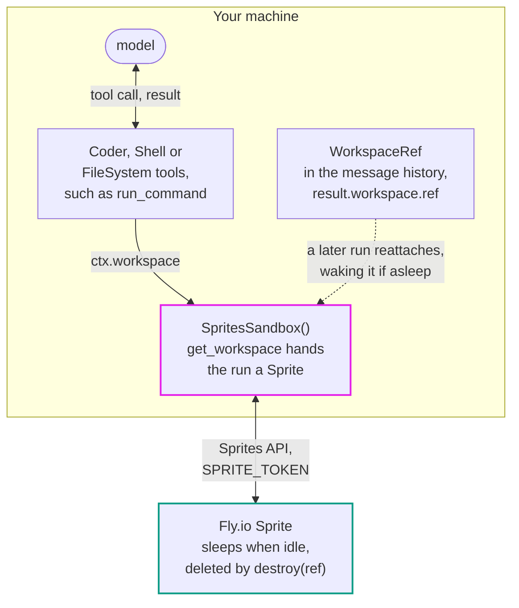

# Sprites Sandbox

Run your agent's commands and file edits in a persistent [Fly.io Sprite](https://sprites.dev) instead of on your machine.

[Source](https://github.com/pydantic/pydantic-ai/tree/main/src/pydantic_ai_harness/pydantic_ai_harness/sprites_sandbox/)

> While Pydantic AI Harness is on 0.x releases, the API may change between minor releases; when it does, deprecation warnings and release-note migration guidance tell you (or your agent) exactly how to upgrade. See the [version policy](index.md#version-policy).



## Install

```bash
pip/uv-add "pydantic-ai-harness[coder,sprites,anthropic]"
```

Set `SPRITE_TOKEN` to your Sprites API token. The examples also use `Coder` and an Anthropic model, hence the `coder` and `anthropic` extras and `ANTHROPIC_API_KEY`; swap them for your own tools and model provider.

## Quick start

```python {names="defined"}
from pydantic_ai import Agent
from pydantic_ai_harness.coder import Coder
from pydantic_ai_harness.sprites_sandbox import SpritesSandbox

agent = Agent('{{ anthropic:large }}', capabilities=[SpritesSandbox(), Coder()])
result = agent.run_sync('Clone https://github.com/pydantic/pydantic-ai and summarize how capabilities work.')
```

`Coder`'s shell and file tools now run in a Sprite. For a narrower agent, use [`Shell`](shell.md), [`FileSystem`](filesystem.md) or your own tools on [`ctx.workspace`](../workspace.md#using-the-workspace-in-tools).

- **It has no lifetime limit.** It sleeps when idle and keeps its files and installed packages, and costs money, until you delete it. See [Clean up](#clean-up).
- **Processes pause between commands** unless you run them as a [Sprites service](https://docs.fly.io/sprites/concepts/services/).
- **Commands run as the non-root `sprite` user in `/home/sprite`.** Pass `working_dir='/home/sprite/project'` to give the agent a project directory; it is created on a new Sprite.
- **A new Sprite has git, Python and Node.js** ([preinstalled tools](https://docs.fly.io/sprites/working-with-sprites/)), but not pytest or `rg`. Install what your project needs once and reuse the Sprite by its ref; for faster `Coder` searches, run `sudo apt-get update && sudo apt-get install ripgrep`.

## Continue in the same Sprite

Pass the message history, and the next run works in the same Sprite:

```python {names="defined"}
from pydantic_ai import Agent
from pydantic_ai_harness.coder import Coder
from pydantic_ai_harness.sprites_sandbox import SpritesSandbox

agent = Agent('{{ anthropic:large }}', capabilities=[SpritesSandbox(), Coder()])
result = agent.run_sync('Clone https://github.com/pydantic/pydantic-ai and summarize how capabilities work.')

followup = agent.run_sync(
    'Which capability would you add next, and where would it live?',
    message_history=result.all_messages(),
)
ref = result.workspace.ref  # or store this, and pass `workspace=ref` to a later run
```

If the Sprite has been deleted, the run raises `WorkspaceUnavailableError`, as does a command running when it is deleted; pass `workspace='new'` to start over. [Workspaces](../workspace.md#continuing-in-the-same-workspace) covers how runs find their workspace.

The ref holds no credentials: the process that reattaches needs `SPRITE_TOKEN` or a `client=` too.

Already have a `sprites.AsyncSprite`? Pass `workspace=SpritesSandboxBackend(sandbox=sprite, working_dir=..., env=...)` to a run; `SpritesSandbox`'s settings don't apply to it. A backend's `get_sandbox()` returns its `sprites.AsyncSprite` for Sprites features the workspace API doesn't cover; on a backend with no Sprite yet, it creates one, which Sprites bills.

## Prepare a Sprite before the run

To seed files before the agent starts, build the backend yourself, write through a `Workspace`, and pass the backend to the run:

```python {names="defined"}
from pydantic_ai import Agent
from pydantic_ai.workspaces import Workspace
from pydantic_ai_harness.coder import Coder
from pydantic_ai_harness.sprites_sandbox import SpritesSandbox, SpritesSandboxBackend

agent = Agent('{{ anthropic:large }}', capabilities=[SpritesSandbox(), Coder()])


async def run_in_prepared_sprite() -> str:
    backend = SpritesSandboxBackend(working_dir='/home/sprite/project')
    try:
        await Workspace(backend).write_text('TASK.md', 'Add a `--version` flag to cli.py.\n')
        result = await agent.run('Do the task in TASK.md.', workspace=backend)
        return result.output
    finally:
        await backend.aclose()
        ref = backend.ref  # set once the Sprite exists
        if ref is not None:
            await SpritesSandbox().destroy(ref)
```

The run leaves a backend you built open, so close it with `aclose()`; that closes the client it opened from `SPRITE_TOKEN`, not the Sprite. A `client=` or `sandbox=` you passed is never closed. To keep the Sprite, store `backend.ref` instead of destroying it.

## Clean up

Delete a Sprite with the ref you stored. This doesn't wake it:

```python {names="defined"}
from pydantic_ai.workspaces import WorkspaceRef
from pydantic_ai_harness.sprites_sandbox import SpritesSandbox


async def delete_sprite(ref: WorkspaceRef) -> None:
    await SpritesSandbox().destroy(ref)
```

A ref can name any Sprite your `SPRITE_TOKEN` reaches, and `destroy` deletes whatever it names, so keep refs on your server and only destroy Sprites you created.

A failed run returns no result, so delete its Sprite in an `on_run_error` hook:

```python
from typing import Any

import anyio

from pydantic_ai import Agent, RunContext
from pydantic_ai.capabilities import Hooks
from pydantic_ai.run import AgentRunResult
from pydantic_ai_harness.coder import Coder
from pydantic_ai_harness.sprites_sandbox import SpritesSandbox

hooks = Hooks()


@hooks.on.run_error
async def terminate_failed_run(ctx: RunContext[None], *, error: BaseException) -> AgentRunResult[Any]:
    if ctx.workspace.ref is not None:
        # Shielded so a deadline around the run can't cut the kill short, bounded so a hung call can't hang it.
        with anyio.move_on_after(30, shield=True):
            await SpritesSandbox().destroy(ctx.workspace.ref)
    raise error


agent = Agent('{{ anthropic:large }}', capabilities=[SpritesSandbox(), Coder(), hooks])
```

You pay for compute while a Sprite is active and for storage until you delete it; see [Sprite lifecycle](https://docs.sprites.dev/concepts/lifecycle/). Since a Sprite never expires, one whose ref was never stored, after a crash, Ctrl-C or a killed worker, stays until you delete it. Each new Sprite's id is logged as `Created Sprite <id>` at INFO on the `pydantic_ai_harness.sprites_sandbox._backend` logger; delete it with `await SpritesSandbox().destroy(WorkspaceRef(provider='sprites', id=...))`. If creation's reply was lost, the Sprite may not be visible to the API yet, so a failed lookup doesn't prove it was never created.

## Configuration

| Option | What it does |
| --- | --- |
| `client` | A `sprites.AsyncSpritesClient` to share across runs on one event loop, or to set its base URL or timeout. Default: `None`, a client each run opens from `SPRITE_TOKEN` and closes when it ends. You close a client you pass. |
| `runtime` | Runtime for a new Sprite. Default: `None`, Sprites' default. An unknown runtime fails on first use with `WorkspaceUnavailableError`. |
| `working_dir` | Absolute directory commands start in and relative paths resolve against. Default: `None`, `/home/sprite`. Created on a new Sprite; on an attached one it must exist. |
| `env` | Environment variables every command gets. Default: `None`; nothing from your machine reaches the Sprite. The agent's commands can read these, so leave out secrets it shouldn't see. |

`client`, `working_dir` and `env` also apply when you reattach, and `destroy` uses `client`; `runtime` only shapes a new Sprite.

## Limits

- Unix permissions don't restrict the `sprite` user: a file with mode `000` is still readable. Don't rely on them to keep tools out of a path.
- Stopping a command on a timeout or cancellation is best effort; its children may keep running. If unsure, inspect or delete the Sprite.
- A background process that keeps the command's stdout or stderr open keeps `run()` waiting. Redirect its output to a file; `Shell.start_command` does this for you.
- `timeout=None` removes the command deadline, not the Sprite's idle pause.
- The Sprites SDK needs asyncio; under Trio, every operation raises `UserError`.

## Durable execution

Add a durability capability, such as `TemporalDurability()` from the `temporal` extra, next to `SpritesSandbox()`; [Workspaces](../workspace.md#durable-execution) covers what changes. If the connection drops after a command started but before it finished, the command may have run, so it raises a non-retryable error rather than running again.

## Telemetry

`SpritesSandbox` emits no spans of its own. Core's [instrumentation](../capabilities/instrumentation.md) records `pydantic_ai.workspace.provider` and `pydantic_ai.workspace.id` on the agent run span, and each command or file operation runs inside its tool call's span.

## API reference

::: pydantic_ai_harness.sprites_sandbox.SpritesSandbox

::: pydantic_ai_harness.sprites_sandbox.SpritesSandboxBackend
