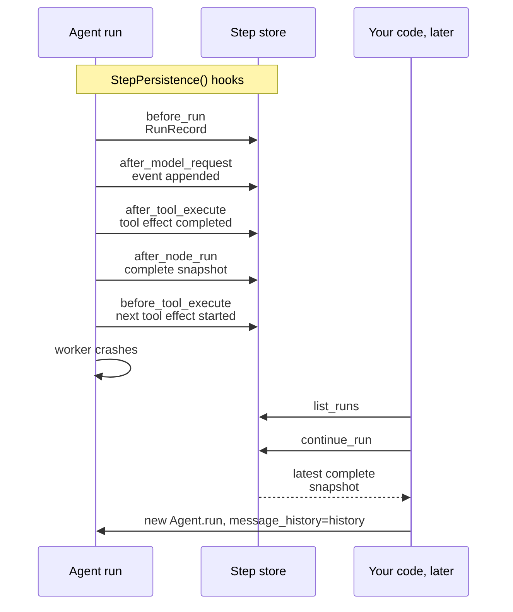

# Step Persistence

Use Step Persistence to resume an agent run or fork it from an earlier step, in the same process or another one, including after a crash, or to continue a delegate's investigation with a follow-up question. `StepPersistence` snapshots the run's message history at every settled step and on failure, to memory, files, SQLite, MongoDB, PostgreSQL, or your own store, and keeps an append-only step-event trail and a ledger of tool side effects, so after a crash you can tell which tool calls completed and which may or may not have run.

Snapshots hold only the message history. Capability state, workspace files, and resuming from the middle of a step are not covered (see `pydantic-ai-harness` issues #149 and #196). For recovery inside a step, also run the agent on [durable execution](../durable_execution/overview.md).

!!! note "Storing sessions"
    To store a chat session or any other conversation you pick up later, use core's [`ConversationStore`](../persistence.md#using-a-conversation-store): it keeps the conversation's usage and deferred tool requests along with its messages, stores each message once, and catches conflicting saves. `StepPersistence` remains supported for recovering runs: the step-event trail, the tool-effect ledger, and continuing or forking a run from a settled step. To move sessions you already stored with it, see [Moving sessions to a `ConversationStore`](#moving-sessions-to-a-conversationstore).

[Source](https://github.com/pydantic/pydantic-ai/tree/main/src/pydantic_ai_harness/pydantic_ai_harness/step_persistence/)

> While Pydantic AI Harness is on 0.x releases, the API may change between minor releases; when it does, deprecation warnings and release-note migration guidance tell you (or your agent) exactly how to upgrade. See the [version policy](index.md#version-policy).



## What it gives you

1. **Append-only step events.** Run start and end, model requests, tool calls, and failures append `StepEvent`s, so a run killed mid-tool-call still leaves a trail.
2. **Continuable snapshots.** A `ContinuableSnapshot` is saved at each settled node boundary and on failure, with `state` `complete` when every [`ToolCallPart`][pydantic_ai.messages.ToolCallPart] has a matching result and `interrupted` otherwise (for example, after a crash mid-tool-cycle). `latest_snapshot` and `continue_run` skip `interrupted` snapshots unless you pass `include_interrupted=True`. Pass `messages` to `Agent.run(message_history=...)` to continue or fork.
3. **Tool-effect ledger.** Each tool call's `started`, `completed`, or `failed` status is recorded against `(run_id, tool_call_id)`; a tool that raises, including `ModelRetry` or `ToolFailed`, is `failed`. After a crash, a `started` record with no terminal update is `unknown_after_crash`: the side effect may or may not have happened.
4. **Lineage metadata.** `conversation_id` (sequence) and `parent_run_id` (hierarchy) are independent axes; see [Three-level identity](#three-level-identity).

## Quick start

```python
import asyncio

from pydantic_ai import Agent
from pydantic_ai_harness import StepPersistence
from pydantic_ai_harness.step_persistence import InMemoryStepStore

store = InMemoryStepStore()
librarian = Agent(
    '{{ openai:medium }}',
    capabilities=[StepPersistence(store=store, agent_name='code_librarian')],
)


async def main():
    await librarian.run('Find ThinkingPartDelta and confirm the callable allowance')


asyncio.run(main())
```

Each [`Agent.run`][pydantic_ai.agent.Agent.run] call gets its own `run_id`, matching [`RunContext.run_id`][pydantic_ai.tools.RunContext]; group turns with `conversation_id=` (see [Three-level identity](#three-level-identity)). Per call, `run_id` resolves as:

- **Explicit `run_id='libr-1'`** is used as-is, for a deterministic id in tests, replay, debugging, or a one-off script. Reusing it on one capability instance across `.run()` calls raises `ValueError` in `before_run`: the ledger is keyed by `(run_id, tool_call_id)` and providers reuse deterministic tool-call ids, so a collision would erase the `unknown_after_crash` signal.
- **`agent_name` set, `run_id` unset** derives a path-safe base64url encoding of the complete `(agent_name, ctx.run_id)` pair. It is injective within `FileStepStore`'s 200-character limit, so replay addresses the same stored run without collisions. A longer derived id raises `ValueError` on every store.
- **Neither set** uses `ctx.run_id`. A missing context run id raises `RuntimeError`, since inventing one would disconnect replayed writes.

The run record, events and snapshots carry `agent_name`, falling back to the agent's `name` (inferred from the variable name without `Agent(name=...)`). The fallback doesn't change the store key, so a run stays addressable by the id passed to or returned from `Agent.run`.

## Durable execution

`StepPersistence` and a durable execution engine recover from different failures:

- **`StepPersistence`** needs no engine: after a crash, your code passes the latest complete snapshot from `continue_run` or `fork_run` to a new `Agent.run(message_history=...)` in any process. The in-flight step is not retried; its tool calls show up as `started` effects, and you decide whether redoing them is safe.
- **A [durable engine](../durable_execution/overview.md)** replays the run after a restart and retries the call that was in flight.

Use `StepPersistence` alone when resuming from the last settled step is enough, a durable engine when a run must finish without your code restarting it (even mid-step), and both to keep the run alive and also keep a history to inspect, continue, or fork.

The capability id is `step_persistence`, so it attaches alongside a Pydantic AI durability capability without `id=`; pass one only when an agent has several `StepPersistence` instances.

Six store calls are durable operations: registration identity, run registration, event append, snapshot save, tool-effect start, and tool-effect completion or failure. Timestamps are read inside them, so replay reuses journaled values instead of the workflow wall clock, and a retried registration is idempotent while a distinct reuse of the run id still fails. Capability-written events and snapshots carry deterministic per-run idempotency keys that every built-in store applies once; records created with `idempotency_key=None` are always appended. Snapshot keys combine a per-run save sequence with `step_index` and `state`, so replay reproduces them while distinct snapshots at the same step and state keep their order.

!!! warning "Compatibility impact: recorded tool-failure operations"
    Recording a tool call that raises `ModelRetry` or `ToolFailed` as `failed` adds a tool-effect failure and an event append to the recorded operation sequence. Before upgrading, let in-flight DBOS or Temporal runs that already made such a call finish, or deploy the upgrade as a new DBOS application version or with [Temporal worker versioning](https://docs.temporal.io/production-deployment/worker-deployments/worker-versioning). Set the DBOS `application_version` explicitly: the computed one does not change with a library upgrade. Replaying an older run with the new code raises `DBOSUnexpectedStepError` on DBOS and a nondeterminism error on Temporal.

For one logical agent serving many turns (the orchestrator pattern), use `conversation_id`, not a shared `run_id`:

```python
import asyncio

from pydantic_ai import Agent
from pydantic_ai_harness import StepPersistence
from pydantic_ai_harness.step_persistence import InMemoryStepStore

store = InMemoryStepStore()
orchestrator = Agent(
    '{{ openai:medium }}',
    capabilities=[StepPersistence(store=store, agent_name='orchestrator')],
)


async def main():
    for turn in turns:
        await orchestrator.run(turn, conversation_id='orch-conv')

    # One record per turn, oldest first:
    records = await store.list_runs(conversation_id='orch-conv')
    assert len(records) == len(turns)


asyncio.run(main())
```

## Three-level identity

The capability mirrors Pydantic AI's identity stack:

| Concept | Definition | Granularity |
| --- | --- | --- |
| `conversation_id` | The dialogue: the `conversation_id=` passed to `Agent.run`, else the most recent one on `message_history`, else a fresh UUID7. | sequence of runs |
| `run_id` | One `Agent.run` invocation. | one step in the sequence |
| `step_index` | Graph-node count within a run (`ctx.run_step`). | one node within one run |

`StepEvent.conversation_id` and `RunRecord.conversation_id` come from `ctx.conversation_id`, so three `.run()` calls sharing one `conversation_id` produce three `run_id`s, queryable as a group:

```python
import asyncio


async def main():
    runs = await store.list_runs(conversation_id='conv-abc')
    assert len(runs) == 3  # oldest first


asyncio.run(main())
```

## Continuing a delegate's investigation

`continue_run` loads the most recent settled snapshot for Pydantic AI's existing `message_history=`, rather than adding a parallel mechanism:

```python
import asyncio

from pydantic_ai import Agent
from pydantic_ai_harness import StepPersistence
from pydantic_ai_harness.step_persistence import InMemoryStepStore, continue_run

store = InMemoryStepStore()
librarian = Agent(
    '{{ openai:medium }}',
    capabilities=[StepPersistence(store=store, agent_name='code_librarian')],
)


async def main():
    # Tag the first turn with a conversation id so the follow-up can find it.
    await librarian.run(
        'Find ThinkingPartDelta and confirm the callable allowance',
        conversation_id='libr-conv',
    )

    # Later, possibly in a different process:
    prior_run = (await store.list_runs(conversation_id='libr-conv'))[-1].run_id
    history = await continue_run(store, run_id=prior_run)
    await librarian.run(
        'Read _apply_provider_details_delta and check the path',
        message_history=history,
        conversation_id='libr-conv',  # keep the conversation grouping
    )


asyncio.run(main())
```

`fork_run(store, run_id=...)` returns the same messages, for branching a new logical run from that snapshot (with a fresh `run_id` and usually a fresh `conversation_id`).

### What "safe to continue from" means

By default `continue_run` returns the latest `complete` snapshot, whose tool work was settled when captured. Snapshots are written:

- after every `CallToolsNode` whose tool calls all returned, with the pending tool-return request folded in, so the point is saved before the next model request is sent;
- at `after_run`, if the run ended past that boundary (it reached none, or an [`Agent.run_stream`][pydantic_ai.agent.Agent.run_stream] closing response landed after the last one);
- on failure, from the live history if it contains a model response (with `capture_frontier=True`, any messages): `complete` when a model request raises after a clean tool cycle, `interrupted` (carrying every completed cycle) after a crash mid-tool-cycle.

An `interrupted` snapshot can be sent, but may not be safe. Resuming it without a new prompt re-executes the pending calls. With a new prompt, pending calls are closed out with a synthesized `interrupted` return if some of their batch returned; if none did, the run raises [`UserError`][pydantic_ai.exceptions.UserError] rather than abandon them, so close them out first with [`repair_messages`][pydantic_ai.messages.repair_messages]. Neither path tells you whether the original side effect happened; the tool-effect ledger does. So check `list_unresolved_tool_effects` before passing `include_interrupted=True` to `continue_run`, `fork_run`, or `latest_snapshot`. With no matching snapshot, `continue_run` raises `LookupError`.

## Run lineage: `parent_run_id`

`parent_run_id` is a lineage label on every `StepEvent` and `RunRecord`, not a functional dependency; `store.list_runs(parent_run_id='orch-1')` returns that orchestrator's delegate runs. In-process, it is inferred: when an orchestrator's tool awaits a delegate's `Agent.run(...)`, the delegate reads the orchestrator's `run_id` from a `ContextVar` set by the orchestrator's `wrap_run`:

```python
import asyncio

from pydantic_ai import Agent
from pydantic_ai_harness import StepPersistence
from pydantic_ai_harness.step_persistence import InMemoryStepStore

store = InMemoryStepStore()
orchestrator = Agent(
    '{{ openai:medium }}',
    capabilities=[StepPersistence(store=store, agent_name='orchestrator')],
)
librarian = Agent(
    '{{ openai:medium }}',
    capabilities=[StepPersistence(store=store, agent_name='code_librarian')],
)


@orchestrator.tool_plain
async def ask_librarian(question: str) -> str:
    result = await librarian.run(question)  # parent_run_id auto-filled
    return result.output


async def main():
    # Tag the orchestrator turn so the lookup below can find its run_id.
    await orchestrator.run(
        'Where is ThinkingPartDelta defined?',
        conversation_id='orch-conv',
    )

    # Every librarian run now points at the orchestrator's run_id:
    orch_run_id = (await store.list_runs(conversation_id='orch-conv'))[-1].run_id
    delegates = await store.list_runs(parent_run_id=orch_run_id)
    print([run.agent_name for run in delegates])


asyncio.run(main())
```

Set `parent_run_id=` to override it, as for cross-process delegation, where `ContextVar`s don't propagate. It is independent of `conversation_id`: orchestrator and delegate usually have different conversations (one with the user, one with itself) but a parent-child link.

## Inspecting a run tree

`list_runs` returns matches sorted by `started_at` ascending on every backend, so `[-1]` is the most recent.

```python
import asyncio


async def main():
    # Every delegate of one orchestrator run (chronological)
    delegates = await store.list_runs(parent_run_id='orch-3f2a')

    # Every run in one dialogue (multi-turn conversation across many .run() calls)
    turns = await store.list_runs(conversation_id='conv-abc')
    print(turns[-1].run_id)  # the latest turn

    # Filters combine (AND):
    print(await store.list_runs(parent_run_id='orch-3f2a', conversation_id='libr-conv'))

    # Detail per run:
    run_id = delegates[0].run_id
    print(await store.list_events(run_id=run_id))
    print(await store.latest_snapshot(run_id=run_id))
    print(await store.list_unresolved_tool_effects(run_id=run_id))


asyncio.run(main())
```

## Failure recovery

```python
import asyncio


async def main():
    # An earlier delegate run died mid-investigation.
    unresolved = await store.list_unresolved_tool_effects(run_id='libr-3f2a')
    for record in unresolved:
        # status == 'started' with no terminal update: unknown_after_crash.
        print(f'tool {record.tool_name} ({record.tool_call_id}) may or may not have run')
        print(f'  idempotency_key={record.idempotency_key}  effect_summary={record.effect_summary}')

    # If the unresolved tools were read-only and safe to redo, continue the run:
    history = await continue_run(store, run_id='libr-3f2a')
    await librarian.run('continue investigating', message_history=history, conversation_id='libr-conv')

    # If side effects might have happened, fork a fresh attempt (new agent_name / conversation_id):
    history = await fork_run(store, run_id='libr-3f2a')

    # After checking those effects, resume from the interrupted frontier (crashed cycle included):
    history = await continue_run(store, run_id='libr-3f2a', include_interrupted=True)


asyncio.run(main())
```

Side-effect deduplication is the orchestrator's responsibility. Tools that write external state should annotate their in-flight `ToolEffectRecord`:

```python
from pydantic_ai import RunContext
from pydantic_ai_harness.step_persistence import annotate_tool_effect


@orchestrator.tool
async def set_label(ctx: RunContext[Deps], issue: int, label: str) -> str:
    await annotate_tool_effect(
        store,
        ctx,
        idempotency_key=f'issue-{issue}::label::{label}',
        effect_summary=f'set label {label!r} on issue #{issue}',
    )
    await github.set_label(issue, label)  # the actual side effect
    return 'ok'
```

`annotate_tool_effect` reads the active `run_id` from the `StepPersistence` `ContextVar` and `tool_call_id` / `tool_name` from `ctx`, and merges the metadata into the existing record; outside a `StepPersistence`-wrapped tool call it does nothing. The terminal `completed` / `failed` entry keeps both fields.

## Compaction receipt handles

`StepPersistence.compaction_transcript_handle()` gives compaction receipts the current `run_id`. It identifies this store's persisted run history but does not guarantee the pre-compaction transcript remains: snapshots may already hold compacted history, and retention may delete older ones.

## Backends

- `InMemoryStepStore` -- process-local; for tests.
- `FileStepStore(directory)` -- one directory per run, `<directory>/<run_id>/`:
    - `run.json` -- the `RunRecord` (lineage)
    - `events.jsonl` -- append-only `StepEvent`s
    - `tool_effects.jsonl` -- append-only `ToolEffectRecord`s
    - `snapshot-keys.jsonl` -- replay-suppression keys, kept through snapshot pruning
    - `snapshots/{seq}.json` -- `ContinuableSnapshot`s, named by a per-run counter rather than `step_index`, which resets to 0 each `Agent.run` call and would collide when a `run_id` is reused.
- `SqliteStepStore(database='runs.db')` -- one SQLite file with tables `runs`, `events`, `snapshots`, `snapshot_idempotency_keys`, `tool_effects`, `snapshot_messages` and `snapshot_message_refs` (see [Storing each message once](#storing-each-message-once)), and `media` (see [Persisting media](#persisting-media)). It uses WAL mode; a write waits up to 30 seconds for another writer, such as another process, before raising `database is locked`. `tool_effects` upserts per `(run_id, tool_call_id)` (latest state wins); snapshots use `AUTOINCREMENT seq`. Older databases gain the snapshot `state` column on open, existing rows reading as `complete`. Pass `connection=` instead of `database=` to share a `sqlite3.Connection`, opened with `check_same_thread=False` because hooks run on a worker thread; the store leaves its busy timeout and journal mode as you set them.
- `MongoStepStore(client= or db_url=, database=...)` -- collections `runs`, `events`, `snapshots`, `snapshot_messages`, `snapshot_idempotency_keys`, `tool_effects`, and `counters` (atomic `$inc` allocates `seq`). Registration atomically inserts `runs._id = run_id`; a duplicate raises `ValueError`. Needs the `mongodb` extra (`pymongo>=4.17.0`). Pass a shared `AsyncMongoClient` as `client=`, or a connection string as `db_url=`, in which case the store owns the client; release it with `await store.aclose()`. A store-owned client adds `pydantic-ai-harness` and its version to the driver metadata of the MongoDB connection handshake, which server logs show; a `client=` you pass is left as you configured it. Parts at or above `media_threshold_bytes` go to a `MongoMediaStore` on the same client by default. The threshold is per value, so a message of many smaller parts can still exceed MongoDB's 16 MiB document limit and fail on insert; lower it if that is a risk.
- `PostgresStepStore(pool, table='step_persistence')` -- tables `{table}_runs`, `{table}_events`, `{table}_snapshots`, `{table}_snapshot_keys`, `{table}_messages`, `{table}_tool_effects`, and `{table}_media` (see [Persisting media](#persisting-media)); `table` is a prefix. `pool` is a caller-owned asyncpg-compatible pool: the harness imports no driver, defines no extra for one, and never closes the pool. Registration inserts on the `run_id` primary key; a duplicate raises `ValueError`. Events and snapshots are ordered by a `BIGINT GENERATED ALWAYS AS IDENTITY` `seq` that keeps counting when `ctx.run_step` resets. `{table}_snapshot_keys` keeps replay-suppression keys through snapshot pruning; `{table}_tool_effects` upserts per `(run_id, tool_call_id)`. Timestamps and JSON are `TEXT`.

All implement the async `StepStore` protocol. File and SQLite I/O runs through `anyio.to_thread`, so hooks never block the event loop; Mongo and Postgres are natively async.

`FileStepStore` validates `run_id` against `[A-Za-z0-9_.-]{1,200}` and rejects `..` to prevent path traversal; still sanitize user-controlled IDs.

### What `MongoStepStore` creates on first write

The first write issues `createIndex` for ten indexes: `conversation_id` and `parent_run_id` (both sparse) plus `started_at` on `runs`; `(run_id, seq)` and unique keyed `(run_id, idempotency_key)` on `events`; `(run_id, seq)`, unique keyed `(run_id, idempotency_key)`, and `(run_id, state, seq)` on `snapshots`; and a unique `(run_id, tool_call_id)` plus `(run_id, status)` on `tool_effects`. Idempotency indexes cover only string keys, so `None` keys are always appended. The default `MongoMediaStore` adds one more (see the [media page](media.md)). Before pointing the store at an existing deployment:

- The user needs privilege to create indexes; a restricted Atlas role fails on the first write, not at construction.
- The unique index build fails if `tool_effects` already holds duplicate `(run_id, tool_call_id)` pairs.
- Building indexes on populated collections costs time and I/O on that first call.

`RunRecord.metadata` and `StepEvent.metadata` are nested documents, so their keys are BSON field names: keys containing `.` or starting with `$` need [MongoDB 5.0 or later](https://www.mongodb.com/docs/manual/core/dot-dollar-considerations/), and the BSON encoder rejects a key with a NULL byte before it reaches the server. CI tests both Mongo backends against MongoDB 9.0.

Install MongoDB support:

```bash
pip/uv-add "pydantic-ai-harness[mongodb]"
```

### What `PostgresStepStore` creates on first use

Each store instance creates its schema on its first operation, reads included: the tables listed under [Backends](#backends) except `{table}_media`, indexes on `conversation_id` and `parent_run_id` (`{table}_runs`) and `(run_id, seq)` (`{table}_events`, `{table}_snapshots`), and a unique `(run_id, idempotency_key)` index on `{table}_events` over non-`NULL` keys, so `None` keys are always appended. Every statement is `CREATE ... IF NOT EXISTS`, in one transaction that first takes `pg_advisory_xact_lock` on a hash of `table`; the default `PostgresMediaStore` creates `{table}_media` the same way on its own first use. Before pointing the store at an existing database:

- The statements are skipped when all of the store's tables already exist, so only the call that creates them needs `CREATE` on the schema. After that, a role with `SELECT`, `INSERT`, `UPDATE` and `DELETE` on the tables is enough, plus `SELECT` and `INSERT` on `{table}_media` unless you pass `media_store=None`. A role without `CREATE` on a database missing a table fails on the first operation, not at construction.
- Processes starting together wait on the advisory lock instead of colliding in the catalog, which `CREATE TABLE IF NOT EXISTS` alone does not prevent. The lock is released when the transaction ends.
- `table` must match `[a-z_][a-z0-9_]*`, at most 40 characters, so derived table, index, and constraint names fit PostgreSQL's 63-byte identifier limit. Lowercase only, since PostgreSQL folds unquoted identifiers (`'Orders'` would share tables with `'orders'`). Anything else raises `ValueError` at construction.
- There is no migration: an existing same-named table with a different layout is left as is, and fails on the first statement that uses a missing column.

`PostgresStepStore` takes the driver-neutral `PostgresPool` protocol (exported from `pydantic_ai_harness.media`), so you install and manage a driver yourself, for example:

```bash
pip/uv-add asyncpg
```

```python
import asyncpg

from pydantic_ai_harness import StepPersistence
from pydantic_ai_harness.step_persistence import PostgresStepStore


async def build_persistence() -> tuple[StepPersistence, asyncpg.Pool]:
    pool = await asyncpg.create_pool('postgres://localhost/app')
    persistence = StepPersistence(store=PostgresStepStore(pool), agent_name='code_librarian')
    return persistence, pool
```

Call `build_persistence` at startup and close the pool at shutdown; the store does not manage it. CI tests both Postgres backends against `postgres:17`.

## Bounding snapshot growth

Each settled tool-call step writes a full-history snapshot keyed by an incrementing `seq`, and nothing is pruned by default, so a long `Agent.run` keeps growing storage. All five stores accept `max_snapshots_per_run: int | None` (default `None`, unbounded). With `N >= 1`, each `save_snapshot` prunes the run to:

- the newest `N` snapshots by `seq`,
- the newest snapshot overall (serves `latest_snapshot(include_interrupted=True)`),
- the newest `complete` snapshot (serves the default read path).

The last two keep both read modes working, so the retained set can exceed `N` when the newest `N` are all `interrupted`. `from_spec(..., max_snapshots_per_run=N)` forwards the bound for `backend='memory'`, `'file'`, or `'sqlite'`; Mongo and Postgres stores take a live client or pool, so build them directly.

```python
from pydantic_ai_harness.step_persistence import FileStepStore

store = FileStepStore('runs', max_snapshots_per_run=8)
```

Pruning never deletes externalized media (see the non-goals below), and there is no age-based (TTL) expiry, which belongs at whole-run granularity, not per snapshot. Anything that rebuilds history from retained snapshots, such as snapshot search or a compaction receipt keyed on `run_id`, sees only what is kept: with `max_snapshots_per_run=1`, pre-compaction states are gone. When that history matters, leave the bound at `None` or set it high enough.

### Storing each message once

Every snapshot repeats the history before it, so full copies grow with snapshot count times history length. `SqliteStepStore` stores each message once: `snapshot_messages` holds message JSON keyed by SHA-256, and `snapshot_message_refs` lists each snapshot's messages in order, one short row each. Reads rebuild the full history, so `latest_snapshot` and `list_snapshots` return the same messages. Deleting a snapshot, by pruning or `SqliteSessionStore.delete`, also deletes messages no remaining snapshot references.

Databases from earlier releases keep working: their rows hold history inline and still read, and new snapshots store messages once. Earlier releases can't read the new rows, so don't downgrade a store a newer release wrote to. Old rows keep their history until pruned or their conversation is deleted, and SQLite keeps freed space until you run `VACUUM`.

`PostgresStepStore` and `MongoStepStore` also store each message once (`{table}_messages`, `snapshot_messages`), each snapshot holding its message keys in order. Unlike SQLite, they keep messages after their snapshots are pruned, as with media, because with concurrent writers deleting a message with its last snapshot could race a save about to reference it. So pruning neither bounds their size nor removes that content, such as messages compaction replaced. `FileStepStore` still writes each snapshot as a complete JSON file, so a run directory stays readable and greppable on its own.

## Persisting media

Inline base64 [`BinaryContent`][pydantic_ai.messages.BinaryContent] (images, audio, documents, video) bloats every snapshot containing it, and a large text part can push a `MongoStepStore` message past MongoDB's 16 MiB document cap ([#440](https://github.com/pydantic/pydantic-ai-harness/issues/440)). So every store except `InMemoryStepStore` moves any `BinaryContent.data` or string part `content` at or above `media_threshold_bytes` (default 64 KiB, shared by binary and text) to a `MediaStore` and leaves a URI in the snapshot; `media_store=None` is the only opt-out. Reads are transparent: `latest_snapshot(...).messages` returns the original bytes and text.

The marker format is versioned and upgrade-only: current readers restore older snapshots, but older releases can misread or reject newer markers, so keep a current reader. An escaped-keys marker or literal wrapper with an unknown format version makes `restore_media` raise `ValueError`, which `latest_snapshot` surfaces; `list_snapshots` skips that snapshot and logs the error.

| StepStore | Default `media_store` | Where blobs live |
| --- | --- | --- |
| `InMemoryStepStore` | not applicable | bytes stay in the in-memory snapshot |
| `FileStepStore` | `FileMediaStore(<root>/media/)` | `<root>/media/<sha256>.bin` |
| `SqliteStepStore` | `SqliteMediaStore(database=<same db>)` | sibling `media` table in the same DB |
| `MongoStepStore` | `MongoMediaStore(client=<same client>)` | sibling `media` + `media_chunks` collections |
| `PostgresStepStore` | `PostgresMediaStore(<same pool>)` | `{table}_media` table on the same pool |

Pass your own `MediaStore` to change the destination:

```python
from pydantic_ai_harness.media import S3MediaStore
from pydantic_ai_harness.step_persistence import FileStepStore

store = FileStepStore(
    'runs',
    media_store=S3MediaStore(
        bucket='my-bucket',
        endpoint='https://<account>.r2.cloudflarestorage.com',
        region='auto',
        access_key_id=...,
        secret_access_key=...,
    ),
    media_threshold_bytes=64 * 1024,  # raise or lower if you want
)
```

Or opt out and keep bytes inline in the snapshot JSON or row:

```python
from pydantic_ai_harness.step_persistence import FileStepStore, SqliteStepStore

FileStepStore('runs', media_store=None)
SqliteStepStore(database='runs.db', media_store=None)
```

URIs are content-addressed (`media+sha256://<hex>`), so a blob resolves the same through any `MediaStore`, dedup is automatic, and moving storage is a one-line swap. Shipped stores:

- `FileMediaStore(directory)` -- one file per blob, `<directory>/<sha256>.bin`.
- `SqliteMediaStore(database=...)` or `SqliteMediaStore(connection=...)` -- one row per blob, deduplicated with `INSERT OR IGNORE`.
- `S3MediaStore(bucket=, endpoint=, region=, access_key_id=, secret_access_key=)` -- path-style URLs and handrolled SigV4 for AWS S3, Cloudflare R2 (`region='auto'`), MinIO, and other S3-compatible services. PUT/GET/HEAD only: no multipart, lifecycle, or listing.
- `MongoMediaStore(client= or db_url=, database=...)` -- needs the `mongodb` extra. Splits each blob into sha256-addressed chunks across a `media` manifest document and a `media_chunks` collection (manual chunking rather than GridFS, to keep dedup; see the [media page](media.md)), so blobs larger than a BSON document round-trip. The manifest holds `MediaContext.metadata` unchunked, so keep it small. `collection=` renames both collections; `chunk_size_bytes=` (default 8 MiB) sets the chunk size.
- `PostgresMediaStore(pool, table='media')` -- over a caller-owned asyncpg-compatible pool, no extra needed. One row per blob keyed by sha256, deduplicated with `ON CONFLICT (sha256) DO NOTHING`, storing the bytes as one `BYTEA` value, which PostgreSQL caps at 1 GB.

`MongoMediaStore` and `PostgresMediaStore` have no streaming API, so each blob is held whole in process memory on `put` and `get`; Mongo chunking bounds the document, not memory.

### Exposing externalized bytes as URLs

All five media stores accept a `public_url=` resolver that maps the `media+sha256://<hex>` URI to a URL the model can fetch, for when a CDN, local HTTP server, or signed-URL service fronts the bytes. Without one, or when it returns `None`, `public_url(...)` returns `None` and the model sees no URL. If the target model doesn't accept that URL type, Pydantic AI providers download the bytes, so a URL costs a download, not a failed request. For a static base URL (public R2 bucket, CDN):

```python
from pydantic_ai_harness.media import S3MediaStore, make_static_public_url

store = S3MediaStore(
    bucket='my-bucket',
    endpoint='https://<acc>.r2.cloudflarestorage.com',
    region='auto',
    access_key_id=...,
    secret_access_key=...,
    key_prefix='media/',
    public_url=make_static_public_url('https://pub-abc.r2.dev', key_prefix='media/'),
)
```

For a presigned or rotating-signature URL, pass any async callable that takes `(uri, MediaContext)`:

```python
from pydantic_ai_harness.media import MediaContext, S3MediaStore


async def presign(uri: str, ctx: MediaContext) -> str:
    key = 'media/' + uri.removeprefix('media+sha256://') + '.bin'
    return await my_signer.generate(key, ttl=3600, content_type=ctx.media_type)


store = S3MediaStore(..., public_url=presign)
```

### `MediaContext`, an extensible per-operation bag

Every `MediaStore` method (`put`, `get`, `exists`, `public_url`, `get_metadata`) and both user-supplied callables (`PublicUrlResolver`, `KeyStrategy`) accept a `MediaContext`. Every field has a default; pass what you have:

```python
from collections.abc import Mapping
from dataclasses import dataclass, field


@dataclass(frozen=True, kw_only=True)
class MediaContext:
    media_type: str | None = None  # e.g. 'image/png'
    filename: str | None = None  # original filename, when known
    metadata: Mapping[str, str] = field(default_factory=dict)  # user-supplied tags
```

**Persistence by store.** `get_metadata(uri)` returns the stored `metadata`, raising `FileNotFoundError` for an unknown blob. It never returns `media_type`, which S3 sends as `Content-Type`, the database stores keep in a column, and `FileMediaStore` does not persist. On a repeated `put`, SQLite, MongoDB, and PostgreSQL keep the first metadata, `FileMediaStore` replaces it if the new `put` has metadata, and `S3MediaStore` always replaces it (clearing it if the new `put` has none). On Disk and S3 this holds for puts resolving to the same key, which a custom `key_strategy` may not.

- `SqliteMediaStore`: `metadata` in a JSON column, `media_type` in its own column.
- `S3MediaStore`: `metadata` as signed `x-amz-meta-*` headers (read back from HEAD), `media_type` as `Content-Type`. Keys must match `[A-Za-z0-9-]+` and come back lowercased.
- `FileMediaStore`: a sidecar `<resolved>.meta.json` per blob, written atomically through a uniquely named temporary file.
- `MongoMediaStore`: `metadata` as a JSON string and `media_type` as a field on the manifest document (`media` collection by default); as one string, metadata keys aren't subject to BSON field-name rules.
- `PostgresMediaStore`: `metadata` as a JSON string in a `TEXT` column, `media_type` in its own column.

### `key_strategy`: controlling the backend storage path

The default key is `<sha256>.bin`. `FileMediaStore` and `S3MediaStore` accept a `key_strategy` to fit existing layouts; the SQLite, MongoDB, and PostgreSQL stores key by digest, where a custom key would break dedup or do nothing, so move their rows or documents with `table=` / `collection=`.

```python
from pydantic_ai_harness.media import FileMediaStore, MediaContext


def by_media_type(uri: str, ctx: MediaContext) -> str:
    digest = uri.removeprefix('media+sha256://')
    ext = {'image/png': '.png', 'image/jpeg': '.jpg'}.get(ctx.media_type or '', '.bin')
    return f'images/{digest}{ext}'


store = FileMediaStore('runs', key_strategy=by_media_type)
```

**Caveat**: if your strategy reads `context.media_type` (for example, to pick an extension), `get(uri)` and `exists(uri)` find the blob only when given the same context at read time. `FileMediaStore` rejects strategies that produce absolute paths or `..` segments, so a key cannot escape the store directory.

### Persisting to unsupported backends

DynamoDB, Redis, GCS, and other backends are not built in. Write your own `StepStore` (a protocol of ten methods) or `MediaStore` (five methods: `put`, `get`, `exists`, `public_url`, `get_metadata`) and pass it as `store=` / `media_store=`.

## Moving sessions to a `ConversationStore`

Save each session to a `ConversationStore` once, then load and save around each run as [Using a conversation store](../persistence.md#using-a-conversation-store) shows. Where a session's history lives decides what to copy:

- If you saved [conversation heads](#conversation-heads-and-background-names) with `SqliteSessionStore`, each head is the conversation, including edits between runs such as compaction. `move_heads` copies every head.
- Otherwise, a run's latest `complete` snapshot holds the history it continued plus what the run added, so the newest run of a conversation that has one holds the conversation up to that point. Call `move_conversation` for each ID your application passed as `conversation_id=` for a session. `list_runs()` lists every run, but core gives each run a fresh conversation ID when none is passed, so one-shot runs and delegates each have one of their own.

Run `move_heads` while nothing else writes to the store: `listing` pages by last activity, so a head saved during the move can shift the pages and be skipped.

```python
from pydantic_ai import Conversation
from pydantic_ai.conversation_store import ConversationConflict, ConversationStore
from pydantic_ai_harness.step_persistence import StepStore
from pydantic_ai_harness.step_persistence.conversations import SqliteSessionStore


async def save_once(conversations: ConversationStore, conversation: Conversation, scope: str | None) -> None:
    try:
        await conversations.save(conversation, scope=scope)
    except ConversationConflict:
        pass  # moved by an earlier pass


async def move_conversation(
    steps: StepStore, conversations: ConversationStore, conversation_id: str, *, scope: str | None = None
) -> None:
    runs = [run for run in await steps.list_runs(conversation_id=conversation_id) if run.parent_run_id is None]
    if not runs:
        return
    snapshot = await steps.latest_snapshot(run_id=runs[-1].run_id)
    events = await steps.list_events(run_id=runs[-1].run_id)
    responses = [event.timestamp for event in events if event.kind == 'model_request_completed']
    if snapshot is None or (responses and snapshot.timestamp < max(responses)):
        raise ValueError(f'{conversation_id!r} has a turn no complete snapshot holds: settle its tool calls first')
    conversation = Conversation(messages=snapshot.messages, conversation_id=conversation_id)
    await save_once(conversations, conversation, scope)


async def move_heads(
    heads: SqliteSessionStore, conversations: ConversationStore, *, scope: str | None = None
) -> None:
    offset = 0
    while page := await heads.listing(offset=offset):
        for summary in page:
            saved = await heads.get(conversation_id=summary.id)
            await save_once(conversations, Conversation(messages=saved.messages, conversation_id=summary.id), scope)
        offset += len(page)
```

- The moved conversation starts with empty `usage` and no `deferred_tool_requests`, since neither source records them.
- `move_conversation` raises for a session whose newest run got a model response after its latest `complete` snapshot, such as a run waiting on an approval or a deferred result, or one stopped mid-tool. No `complete` snapshot holds that turn, so settle the calls first by continuing the run, then move the session.
- `save_once` skips a conversation the store already has, so a pass that stops partway can be run again to move the rest, and leaves conversations already moved, or saved since, unchanged. Pass `scope=` to record whose conversation it is, and the same `scope=` on every pass: a conversation the store has under another scope is skipped too.
- `move_heads` moves archived heads too, and saves each head as a conversation of its own, so the `forked_from` link a head records isn't kept.
- Keep `StepPersistence` on the agent if you still need the step-event trail, the tool-effect ledger, or [Conversation Search](conversation-search.md), which reads its store.

## Storing conversations

`SqliteConversationStore`, `PostgresConversationStore`, and `MongoConversationStore` store a whole
[`Conversation`][pydantic_ai.conversation.Conversation] between runs. They implement Pydantic AI's
[`ConversationStore`][pydantic_ai.conversation_store.ConversationStore], which keeps a conversation as a log of
messages and stores each one once: continuing a conversation appends only its new messages, and a
[`fork`][pydantic_ai.conversation_store.ConversationStore.fork] shares the history it keeps rather than copying it.

```python
import asyncio
import sqlite3

from pydantic_ai import Agent, Conversation
from pydantic_ai_harness.step_persistence import SqliteConversationStore

store = SqliteConversationStore(connection=sqlite3.connect(':memory:', check_same_thread=False))
agent = Agent('{{ openai:medium }}')


async def chat(conversation_id: str, prompt: str) -> str:
    conversation = await store.load(conversation_id) or Conversation(conversation_id=conversation_id)
    result = await agent.run(prompt, conversation=conversation)
    await store.save(result.conversation)
    return result.output


async def main():
    await chat('support-42', 'What is the capital of France?')
    await chat('support-42', 'And of Germany?')


asyncio.run(main())
```

A save is checked against the conversation's [`revision`][pydantic_ai.conversation.Conversation.revision], which
`load` sets and a run carries through to its result. When someone else saved the conversation in between, or a
conversation with that ID already exists, `save` raises
[`ConversationConflict`][pydantic_ai.conversation_store.ConversationConflict] instead of overwriting it. `save` advances
the revision of the conversation you pass it, so keep that conversation in a variable to save again or continue from.

Each message's JSON is stored once, keyed by its SHA-256, however many conversations hold it. Binary and text parts
at or above `media_threshold_bytes` (64 KiB by default) are externalized like step snapshots' (see
[Persisting media](#persisting-media)). The constructors take the same connection arguments as the matching step
store:

- `SqliteConversationStore(database= or connection=)` -- tables `conversation_records`, `conversation_entries`,
  `conversation_messages`, and `conversation_branches`. A save writes its new entries and the record in one
  transaction. Deleting a conversation also deletes the entries and messages no other conversation's history or
  branches use, including the branches it left.
- `PostgresConversationStore(pool, table='step_persistence')` -- tables `{table}_conv_records`,
  `{table}_conv_entries`, `{table}_conv_messages`, and `{table}_conv_branches`, which don't clash with `PostgresStepStore`'s, so the two
  can share a prefix. Saves and deletes work as for SQLite. Foreign keys keep a concurrent save from
  pointing at an entry or message a delete is removing: the save raises `ConversationConflict` instead.
- `MongoConversationStore(client= or db_url=, database=...)` -- collections `conversation_records`,
  `conversation_entries`, and `conversation_messages`. The store uses no transactions, so deleting a conversation
  deletes only its record: without one, it can't tell an entry no conversation uses from one a concurrent save or
  fork is about to point at. Its entries and messages stay.

All three support [`update`][pydantic_ai.conversation_store.ConversationStore.update]. A conversation's title and
metadata are stored beside its record, so a save leaves what `update` set even when the save read the conversation
first.

Externalized media is never deleted, as for step snapshots.

## Conversation heads and background names

`pydantic_ai_harness.step_persistence.conversations` provides `SqliteSessionStore`, `ConversationSummary`, and `SavedConversation`, the local session store behind Pax's resume browser: alongside the messages it keeps Pax's workspace, title, naming, and busy-process metadata. It was called `SqliteConversationStore` before the [conversation stores](#storing-conversations) took that name; the old name still imports from this module, with a `HarnessDeprecationWarning`. For conversations in an application, use core's `ConversationStore`; to copy heads already saved here, see [Moving sessions to a `ConversationStore`](#moving-sessions-to-a-conversationstore). A conversation head is separate from run checkpoints: it includes accepted prompts and between-run edits such as compaction, so don't rebuild it by concatenating overlapping run snapshots.

`save(summary=..., messages=...)` checks the content revision and returns the committed summary; a stale writer or deleted session raises `SessionConflict`. `get(conversation_id=...)` restores messages through the step-snapshot media format. `listing(query=..., limit=..., offset=...)` returns summaries without loading messages. Search case-folds (Unicode) over saved user and assistant text, including text in multimodal prompts, and metadata, but not tool output, reasoning, or discarded pre-compaction history. Unknown metadata schema versions are rejected. `ConversationSummary.checkout` may hold the workspace's `GitCheckout` (repository, name, checkout root, branch), saved as given, so a browser can group the conversation by repository after the folder is removed.

`ConversationSummary.created_at` is set on first save and kept after, so `listing(order_by='created_at')` pages stably and reusing an old conversation doesn't move it to the first page. Conversations saved before the field existed read `None` until their next save sets it to the previous `updated_at`.

Naming has its own metadata version: `name(source=..., title=..., ...)` cannot overwrite a newer content revision, newer name, or manual title, and leaves the activity timestamp alone. `delete(source=...)` atomically removes the conversation and its run records from the same SQLite database, keeping shared media; it is not secure erasure. A live local PID marks an unfinished conversation busy. This is not a distributed lease: don't share the database between hosts. On Linux, a process started after the last save means the PID was reused, so the conversation is not busy; elsewhere PID reuse is conservatively treated as busy. Linux times process start from the wall clock, so a forward clock jump larger than the owner's age at its last save makes a running conversation read as not busy.

`set_archived(conversation_id=..., archived=...)` sets or clears `ConversationSummary.archived_at`, a metadata-only change that keeps messages, content revision, and activity timestamp, and deletes nothing. Saving new content unarchives. `listing(archived=False)` excludes archived conversations, `archived=True` lists only them, and the default `None` lists both.

An application that copies a conversation may set `ConversationSummary.forked_from` to the source conversation's `id` (not a message); later saves keep it, and the application decides which copies record it. `listing(forked_from=...)` filters by it.

The database is created owner-only where supported and is not encrypted. There is no automatic conversation TTL or media garbage collection.

`pydantic_ai_harness.step_persistence.naming` is deprecated and emits `HarnessDeprecationWarning` on import: its naming prompt, queue bounds, and failure policy are Pax resume-browser policy, not a Harness primitive, and Pax now has its own copy. Copy what you use before the module is removed in a future release; the conversation store is unaffected. Until then, `SessionNamer` users must join the worker before closing its model clients or storage, and failed or timed-out naming requests may still incur provider usage.

## Earlier checkpoints and notifications

`capture_frontier=True` also saves accepted request histories before model requests and the model response frontier before tool execution. It defaults to `False` to keep the existing checkpoint frequency; Pax enables it. A failed first model request then keeps its prompt, and a process killed mid-tool-cycle keeps the proposed calls and arguments before the cycle settles.

`inspect_recovery(store=..., run_id=...)` (in `pydantic_ai_harness.step_persistence.recovery`) returns the newest and settled snapshots, unresolved effects, and the names of tools recorded as completed or failed. It does not infer that replay is safe.

These remain message checkpoints, not graph-state checkpoints; unsettled frontiers are saved `interrupted`, off the default read path. `after_run` compares final content, not just length, to catch same-length or shortened rewrites. Core runs after-hooks in reverse order, so put `StepPersistence` before capabilities whose `after_run` transforms history. Messages are copied before storage, so later mutations can't alter a saved in-memory checkpoint.

`SnapshotSavedEvent` is a typed capability event emitted after each checkpoint write, carrying `persistence_run_id`, `conversation_id`, `step_index`, and `state`. Subscribe with core's `hooks.on.event(SnapshotSavedEvent)`, which a Pax plugin returns from `get_capabilities`. The store is the source of truth: notifications may repeat during durable replay, and observer failures can't undo committed writes. `STEP_PERSISTENCE_EVENTS` is that event's namespace (`step_persistence`), not the persisted `StepEvent` log's.

There is no automatic execution recovery. Snapshots are saved per settled batch, not per tool, so a hard kill during a parallel batch can leave a completed effect with no persisted result, and a `failed` tool may have made partial external changes. Returning to an older `complete` checkpoint doesn't undo them, so tools with external effects need their own idempotency or reconciliation.

## What this capability does not do

- No restoring of capability per-run state, graph-node state, retry counters, or in-flight streaming responses.
- No automatic deduplication of replayed side effects: tools that write artifacts, labels, PRs, or other external state should call `annotate_tool_effect(store, ctx, ...)` (see [Failure recovery](#failure-recovery)) so the orchestrator can judge whether replay is safe.
- No event pruning, and snapshot pruning only with `max_snapshots_per_run` (see [Bounding snapshot growth](#bounding-snapshot-growth)); otherwise retention is the caller's job.
- No garbage collection of externalized media: pruning leaves content-addressed blobs that other snapshots and runs may share.
- No OpenTelemetry spans: Pydantic AI's [`Instrumentation`][pydantic_ai.capabilities.Instrumentation] capability already spans `agent run` / `chat` / `running tool` and sets `gen_ai.agent.name`, `gen_ai.agent.call.id`, and `gen_ai.conversation.id` via baggage.

## Related

- [Capabilities overview](index.md)
- [Code Mode](code-mode.md)

## API reference

::: pydantic_ai_harness.step_persistence.StepPersistence
