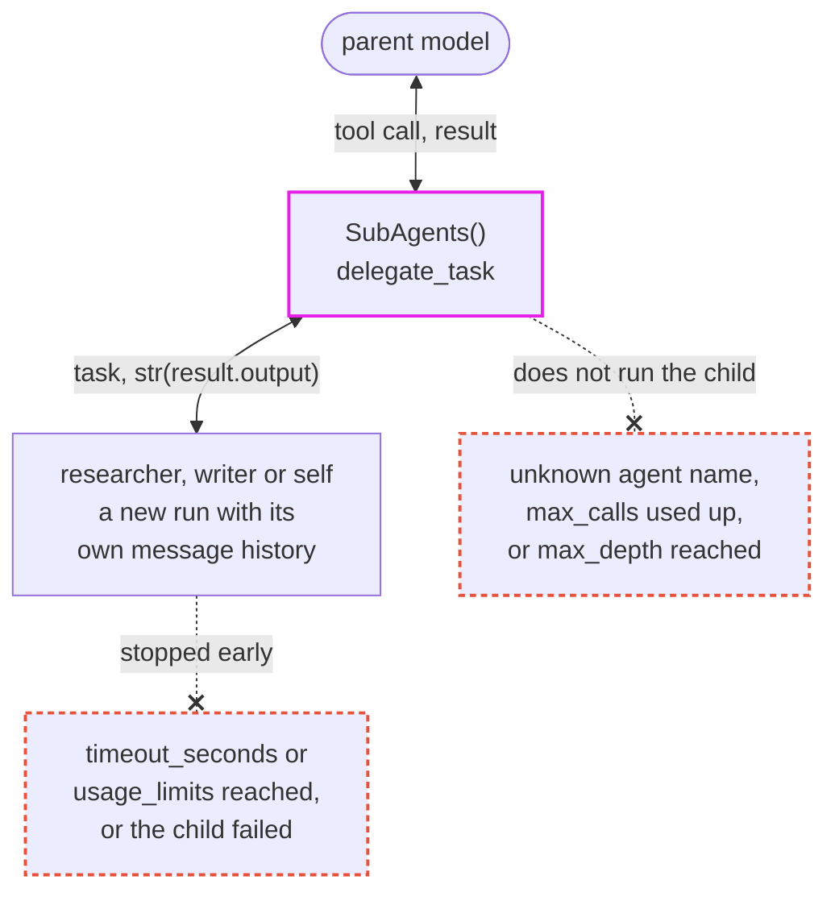

# Subagents

Let an agent delegate self-contained tasks to named child agents, each in its own run with its own message history.

[Source](https://github.com/pydantic/pydantic-ai/tree/main/src/pydantic_ai_harness/pydantic_ai_harness/sub_agents/)

> While Pydantic AI Harness is on 0.x releases, the API may change between minor releases; when it does, deprecation warnings and release-note migration guidance tell you (or your agent) exactly how to upgrade. See the [version policy](index.md#version-policy).



## The problem

One agent that does everything accumulates many tools and a long context. Specialized sub-agents keep each context focused, but hand-wired delegation needs a tool per agent, forwarded deps, threaded usage limits, and a prompt listing the delegates.

## The solution

`SubAgents` takes a sequence of `SubAgent` entries and exposes one `delegate_task(agent_name, task)` tool. Each delegation runs the chosen sub-agent in its own run, which never sees the parent conversation, and returns its output to the parent. The system prompt lists the sub-agents by name and `description` (the agent's own, or `SubAgent(description=...)`; one without a description is listed by name alone), so the listing stays in the cached prefix; a change between runs of the same conversation is [appended](../agent.md#appending-instruction-changes) instead of rewriting the prefix.

```python
from pydantic_ai import Agent
from pydantic_ai_harness import SubAgent, SubAgents

researcher = Agent('{{ anthropic:large }}', name='researcher', description='Researches a topic')
writer = Agent('{{ anthropic:large }}', name='writer', description='Turns notes into polished prose')

orchestrator = Agent(
    '{{ anthropic:large }}',
    capabilities=[SubAgents(agents=[SubAgent(researcher), SubAgent(writer)])],
)

result = orchestrator.run_sync('Research the history of TLS and write a one-paragraph summary.')
print(result.output)
```

A delegate's name, used by the parent model and in the prompt listing, is the agent's own `name` or a `SubAgent(name=...)` override. An agent with neither is rejected, and two delegates with the same name are an error.

## The tool

| Tool | Purpose |
|---|---|
| `delegate_task(agent_name, task)` | Run the named sub-agent on a self-contained task and return its output. |

- `task` must be self-contained, since the sub-agent does not see the parent conversation.
- An unknown `agent_name` raises `ModelRetry`, so the model can correct itself.
- The parent gets `str(result.output)`.
- With a `models` menu, the tool takes an extra `model` argument (see below).

## Deps, usage, tools, and capabilities

- **Deps are forwarded.** Each sub-agent gets the parent run's `deps`, so it shares the parent's `AgentDepsT` (every sub-agent is an `AbstractAgent[AgentDepsT, Any]`).
- **The workspace is inherited**, unless `workspace_resolver` selects another directory. Parent read-only restrictions still apply.
- **Usage is shared by default.** Each sub-agent run gets the parent's `usage`, so token usage aggregates and a parent `usage_limits` applies across the whole agent tree. Set `forward_usage=False` to give each sub-agent run its own accounting.
- **The parent's tools are not passed on.** A sub-agent runs with its own tools. To delegate to an agent with all of the parent's tools and capabilities, use `include_self=True` (see below).
- **Capabilities can be shared.** `shared_capabilities` apply to every sub-agent run, for example a common guardrail, memory, or planning capability, without rebuilding each `Agent`.
- **Sub-agent events can be streamed.** An `event_stream_handler` is forwarded to each sub-agent run, so its model-streaming and tool events reach the caller. The handler receives the sub-agent's own `RunContext`.

`inherit_tools=True` is deprecated and emits a `HarnessDeprecationWarning`. It adds the parent agent's own tools (from `tools=` or `toolsets=`, minus the delegate tool) to each sub-agent run, but not the tools from the parent's capabilities. Instead, bind the tools an explicit sub-agent needs to its `Agent`, use `include_self=True`, or give disk-loaded agents tools with a `tool_resolver`.

## Delegating to the agent itself

With `include_self=True`, the roster also lists the running agent as `self`. A delegation to `self` starts a fresh run of that agent (`RunContext.agent`) on the parent run's model (or the `models` option the parent picks), with no parent conversation. The child is the same `Agent`, so every capability, toolset, and instruction bound to it registers again in the child run: a guardrail, approval gate, or audit hook bound next to `SubAgents` sees the delegate's tool calls, not only the `delegate_task` call. [`Coder`](coder.md) uses this by default.

```python
from pydantic_ai import Agent
from pydantic_ai_harness import SubAgents

agent = Agent(
    '{{ anthropic:large }}',
    capabilities=[SubAgents(include_self=True)],
)
```

- **Only what is bound to the `Agent` carries over.** Capabilities, toolsets, instructions, and model settings passed to the parent's `run()` do not reach the delegate. Passing `SubAgents(include_self=True)` itself to `run()` raises a `UserError` when the run starts, since the delegate would come up without it.
- **Delegation depth is capped.** The delegate has `delegate_task` too, so `max_depth` (default `3`, counting the top-level run) bounds the tree: the top-level run delegates, its delegates delegate once more, and a run at the limit gets neither `delegate_task` nor the sub-agent listing. The limit applies to every delegation through `SubAgents`, including explicit rosters.
- **Delegates inherit everything, including what may not suit a sub-task.** An `AskUser` capability bound to the agent can prompt the user from inside a delegation. The delegate returns the agent's own `output_type`, rendered with `str()`; a run that ends with [`DeferredToolRequests`](../deferred-tools.md) or [`PendingModelResponse`](../batch.md#ending-a-run-while-it-waits) returns a steering message instead (see [Failure handling](#failure-handling)), unless `forward_deferred_calls=True` passes its deferred tool calls to the caller (see [Approving a delegate's tool calls](#approving-a-delegates-tool-calls)).
- The deprecated `inherit_tools` does not apply to `self`, whose tools are already the parent's. The name `self` is reserved: an explicit delegate with that name is an error, and a disk definition with that name is skipped with a warning.
- **On Temporal, `agent_folders` is not supported.** Disk-loaded sub-agents add a toolset at run time, which Temporal refuses, so pass `agent_folders=None`. When `self` is the only delegate, it runs in the workflow, so register a `Model` instance from `models` with `TemporalDurability(models=...)`. Otherwise delegations run in an activity, or in a child workflow when you opt in (see [Delegates as child workflows](#delegates-as-child-workflows)). Neither has the parent run's model, so a delegate needs a model of its own (or, in an activity, a `models` option); see [delegation on Temporal](../durable_execution/temporal.md#harness-workspace-capabilities).

## Per-delegate run controls

Each `SubAgent` carries its own budgets; one with none set runs with the `SubAgents` defaults.

```python
from pydantic_ai import Agent
from pydantic_ai.usage import UsageLimits
from pydantic_ai_harness import SubAgent, SubAgents

reproducer = Agent('{{ anthropic:large }}', instructions='Reproduce the reported bug from a minimal script.')
librarian = Agent('{{ anthropic:large }}', instructions='Find relevant docs, issues, and prior art.')

orchestrator = Agent(
    '{{ anthropic:large }}',
    capabilities=[
        SubAgents(
            agents=[
                SubAgent(reproducer, usage_limits=UsageLimits(request_limit=35), timeout_seconds=600, max_calls=1),
                SubAgent(librarian, usage_limits=UsageLimits(request_limit=18), timeout_seconds=300, max_calls=2),
            ]
        )
    ],
)
```

| Field | Effect |
|---|---|
| `models` | The `SubAgents` menu keys this delegate may run on. The first key is its default. See [Per-delegation model selection](#per-delegation-model-selection). |
| `usage_limits` | A request/token budget for one delegation. The child gets its own usage accounting, so the budget counts only that child's requests and tokens. With `forward_usage=True`, the child's usage is added to the parent's after the delegation. Reaching the budget is a soft outcome (see below), not a run-stopping `UsageLimitExceeded`. |
| `timeout_seconds` | A wall-clock budget for one delegation. A child that exceeds it is cancelled and the parent gets a steering message. The cancelled child's `event_stream_handler` stops receiving events without a terminal event. |
| `max_calls` | The maximum delegations to this sub-agent per parent run. After that, delegations return a budget-exhausted steering message without running the child. Counts are per `Agent.run` (a `run_id`) and cleared when it ends, so each parent run and each level of a nested tree has its own budget. |
| `on_failure` | A steering message that replaces the built-in default for any soft outcome of this delegate. While `on_model_error` is unset, it also makes child failures soft (see below). |
| `on_model_error` | What the parent gets when the child fails with a soft model error: `'retry'` raises a parent `ModelRetry`, `'return'` returns the error and the steering message as a normal tool result. Unset means `'return'`, with the `on_failure` message alone, when `on_failure` is set, and `'retry'` otherwise. |
| `contain_errors` | Whether an unexpected crash in this delegate returns to the parent as a bounded `ModelRetry` instead of aborting the parent run. Unset inherits `SubAgents(contain_errors=...)` (off). |
| `keep_partial_output` | Whether a child stopped by `timeout_seconds` or its own `usage_limits` passes its last text response to the parent. Off by default. |
| `read_only` | Wrap the child's workspace in `ReadOnlyWorkspace`, which refuses commands and file changes through the workspace API. Off by default. |

## Per-delegation model selection

Let the orchestrator pick a model per task: with a `models` menu, the delegate tool gains a `model` argument naming one of its keys.

```python
from pydantic_ai import Agent
from pydantic_ai.settings import ModelSettings
from pydantic_ai_harness import SubAgent, SubAgents
from pydantic_ai_harness.sub_agents import ModelOption

reviewer = Agent('{{ anthropic:large }}', name='reviewer', description='Reviews a diff')
linter = Agent('{{ anthropic:large }}', name='linter', description='Runs the linter and reports failures')

orchestrator = Agent(
    '{{ anthropic:large }}',
    capabilities=[
        SubAgents(
            agents=[SubAgent(reviewer), SubAgent(linter, models=['fast'])],
            models={
                'fast': '{{ anthropic:small }}',
                'standard': '{{ anthropic:medium }}',
                'deep': ModelOption(
                    '{{ anthropic:large }}',
                    description='hard reasoning, multi-file changes',
                    settings=ModelSettings(thinking='xhigh'),
                ),
            },
        )
    ],
)
```

- **Off by default.** Without a `models` menu, the tool schema has no `model` argument.
- **The keys are the interface.** The system prompt lists them with each entry's model and description, and the tool schema offers them as an enum, so the model picks from the menu instead of inventing a model name. Name them for the job (`'fast'`, `'deep'`), not the vendor.
- **An entry is a model or a `ModelOption`.** `ModelOption(model, description=..., settings=...)` adds a routing hint and per-option `ModelSettings`, so one key can mean "same model, more thinking". The settings merge over the sub-agent's own `model_settings`, keeping the parts the option does not set.
- **Resolution order.** The key the parent passed, else the delegate's first allowed key, else the delegate's own model, else the parent run's model.
- **A delegate can be restricted.** `SubAgent(linter, models=['fast'])` pins that delegate to `fast`: it runs on the first listed key when the parent passes no `model`, and other keys are refused with a `ModelRetry`. The prompt listing shows the restriction (`- linter: Runs the linter (models: fast)`). A key the menu does not define is a `ValueError` at construction.
- **A rejected key costs nothing.** An unknown or unavailable key returns a `ModelRetry` listing the valid options, before the delegate's `max_calls` budget is charged.

## Per-delegation working directory

Set `workspace_resolver` to offer `delegate_task(working_directory=...)`. The async callback receives the parent `RunContext` and a `DelegationWorkspaceRequest` with the delegate name and requested directory, and returns a `Workspace`. It validates the request and decides which delegates may use another workspace. Without it, the tool has no `working_directory` and children inherit the parent's workspace.

```python
from pydantic_ai import Agent, RunContext
from pydantic_ai.exceptions import ModelRetry
from pydantic_ai.workspaces import LocalWorkspaceBackend, Workspace
from pydantic_ai_harness.file_system import FileSystem
from pydantic_ai_harness.sub_agents import DelegationWorkspaceRequest, SubAgent, SubAgents

workspaces: dict[str, Workspace] = {'/repos/policy': Workspace(LocalWorkspaceBackend('/repos/policy'))}


async def resolve_workspace(ctx: RunContext[object], request: DelegationWorkspaceRequest) -> Workspace:
    if request.agent_name != 'reviewer' or request.directory not in workspaces:
        raise ModelRetry('Choose the reviewer and a configured directory.')
    return workspaces[request.directory]


reviewer = Agent(name='reviewer', deps_type=object, capabilities=[FileSystem(read_only=True)])
delegation = SubAgents(
    agents=[SubAgent(reviewer, read_only=True)],
    workspace_resolver=resolve_workspace,
)
```

- The child's relative file paths and repository instructions use the returned workspace. Read-only restrictions from the parent or `SubAgent(read_only=True)` still apply. Limit the delegate to trusted read-only tools too, since arbitrary Python tools can bypass the workspace API. The resolver must keep any other backend restrictions the application requires.
- The caller owns the returned workspace and keeps its resources alive until background children finish.
- Managed tasks record the resolved directory in `DelegationTask.working_directory`. A resume without the argument resolves that saved directory again, so the resolver must accept its own resolved spelling; changing it is rejected. Older tasks without this field inherit the parent workspace.
- Remote and durable delegations reject directory overrides.
- This does not change where disk agent definitions are found: `SubAgents.workspace` controls that.

## Failure handling

A *soft outcome* returns a steering message to the parent as a normal tool result, so its model reads it and decides what to do next, instead of re-delegating straight away as a `ModelRetry` invites. A timeout, a reached `usage_limits` budget, and an exhausted `max_calls` budget are always soft. `on_failure` replaces the built-in message for these outcomes.

With `keep_partial_output=True`, a delegation stopped by its timeout or its own usage budget also passes the child's last text response to the parent. It follows the steering message (or `on_failure`) as `<partial_output>...</partial_output>`, and the outcome stays `timeout` or `budget`. `DelegationFinishedEvent.output` carries the same text, bounded like any other output. The text has not passed the child's output validation: it can be text the child's output validator or `OutputGuardrail` rejected, so leave this off for a child whose guardrails keep content from its parent. Text from a response the child answered with a retry is skipped, as is a final response the run stopped before acting on, or one whose output tool call the stop cut off before its verdict. A child with no such text returns the steering message alone.

A sub-agent run that ends with `DeferredToolRequests` (its `output_type` includes it and a tool needed approval or was deferred) is soft too by default. The parent's model cannot approve the child's tool calls or resume its run, and the same task would likely stop the same way again, so the delegation returns a steering message naming the sub-agent and why it stopped, or the `on_failure` message. With `forward_deferred_calls=True`, the calls go to the parent run's caller instead, and the child resumes once they are answered (see [Approving a delegate's tool calls](#approving-a-delegates-tool-calls)). A sub-agent that resolves its own deferred calls, for example with [`HandleDeferredToolCalls`](../capabilities/handle-deferred-tool-calls.md), never ends this way. A run that ends with `PendingModelResponse` (a model request left waiting on the provider, for example in a batch) returns a steering message the same way, including on a remote worker, and the request is cancelled, since nobody will check on it later. Cancelling is best effort, and a [batch](../batch.md) is cancelled only once no other request in it is still waiting.

A sub-agent run that fails with a *soft model error* (`ModelRetry`, or `UnexpectedModelBehavior` such as exhausted retries) becomes a `ModelRetry` for the parent by default: the parent's model sees `Sub-agent '<name>' failed: ...` and can re-delegate. The delegate tool defaults to `tool_retries=2`, so the parent aborts only after that many consecutive delegate failures; a successful delegation resets the count. Raise `tool_retries` for a flakier sub-agent, or set `None` to inherit the parent agent's default. `on_model_error='return'` makes a delegate's failures soft: the parent gets `Sub-agent '<name>' failed: ...` as a normal tool result, followed by the `on_failure` message or a default steering message. `on_model_error='retry'` keeps the parent `ModelRetry` even with `on_failure` set, so `on_failure` then customizes only the other soft outcomes. With `on_model_error` unset, `on_failure` makes failures soft and returns its message alone, without the error.

Hard errors stop the whole run. A `UsageLimitExceeded` from a child with *no* per-delegate `usage_limits` (sharing the parent's accounting) means the whole tree is out of budget, and propagates; a child reaching its *own* `usage_limits` is soft, as above.

An *unexpected crash*, any other exception the child raises (a provider `ModelAPIError` or `FallbackExceptionGroup`, a `ValueError` from a bad tool argument), propagates by default and aborts the parent run. `contain_errors=True` (per delegate, or as the `SubAgents` default) returns it to the parent as a bounded `ModelRetry` instead, so one crash cannot kill the whole run. The exception is in the retry message (`Sub-agent '<name>' crashed: ...`) and logged through `logging`, and `tool_retries` still turns consecutive crashes into an abort. A contained crash always raises this retry, never the `on_failure` return. These bypass containment: cancellation, a shared `UsageLimitExceeded`, Pydantic AI control-flow signals (`CallDeferred`, `ApprovalRequired`, the `Skip*` signals), and `UserError`. External cancellation (`asyncio.CancelledError`) propagates as-is. A child's own cancellation (`RunContext.cancel()` in the child, raising `RunCancelled`) leaves the delegate tool uncontained; Pydantic AI then isolates it as a failed `delegate_task` return the parent model can react to, not a crash retry that invites re-delegation.

### Approving a delegate's tool calls

With `SubAgents(forward_deferred_calls=True)`, a sub-agent run that ends with [`DeferredToolRequests`](../deferred-tools.md) doesn't return a steering message. The delegate call raises `ApprovalRequired` instead, so the parent run ends with `DeferredToolRequests` too, and its caller answers the sub-agent's calls the way it answers the parent's own. The parent's `output_type` must include `DeferredToolRequests`, or a [`HandleDeferredToolCalls`](../capabilities/handle-deferred-tool-calls.md) handler on the parent must answer them through the same two functions below. Whatever approves the `delegate_task` call itself, such as a handler that doesn't use them or a UI adapter like AG-UI, which shows the user only that call, approves none of the sub-agent's calls.

`delegated_requests()` lists the sub-agent's calls in place of the delegate call that stopped on them, each under the delegate call's ID and its own joined by `:` (`'c1:e1'`), with an `agent_path` metadata entry naming the delegates it was made under, outermost first. `delegated_results()` routes the answers back. Both only look at calls of the delegate tool, `delegate_task`: if `SubAgents(tool_name=...)` renames it anywhere in the delegation tree, pass every name to both as `tool_names=`.

```python
from pydantic_ai import Agent, DeferredToolRequests
from pydantic_ai_harness import SubAgent, SubAgents
from pydantic_ai_harness.sub_agents import delegated_requests, delegated_results

mailer = Agent('{{ anthropic:large }}', name='mailer', output_type=[str, DeferredToolRequests])


@mailer.tool_plain(requires_approval=True)
def send_email(to: str, body: str) -> str:
    return f'Sent to {to}'


orchestrator = Agent(
    '{{ anthropic:large }}',
    output_type=[str, DeferredToolRequests],
    capabilities=[SubAgents(agents=[SubAgent(mailer)], forward_deferred_calls=True)],
)


async def run_with_approvals(prompt: str) -> str:
    result = await orchestrator.run(prompt)
    while isinstance(result.output, DeferredToolRequests):
        requests = delegated_requests(result.output)
        approvals: dict[str, bool] = {}
        for call in requests.approvals:
            path = ' > '.join(requests.metadata.get(call.tool_call_id, {}).get('agent_path', ['agent']))
            approvals[call.tool_call_id] = input(f'{path} wants {call.tool_name}({call.args}). Approve? ') == 'y'
        result = await orchestrator.run(
            message_history=result.all_messages(),
            deferred_tool_results=delegated_results(result.output, requests.build_results(approvals=approvals)),
        )
    return result.output
```

The next run resumes the sub-agent from its own history with those answers, so the calls it already ran don't run again, and the delegation then ends like any other. A delegate that sets `forward_deferred_calls` too passes its own delegates' calls up the same way.

- Every call the sub-agent waits on needs an answer: `delegated_results()` raises `ValueError` otherwise. Deny a call with `False` or `ToolDenied`.
- Only the sub-agent decides which of its calls need approval. Approving the delegate call itself, for example with `build_results(approve_all=True)` on the parent's requests or through an approval gate on the delegate tool, approves none of them: the delegation runs the task again, and passes on the calls it stops on.
- The sub-agent's history waits on the server, in `deferred_state_store`, until the answers arrive. A resume takes it out of the store before the sub-agent runs, so the answers resume it at most once: two submissions of the same answers can't both resume it, and if the resumed delegation fails, a retry raises `UserError` rather than run approved calls again. Approving the delegate call itself then runs the task afresh. The delegate call's metadata carries only its ID, the sub-agent's name and its pending calls, the ones the caller is asked about. A resume accepts only a state in that store, saved by the same delegate call for the same sub-agent and task, with answers only to the calls the sub-agent asked about. Anything else raises `UserError`. Unset, each `SubAgents` keeps the states in memory (`InMemoryDeferredStateStore`, at most 1000 for at most a day by default), so resume through the same instance, in the same process; pass a `DeferredStateStore` of your own, such as one backed by your database, to resume in another.
- The delegation that stops emits a `DelegationFinishedEvent` with outcome `failed`, whose `output` says the sub-agent is waiting for answers, and the sub-agent's usage up to that point counts like any delegation's. The resumed run is a new delegation, with its own events.
- Durable execution and `task_control` don't support it: `forward_deferred_calls=True` with either raises an error.

## Events

`SubAgents` emits typed capability events in the `sub_agents` namespace, so a host can show a delegation as it runs and how it ended without parsing the delegate tool's arguments and result:

| Event | Dispatch | When | Payload |
|---|---|---|---|
| `DelegationStartedEvent` | stream | a delegation passed every check and the child run is about to start | `agent_name`, `task`, `truncated`, `model` (the menu key, or `None`), `inherits_tools` |
| `DelegationFinishedEvent` | stream | the delegation settled into what the parent receives | `agent_name`, `outcome`, `output`, `truncated`, `usage`, `duration_ms` |

Both are notifications. A start and its end share the `tool_call_id` core stamps on every event, which pairs them when the model delegates in parallel. `duration_seconds` is the deprecated name of `duration_ms`: it still reads, in seconds and with a warning, and a payload saved under it still loads.

`outcome` follows [Failure handling](#failure-handling):

- `ok`: the child's output went back to the parent.
- `timeout` or `budget`: the child hit its `timeout_seconds` or its own `usage_limits`.
- `failed`: a soft model error, returned or raised per `on_model_error`, or a run that ended with `DeferredToolRequests` or `PendingModelResponse`, including one whose deferred tool calls `forward_deferred_calls` passed to the caller.
- `contained`: a crash `contain_errors` caught.

`output` is what the delegate tool returns to the parent: the child's output, the steering message, or the retry text. It is emitted inside the tool, before any `ToolGuardrail` result guard screens it; for the screened text, read the `ToolReturnPart` in core's `FunctionToolResultEvent`. `usage` is the child's own `RunUsage` when it has separate accounting (`usage_limits` set, or `forward_usage=False`), and `None` when its usage goes into the parent's.

A delegation refused before the child runs (an unknown sub-agent, a model key off the menu, an exhausted `max_calls` budget) emits nothing; the tool result says why. An exception out of the delegate tool (a shared usage limit, an uncontained crash, a cancellation) ends without an end event. A `SubAgentToolset` registered directly in `Agent(toolsets=[...])` has no owning capability and emits nothing. As with any capability event, a listener that raises aborts the parent run.

`task` and `output` are cut at `MAX_EVENT_TEXT_CHARS` (4096) with a `truncated` flag, so one verbose delegation cannot flood a persisted or forwarded event stream. The [task events](#task-events) and `AgentCreatedEvent` are not cut.

```python
from pydantic_ai import Agent
from pydantic_ai.capabilities import AbstractCapability, on_event
from pydantic_ai_harness.sub_agents import DelegationFinishedEvent, SubAgent, SubAgents


class ReportDelegations(AbstractCapability):
    @on_event(DelegationFinishedEvent)
    async def on_delegation_end(self, ctx, event: DelegationFinishedEvent) -> None:
        print(f'{event.agent_name}: {event.outcome} in {event.duration_ms / 1000:.1f}s')


researcher = Agent('{{ anthropic:large }}', name='researcher')
agent = Agent(
    '{{ anthropic:large }}',
    capabilities=[SubAgents(agents=[SubAgent(researcher)]), ReportDelegations()],
)
```

For the child run's model streaming, pass an `event_stream_handler`. See [capability events](../capabilities/overview.md#capability-events) for how `@on_event` works.

Plain delegation adds no OpenTelemetry spans: the child run's own spans nest under the parent's tool-call span.

A child run has its own `conversation_id`, so adding up cost by `gen_ai.conversation.id` leaves it out of the conversation it was started for. Its spans also carry `pydantic_ai.root_conversation_id`, the `conversation_id` of the top-level run (the run that isn't inside any other run), even for a child started by another child; see [correlating runs](../message-history.md#correlating-runs-with-run_id-and-conversation_id) for how to use it and where it's missing.

Task control records its own decisions, which core's spans don't show, as zero-duration spans on the delegating run's tracer. Their attributes have the `sub_agents.` prefix and include `sub_agents.agent_name` (for a created agent, whose name the model chose, only as content) and, for a task, `sub_agents.task_id`:

| Span | When | Attributes |
| --- | --- | --- |
| `sub_agents vetoed` | a listener vetoed a task, message, answer, cancellation, or created agent | `sub_agents.event` (the vetoed event's kind), `sub_agents.veto_reason` |
| `sub_agents task backgrounded` | a task moved to the background | `sub_agents.reason`: `requested`, `auto`, or `question` |
| `sub_agents question answered` | a listener, not the model, answered a task's question | `sub_agents.question`, `sub_agents.answer` |
| `sub_agents task refused` | `max_running_tasks` refused a delegation | `sub_agents.running_tasks`, `sub_agents.max_running_tasks` |
| `sub_agents task not accepted` | no worker picked a remote task up within `accept_timeout` | `sub_agents.accept_timeout` |
| `sub_agents remote task stopped` | a remote task ended without its worker's report, and its worker was told to stop it | |

A veto reason, question, or answer, and the name a vetoed `create_agent` call asked for, are attached only when the run's instrumentation includes content. While a top-level run waits for its background tasks, a `sub_agents wait for tasks` span with `sub_agents.running_tasks` covers the wait.

## Task control

By default a delegation finishes inside the `delegate_task` call that started it. With `task_control=TaskControl()`, delegations become tasks the model manages: they can run in the background, ask questions, be steered or cancelled, and be resumed.

```python
from pydantic_ai import Agent
from pydantic_ai_harness import SubAgent, SubAgents
from pydantic_ai_harness.sub_agents import TaskControl

researcher = Agent('{{ anthropic:large }}', name='researcher', description='Researches a topic')

orchestrator = Agent(
    '{{ anthropic:large }}',
    capabilities=[SubAgents(agents=[SubAgent(researcher)], task_control=TaskControl(auto_background_after=60))],
)
```

| Tool | Purpose |
|---|---|
| `delegate_task(agent_name, task, background=False, resume=None)` | Start a task, or resume a finished one by its task ID. `background=True` returns a receipt right away. |
| `list_tasks()` | The tasks this run started and the tasks they started, with status and IDs (the 50 most relevant). |
| `check_task(task_id)` | What one of those tasks is doing now, without waiting for it: elapsed time, the model requests, last five tool calls and latest text of its current run, and any question it waits on. A finished task shows only its outcome. |
| `message_task(task_id, message)` | Steer a running task; it reads the message, as sent, at its next model request. Its instructions tell it its delegating agent may send it messages. A finished task resumes with the message as its prompt, in the background if it ran there, through a `delegate_task(resume=...)` call that the delegate tool's hooks and approvals see and that counts as a second tool call. |
| `answer_task(task_id, answer)` | Answer the question a task is waiting on. |
| `cancel_task(task_id, force=False)` | Stop a task, and the tasks it started, before its next model request, or right away with `force=True`. |

- **Reports and questions arrive as messages.** A background task's report is `<task_output>` data, and its question `<task_question>` data, on the user channel; the task-control instructions tell the model both are untrusted task data. A top-level run whose model ends while background tasks still run waits for them, so their reports become its next request.
- **Questions.** Each sub-agent gets an `ask_parent(question)` tool. A question moves its task to the background, since the delegating model can answer only once `delegate_task` returns, and reaches that model as a message. Turn it off per delegate with `SubAgent(can_ask_questions=False)`. A task that can't run in the background (a run-owned workspace that isn't local) gets no `ask_parent`.
- **Limits.** `TaskControl(auto_background_after=...)` moves a task still running after that many seconds to the background. `TaskControl(max_running_tasks=...)` caps how many tasks a conversation runs at once, across its whole delegation tree. `SubAgent(resumable=False)` makes a delegate one-shot (see [Managed delegation sessions](#managed-delegation-sessions) for `one_shot`). All are off by default.
- **Who controls a task.** Only the run that started a task can message, answer, or resume it. Any run above it can cancel it.
- **Each run gets an owner.** With no `DelegationTasks` bound, `SubAgents` opens one for the run and cancels the tasks still running when the run ends. Delegations then follow the owner's rules in [Managed delegation sessions](#managed-delegation-sessions), including how a delegate's `usage_limits` apply. Another agent's run that one of the run's tools starts is not a task and doesn't share the owner. Bind your own owner to keep tasks across runs, persist them, and observe them.
- **Task IDs** derive from the run's `run_id` and the tool call that started the task, so a rerun with the same `run_id` and tool calls gets the same task IDs, and runs that share an owner or a `SubAgentWorker` need distinct `run_id`s, as [`run_id`](../message-history.md#correlating-runs-with-run_id-and-conversation_id) already requires.
- Only one `SubAgents` on an agent can set `task_control`. The deprecated wrapper agents, such as `TemporalAgent`, give a run no durability capability, so the checks below can't catch them; don't use task control or `dynamic_agents` with them.
- On Temporal and DBOS, task control keeps the tasks in the workflow and runs each in its own durable unit, so recovery replays a background task's events and reuses its result. On replay, a task sent to the background on request can get its `TaskBackgroundedEvent` after it settles. A durable task can't ask questions, take messages, or be resumed, `cancel_task` stops it right away, and its report reaches the model when the run would otherwise end, not at its next request. On DBOS, a replayed `list_tasks` can show a task's status as of a different moment. A durable task's history is not updated while it runs, so `check_task` shows only its status and elapsed time. Under durable execution, these raise a `UserError`:
    - task control with `include_self`, `remote_agents` or `forward_events`
    - task control with `auto_background_after` or `max_running_tasks` outside Temporal
    - task control or `dynamic_agents` on another durable engine, or within a bound `DelegationTasks` owner
- On Temporal and DBOS, `dynamic_agents` keeps the roster in the workflow and runs each delegation other than to `self` in its own durable unit, on the parent run's model unless the created agent has one, so recovery rebuilds the created agents and reuses each delegation's result. The `factory` runs again on replay, so keep it deterministic. Engines that record each tool call in its own unit would lose the roster on replay, so they raise a `UserError`. Under any durability capability, `SubAgents` needs an `id`, which it has by default; `id=None` raises a `UserError`.
- Task control and `DelegationTasks` run tasks as asyncio tasks, so AnyIO's Trio backend is not supported.

### Task events

With task control, every step of a task is a typed capability event in the `sub_agents` namespace. A task's events go into the event stream of the run that started it, so a nested task's events reach its own parent's run. A bound `DelegationTasks` observer also receives them as `DelegationTaskEvent(event=...)`, including those of a task that settles after its delegating run ended; in place of `TaskProgressEvent`, it receives the task run's own events.

| Event | When | A listener can |
|---|---|---|
| `TaskAssignedEvent`, `TaskResumedEvent` (`TaskRequestEvent` matches both) | a task is about to start, or to resume | rewrite `prompt`, or `veto()` it |
| `TaskStartedEvent` | the task's run is starting, locally or on a worker | |
| `TaskBackgroundedEvent` | the task moved to the background; `reason` is `requested`, `auto`, or `question` | |
| `TaskProgressEvent` | an event of the task's own run, with `TaskControl(forward_events=True)` | |
| `TaskQuestionAskedEvent` | the task asked a question | set `answer`, so the model is not asked |
| `TaskAnsweredEvent` | an answer is about to reach the task | rewrite `answer`, or `veto()` it |
| `TaskSteeredEvent` | a steering message is about to reach the task | rewrite `message`, or `veto()` it |
| `TaskCancelRequestedEvent`, `TaskForceCancelRequestedEvent` | a cancellation is about to reach the task | `veto()` it |
| `TaskRetriedEvent` | a worker is running a failed remote task again | |
| `TaskCompletedEvent`, `TaskFailedEvent`, `TaskCancelledEvent` | the task settled | rewrite `output` of a completed task |

These events and `AgentCreatedEvent` are not cut at `MAX_EVENT_TEXT_CHARS`: each is the message a transport carries, so a prompt, question, answer, or output arrives whole. A listener that persists or forwards them bounds them itself.

Events a listener can change are dispatched immediately, so its decisions take effect. A vetoed message is not sent, and the model is told why. With a bound `DelegationTasks`, `DelegationStartedEvent` and `DelegationFinishedEvent` go to its observer only (see [Managed delegation sessions](#managed-delegation-sessions)); with the run's own owner, they go to the run.

Earlier releases named some of these differently. The old class names still import from the deprecated `pydantic_ai_harness.subagents` path, with a `HarnessDeprecationWarning`: `SubAgentMessage`, `ParentMessage` and `ChildMessage` (each now ends in `Event`), `TaskFollowUpEvent` (`TaskResumedEvent`), `TaskMessageEvent` (`TaskSteeredEvent`), `TaskAnswerEvent` (`TaskAnsweredEvent`), `TaskCancelRequestEvent` (`TaskCancelRequestedEvent`), `TaskForceCancelEvent` (`TaskForceCancelRequestedEvent`), `TaskQuestionEvent` (`TaskQuestionAskedEvent`) and `TaskRetryEvent` (`TaskRetriedEvent`). Each event's `kind` is unchanged. `AgentCreatedEvent.name` is now `agent_name`, and `parent_id` on `DelegationStartedEvent` and `DelegationFinishedEvent` is now `parent_task_id`: the old attributes still read, with the same warning, and an event serialized under an old key still loads. Constructors take the new keyword only, and events serialize under the new keys: update code that reads a serialized event by key, and upgrade any process that loads events this release writes.

```python
from pydantic_ai.capabilities import AbstractCapability, on_event
from pydantic_ai_harness.sub_agents import TaskAssignedEvent, TaskQuestionAskedEvent


class DelegationPolicy(AbstractCapability):
    @on_event(TaskAssignedEvent)
    async def check_task(self, ctx, event: TaskAssignedEvent) -> None:
        if 'production' in event.prompt:
            event.veto('ask the user before touching production')

    @on_event(TaskQuestionAskedEvent)
    async def answer_known(self, ctx, event: TaskQuestionAskedEvent) -> None:
        if event.question == 'Which branch?':
            event.answer = 'main'
```

### Remote sub-agents

A `SubAgentWorker` serves agents to delegating agents in other processes. The delegating side lists them as `RemoteSubAgent`s, by name, and reaches them through a `SubAgentTransport`:

```python {test="skip"}
from pydantic_ai import Agent
from pydantic_ai_harness.sub_agents import RemoteSubAgent, SubAgents, SubAgentWorker, TaskControl

transport = ...  # a SubAgentTransport both processes reach


# In the process that hosts the agent:
async def serve():
    researcher = Agent('{{ anthropic:large }}', name='researcher')
    await SubAgentWorker(agents={'researcher': researcher}, transport=transport, deps=None).serve()


# In the delegating process:
orchestrator = Agent(
    '{{ anthropic:large }}',
    capabilities=[
        SubAgents(
            task_control=TaskControl(
                remote_agents=[RemoteSubAgent(name='researcher', description='Researches a topic')],
                transport=transport,
            )
        )
    ],
)
```

- **A transport is a set of mailboxes.** Implement `send`, `receive`, and optionally `release` over a WebSocket, a Redis list, or anything else that moves bytes, with `serialize_message` and `deserialize_message` at the boundary. Every message is one of the `SubAgentMessageEvent`s above. `InMemoryTransport` serves a worker in the same process.
- **The transport is the trust boundary.** Anyone who can send to it can run the served agents, with their tools and `deps`, and read what they return. Put authentication, authorization, and network binding in your transport. A worker's output and errors reach the delegating model like a local delegate's: as tool results in the foreground, as framed reports in the background.
- **A transport reports a lost worker.** A worker that stops sends `TaskFailedEvent` for its running tasks. If one dies without doing so, the delegating run waits for its report until the run is cancelled, unless `receive` raises when the worker is gone. The protocol has no heartbeats.
- **The worker runs the agent** with its own model, tools, and `deps`, which never cross the transport. It takes the agents it serves by name, without per-delegate run controls, which belong to the delegating side's `SubAgents`. It applies the delegating run's usage limits to the task's own usage and continues the delegating run's trace. The usage it reports with the settled event is added to the delegating run's usage, unless `forward_usage=False`.
- **A task nobody picks up fails.** The worker sends `TaskStartedEvent` when it starts a task. A remote task no worker picks up within `TaskControl.accept_timeout` seconds (default `30`) fails. A remote task that stops without its worker's report, for example because its delegating run ended, is force-cancelled on the worker.
- `SubAgentWorker(retries=...)` runs a failed task again from its prompt, with a `TaskRetriedEvent`. The worker keeps up to `max_conversations` task conversations (default `1000`) for resuming. A conversation stays in its worker, so serve each remote agent name from one worker: a follow-up that reaches another worker fails.
- A remote agent runs on its worker's model, so `delegate_task` refuses a `model` for it, and its delegations emit no `DelegationStartedEvent` or `DelegationFinishedEvent`.

### Agents the model creates

With `dynamic_agents`, the model gets a `create_agent(name, description, instructions, model=None)` tool and can delegate to the agents it creates until the run ends, with or without task control.

```python
from pydantic_ai_harness.sub_agents import DynamicAgents, SubAgents

SubAgents(models={'fast': '{{ anthropic:small }}'}, dynamic_agents=DynamicAgents(models=['fast'], max_agents=3))
```

- A created agent is an `Agent` with the model-written instructions and no tools, on the `models` key it was created with, or on the delegating run's model when `DynamicAgents.models` is empty. The model delegates to it by the name it gave in `create_agent`. The agent has no `name` or `description` of its own, since tracing records those even without content. The description goes only to a custom factory, as `DynamicAgentSpec.description`, and the model never sees it: created agents aren't added to the cache-stable roster. Pass `DynamicAgents(factory=...)` to build the agent yourself from the `DynamicAgentSpec`.
- An `AgentCreatedEvent` is dispatched immediately before the agent is created: a listener can rewrite its `instructions` (and its `description`, which only a custom factory reads), or `veto()` it.
- `max_agents` (default `5`) caps how many agents one run creates. Only one `SubAgents` on an agent can set `dynamic_agents`.

Task control, remote agents, and created agents are a port of [`subagents-pydantic-ai`](https://github.com/vstorm-co/subagents-pydantic-ai), a community package by [Vstorm](https://vstorm.co/) (MIT licensed).

## Managed delegation sessions

`SubAgents` delegates in the foreground only, unless a caller opens and binds a `DelegationTasks` owner. The owner adds `background` and `resume` to the delegate tool's schema, gives every child a stable conversation ID, and owns every worker (an asyncio task) until shutdown. It adds no agent loop of its own.

Use `DelegationReports` on the parent run to deliver settled background reports through core's queued-message API. Each report is a `TaskOutputPart` holding the child's output as `<task_output task_id="..." agent_name="...">` data on the user channel, with `outcome="..."` added when the task didn't succeed, like a background tool's `<tool_result>`. A model wrote the output, so it never enters system voice: a note in the application's voice says the sub-agent wrote it, not the user or the application. The output goes out as the child wrote it; text in it that looks like the frame's own tag or an application frame such as `<system>` gets a further note naming the sub-agent as its author, so it can't end the frame early or speak as the application. Nothing else precedes the frame: the receipt the parent got at launch already said a report would follow.

Reports default to `priority='when_idle'`, so active parents finish their current work first. A host that starts an idle continuation should use `DelegationReports(..., priority='asap')` and `agent.run(None, ...)`: pending reports then enter the first model request, with no synthetic user prompt. The host schedules wake-ups between runs. A report or question that arrives after a run has read its last queued messages is kept for the conversation's next run.

A task's question arrives the same way, as a `TaskQuestionPart` framed as `<task_question task_id="..." agent_name="...">`. Find reports and questions in history by these types, or with `is_task_report(part)`, which also recognizes the user text earlier versions delivered them as, for example to keep them out of a transcript of what the user typed. The Vercel AI and AG-UI message conversions leave capability parts out, so reports and questions stay in server-side history.

```python {test="skip"}
from pathlib import Path

from pydantic_ai import Agent
from pydantic_ai_harness.sub_agents import DelegationReports, DelegationTasks, SubAgents

agent = Agent('{{ anthropic:medium }}', capabilities=[SubAgents(include_self=True)])
tasks = DelegationTasks(directory=Path('.task-history'))


async def converse():
    async with tasks.opened():
        with tasks.bind():
            result = await agent.run(
                'Delegate an independent investigation in the background.',
                conversation_id='review',
                capabilities=[DelegationReports(tasks, conversation_id='review')],
            )
            print(result.output)
            # Keep this owner open across subsequent parent turns.
```

### Opening, depth, and restoring

- `opened()` cancels and drains workers on exit. If a child hasn't released its resources within ten seconds, `opened()` raises `RuntimeError`, or only logs it when an error is already closing the owner, so that error isn't masked. Keep workspace and plugin resources alive outside that scope.
- A task still running when its process exited loads as cancelled when the owner next opens; if it was waiting for an answer, its output names the question, so the parent can resume it with the answer.
- A running task records the process running it. An owner opening the same `directory` in another process while that process still runs leaves the task out of `records` and never saves over it; once that process is gone, the next owner to open loads it as cancelled. As with saved sessions, this is a check on the local machine, not a lock: don't share `directory` between hosts.
- Detached execution is refused for run-owned non-local workspaces; foreground delegation still works.
- The owner's `max_depth=4` counts the main run and allows three child layers. An explicitly set non-default `SubAgents.max_depth` takes precedence; plain `SubAgents` keeps its own default.
- `restore(task)` adds a finished `DelegationTask` made elsewhere, such as one imported from another agent's session, so the parent can resume it by ID. It works before `opened()` too; the owner loads the task when it opens. A task with the same ID that has run since, under a different `run_id`, is kept rather than replaced, and `restore` returns `False`.

### Controlling tasks

- `background(task_id)` releases a foreground waiter without restarting the child. `await cancel(task_id)` stops and drains that child and its descendants.
- A user stop blocks model-requested resume until the application calls `await allow_resume(task_id)`.
- `one_shot` names never resume. `SubAgent(resumable=False)` does the same for one delegate, also with the owner `SubAgents(task_control=...)` opens: use `one_shot` when the application binds the owner and decides by agent name, and `resumable` where the delegate is declared. Either makes the task one-shot.
- A resume uses the same child ID and its own history, a new run ID, and the current direct parent.
- A child waits for its own descendants and consumes their reports before its final output settles. Reports go to the direct parent; an idle parent receives pending reports on its next explicitly started run. Delivery is acknowledged only when core emits `EnqueuedMessagesEvent`, and acknowledgements are persisted.
- With task control, a child's `ask_parent` question is routed the same way: `questions(conversation_id=...)` lists the children whose question awaits delivery, and the observer is notified when one starts waiting, so an application can start its idle parent's next run to answer it.
- `steer(task_id, text)` sends a running child a user message on its own run's queue with `priority='asap'`: the child reads it at its next model request, and one about to finish goes on with it instead. It returns `False` when the child is not running, so an application can offer to resume it. A message sent before the child's run starts waits for it; one sent as the child's final response settles may arrive too late.

### Observing and saving tasks

- An observer receives `DelegationTaskEvent`, with the task identity and an optional correlated child stream event. Events from the child's own stream also carry the `model_name` and `context_window` of the model streaming that request, so a UI can show the child's context usage. Managed start and end events carry `task_id` and `parent_task_id`. Managed cancellation and uncontained exceptions produce terminal outcomes; unmanaged events and exception propagation are unchanged.
- Metadata and final or interrupted histories are saved atomically under `directory`. Once a task settles and is saved, the owner keeps its history only in that file, so long-finished tasks don't fill memory: an observer is told a task settled with its history, and after that the task in `records` has empty `messages`. `history(task_id)` reads the history from the file (from async code, call it in a worker thread: `anyio.to_thread.run_sync(owner.history, task_id)`), and a resume loads it back. To copy a settled task with its history, use `replace(task, messages=owner.history(task.id))`.
- `snapshot(task_id)` returns a `DelegationSnapshot` of a running task from its live history, without waiting on it: status, `elapsed_seconds`, the `usage` of its current run's model responses, its `recent_tool_calls` as `DelegationToolCall`s, and its `latest_text` and `pending_question`, both cut at `MAX_EVENT_TEXT_CHARS`. It leaves out the child's final result, so a snapshot doesn't show a result before `TaskCompletedEvent` listeners process it. A host can render a task list or status line from it, for example on each `DelegationTaskEvent`. `usage` is `None`, with no tool calls or text, when the owner doesn't see the run's history as it streams: before the child's first model request, for a remote task (its history stays on its worker) or a durable one, and once the task settles (its history is in its file). `check_task` gives the model the same view.
- Pass `step_store` to checkpoint through `StepPersistence` and recover a process-killed child's latest frontier. Loading an interrupted record never executes its tools; inspect possible partial effects before an explicit resume. A resume answers tool calls the interruption left unanswered with an `interrupted` tool return, so the child sees they did not complete.
- Each saved file loads on its own. A file that can't be read or validated, whose name doesn't match its task ID, or whose saved ancestry loops is skipped and left on disk: `opened()` logs a warning and lists it in `problems` as a `SavedTaskProblem` (its path and the reason), and the other tasks still load.

To list a saved task tree without opening an owner or resuming anything, for example from a dashboard or another process, call `DelegationTasks.discover(directory)`. It returns `SavedTasks`, with the loaded `tasks` by ID (follow `parent_id` for the tree) and the same `problems`. `discover()` writes nothing and returns a task saved as `running` unchanged, since the process that owns it may still be running it.

```python
from pathlib import Path

from pydantic_ai_harness.sub_agents import DelegationTasks


async def show_saved_tasks():
    saved = await DelegationTasks.discover(Path('.task-history'))
    for task in saved.tasks.values():
        print(task.id, task.parent_id, task.agent_name, task.status, task.outcome)
    for problem in saved.problems:
        print(f'Skipped {problem.path}: {problem.reason}')
```

### Usage and scope

- Managed children with `forward_usage=True` share live usage accounting and inherit parent ceilings. A per-child budget becomes an absolute ceiling at launch: concurrent sibling spend may reach it earlier, but cannot bypass the parent's budget. Unmanaged per-child accounting is unchanged.
- A locally run child that inherits `count_tokens_before_request=True` from the run's limits checks each request against the token and cost ceilings before sending it, when its model implements `count_tokens`. When a child run raises `NotImplementedError` before its first request (such as a child model without `count_tokens`, or an `openai-codex:` or `openai-chatgpt:` model, whose provider serves no token counting), the delegation starts the child once more without the up-front count (under a new run ID when the delegation is a task), so those ceilings are checked against each response's usage instead. There is no second start once the `usage` the child counts into has counted a request since the child started, so a tool that raises `NotImplementedError` does not run twice; with `forward_usage=True`, a sibling's request in that window also rules it out. Under durable execution, a delegation to `self` can run its child's token counts through the engine, which reports an `openai-codex:` or `openai-chatgpt:` model's count error as a `UserError`, so that child fails as a top-level run would. This happens on DBOS and Prefect for every delegation to `self`, and on Temporal when `self` is the only delegate or `dynamic_agents` or `task_control` is set ([#14194](https://github.com/pydantic/pydantic-ai/issues/14194)). A per-child `usage_limits` that sets `count_tokens_before_request=True` itself is kept, so on such a model the child fails as a top-level run would. A remote worker applies the announced limits as received, so on a model without `count_tokens` the remote task fails.
- `agents`, `aliases`, and `instructions` extend the roster and guidance only inside the bound scope; they do not add delegation to an agent without `SubAgents`.
- For a `SubAgent(read_only=True)` delegate, give the agent only trusted read-only capabilities, since arbitrary Python tools can bypass the workspace API. Pax's Explore and Plan specialists use filesystem readers and expose no shell, code execution, or parent plugin tools.
- Core's agent, model, and tool spans provide execution telemetry; task IDs, parent IDs, and child run IDs provide correlation. The owner adds no logging exporter.

## Durable execution

### Delegates as child workflows

By default, on Temporal a delegation to an agent other than `self` runs in an activity, and on DBOS it runs inline in the parent workflow, so a delegate's own durability does nothing. To keep it, run the delegate tool as a child workflow ([Temporal](../durable_execution/temporal.md#child-workflows), [DBOS](../durable_execution/dbos.md#child-workflows)) with [`SetToolMetadata`][pydantic_ai.capabilities.SetToolMetadata]:

```python {test="skip"}
from pydantic_ai import Agent
from pydantic_ai.capabilities import SetToolMetadata
from pydantic_ai.durable_exec.temporal import TemporalDurability
from pydantic_ai_harness.sub_agents import SubAgent, SubAgents

worker = Agent('{{ anthropic:large }}', name='worker', capabilities=[TemporalDurability()])

lead = Agent(
    '{{ anthropic:large }}',
    name='lead',
    capabilities=[
        SubAgents(agents=[SubAgent(worker)]),
        SetToolMetadata(tools=['delegate_task'], temporal={'child_workflow': {}}),
        TemporalDurability(),
    ],
)
```

On DBOS, use `DBOSDurability()` and `SetToolMetadata(tools=['delegate_task'], dbos={'child_workflow': {}})`. The delegate's model requests and tool calls are then recorded in the child's history, not the parent's.

- Every delegate must be durable on the parent's engine: the tool body runs as workflow code.
- On Temporal, register each delegate with the worker too, for example with an [`AgentPlugin`][pydantic_ai.durable_exec.temporal.AgentPlugin].
- `include_self`, `inherit_tools`, `models`, `shared_capabilities`, `event_stream_handler`, `dynamic_agents`, `task_control`, and a delegate's `max_calls` rely on parent-run state the child workflow doesn't receive, so a delegation with any of them raises a `UserError`.
- The delegate's usage isn't reliably counted in the parent run's usage, and the parent's usage limits don't bound it.
- The delegation depth isn't carried into the child workflow, so if a delegate's own `SubAgents` also opts in, `max_depth` counts again from each child workflow and no longer bounds the tree.

## Loading sub-agents from disk

With `agent_folders` set, every Claude-style `*.md` and Codex-style `*.toml` file in those folders is loaded as a sub-agent, alongside the explicit `agents`. Files are read in sorted filename order.

```python
from pydantic_ai import Agent
from pydantic_ai_harness import SubAgents

orchestrator = Agent(
    '{{ anthropic:large }}',
    capabilities=[SubAgents(agent_folders='agents')],  # loads .agents/agents/ from the run's workspace
)
```

Definitions are read at the start of every run from the run's [workspace](https://pydantic.dev/docs/ai/core-concepts/workspace/), so a sandbox's agent files are found and nothing is read from your home directory. To read them from elsewhere, such as definitions that ship with your application, pass `workspace=LocalWorkspaceBackend('/app')`.

`agent_folders` controls which folders are read:

- A folder-name `str` (`'agents'` is the conventional layout) loads from `.agents/<name>/`, `.claude/<name>/`, and `.codex/<name>/` under the workspace's working directory, in that order, so a workspace that uses `.agents/` for something else (such as skills) still loads agents from the others. A run without a workspace skips them.
- A sequence of workspace paths, absolute or relative to the working directory, loads from exactly those folders, in order. A run without a workspace fails at its start.
- `None`, the default, disables disk loading.

Convention discovery warns once when it skips a `.agents/` or `.claude/` folder in the current or home directory that the workspace does not reach, naming the folder and the `workspace=` that reads it.

### Definition format

A definition is a Claude-style markdown file with optional frontmatter, or a Codex-style TOML file. Markdown:

```markdown
---
name: researcher
description: Researches a topic and reports findings
tools: Read, Grep
---
You research topics. Report your findings, each with a source.
```

- `name` is the delegate name. It falls back to the filename stem.
- `description` drives the prompt listing.
- The markdown body becomes the agent's instructions.
- `tools` (or `allowed-tools`) is a comma-separated string or a YAML block list. See [Tools](#tools).
- `model` and `color` are ignored: the model is inherited from the parent (see below), and `color` has no Pydantic AI equivalent.

A small, dependency-free parser reads only those keys (`pyyaml` is not a harness dependency); full YAML frontmatter is not supported.

A Codex-style standalone TOML file:

```toml
name = "reviewer"
description = "Reviews code for bugs"
developer_instructions = "Inspect the code and report findings. Do not edit files."
tools = ["Read", "Grep"]
```

- `name`, `description`, and `developer_instructions` are required nonempty strings.
- `tools` (or `allowed-tools`) is optional: a list of strings or a comma-separated string, not both keys.
- `model`, `effort`, `model_reasoning_effort`, and `color` are ignored with a warning; use `agent_overrides` for models and effort.
- Any other key, including sandbox or permission settings, skips that file with a warning instead of granting broader tools. The older `[agents.<name>] config_file` layout is not supported.
- TOML files are parsed with the standard-library `tomllib`.

Nothing in a definition file is executed. A malformed or invalid file is skipped with a warning without blocking the others.

### Models and effort

Disk agents inherit the parent run's model by default. `agent_overrides`, keyed by agent name, sets a model and a thinking/effort level per agent:

```python
from pydantic_ai_harness import SubAgents
from pydantic_ai_harness.sub_agents import AgentOverride

SubAgents(
    agent_folders='agents',
    agent_overrides={'researcher': AgentOverride(model='{{ anthropic:large }}', effort='high')},
)
```

With `effort` unset, the disk agent adds no thinking setting, so the inherited model's defaults apply. An explicit value, including `False` or `'minimal'`, is passed unchanged through Pydantic AI's `ModelSettings.thinking`.

`MINIMUM_EFFORT_FLOOR` and `clamp_effort(level, floor=...)` still import from the deprecated `pydantic_ai_harness.subagents` path, with a `HarnessDeprecationWarning`, but `SubAgents` no longer uses them. Pass `AgentOverride(effort=...)` for an explicit level, or apply an application-specific floor outside the capability.

### Tools

Without a `tool_resolver`, a disk agent gets no tools and its `tools` frontmatter is ignored. A `tool_resolver` receives each tool name (so it can honor entries like `Bash(git:*)`) and returns the toolsets that provide it, or `None` for an unknown name, which is skipped with a warning.

```python {names="defined"}
from collections.abc import Sequence

from pydantic_ai.toolsets import AgentToolset
from pydantic_ai_harness import SubAgents

TOOLSETS: dict[str, Sequence[AgentToolset[object]]] = {}  # your tool name -> toolsets mapping


def resolve(tool_name: str) -> Sequence[AgentToolset[object]] | None:
    return TOOLSETS.get(tool_name)


SubAgents(agent_folders='agents', tool_resolver=resolve)
```

### Precedence

When a name appears in more than one source, the higher-precedence one wins and the others are skipped with a warning: explicit `agents` first; then, for convention discovery, the workspace's `.agents/`, `.claude/`, and `.codex/` folders in that order, or, for a path sequence, earlier folders first. A duplicate name within the explicit `agents` is an error.

## Configuration

```python {names="defined"}
from pydantic_ai_harness import SubAgents

SubAgents(
    agents=(),  # Sequence[SubAgent[AgentDepsT]]: each pairs an agent with its run controls
    models={},  # Mapping[str, Model | str | ModelOption]: per-delegation model menu (off when empty)
    agent_folders=None,  # folder-name str ('agents' is conventional) | Sequence[str | Path] workspace paths | None
    agent_overrides={},  # Mapping[str, AgentOverride]: per-disk-agent model/effort override
    tool_resolver=None,  # Callable[[str], Sequence[AgentToolset[object]] | None]: disk-agent tool mapping
    forward_usage=True,  # share the parent's usage with sub-agent runs
    inherit_tools=False,  # deprecated: use include_self=True, or tool_resolver for disk agents
    shared_capabilities=(),  # capabilities applied to every sub-agent run
    event_stream_handler=None,  # forwarded to each sub-agent run to stream its events
    tool_name='delegate_task',
    id='sub_agents',  # capability ID; durable execution needs one
    tool_retries=2,  # delegate-tool retries after a sub-agent error before aborting (None inherits the agent default)
    contain_errors=False,  # default for SubAgent.contain_errors: contain an unexpected crash as a bounded retry
    workspace=None,  # WorkspaceBackend to read agent_folders from instead of the run's workspace
    workspace_resolver=None,  # async (ctx, request: DelegationWorkspaceRequest) -> Workspace
    forward_deferred_calls=False,  # pass a sub-agent's deferred tool calls to the caller, and resume it
    deferred_state_store=None,  # DeferredStateStore holding a waiting sub-agent's history; None keeps it in memory
    include_self=False,  # also list the running agent itself as the delegate `self`
    max_depth=3,  # delegation levels, counting the top-level run
    task_control=None,  # TaskControl: background tasks, task-control tools, questions, and task events
    dynamic_agents=None,  # DynamicAgents: let the model create sub-agents with `create_agent`
)
```

```python {names="defined"}
from pydantic_ai import Agent
from pydantic_ai_harness import SubAgent

agent = Agent('{{ anthropic:large }}')

SubAgent(
    agent,  # AbstractAgent[AgentDepsT, Any]: the child agent to run
    name=None,  # delegate name; defaults to the agent's own `name`
    description=None,  # prompt-listing description; defaults to the agent's own `description`
    models=None,  # Sequence[str]: menu keys this delegate may run on; the first is its default
    usage_limits=None,  # per-delegation request/token budget (isolated accounting)
    timeout_seconds=None,  # per-delegation wall-clock budget
    max_calls=None,  # max delegations to this sub-agent per parent run
    on_failure=None,  # steering message for soft outcomes of this delegate
    contain_errors=None,  # contain an unexpected crash as a bounded retry; None inherits the SubAgents default
    on_model_error=None,  # 'retry' or 'return' for a child soft model error; None: 'return' iff on_failure is set
    read_only=False,  # wrap the child's workspace in ReadOnlyWorkspace
    resumable=True,  # whether a finished task can be resumed, with a task owner
    can_ask_questions=True,  # give the sub-agent `ask_parent`, with task_control
    keep_partial_output=False,  # pass on the child's last text when its timeout or usage budget stops it
)
```

```python {names="defined"}
from pydantic_ai_harness.sub_agents import TaskControl

TaskControl(
    remote_agents=(),  # Sequence[RemoteSubAgent]: agents a SubAgentWorker serves
    transport=None,  # SubAgentTransport reaching that worker, required with remote_agents
    accept_timeout=30.0,  # seconds a remote task waits for a worker to pick it up
    auto_background_after=None,  # seconds a delegation waits before its task moves to the background
    max_running_tasks=None,  # tasks a conversation may run at once, across its delegation tree
    forward_events=False,  # forward the events of task runs as TaskProgressEvent
)
```

`SubAgents` is not serializable through the [agent spec](../agent-spec.md), since it holds live `Agent` instances, so `get_serialization_name()` returns `None`.

## Notes

- Sub-agents can have their own `SubAgents`, forming a tree. Each `SubAgents` stops offering delegation at its own `max_depth`, so a delegate with a higher limit can go deeper than its parent's. Share `usage` (the default) and set `usage_limits` on the top-level run to bound the whole tree.
- Delegations the model issues in parallel run as independent sub-agent runs.

## Further reading

- [Pydantic AI capabilities](../capabilities/overview.md)
- [Multi-agent applications](../multi-agent-applications.md)

## API reference

::: pydantic_ai_harness.sub_agents.SubAgents

::: pydantic_ai_harness.sub_agents.SubAgent

::: pydantic_ai_harness.sub_agents.ModelOption

::: pydantic_ai_harness.sub_agents.AgentOverride

::: pydantic_ai_harness.sub_agents.DelegationStartedEvent

::: pydantic_ai_harness.sub_agents.DelegationFinishedEvent

::: pydantic_ai_harness.sub_agents.TaskControl

::: pydantic_ai_harness.sub_agents.RemoteSubAgent

::: pydantic_ai_harness.sub_agents.SubAgentWorker

::: pydantic_ai_harness.sub_agents.SubAgentTransport

::: pydantic_ai_harness.sub_agents.InMemoryTransport

::: pydantic_ai_harness.sub_agents.serialize_message

::: pydantic_ai_harness.sub_agents.deserialize_message

::: pydantic_ai_harness.sub_agents.DynamicAgents

::: pydantic_ai_harness.sub_agents.DynamicAgentSpec

::: pydantic_ai_harness.sub_agents.DynamicAgentFactory

::: pydantic_ai_harness.sub_agents.SubAgentMessageEvent

::: pydantic_ai_harness.sub_agents.ParentMessageEvent

::: pydantic_ai_harness.sub_agents.ChildMessageEvent

::: pydantic_ai_harness.sub_agents.Recipient

::: pydantic_ai_harness.sub_agents.TaskSettledEvent

::: pydantic_ai_harness.sub_agents.BackgroundReason

::: pydantic_ai_harness.sub_agents.TaskRequestEvent
    options:
        inherited_members: true

::: pydantic_ai_harness.sub_agents.TaskAssignedEvent
    options:
        inherited_members: true

::: pydantic_ai_harness.sub_agents.TaskResumedEvent
    options:
        inherited_members: true

::: pydantic_ai_harness.sub_agents.TaskStartedEvent

::: pydantic_ai_harness.sub_agents.TaskBackgroundedEvent

::: pydantic_ai_harness.sub_agents.TaskProgressEvent

::: pydantic_ai_harness.sub_agents.TaskQuestionAskedEvent

::: pydantic_ai_harness.sub_agents.TaskAnsweredEvent
    options:
        inherited_members: true

::: pydantic_ai_harness.sub_agents.TaskSteeredEvent
    options:
        inherited_members: true

::: pydantic_ai_harness.sub_agents.TaskCancelRequestedEvent
    options:
        inherited_members: true

::: pydantic_ai_harness.sub_agents.TaskForceCancelRequestedEvent
    options:
        inherited_members: true

::: pydantic_ai_harness.sub_agents.TaskRetriedEvent

::: pydantic_ai_harness.sub_agents.TaskCompletedEvent
    options:
        inherited_members: true

::: pydantic_ai_harness.sub_agents.TaskFailedEvent
    options:
        inherited_members: true

::: pydantic_ai_harness.sub_agents.TaskCancelledEvent
    options:
        inherited_members: true

::: pydantic_ai_harness.sub_agents.AgentCreatedEvent
    options:
        inherited_members: true
