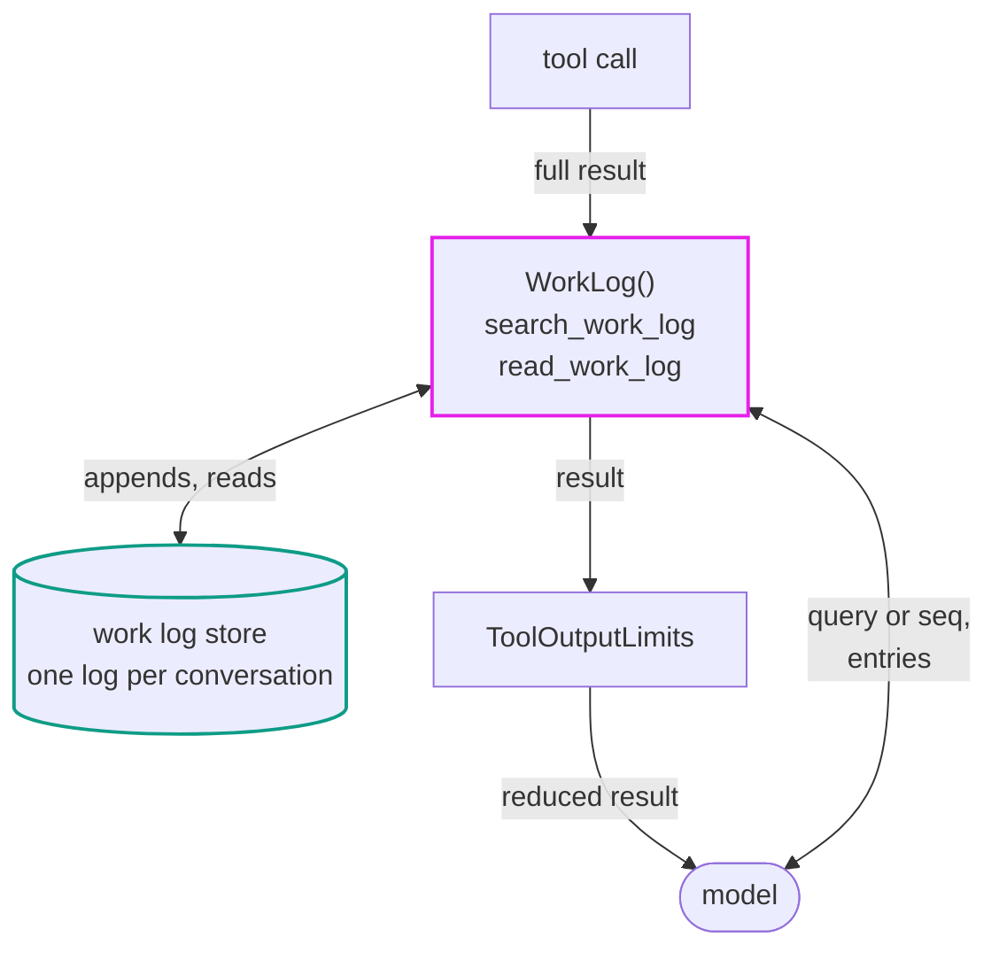

# Work Log

Keep a log of every tool call the agent makes, with its full result, and of the model's replies, so the model can find and read earlier work again after compaction cleared it from the conversation or `ToolOutputLimits` cut it down. The model searches the log with `search_work_log` and reads an entry with `read_work_log`, as tools or from Code Mode code. [`ResetCompaction`](compaction.md#resetcompaction-clear-the-context-keep-the-work-log) builds on it: it clears the history in one step and points the model at the log.

[Source](https://github.com/pydantic/pydantic-ai/tree/main/src/pydantic_ai_harness/pydantic_ai_harness/work_log/)

```python
from pydantic_ai import Agent
from pydantic_ai_harness import WorkLog
from pydantic_ai_harness.work_log import FileWorkLogStore

agent = Agent('{{ openai:medium }}', capabilities=[WorkLog(FileWorkLogStore('work-logs'))])
```

> While Pydantic AI Harness is on 0.x releases, the API may change between minor releases; when it does, deprecation warnings and release-note migration guidance tell you (or your agent) exactly how to upgrade. See the [version policy](index.md#version-policy).



## Why

A long run outgrows its context window, and compaction makes room by clearing old tool results or dropping old messages. The model then runs the same tool again to get back a result it already had. `WorkLog` writes each result to a store as the tool returns it, so the model can search for the entry it needs and read it in pages instead.

The log is written beside the conversation, not derived from it. It holds what the conversation never did: the full result before [`ToolOutputLimits`](tool-output-limits.md) reduced it, and the tool calls a [Code Mode](code-mode.md) script made inside one `run_code` call.

## What it records

Each entry is one tool call, one model reply, or one piece of model thinking:

- **Tool calls that ran.** The tool's name and arguments (as JSON), the outcome, and the result as the model would see it: the return value, followed by a `ToolReturn`'s `content` when it has one. Text is stored as it is. Structured results are stored as indented JSON, one field per line, so `read_work_log` pages them by line and `pattern` matches a field; a value holding something with no JSON form, such as a type, is stored as compact JSON with that part as its `repr`. Files are not logged: each becomes a `[<media type> content not logged]` line.
- **Failures.** A `ModelRetry` is logged with the outcome `retried` and the retry message. Any other exception is logged as `failed`, with its type only, and is still raised; a tool wrapped by [`ReportToolErrors`](report-tool-errors.md) is logged as `failed` with the message it reports. A failure that an outer capability recovers from is logged once, as `success`, with the recovered result. A result that an outer capability's `after_tool_execute` rejects is logged twice: as `success`, then as `retried` or `failed` with the rejection.
- **Model replies.** Each text part of a response, with `record_text=True` (the default). Thinking is logged only with `record_thinking=True`.

Not logged:

- a call that was deferred or needs approval, until it runs;
- a call whose arguments failed validation, since nothing ran and the model already got the retry prompt;
- calls to `search_work_log` and `read_work_log` themselves;
- user prompts.

Capabilities that run innermost, such as [`ToolGuardrail`](guardrails.md) and [`PromptInjectionDefender`](prompt-injection-defender.md), see a result before `WorkLog` does, so the log holds the result after they blocked or redacted it.

Every entry carries `seq` (its 1-based position in the log), `kind` (`tool`, `text` or `thinking`), `tool_name`, `tool_call_id`, `parent_tool_call_id`, `args`, `outcome`, `content`, `chars` (the content's length), `run_id`, `step`, a UTC `timestamp`, and `context`: how many times [`ResetCompaction`](compaction.md#resetcompaction-clear-the-context-keep-the-work-log) had cleared the conversation when it was recorded, `0` before the first. Each entry also has an idempotency `key`, so a hook that runs again, or a retried durable operation, writes it once.

A tool that dispatches others records them under its own call: a Code Mode script's calls have `run_code`'s id as their `parent_tool_call_id`. [`ToolBridge`](tool-bridge.md)'s `tool_call` runs the tool it names under its own id, so the two entries share a `tool_call_id`, and the named tool's `parent_tool_call_id` is that same id.

`WorkLog` adds no instructions. The tool descriptions say what the log holds, and `ResetCompaction`'s notice points the model at it when the history was cleared.

## Searching and reading

`search_work_log(query=None, tool_name=None, run_id=None, limit=10)` finds entries:

- With a `query`, only entries containing a query word are returned, ranked with BM25 over the tool name, arguments and content, the same ranking as [Conversation Search](conversation-search.md): rare terms and exact words score higher.
- Without one, it returns the most recent entries, newest first.
- `tool_name` and `run_id` keep only entries that match exactly.

Each match has the entry's `seq`, `context`, `kind` and `tool_name`, its arguments clipped to about 200 characters, an excerpt of about 300 characters around the first query term the content contains, and `chars`, so the model can tell whether reading the entry takes more than one page. The result also has `total_entries`, the size of the whole log, and `capped`, set when matches were left out to keep the result under 50,000 characters.

`read_work_log(seq, offset=0, limit=200, from_end=False, pattern=None, unit='lines')` reads one entry: the call with its arguments in full and its outcome, plus a window of the content. It follows `ToolOutputLimits`' `read_tool_result`:

- `pattern` is a literal substring, not a regex, and keeps only the lines that contain it; `total` counts those lines, or all lines without a `pattern`.
- `limit` is clamped to 1,000 lines, and the returned text to 50,000 characters. `capped` says the character cap cut the text, keeping its start, or its end with `from_end=True`; `next_offset` then points at the first line not returned in full, passing over a line the cap cut. `cut_at` is the byte offset where the cut line's missing part starts.
- `unit='bytes'` reads the content's UTF-8 bytes instead, for output without useful line breaks such as minified JSON: `offset`, `limit`, `next_offset` and `total` then count bytes, `limit` is clamped to 50,000, and `pattern` can't be used. `read_work_log(seq, unit='bytes', offset=cut_at, limit=50_000)` returns the rest of a cut line.
- `next_offset` is the `offset` that reads on, or `None` when the window reached the end (the start, with `from_end=True`).
- An unknown `seq`, a negative `offset` or a `limit` below 1 asks the model to retry, with the valid range of `seq` in the message.

Both tools return `TypedDict`s, so [Code Mode](code-mode.md) shows their return types to the model, and a script can search and read the log in one `run_code` call. Both are exempt from `ToolOutputLimits`, as its own `read_tool_result` and `grep_tool_result` are: each result is already bounded, and a spilled one would need a second tool to read.

Both tools are `'redacted'` for [UI adapters](../ui/overview.md#tool-visibility): a client sees each call with its arguments, and a placeholder instead of its result. The log holds every tool's result, including ones the adapter keeps from the client, such as a `'private'` tool's, and an entry does not carry the visibility of the tool it recorded. To show the results, set the tools' visibility with [`PrepareTools`](../ui/overview.md#setting-it-in-bulk).

## One log per conversation

The log is keyed by the run's `conversation_id`, so a run continued from earlier history appends to the same log, and the model can find work from earlier runs of the conversation. A run's `conversation_id` is the explicit `conversation_id=` argument, else the most recent one on `message_history`, else a fresh one.

The value is trusted as given. UI adapters set it from client input, so in a multi-tenant application derive it on the server from the authenticated user, as for [Conversation Search](conversation-search.md#scope); see the [threat model](https://github.com/pydantic/pydantic-ai/blob/main/THREAT_MODEL.md#persistent-state-and-tenant-identity).

## Stores

| Store | Where the log is | Handle a reset notice shows |
| --- | --- | --- |
| `InMemoryWorkLogStore()` (default) | This process, until `discard(conversation_id)` or process exit | None: the agent reaches the log only through the tools |
| `FileWorkLogStore(directory)` | One JSONL file per conversation, `<directory>/<log>.jsonl`, on the machine running the agent | The file's absolute path |
| `WorkspaceWorkLogStore(workspace=None)` | One file per entry under `.pydantic-ai-harness/work-log/<log>/` in the run's workspace | That directory, relative to the working directory; none with `workspace=` |

`<log>` is the conversation ID when it is 1 to 128 letters, digits, `.`, `_` or `-` and not only dots and not starting with `sha256-`; otherwise it is `sha256-` and the ID's SHA-256 hex digest. No ID can name a path outside the store's directory, and no two IDs share a log.

- **In memory.** The log grows for as long as the process runs, so a long-lived server should call `discard` when a conversation ends. Two `WorkLog()`s with default stores are one log stated twice (see [Two of them](#two-of-them)). A reset notice names no handle for it: the agent reaches the log only through the tools.
- **File.** The directory is created on the first write, readable by its owner only (`0700`), and each file `0600`; an existing directory is made owner-only, and one that is a symlink or that another user owns is refused. The process reads a log's file once, the first time it touches that log, to learn which entries it already holds. A reset notice names the file's absolute path.
- **Workspace.** The working directory's `.pydantic-ai-harness/` holds a `.gitignore`, so the entries stay out of version control, and the agent's own file and shell tools can open them. The `Workspace` protocol has no append, so each entry is its own file, named by its `seq` and its key's digest. A search tool that ignores `.gitignore` also finds the copies of files the agent read that the entries hold, as they were when read. The store keeps only file names and keys in memory: each search reads every entry file, which in a remote sandbox is one round trip per entry. A symlinked log directory or entry file raises `WorkspaceError`. A run with no workspace fails at its start; pass `workspace=` a backend, such as `LocalWorkspaceBackend('/var/work-logs')`, to keep logs in a workspace of their own instead. The agent's file and shell tools can't reach a workspace passed as `workspace=`, so a reset notice then names no handle, as for the in-memory store. `FileSystem`'s default read-only patterns cover `.pydantic-ai-harness/`, but the agent's shell can still write there, so an entry read back from this store can hold what the agent wrote rather than what the tool returned.

Each store numbers entries in memory, one append at a time per log, so it supports one writer process per log. Nothing prunes the file and workspace logs; delete them when you no longer need them.

To keep the log elsewhere, implement `WorkLogStore`: `append(log_id, record)` returns the entry's `seq` and writes nothing when the log already holds `record['key']`; `read(log_id, start=1, stop=None)` returns entries with `start <= seq < stop`, in order; `locate(log_id)` returns the handle a reset notice names, or `None` when the agent can't open the log itself, synchronously and without I/O.

## Code Mode

`run_code` is logged like any other tool: its `args` hold the code and its `content` the script's output. Each tool call the script makes is logged as an entry of its own, with `run_code`'s call ID as its `parent_tool_call_id`. A nested call finishes before the script does, so it gets a lower `seq` than its `run_code`: `seq` follows the order calls finished, not the order they started.

With `CodeMode(speculate=...)`, a call launched while the model is still writing the script runs its hooks when it launches, so it is logged under its provisional ID (`<call id>__spec_<n>`), which it keeps when the script adopts it. A launch the script never claims is cancelled: one still running is not logged, while one that had already finished stays in the log although the script never used its result.

## Ordering with Tool Output Limits

`WorkLog` orders itself inside `ToolOutputLimits`, so it records a result before `ToolOutputLimits` reduces it: the conversation can hold a spill marker while the log keeps the whole result. Without `ToolOutputLimits` on the agent, this ordering has no effect.

## Durable execution

The log's writes and both tools run as durable operations of the capability's `id`, `'work_log'`: `append` for each recorded entry, and `search` and `read` for the tools. A replay reuses what was recorded. That records one operation per entry, so under Temporal each recorded tool call, reply or thought outside another durable unit runs as an activity of its own in the workflow history. An append made inside another durable unit runs inline in it, and the entry's key keeps a retried unit from writing twice.

Keep the `id` fixed once a workflow is live. Each store numbers entries in the memory of the process that writes them, so two processes appending to one log give two entries the same `seq`. With one worker at a time, `FileWorkLogStore` and `WorkspaceWorkLogStore` keep the log across a worker restart, which the in-memory default loses. When a log's operations can run on several workers at once, implement `WorkLogStore` over storage that assigns `seq` atomically, such as a database.

## Two of them

`WorkLog` declares the default `id` `'work_log'`. Two `WorkLog`s on one agent that share it are one log stated twice: they become one when they agree, and the agent raises a `UserError` when it's built if they differ.

## Telemetry

`WorkLog` emits no spans of its own. Each search and read is a tool call, and the calls it records are tool calls and model requests, so core's spans already cover them, with their content behind the usual instrumentation settings.

## Relationship to other capabilities

- [Conversation Search](conversation-search.md) searches the message history `StepPersistence` saved: user turns, replies, and tool results as the conversation held them. `WorkLog` keeps its own record of tool calls with their full results, including the ones made inside Code Mode, and the model's replies, but no user prompts. Use Conversation Search to recall what was said, and `WorkLog` to recall what tools returned.
- [`ResetCompaction`](compaction.md#resetcompaction-clear-the-context-keep-the-work-log) clears the history down to the task and the latest step, and leaves a notice naming this log and its tools.
- [Tool Output Limits](tool-output-limits.md) keeps one large result from filling the context; the log keeps that result whole.

## Limitations

- A search reads the conversation's whole log on every call, so it gets slower as the log grows.
- The log holds files as they were when the tool read them. A later write is not reflected in an earlier entry. The log is for results that are expensive to get again and for what the model already did, not for a file's current contents.
- Speculative calls keep their provisional IDs; the log does not map them to the IDs the script would have given them.
- It can't be loaded from an [agent spec](../agent-spec.md): its store is an object. Build it in Python.

## Further reading

- [Pydantic AI capabilities](../capabilities/overview.md)
- [Compaction](compaction.md) -- the strategies that clear what this log keeps
- [Tool Output Limits](tool-output-limits.md) -- reduce large tool results at the source

## API reference

::: pydantic_ai_harness.work_log.WorkLog
