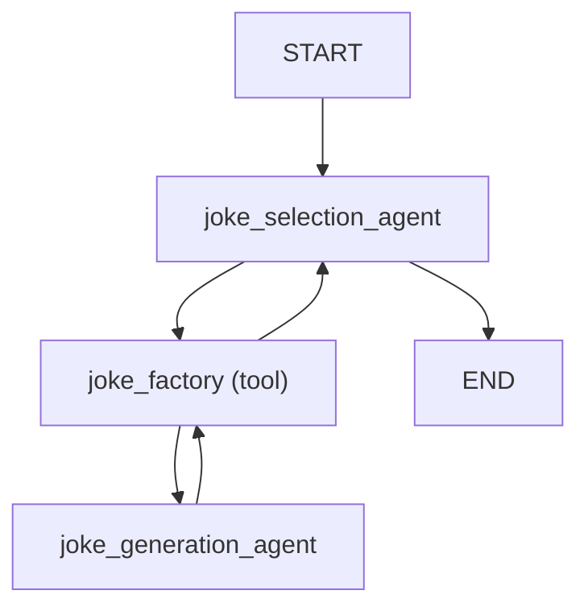
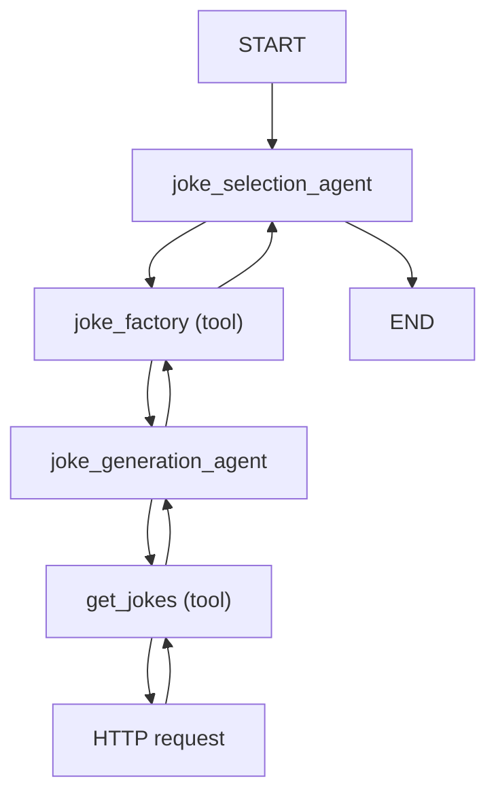
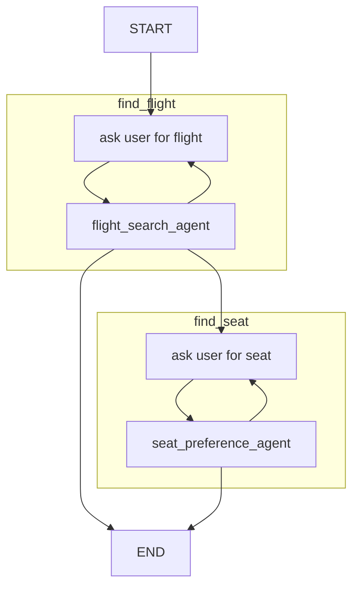

# Multi-agent Applications

There are roughly five levels of complexity when building applications with Pydantic AI:

1. Single agent workflows — what most of the `pydantic_ai` documentation covers
2. [Agent delegation](#agent-delegation) — agents using another agent via tools, either wired up by hand or with the Harness's [`SubAgents`](https://pydantic.dev/docs/ai/harness/subagents/) capability
3. [Programmatic agent hand-off](#programmatic-agent-hand-off) — one agent runs, then application code calls another agent
4. [Graph based control flow](graph.md) — for the most complex cases, a graph-based state machine can be used to control the execution of multiple agents
5. [Deep Agents](#deep-agents) — autonomous agents with planning, file operations, task delegation, and sandboxed code execution

Of course, you can combine multiple strategies in a single application.

Whichever you choose, two patterns help once a workflow has side effects or several steps: [extract, decide, write](#extract-decide-write) keeps writes to your data out of agent runs, and [shared typed state](#shared-typed-state) passes delegates' results between steps as typed data rather than text.

## Agent delegation

"Agent delegation" refers to the scenario where an agent delegates work to another agent, then takes back control when the delegate agent (the agent called from within a tool) finishes.
If you want to hand off control to another agent completely, without coming back to the first agent, you can use an [output function](output.md#output-functions).

!!! tip "`SubAgents` does this for you"
    [Pydantic AI Harness](https://pydantic.dev/docs/ai/harness/) ships a [`SubAgents`](https://pydantic.dev/docs/ai/harness/subagents/) capability that is the most convenient way to delegate: you hand it a list of named agents and it exposes a single `delegate_task(agent_name, task)` tool, forwards dependencies, threads usage limits, and lists the available delegates in the system prompt as a static instruction so the listing stays in the cacheable prefix (see [prompt caching](models/anthropic.md#prompt-caching)). Each delegation runs in its own run with its own message history, so a delegate never sees the parent conversation.

    Write the delegation tool by hand, as below, when you need control `SubAgents` doesn't give you — a bespoke tool schema, per-delegate argument validation, or passing the parent's message history through.

Since agents are stateless and designed to be global, you do not need to include the agent itself in agent [dependencies](dependencies.md).

You'll generally want to pass [`ctx.usage`][pydantic_ai.tools.RunContext.usage] to the [`usage`][pydantic_ai.agent.AbstractAgent.run] keyword argument of the delegate agent run so usage within that run counts towards the total usage of the parent agent run.

[Cancellation](agent.md#cancellation-and-sub-agents) is run-scoped: a delegate agent cancelling itself surfaces to the parent as a failed tool return rather than cancelling the parent, and a shared [`CancellationToken`][pydantic_ai.CancellationToken] cancels a whole tree of runs at once.

!!! note "Multiple models"
    Agent delegation doesn't need to use the same model for each agent. If you choose different models within a run, the final [`result.usage`][pydantic_ai.agent.AgentRunResult.usage] still accumulates any per-response cost that could be calculated. However, monetary cost cannot be reconstructed from its aggregate token counts because models may have different pricing. You can use [`UsageLimits`][pydantic_ai.usage.UsageLimits] — including `cost_limit`, `request_limit`, `total_tokens_limit`, and `tool_calls_limit` — to avoid unexpected costs or runaway tool loops.

```python {title="agent_delegation_simple.py"}
from pydantic_ai import Agent, RunContext, UsageLimits

joke_selection_agent = Agent(  # (1)!
    '{{ openai:medium }}',
    name='joke_selection_agent',  # (2)!
    instructions=(
        'Use the `joke_factory` to generate some jokes, then choose the best. '
        'You must return just a single joke.'
    ),
)
joke_generation_agent = Agent(  # (3)!
    '{{ google:medium }}', name='joke_generation_agent', output_type=list[str]
)


@joke_selection_agent.tool
async def joke_factory(ctx: RunContext, count: int) -> list[str]:
    r = await joke_generation_agent.run(  # (4)!
        f'Please generate {count} jokes.',
        usage=ctx.usage,  # (5)!
    )
    return r.output  # (6)!


result = joke_selection_agent.run_sync(
    'Tell me a joke.',
    usage_limits=UsageLimits(request_limit=5, total_tokens_limit=500),
)
print(result.output)
#> Did you hear about the toothpaste scandal? They called it Colgate.
print(result.usage)
"""
RunUsage(
    cost=Decimal('0.00047625'),
    input_tokens=165,
    output_tokens=24,
    requests=3,
    tool_calls=1,
)
"""
```

1. The "parent" or controlling agent.
2. Passing `name` is optional but recommended when you run more than one agent: it labels each agent's run span, so naming both lets you tell the parent and delegate apart in [Logfire](logfire.md). When omitted, the name is inferred from the variable the agent is assigned to and falls back to `'agent'` when it can't be (e.g. agents kept in a list or dict).
3. The "delegate" agent, which is called from within a tool of the parent agent.
4. Call the delegate agent from within a tool of the parent agent.
5. Pass the usage from the parent agent to the delegate agent so the final [`result.usage`][pydantic_ai.agent.AgentRunResult.usage] includes the usage from both agents.
6. Since the function returns `#!python list[str]`, and the `output_type` of `joke_generation_agent` is also `#!python list[str]`, we can simply return `#!python r.output` from the tool.

_(This example is complete, it can be run "as is")_

!!! warning "Delegate from an `async def` function, not a sync one"
    Note that `joke_factory` above is `async def` and uses `await joke_generation_agent.run(...)`. That's required, not stylistic: [`run_sync()`][pydantic_ai.agent.AbstractAgent.run_sync] and [`run_stream_sync()`][pydantic_ai.agent.AbstractAgent.run_stream_sync] cannot be used inside a tool, [output function](output.md#output-functions), or other function called during an agent run, and raise [`UserError`][pydantic_ai.exceptions.UserError] there.

    The parent agent can still be started with `run_sync()`, as in the example above; only the delegating function has to be `async def`. If it also needs to do blocking work, keep it `async def` and push just that part into [`asyncio.to_thread()`][asyncio.to_thread].

!!! note "Delegation inside a Temporal workflow"
    A tool running in a [Temporal](durable_execution/temporal.md) activity receives a copy of the run context, so `usage=ctx.usage` does not carry the delegate's usage back to the parent run. See [Agent Run Context and Dependencies](durable_execution/temporal.md#agent-run-context-and-dependencies).

The control flow for this example is pretty simple and can be summarised as follows:



### Agent delegation and dependencies

Generally the delegate agent needs to either have the same [dependencies](dependencies.md) as the calling agent, or dependencies which are a subset of the calling agent's dependencies.

!!! info "Initializing dependencies"
    We say "generally" above since there's nothing to stop you initializing dependencies within a tool call and therefore using interdependencies in a delegate agent that are not available on the parent, this should often be avoided since it can be significantly slower than reusing connections etc. from the parent agent.

```python {title="agent_delegation_deps.py"}
from dataclasses import dataclass

import httpx

from pydantic_ai import Agent, RunContext


@dataclass
class ClientAndKey:  # (1)!
    http_client: httpx.AsyncClient
    api_key: str


joke_selection_agent = Agent(
    '{{ openai:medium }}',
    name='joke_selection_agent',
    deps_type=ClientAndKey,  # (2)!
    instructions=(
        'Use the `joke_factory` tool to generate some jokes on the given subject, '
        'then choose the best. You must return just a single joke.'
    ),
)
joke_generation_agent = Agent(
    '{{ google:medium }}',
    name='joke_generation_agent',
    deps_type=ClientAndKey,  # (4)!
    output_type=list[str],
    instructions=(
        'Use the "get_jokes" tool to get some jokes on the given subject, '
        'then extract each joke into a list.'
    ),
)


@joke_selection_agent.tool
async def joke_factory(ctx: RunContext[ClientAndKey], count: int) -> list[str]:
    r = await joke_generation_agent.run(
        f'Please generate {count} jokes.',
        deps=ctx.deps,  # (3)!
        usage=ctx.usage,
    )
    return r.output


@joke_generation_agent.tool  # (5)!
async def get_jokes(ctx: RunContext[ClientAndKey], count: int) -> str:
    response = await ctx.deps.http_client.get(
        'https://example.com',
        params={'count': count},
        headers={'Authorization': f'Bearer {ctx.deps.api_key}'},
    )
    response.raise_for_status()
    return response.text


async def main():
    async with httpx.AsyncClient() as client:
        deps = ClientAndKey(client, 'foobar')
        result = await joke_selection_agent.run('Tell me a joke.', deps=deps)
        print(result.output)
        #> Did you hear about the toothpaste scandal? They called it Colgate.
        print(result.usage)  # (6)!
        """
        RunUsage(
            cost=Decimal('0.00054750'),
            input_tokens=220,
            output_tokens=32,
            requests=4,
            tool_calls=2,
        )
        """
```

1. Define a dataclass to hold the client and API key dependencies.
2. Set the `deps_type` of the calling agent — `joke_selection_agent` here.
3. Pass the dependencies to the delegate agent's run method within the tool call.
4. Also set the `deps_type` of the delegate agent — `joke_generation_agent` here.
5. Define a tool on the delegate agent that uses the dependencies to make an HTTP request.
6. Usage now includes 4 requests — 2 from the calling agent and 2 from the delegate agent.

_(To run this example, ensure `asyncio` is imported and add `asyncio.run(main())`; no other changes are needed.)_

This example shows how even a fairly simple agent delegation can lead to a complex control flow:



## Programmatic agent hand-off

"Programmatic agent hand-off" refers to the scenario where multiple agents are called in succession, with application code and/or a human in the loop responsible for deciding which agent to call next.

Here agents don't need to use the same deps.

!!! tip "Message history between agents"
    To give another agent the previous conversation as context, pass
    `message_history` to its run method. See
    [Sharing messages between agents](message-history.md#sharing-messages-between-agents)
    for the details on instructions, system prompts, and tool context.

Here we show two agents used in succession, the first to find a flight and the second to extract the user's seat preference.

```python {title="programmatic_handoff.py"}
from typing import Literal

from pydantic import BaseModel, Field
from rich.prompt import Prompt

from pydantic_ai import Agent, ModelMessage, RunContext, RunUsage, UsageLimits


class FlightDetails(BaseModel):
    flight_number: str


class Failed(BaseModel):
    """Unable to find a satisfactory choice."""


flight_search_agent = Agent[object, FlightDetails | Failed](  # (1)!
    '{{ openai:medium }}',
    name='flight_search_agent',
    output_type=FlightDetails | Failed,
    instructions=(
        'Use the "flight_search" tool to find a flight '
        'from the given origin to the given destination.'
    ),
)


@flight_search_agent.tool  # (2)!
async def flight_search(
    ctx: RunContext, origin: str, destination: str
) -> FlightDetails | None:
    # in reality, this would call a flight search API or
    # use a browser to scrape a flight search website
    return FlightDetails(flight_number='AK456')


usage_limits = UsageLimits(request_limit=15)  # (3)!


async def find_flight(usage: RunUsage) -> FlightDetails | None:  # (4)!
    message_history: list[ModelMessage] | None = None
    for _ in range(3):
        prompt = Prompt.ask(
            'Where would you like to fly from and to?',
        )
        result = await flight_search_agent.run(
            prompt,
            message_history=message_history,
            usage=usage,
            usage_limits=usage_limits,
        )
        if isinstance(result.output, FlightDetails):
            return result.output
        else:
            message_history = result.all_messages(
                output_tool_return_content='Please try again.'
            )


class SeatPreference(BaseModel):
    row: int = Field(ge=1, le=30)
    seat: Literal['A', 'B', 'C', 'D', 'E', 'F']


# This agent is responsible for extracting the user's seat selection
seat_preference_agent = Agent[object, SeatPreference | Failed](  # (5)!
    '{{ openai:medium }}',
    name='seat_preference_agent',
    output_type=SeatPreference | Failed,
    instructions=(
        "Extract the user's seat preference. "
        'Seats A and F are window seats. '
        'Row 1 is the front row and has extra leg room. '
        'Rows 14, and 20 also have extra leg room. '
    ),
)


async def find_seat(usage: RunUsage) -> SeatPreference:  # (6)!
    message_history: list[ModelMessage] | None = None
    while True:
        answer = Prompt.ask('What seat would you like?')

        result = await seat_preference_agent.run(
            answer,
            message_history=message_history,
            usage=usage,
            usage_limits=usage_limits,
        )
        if isinstance(result.output, SeatPreference):
            return result.output
        else:
            print('Could not understand seat preference. Please try again.')
            message_history = result.all_messages()


async def main():  # (7)!
    usage: RunUsage = RunUsage()

    opt_flight_details = await find_flight(usage)
    if opt_flight_details is not None:
        print(f'Flight found: {opt_flight_details.flight_number}')
        #> Flight found: AK456
        seat_preference = await find_seat(usage)
        print(f'Seat preference: {seat_preference}')
        #> Seat preference: row=1 seat='A'
```

1. Define the first agent, which finds a flight. We use an explicit type annotation until [PEP-747](https://peps.python.org/pep-0747/) lands, see [structured output](output.md#structured-output). We use a union as the output type so the model can communicate if it's unable to find a satisfactory choice; internally, each member of the union will be registered as a separate tool.
2. Define a tool on the agent to find a flight. In this simple case we could dispense with the tool and just define the agent to return structured data, then search for a flight, but in more complex scenarios the tool would be necessary.
3. Define usage limits for the entire app.
4. Define a function to find a flight, which asks the user for their preferences and then calls the agent to find a flight.
5. As with `flight_search_agent` above, we use an explicit type annotation to define the agent.
6. Define a function to find the user's seat preference, which asks the user for their seat preference and then calls the agent to extract the seat preference.
7. Now that we've put our logic for running each agent into separate functions, our main app becomes very simple.

_(To run this example, ensure `asyncio` is imported and add `asyncio.run(main())`; no other changes are needed.)_

The control flow for this example can be summarised as follows:



## Extract, decide, write {#extract-decide-write}

When a workflow changes business data, such as issuing a refund or updating a record, let agents propose the change and let your code commit it:

1. **Extract**: agents with read-only tools turn unstructured input into typed findings. They never write.
2. **Decide**: one step turns the findings into a typed plan. This is usually plain code; when the decision needs judgment, it can be a single agent whose output is the plan.
3. **Write**: application code applies the plan inside a lock, checks that the data the plan was based on hasn't changed since it was read, and records an idempotency key so that a retry, or a crash after the write, doesn't apply the plan twice.

No model call can change data, so a misread input produces a wrong plan that your code can reject, log, or show to a person, rather than a half-finished set of writes made from inside an agent loop. It also replaces chains of narrow agents that each write part of the result with one typed plan that is applied in a single place.

```python {title="extract_decide_write.py" test="skip"}
from dataclasses import dataclass, field
from decimal import Decimal
from typing import Literal

import anyio
from pydantic import BaseModel

from pydantic_ai import Agent, ModelRetry, RunContext


@dataclass
class Order:
    order_id: str
    total: Decimal
    refunded: Decimal = Decimal(0)
    version: int = 1


@dataclass
class Store:  # (1)!
    orders: dict[str, Order]
    applied_keys: set[str] = field(default_factory=set[str])
    lock: anyio.Lock = field(default_factory=anyio.Lock)


class Findings(BaseModel):
    order_id: str
    problem: Literal['damaged', 'late', 'other']


extract_agent = Agent(
    '{{ openai:medium }}',
    name='extract_agent',
    deps_type=Store,
    output_type=Findings,
    instructions='Find the order the customer email is about and classify the problem.',
)


@extract_agent.tool
async def get_order(ctx: RunContext[Store], order_id: str) -> Order | None:  # (2)!
    return ctx.deps.orders.get(order_id)


@extract_agent.output_validator
async def check_order_exists(ctx: RunContext[Store], findings: Findings) -> Findings:
    if findings.order_id not in ctx.deps.orders:  # (3)!
        raise ModelRetry(f'There is no order {findings.order_id!r}.')
    return findings


class RefundPlan(BaseModel):
    order_id: str
    amount: Decimal
    order_version: int


def decide(findings: Findings, order: Order) -> RefundPlan | None:  # (4)!
    remaining = order.total - order.refunded
    if findings.problem == 'damaged':
        amount = remaining
    elif findings.problem == 'late':
        amount = min(remaining, order.total * Decimal('0.1'))
    else:
        return None
    return RefundPlan(
        order_id=order.order_id, amount=amount, order_version=order.version
    )


class StalePlanError(Exception):
    pass


async def apply(store: Store, plan: RefundPlan, idempotency_key: str) -> None:
    async with store.lock:  # (5)!
        if idempotency_key in store.applied_keys:
            return
        order = store.orders[plan.order_id]
        if order.version != plan.order_version:
            raise StalePlanError(f'Order {order.order_id!r} changed since it was read.')
        order.refunded += plan.amount
        order.version += 1
        store.applied_keys.add(idempotency_key)


async def handle_email(store: Store, message_id: str, email: str) -> RefundPlan | None:
    result = await extract_agent.run(email, deps=store)
    order = store.orders[result.output.order_id]
    plan = decide(result.output, order)
    if plan is not None:
        await apply(store, plan, idempotency_key=f'refund:{message_id}')  # (6)!
    return plan
```

1. Stands in for your database: the orders, the idempotency keys of the plans already applied, and a lock that serializes writes.
2. The extraction agent only gets read-only tools.
3. An [output validator](output.md#output-validator-functions) checks every id the model returns against the data, so a made-up order id is sent back to the model as a retry instead of reaching your code.
4. The decision is plain code: the refund policy is a business rule, not something the model should make up. The plan records the order version it was based on.
5. The write happens in one place, under a lock, and only if the order still has the version the plan was based on. If a person reviews the plan before it is applied, this is what stops an approved plan from overwriting a change made while it was waiting.
6. The idempotency key comes from the input (here, the email's message id), not from the model, so handling the same email twice applies its refund once.

When a person has to approve the change, show them the typed plan between the decide and write steps. [Deferred tools](deferred-tools.md) are the right fit when they need to approve an individual tool call that the agent makes during its run, rather than a business change.

## Shared typed state across delegated agents {#shared-typed-state}

When a parent agent delegates several steps of one task and the results of earlier steps feed later ones, keep those results as typed data in the parent's [dependencies](dependencies.md), not only as text in the conversation:

- A "case file" object in deps holds the typed state of the task.
- Each delegate agent has a typed `output_type`, and the tool that calls it stores the output on the case file.
- The tool returns a short summary to the parent model: enough to decide the next step, while the full typed result stays available to later tools and to your code after the run.

```python {title="shared_typed_state.py" test="skip"}
from dataclasses import dataclass
from decimal import Decimal

from pydantic import BaseModel

from pydantic_ai import Agent, ModelRetry, RunContext


class Charge(BaseModel):
    charge_id: str
    amount: Decimal
    merchant: str


class DisputedCharges(BaseModel):
    charge_ids: list[str]


class Eligibility(BaseModel):
    eligible: bool
    reason: str


@dataclass
class CaseFile:  # (1)!
    complaint: str
    charges: list[Charge]
    disputed: DisputedCharges | None = None
    eligibility: Eligibility | None = None


dispute_agent = Agent(
    '{{ openai:small }}',
    name='dispute_agent',
    output_type=DisputedCharges,
    instructions='List the ids of the charges the customer is disputing.',
)
eligibility_agent = Agent(
    '{{ openai:medium }}',
    name='eligibility_agent',
    output_type=Eligibility,
    instructions='Decide whether the disputed charges are eligible for a chargeback.',
)
case_agent = Agent(
    '{{ openai:medium }}',
    name='case_agent',
    deps_type=CaseFile,
    instructions=(
        'Handle the customer dispute: find the disputed charges, check eligibility, '
        'then write a short reply to the customer.'
    ),
)


@case_agent.tool
async def find_disputed_charges(ctx: RunContext[CaseFile]) -> str:
    case = ctx.deps
    charges = '\n'.join(c.model_dump_json() for c in case.charges)
    result = await dispute_agent.run(
        f'Complaint: {case.complaint}\n\nCharges:\n{charges}',
        usage=ctx.usage,
    )
    case.disputed = result.output  # (2)!
    return f'{len(result.output.charge_ids)} charge(s) disputed.'  # (3)!


@case_agent.tool
async def check_eligibility(ctx: RunContext[CaseFile]) -> str:
    case = ctx.deps
    if case.disputed is None:
        raise ModelRetry('Find the disputed charges first.')
    disputed = [c for c in case.charges if c.charge_id in case.disputed.charge_ids]
    result = await eligibility_agent.run(  # (4)!
        '\n'.join(c.model_dump_json() for c in disputed),
        usage=ctx.usage,
    )
    case.eligibility = result.output
    return f'Eligible: {result.output.eligible}. {result.output.reason}'


async def handle_dispute(case: CaseFile) -> str:
    result = await case_agent.run(case.complaint, deps=case)
    if case.disputed and case.eligibility and case.eligibility.eligible:  # (5)!
        ...  # open the chargeback for case.disputed.charge_ids
    return result.output
```

1. The case file is the run's shared state. Your code creates it, the parent's tools fill it in, and your code reads it after the run.
2. The delegate's typed output is stored as-is, so nothing downstream has to parse it back out of text.
3. The parent model only sees a summary. It doesn't need the full result to decide what to do next.
4. The second delegate gets its input from the typed state the first one produced, not from the parent model restating it.
5. Your code acts on the typed state, not on the reply the parent model wrote to the customer. This combines with [extract, decide, write](#extract-decide-write): the delegates extract, and your code decides and writes.

The delegation tools are written by hand here because the Harness's [`SubAgents`](https://pydantic.dev/docs/ai/harness/subagents/) capability returns a delegate's output to the parent as text, with no hook for storing the typed result.

## Pydantic Graphs

See the [graph](graph.md) documentation on when and how to use graphs.

## Deep Agents

Deep agents are autonomous agents that combine multiple architectural patterns and capabilities to handle complex, multi-step tasks reliably. [Pydantic AI Harness](harness/index.md) ships each of these patterns as a capability you can compose with Pydantic AI's built-in features:

- **Planning and progress tracking** — agents break down complex tasks into steps and track their progress, giving users visibility into what the agent is working on. See [`Planning`](harness/planning.md).
- **File system operations** — reading, writing, and editing files in the run's workspace, on the local machine or in a sandboxed container. See [`FileSystem`](harness/filesystem.md) and [`Shell`](harness/shell.md).
- **Task delegation** — spawning specialized sub-agents for specific tasks, with isolated context to prevent recursive delegation issues. See [`SubAgents`](harness/subagents.md) and [Agent Delegation](#agent-delegation) above.
- **Sandboxed code execution** — running AI-generated code in isolated environments to prevent accidents. See [`Shell`](harness/shell.md) with a sandbox backend such as [`DockerSandbox`](harness/docker-sandbox.md), and [`CodeMode`](harness/code-mode.md).
- **Context management** — automatic conversation compaction to handle long sessions that would otherwise exceed token limits. See [Compaction](capabilities/compaction.md) and the Harness [compaction strategies](harness/compaction.md).
- **Human-in-the-loop** — approval workflows for dangerous operations like code execution or file deletion. See [Requiring Tool Approval](toolsets.md#requiring-tool-approval).
- **Durable execution** — preserving agent state across transient API failures and application errors or restarts. See [Durable Execution](durable_execution/overview.md).

For a ready-made assembly of these pieces, [`Coder`](harness/coder.md) combines file system, shell, delegation, and context management capabilities into a coding agent you can use whole or take apart.

## Observing Multi-Agent Systems

Multi-agent systems can be challenging to debug due to their complexity; when multiple agents interact, understanding the flow of execution becomes essential.

### Tracing Agent Delegation

Run `uvx logfire-cli wizard --task pydantic-ai` once from your project to [set up Logfire](logfire.md#using-logfire) and trace the entire flow across multiple agents. It has your coding agent add this instrumentation:

```python
import logfire

logfire.configure()
logfire.instrument_pydantic_ai()

# Your multi-agent code here...
```

Logfire shows you:

- **Which agent handled which part** of the request
- **Delegation decisions**—when and why one agent called another
- **End-to-end latency** broken down by agent
- **Token usage and costs** per agent
- **What triggered the agent run**—the HTTP request, scheduled job, or user action that started it all
- **What happened inside tool calls**—database queries, HTTP requests, file operations, and any other instrumented code that tools execute

This is essential for understanding and optimizing complex agent workflows. When something goes wrong in a multi-agent system, you'll see exactly which agent failed and what it was trying to do, and whether the problem was in the agent's reasoning or in the backend systems it called.

### Full-Stack Visibility

If your Pydantic AI application includes a TypeScript frontend, API gateway, or services in other languages, Logfire can trace them too—Logfire provides SDKs for Python, JavaScript/TypeScript, and Rust, plus compatibility with any OpenTelemetry-instrumented application. See traces from your entire stack in a unified view. For details on sending data from other languages using standard OpenTelemetry, see the [alternative clients guide](https://logfire.pydantic.dev/docs/how-to-guides/alternative-clients/).

Pydantic AI's instrumentation is built on [OpenTelemetry](https://opentelemetry.io/), so you can also use any OTel-compatible backend. See the [Logfire integration guide](logfire.md#using-logfire) for details.

## Examples

The following examples demonstrate how to use multi-agent patterns in Pydantic AI:

- [Flight booking](examples/flight-booking.md)
