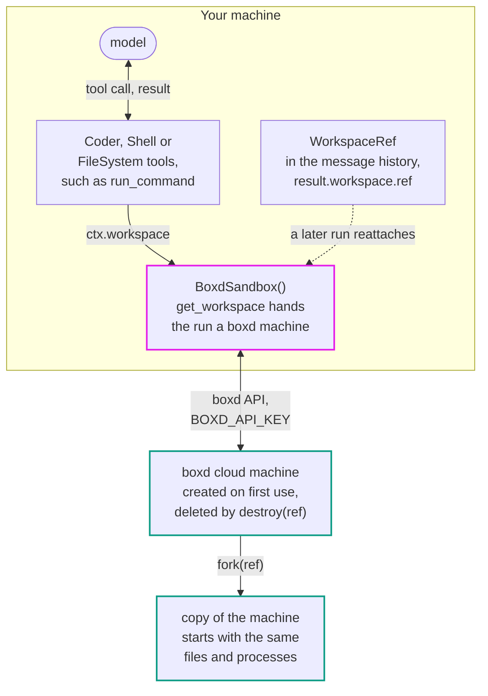

# boxd Sandbox

Run your agent's commands and file edits in an isolated [boxd](https://boxd.sh) cloud machine instead of on your machine.

[Source](https://github.com/pydantic/pydantic-ai/tree/main/src/pydantic_ai_harness/pydantic_ai_harness/boxd_sandbox/)

> While Pydantic AI Harness is on 0.x releases, the API may change between minor releases; when it does, deprecation warnings and release-note migration guidance tell you (or your agent) exactly how to upgrade. See the [version policy](https://pydantic.dev/docs/ai/harness/#version-policy).



## Install

uv:

```bash
uv add "pydantic-ai-harness[coder,boxd,anthropic]"
```

pip:

```bash
pip install "pydantic-ai-harness[coder,boxd,anthropic]"
```

Set `BOXD_API_KEY` to an API key from `boxd auth keys create`. Each key belongs to one boxd organization. The examples also use `Coder` and an Anthropic model, so they need the `coder` and `anthropic` extras and `ANTHROPIC_API_KEY`. Swap them for your own tools and model provider.

## Quick start

<span id="choose-the-tools"></span>

```python {names="defined"}
from pydantic_ai import Agent
from pydantic_ai_harness.boxd_sandbox import BoxdSandbox
from pydantic_ai_harness.coder import Coder

agent = Agent('anthropic:claude-opus-5-5', capabilities=[BoxdSandbox(), Coder()])
result = agent.run_sync('Clone https://github.com/pydantic/pydantic-ai and summarize how capabilities work.')
```

`Coder`'s shell and file tools now run in a boxd machine. For a narrower agent, use [`Shell`](https://pydantic.dev/docs/ai/harness/shell/), [`FileSystem`](https://pydantic.dev/docs/ai/harness/filesystem/) or your own tools on [`ctx.workspace`](https://pydantic.dev/docs/ai/core-concepts/workspace/#using-the-workspace-in-tools).

- `Coder` creates it when the run starts, to load the repository's instructions, even if no tool is called. Pass `Coder(repo_context=False)` to wait for the first tool call.
- It keeps its disk until you delete it. boxd suspends it when idle, but never deletes it unless your organization's defaults say so. See [Clean up](#clean-up).
- Commands run as the non-root `boxd` user in `/home/boxd`, with passwordless `sudo`. Pass `working_dir='/home/boxd/project'` to give the agent a project directory. It is created on a new machine.
- The default image is Ubuntu 24.04 with git, Python 3, uv, Node.js and `rg`, but not your project's dependencies. Install them in a machine and save it as a snapshot, a copy new machines can start from, with `boxd snapshots save`. Then pass `snapshot='my-snapshot'`. An unknown snapshot, or one still saving, fails on first use with `WorkspaceUnavailableError`.
- It can reach the internet, and has a public HTTPS address that serves the port its code listens on. See [Security model](#security-model).

## Continue in the same machine

<span id="reattach-later"></span>

Pass the message history, and the next run works in the same machine, waking or starting it if needed:

```python {names="defined"}
from pydantic_ai import Agent
from pydantic_ai_harness.boxd_sandbox import BoxdSandbox
from pydantic_ai_harness.coder import Coder

agent = Agent('anthropic:claude-opus-5-5', capabilities=[BoxdSandbox(), Coder()])
result = agent.run_sync('Clone https://github.com/pydantic/pydantic-ai and summarize how capabilities work.')

followup = agent.run_sync(
    'Which capability would you add next, and where would it live?',
    message_history=result.all_messages(),
)
ref = result.workspace.ref  # or store this, and pass `workspace=ref` to a later run
```

The history records the machine as a `WorkspaceRef`, or "ref": the provider's name and the machine's ID. `result.workspace.ref` is the same ref, for continuing without the history.

If the machine has been deleted, the run raises `WorkspaceUnavailableError`. Pass `workspace='new'` to start over. [Workspaces](https://pydantic.dev/docs/ai/core-concepts/workspace/#continuing-in-the-same-workspace) covers how runs find their workspace.

The ref holds no credentials, so the process that reattaches needs `BOXD_API_KEY` or a `client=` too.

## Prepare a machine before the run

To seed files before the agent starts, build the backend yourself, write through a `Workspace`, and pass the backend to the run:

```python {names="defined"}
from pydantic_ai import Agent
from pydantic_ai.workspaces import Workspace
from pydantic_ai_harness.boxd_sandbox import BoxdSandbox, BoxdSandboxBackend
from pydantic_ai_harness.coder import Coder

agent = Agent('anthropic:claude-opus-5-5', capabilities=[BoxdSandbox(), Coder()])


async def run_in_prepared_machine() -> str:
    backend = BoxdSandboxBackend(working_dir='/home/boxd/project')
    try:
        await Workspace(backend).write_text('TASK.md', 'Add a `--version` flag to cli.py.\n')
        result = await agent.run('Do the task in TASK.md.', workspace=backend)
        return result.output
    finally:
        await backend.aclose()
        ref = backend.ref  # set once the machine exists
        if ref is not None:
            await BoxdSandbox().destroy(ref)
```

The run leaves a backend you built open, so close it with `aclose()`. That closes the client it opened from the environment, not the machine. A `client=` you passed is never closed. To keep the machine, store `backend.ref` instead of destroying it.

For boxd features the workspace API doesn't cover, such as snapshots and public URLs, `await backend.get_sandbox()` returns the machine's `boxd.Machine` record. Use its `id` with your own `boxd.AsyncBoxd`.

## Clean up

Delete a machine with the ref you stored, whatever state it is in:

```python {names="defined"}
from pydantic_ai.workspaces import WorkspaceRef
from pydantic_ai_harness.boxd_sandbox import BoxdSandbox


async def delete_machine(ref: WorkspaceRef) -> None:
    await BoxdSandbox().destroy(ref)
```

A failed run returns no result, so delete its machine in an `on_run_error` hook:

```python
from typing import Any

import anyio

from pydantic_ai import Agent, RunContext
from pydantic_ai.capabilities import Hooks
from pydantic_ai.run import AgentRunResult
from pydantic_ai_harness.boxd_sandbox import BoxdSandbox
from pydantic_ai_harness.coder import Coder

hooks = Hooks()


@hooks.on.run_error
async def delete_failed_run_machine(ctx: RunContext[None], *, error: BaseException) -> AgentRunResult[Any]:
    if ctx.workspace.ref is not None:
        # Shielded so a deadline around the run can't cut the delete short, bounded so a hung call can't hang it.
        with anyio.move_on_after(30, shield=True):
            await BoxdSandbox().destroy(ctx.workspace.ref)
    raise error


agent = Agent('anthropic:claude-opus-5-5', capabilities=[BoxdSandbox(), Coder(), hooks])
```

A machine you don't delete is suspended when it sits idle, then hibernated:

- boxd uses your organization's idle time. Set `auto_suspend_timeout=` in seconds to change it, or `0` to never suspend.
- boxd deletes a machine only if your organization gives new machines a delete timer. `boxd machine get` shows a machine's timers.

### Find a lost machine

If your program stops before it stores the ref, for example after a crash or Ctrl-C, the machine is left running. To find it:

- Run `boxd list`. Machines Pydantic AI creates are named `pydantic-ai-<hex>`.
- Or search your logs for `Created boxd machine <id>`, or `Forked boxd machine` for a copy, logged at INFO by the `pydantic_ai_harness` logger.

Then delete it: `await BoxdSandbox().destroy(WorkspaceRef(provider='boxd', id='<id>'))`.

## Keep a token out of the machine

Pass `secrets` to give a new machine boxd secrets by name. If a secret is tied to domains, the machine gets only a placeholder starting with `bxds_`, and boxd swaps in the real value as requests leave for those domains. Create the secret first, since boxd won't create a machine that names a missing one:

```python {test="skip"}
import boxd

from pydantic_ai_harness.boxd_sandbox import BoxdSandbox


async def set_github_secret(token: str) -> None:  # a fine-grained GitHub token, as below
    async with boxd.AsyncBoxd() as client:
        await client.secrets.set(
            'GH_TOKEN',
            token,
            scope='private-unattached',  # your own, reaching only machines whose spec names it
            domains=['github.com', 'api.github.com', 'uploads.github.com'],
            replace_in=['headers'],  # not the URL or body, so a command can't post the real token
        )


sandbox = BoxdSandbox(secrets=['GH_TOKEN'])
```

`gh` then works as the token's owner, while `echo $GH_TOKEN` in the machine prints the placeholder. For `git push`, have git send the placeholder as its password:

```bash
git config --global credential.https://github.com.helper '!f() { echo username=x-access-token; echo "password=$GH_TOKEN"; }; f'
```

- Only HTTPS requests get the real value. Use `https://` remotes, not `git@github.com:owner/repo.git`.
- `replace_in=['headers']` swaps the value only into request headers, which covers `gh` and git's Basic auth. Without it, boxd also swaps it into the URL and body, so a command could write the real token into something GitHub stores, such as an issue or a gist, and read it back. Either way, use a fine-grained token that reaches only the repositories the agent works on, not your `gh auth token`.
- boxd turns the real value back into the placeholder in responses, but may miss an encoded copy. List only hosts that never send request headers back.
- An attached machine keeps the secrets it was created with. Calling `secrets.set` again swaps the value right away, and the placeholder stays the same.

## Fork a machine

`fork(ref)` copies a machine into a new isolated one, with its files and running processes as they are at that moment, and returns the copy's ref. The two then change independently, so agents can try different approaches from the same starting point at once:

```python {names="defined"}
import asyncio

from pydantic_ai import Agent
from pydantic_ai_harness.boxd_sandbox import BoxdSandbox
from pydantic_ai_harness.coder import Coder

sandbox = BoxdSandbox()
agent = Agent('anthropic:claude-opus-5-5', capabilities=[sandbox, Coder()])


async def main() -> None:
    setup = await agent.run('Clone https://github.com/pydantic/pydantic-ai and install it with `uv sync`.')
    ref = setup.workspace.ref
    assert ref is not None  # set once the run has used the machine
    copy = await sandbox.fork(ref)

    await asyncio.gather(
        agent.run('Speed up the slowest test by caching what it builds.', workspace=ref),
        agent.run('Speed up the slowest test by mocking its network calls.', workspace=copy),
    )
    await asyncio.gather(sandbox.destroy(ref), sandbox.destroy(copy))


asyncio.run(main())
```

Destroy each machine when you are done. The copy isn't tied to the original, so destroying one leaves the other.

## Security model

- Machines `BoxdSandbox` creates, and copies `fork` makes, are isolated: code the agent runs holds no boxd credentials and can't reach your other boxd machines.
- They can reach the internet, and like every boxd machine have a public HTTPS address that serves the port their code listens on.
- `BoxdSandbox` refuses to attach to or fork a machine that isn't isolated or is on a named boxd network, and `destroy` refuses one that isn't isolated.
- A machine from a snapshot keeps the networks of the machine the snapshot was saved from, so save snapshots from a machine on no network.
- A ref can name any isolated machine your credentials can see, so keep refs server-side.

## Configuration

| Option | What it does |
| --- | --- |
| `client` | A `boxd.AsyncBoxd` to share across runs on one event loop, or to point at another boxd cluster. You close a client you pass. Default: `None`, a client each run opens and closes. It logs in with `BOXD_TOKEN`, else `BOXD_API_KEY`, else as the boxd machine it runs in. |
| `org` | boxd organization a new machine belongs to. Default: `None`, the API key's organization, or your default one for other credentials. |
| `snapshot` | boxd snapshot a new machine starts from, by name or id. Default: `None`, boxd's default image. An unknown snapshot fails on first use. |
| `vcpu` | Size of a new machine: `1`, `2`, `4` or `8` vCPUs, with 4 GiB of memory each. Default: `None`, the organization's default size. Can't be combined with `snapshot`, since a machine from a snapshot keeps the size it was saved at. |
| `auto_suspend_timeout` | Seconds without network activity before boxd suspends a new machine. `0` disables it. Default: `None`, the organization's default. A command wakes a suspended machine. |
| `working_dir` | Absolute directory commands start in and relative paths resolve against. Default: `None`, `/home/boxd`. Created on a new machine. On an attached one, it must already exist. |
| `env` | Environment variables every command gets. Default: `None`. Nothing from your machine reaches the boxd machine. The agent's commands can read these, so leave out secrets it shouldn't see. |
| `secrets` | Names of existing boxd secrets a new machine gets. Default: `None`. An attached machine keeps the ones it was created with. See [Keep a token out of the machine](#keep-a-token-out-of-the-machine). |
| `authority` | Who wrote the machine's files. A capability that puts a file's text in the prompt gives it no more [authority](https://pydantic.dev/docs/ai/core-concepts/workspace-custom/#workspace-authority) than this. Default: `'operator'`, your own files. Use `'user'` for the user's files, and `'none'` for files nobody on your side wrote, such as a cloned third-party repository. |
| `path_authority` | Levels for some directories and files, overriding `authority` under them. The longest matching path wins. Paths are in the machine, relative to the working directory or absolute, and `~` isn't expanded. Default: `None`. |

`client`, `working_dir`, `env`, `authority` and `path_authority` also apply when you reattach, and `destroy` uses `client`. The other options only shape a new machine. An attached machine keeps the `secrets` it was created with.

## Limits

<span id="what-a-timeout-stops"></span>

- boxd ends a command that prints nothing for 30 minutes, even with `timeout=None`, raising `WorkspaceTimeoutError`. Have long builds print progress.
- A timeout or cancellation stops the command's process group, not the machine.
- `run()` returns when the command exits, so output a background child writes afterwards is lost. Redirect it to a file. `Shell.start_command` does this for you.
- A command whose output passes 10 MiB is stopped with `WorkspaceOutputLimitError`. Redirect large output to a file.
- The boxd SDK needs asyncio. Under Trio, every operation raises `UserError`.

## Durable execution

Add a durability capability, such as `TemporalDurability()` from the `temporal` extra, next to `BoxdSandbox()`. [Workspaces](https://pydantic.dev/docs/ai/core-concepts/workspace/#durable-execution) covers what changes.

Pass one client, as in `BoxdSandbox(client=boxd.AsyncBoxd())`. Without it, every workspace operation logs in to boxd again. boxd allows 30 logins a minute from one IP address, so a busy worker fails with `RateLimitError`.

## Telemetry

`BoxdSandbox` emits no spans of its own. Core's [instrumentation](https://pydantic.dev/docs/ai/capabilities/instrumentation/) records `pydantic_ai.workspace.provider` and `pydantic_ai.workspace.id` on the agent run span, and each command or file operation runs inside its tool call's span.

## API reference

::: pydantic_ai_harness.boxd_sandbox.BoxdSandbox

::: pydantic_ai_harness.boxd_sandbox.BoxdSandboxBackend
