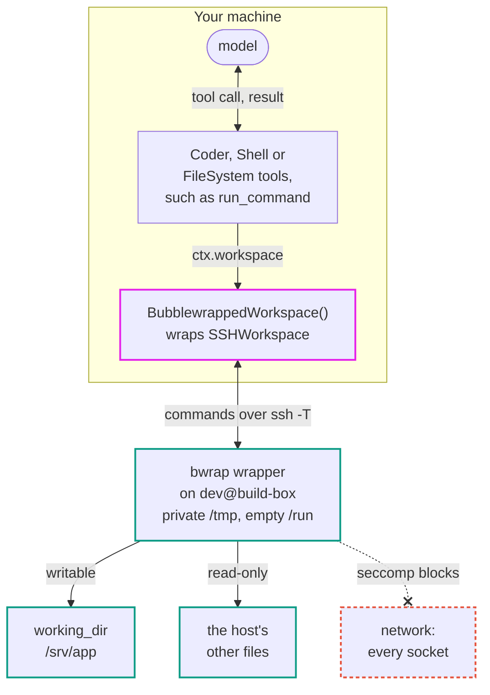

# Bubblewrapped Workspace

Run your agent's commands in a Linux [bubblewrap](https://github.com/containers/bubblewrap) (`bwrap`) wrapper on the host they already run on, over SSH or locally.

[Source](https://github.com/pydantic/pydantic-ai/tree/main/src/pydantic_ai_harness/pydantic_ai_harness/bubblewrap_sandbox/)

!!! warning "Best effort, not a security boundary"
    `BubblewrappedWorkspace` keeps a trusted agent from accidentally changing files outside its working directory. It is **not a security boundary** and **not a sandbox for untrusted code or untrusted agents**: commands share the host kernel and run as the host user. For untrusted agents, use a VM or microVM-backed sandbox such as [E2B](https://pydantic.dev/docs/ai/harness/e2b-sandbox/), [Modal](https://pydantic.dev/docs/ai/harness/modal-sandbox/), [Daytona](https://pydantic.dev/docs/ai/harness/daytona-sandbox/), [BoxLite](https://pydantic.dev/docs/ai/harness/boxlite-sandbox/), or [Smol](https://pydantic.dev/docs/ai/harness/smol-sandbox/).

    Do **not** set the working directory to your home directory or a directory containing it. The agent could change files there, such as shell startup files or configuration under a non-default `$XDG_CONFIG_HOME`, and they run later outside the wrapper. Only the default startup locations listed below are mounted read-only.



## Install

uv:

```bash
uv add "pydantic-ai-harness[coder,anthropic]"
```

pip:

```bash
pip install "pydantic-ai-harness[coder,anthropic]"
```

The host the commands run on must run Linux, with the `bubblewrap` package installed and user namespaces allowed. Otherwise commands raise `WorkspaceUnavailableError`. The examples also use `Coder` and an Anthropic model, hence the `coder` and `anthropic` extras; swap them for your own tools and model provider.

## Quick start

`BubblewrappedWorkspace` wraps another workspace capability and runs its commands in `bwrap` on that workspace's host. Wrap [`SSHWorkspace`](https://pydantic.dev/docs/ai/harness/ssh-workspace/) to confine commands on a remote host, or `LocalWorkspace` to confine them on this one:

```python {test="skip"}
from pydantic_ai import Agent
from pydantic_ai_harness import BubblewrappedWorkspace, Coder, SSHWorkspace

agent = Agent(
    'anthropic:claude-opus-5-5',
    capabilities=[BubblewrappedWorkspace(SSHWorkspace('dev@build-box', working_dir='/srv/app')), Coder()],
)
result = agent.run_sync('Run the test suite and fix the first failure.')
```

- Commands can write only to the working directory. They see the host's other files read-only, a private `/tmp` and an empty `/run`.
- The file tools of [`FileSystem`](https://pydantic.dev/docs/ai/harness/filesystem/) and [`Coder`](https://pydantic.dev/docs/ai/harness/coder/) run in the wrapper too, so they can't write outside the working directory either, even through a swapped-in symlink.
- There is no network, not even loopback or Unix sockets. A test suite that starts a local server needs `network=True`. See [Network](#network).
- Background jobs keep running after the call and the run that started them, until something stops them. Commands share the host's process list.
- The run's ref and `backend` are the wrapped workspace's, so continuing a run works as it does for that workspace.

## What the wrapper allows

`bwrap` gives the wrapper its own user namespace and no Linux capabilities, the kernel's per-process privileges. `/run` is empty because host daemons such as Docker listen on sockets there, and a read-only mount doesn't stop a connection.

When the working directory contains the host account's home directory, as an `SSHWorkspace` without a `working_dir` does, the files the host runs or reads when the next SSH connection logs in are mounted read-only:

- `~/.ssh` and `~/.pam_environment`.
- The startup files a login shell runs or commonly sources for a command: `~/.bashrc`, `~/.bashrc.d`, `~/.cargo/env`, `~/.local/bin/env`, `~/.zshenv` (and `$ZDOTDIR/.zshenv` when `ZDOTDIR` points elsewhere), `~/.cshrc`, `~/.tcshrc` and `~/.config/fish`.

Missing ones are created empty. If one of them is a symlink, or the home directory isn't absolute, the wrapper doesn't start.

Add `bwrap` arguments with `bwrap_args=`. They come after the defaults, including the mounts above:

- `['--bind', path, path]` makes another directory writable.
- `['--tmpfs', path]` hides one, such as `~/.ssh`.

### Network

By default, a seccomp filter, a kernel-level list of blocked system calls, stops commands from:

- Connecting to, serving or accepting on any socket, including Unix sockets elsewhere on disk and the wrapper's own loopback.
- Using `ptrace` or `io_uring`.

Stream socket pairs still work, which language runtimes use between their own processes.

Python's `multiprocessing` listens on a socket with its `forkserver` start method, the default on Linux since Python 3.14. Use `multiprocessing.get_context('spawn')` or `'fork'`, or pass `network=True`.

`network=True` shares the host's network: commands can reach anything the host can, including services on its loopback, and listen on its ports. There is no seccomp filter then.

### What it doesn't stop

The wrapper keeps an agent from accidentally changing the host outside its working directory. It is not a boundary against an agent trying to harm the host user:

- Commands can read every file the host user can, such as SSH keys and cloud credentials, and show them to the model. Hide those directories with `bwrap_args=['--tmpfs', path]`.
- Commands can see the host's processes and their command lines, including a call's `env` values. They can also signal, and so stop, the host user's other processes.
- Anything a command writes in the working directory, such as Git hooks, a `Makefile` or an `.envrc`, runs outside the wrapper if you later run it there.
- When the working directory contains the home directory, everything in it except the paths listed above stays writable. That includes:
  - files only an interactive login runs, such as `~/.profile` and `~/.bash_profile`;
  - other per-user configuration, including fish configuration when `$XDG_CONFIG_HOME` is set to a non-default location;
  - files the read-only startup files source, such as a `~/.bashrc.local`. Which ones depends on each host, so the wrapper can't know them all.

  This isn't specific to SSH: with a `LocalWorkspace`, the same files run the next time you open a shell. Give the wrapper a project directory as its `working_dir` instead.
- The wrapper trusts the wrapped workspace's own settings, `bwrap_args`, and the host's `bwrap` and `base64`, taken from a `PATH` directory outside the working directory.

For an agent you don't trust, give it its own user on the host, or use a VM-backed sandbox such as [Smol](https://pydantic.dev/docs/ai/harness/smol-sandbox/) or [BoxLite](https://pydantic.dev/docs/ai/harness/boxlite-sandbox/).

## Use the workspace directly

The capability builds a `BubblewrapWorkspace` around the wrapped workspace. You can also use it directly, around any workspace. It is a [`WrapperWorkspace`](https://pydantic.dev/docs/ai/core-concepts/workspace-custom/#wrapping-a-workspace):

```python {test="skip"}
from pydantic_ai.workspaces import CommandResult, Workspace
from pydantic_ai_harness import BubblewrapWorkspace, SSHWorkspaceBackend


async def run_tests() -> CommandResult:
    workspace = BubblewrapWorkspace(Workspace(SSHWorkspaceBackend('dev@build-box', working_dir='/srv/app')))
    # `bwrap` runs `make test` on build-box
    return await workspace.run(['make', 'test'])
```

The wrapped workspace must run commands without a controlling terminal. Otherwise, on kernels that permit `TIOCSTI`, wrapped commands could type input into the host terminal. `LocalWorkspaceBackend`, `SSHWorkspaceBackend`, `E2BSandboxBackend` and `ModalSandboxBackend` all run commands without one. A custom backend must too.

## Limits

- On a timeout or cancellation, what stops is up to the wrapped backend:
    - Local and SSH stop the command and its foreground descendants. SSH cleanup can fail if the host stalls.
    - E2B and Modal do so only when the image has `setsid`.
    - Jobs detached into their own session keep running everywhere.
- The seccomp filter covers x86_64 and aarch64 hosts. A 32-bit program in the wrapper is stopped when it makes a system call.
- A read-only wrapped workspace runs no commands, so its files are read from the host directly.

## Telemetry

`BubblewrappedWorkspace` emits no spans of its own. The run's workspace is the wrapped one's, so core's [instrumentation](https://pydantic.dev/docs/ai/capabilities/instrumentation/) records its `pydantic_ai.workspace.provider` and `pydantic_ai.workspace.id` on the agent run span, and each wrapped command runs inside its tool call's span.

## API reference

::: pydantic_ai_harness.bubblewrap_sandbox.BubblewrappedWorkspace

::: pydantic_ai_harness.bubblewrap_sandbox.BubblewrapWorkspace
