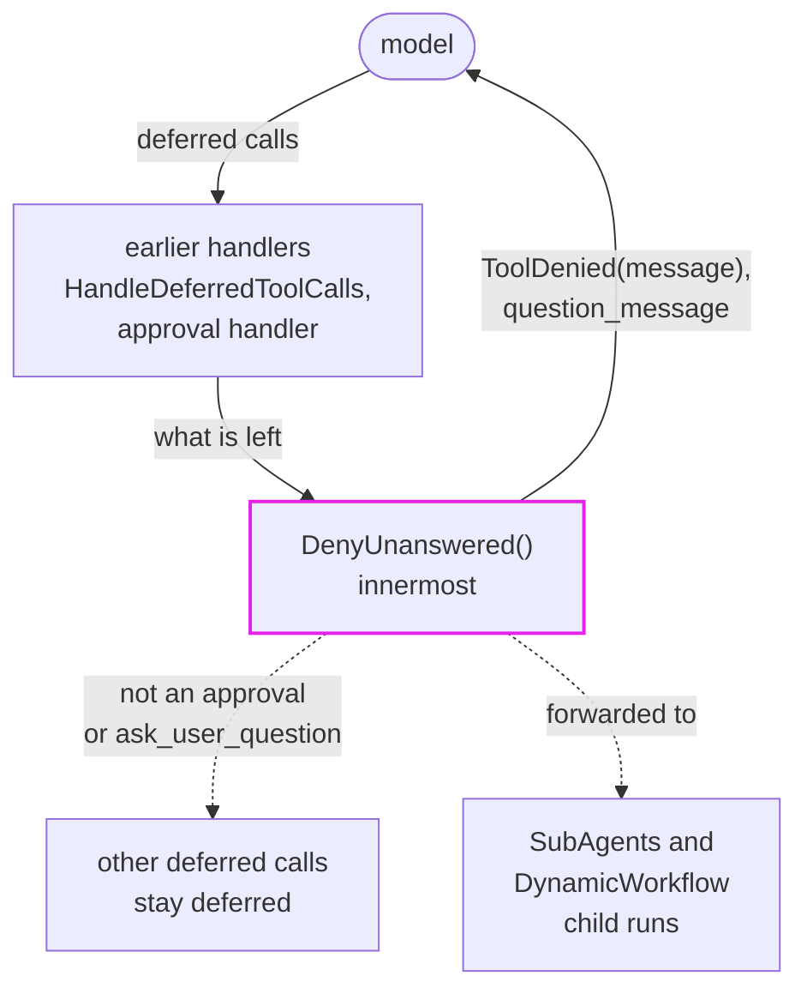

# Deny Unanswered

`DenyUnanswered` denies approval-required calls and unanswered `AskUser` questions with readable results, so a run nobody attends finishes instead of pausing on `DeferredToolRequests`.

Deferred calls exist for a caller who answers them in a second run. In an unattended run nobody ever will: approvals wait on a person who is not there, questions wait on a user who left, and the run ends with `DeferredToolRequests`. `DenyUnanswered` ends the wait inside the run:

- A held approval is denied with `message` (`ToolDenied`).
- A deferred `AskUser` `ask_user_question` call is answered with `question_message`, which says nobody is available to answer rather than that the user declined.

Any other deferred call stays deferred for its own handler. Without `DenyUnanswered`, nothing changes.

[Source](https://github.com/pydantic/pydantic-ai/tree/main/src/pydantic_ai_harness/pydantic_ai_harness/deny_unanswered/)

> While Pydantic AI Harness is on 0.x releases, the API may change between minor releases; when it does, deprecation warnings and release-note migration guidance tell you (or your agent) exactly how to upgrade. See the [version policy](https://pydantic.dev/docs/ai/harness/#version-policy).



## Usage

```python
from pydantic_ai import Agent
from pydantic_ai_harness import AskUser, DenyUnanswered

agent = Agent(
    'anthropic:claude-sonnet-5-5',
    capabilities=[
        AskUser(answerer=None),  # no answerer: every question is deferred
        DenyUnanswered(),
    ],
)
```

Use `message` and `question_message` to change the text the model sees for a denied approval and an unanswered question:

```python
from pydantic_ai_harness import DenyUnanswered

deny = DenyUnanswered(
    message='No one is on duty, so the request was not approved.',
    question_message='No one is on duty to answer; pick a safe default and say which one.',
)
```

## Forwarding to children

`SubAgents` delegations and `DynamicWorkflow` child runs carry the parent run's `DenyUnanswered` into the child's capabilities when it is present, so a delegate that asks a question or requests approval is denied inside the child run too, and the delegation finishes instead of returning a pending child. The handler runs innermost, after every handler that may ask the user, so a present human still wins.

This forwarding is specific to `DenyUnanswered` for now: a general way for capabilities to pass themselves on to child runs is being designed in [#13135](https://github.com/pydantic/pydantic-ai/issues/13135) and will replace it.

Two kinds of delegation do not receive the parent run's capabilities, so nothing is forwarded there and the child keeps its own behavior: one that a durable engine runs as a tool activity, such as a named sub-agent under `TemporalDurability`, and a remote sub-agent that a `SubAgentWorker` runs for `TaskControl(remote_agents=...)`. Give such a child, or the worker's agent, its own `DenyUnanswered` when it should deny too.

## Telemetry

Emits nothing into telemetry.
