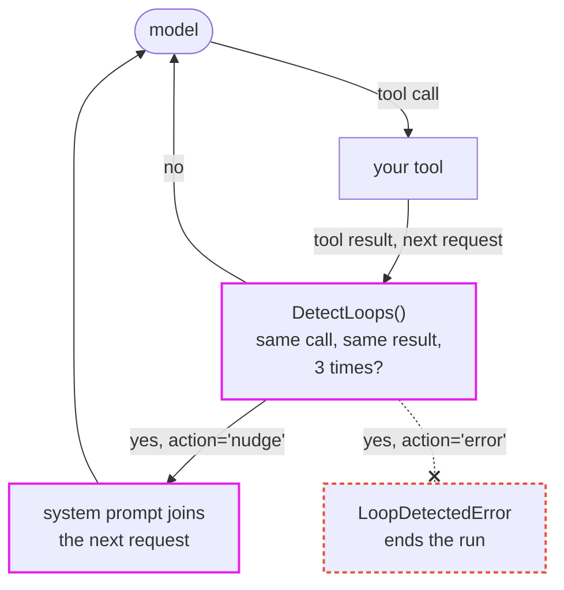

# Detect Loops

Notice when an agent repeats the same actions without making progress, and interrupt it before the loop uses up the run's request, token, or cost budget. Use it on agents that run autonomously for many steps.

[Source](https://github.com/pydantic/pydantic-ai/tree/main/src/pydantic_ai_harness/pydantic_ai_harness/detect_loops/)

> While Pydantic AI Harness is on 0.x releases, the API may change between minor releases; when it does, deprecation warnings and release-note migration guidance tell you (or your agent) exactly how to upgrade. See the [version policy](https://pydantic.dev/docs/ai/harness/#version-policy).



## Usage

uv:

```bash
uv add pydantic-ai-harness
```

pip:

```bash
pip install pydantic-ai-harness
```

```python
from pydantic_ai import Agent
from pydantic_ai_harness import DetectLoops

agent = Agent('anthropic:claude-opus-5-5', capabilities=[DetectLoops()])
```

`DetectLoops` records each model response's tool calls and text as it arrives, and each call's result from the request that follows it. Before each model request, it checks what the run has done so far. When it finds a loop, it adds a system prompt to that request telling the model which loop it is in and asking it to change its approach. It also checks each response on its own as it streams, for thinking, text or tool call arguments that keep repeating the same passage, and stops the stream when they do ([loops within a response](#loops-within-a-response)). The capability adds no tools or instructions, so a run without a loop sends the same requests it would without it.

## What counts as a loop

| Pattern | Reported when | Setting (default) |
|---|---|---|
| `repeated_call` | The same tool call (same tool, same arguments) is made this many times within the last `window` tool calls, whatever it returned. | `repeated_call_threshold` (`5`) |
| `repeated_result` | The same tool call returned the same result each of the last this-many times it was made within `window`. | `repeated_result_threshold` (`3`) |
| `alternating_calls` | Two different tool calls are made in turn, A-B-A-B, for this many A-B cycles. | `alternating_calls_threshold` (`3`) |
| `repeated_text` | This many consecutive responses have no tool calls and the same text, ignoring case and whitespace. This happens when [output validation](https://pydantic.dev/docs/ai/core-concepts/output/#output-validator-functions) keeps asking the model to retry. | `repeated_text_threshold` (`3`) |

`window` (default `10`) is how many of the most recent tool calls the three call-based checks look at. Set a threshold to `None` to turn that check off. `window` must be at least 2, even when every call-based check is off. A threshold must be at least 2, and a call-based threshold has to fit in `window` (`alternating_calls_threshold` needs twice its value), so a check that could never fire raises `ValueError` when the capability is created.

How calls and results are compared:

- Arguments are compared as canonical JSON with sorted keys, so `{"path": "a", "limit": 1}` and `{"limit": 1, "path": "a"}`, or the same object sent as a JSON string, are the same call.
- A result is the tool return's outcome, its content as structured JSON with sorted keys, and the identifiers of any files it returned. A tool that raises [`ModelRetry`](https://pydantic.dev/docs/ai/tools-toolsets/tools-advanced/#tool-retries) with the same message each time returns the same result, so a call that keeps failing the same way is a `repeated_result` loop.
- Every call in a response counts, in order, including parallel calls in a response that already completes a loop.
- A result is matched to its call only within the request that follows the call's response, so models that reuse tool call ids across responses are still compared correctly.
- Calls and results are recorded when they arrive. `DetectLoops` runs outermost among the agent's capabilities, so it reads a call's result before others, such as [compaction](../compaction/), rewrite the request. Compaction that later drops old messages, or replaces old results and arguments with placeholders, doesn't change what was recorded, so it can't make different calls look alike.
- Only [function tool](https://pydantic.dev/docs/ai/tools-toolsets/tools/) calls count. Calls the provider runs itself ([native tools](https://pydantic.dev/docs/ai/tools-toolsets/native-tools/)) are not compared.

At most one loop is reported per model request, checked in the order `repeated_result`, `alternating_calls`, `repeated_call`, `repeated_text`. The responses that formed it are then not counted again, so the same loop has to build up from scratch before it is reported a second time.

Only the current run's responses are recorded. A run that continues an earlier conversation through `message_history` starts with nothing counted.

### Polling and retries

A tool polled until a job finishes, with arguments that don't change, is a `repeated_call` loop after 5 polls within 10 calls, and a `repeated_result` loop after 3 polls in a row that return the same status. If your agent polls on purpose, raise those thresholds or turn the checks off, or have the tool return something that changes between polls, such as the elapsed time.

## Loops within a response

A model can also loop inside one response: going over the same reasoning in its thinking, repeating a paragraph until it runs out of output tokens, or writing the same block again and again into one tool call's arguments, such as the body of a `write_file` call. `DetectLoops` checks each response for this as it streams, so it can stop the stream instead of waiting for the rest of it.

| Pattern | Reported when | Setting (default) |
|---|---|---|
| `repeated_thinking` | A thinking part keeps repeating the same passage. | `stream_detector` (`RepetitionDetector()`) |
| `repeated_stream_text` | A text part keeps repeating the same passage. | `stream_detector` |
| `repeated_tool_args` | One tool call's arguments keep repeating the same passage. | `stream_detector` |
| `repeated_parallel_call` | The same tool call (same tool, same arguments) is made this many times in one response. It's reported before any of the calls run. | `repeated_parallel_call_threshold` (`5`) |

`stream_channels` (default `('thinking', 'text', 'tool_args')`) picks which of a response's parts `stream_detector` checks, and `stream_detector=None` turns those checks off. Each part is checked every `stream_check_every` (default `256`) characters as it streams, and once more when it ends. Only [function tool](https://pydantic.dev/docs/ai/tools-toolsets/tools/) and output tool calls are checked, not [native tool](https://pydantic.dev/docs/ai/tools-toolsets/native-tools/) calls.

A response that isn't streamed, such as one from `agent.run()` without an `event_stream_handler`, gets the same checks once it has arrived, at the same offsets, so it reaches the same decisions. `DetectLoops` doesn't make a run stream.

### The default heuristic

`RepetitionDetector` looks at the end of each part and reports a passage repeated back to back:

| Setting | Default | Meaning |
|---|---|---|
| `min_period` | `20` | The shortest passage that counts, in characters. A run of a shorter unit, such as a divider line, isn't reported, even when a longer passage made of it repeats. |
| `max_period` | `2000` | The longest passage that counts. |
| `min_distinct_chars` | `8` | How many different characters the passage has to use, so a row of numbers or a table rule doesn't count. |
| `min_repeats` | `8` | How many times in a row the passage has to repeat. |
| `min_chars` | `2000` | How many characters the repeats have to cover together. |

It compares characters exactly, over the part's most recent `sample_chars` characters: enough for `min_repeats` repeats of a `max_period` passage. That's cheap enough to run on every check, and gives the same answer every time. It doesn't catch a loop that changes a little on each pass, such as a counter in every sentence: a model judge can.

Output can repeat on purpose, so the defaults trade how early a loop is caught for fewer false alarms. A grid of numbers, a markdown table, or a few dozen identical rows in a file isn't reported, and a real loop is caught once it has filled about 2,000 characters, long before a response that loops would run out of output tokens. Content that repeats more than that, such as a fixture with hundreds of identical rows, is reported. If your agent writes that kind of content, raise `min_chars` and `min_repeats`, or leave `'tool_args'` out of `stream_channels`.

### A model judge

`LoopJudge` asks a model whether a part is looping. Use a "System 1" model for it: a small, fast, cheap model suited to a quick, intuitive read of the text, not a large reasoning model. The stream waits for each answer, and the question doesn't need reasoning.

```python
from pydantic_ai import Agent
from pydantic_ai_harness import DetectLoops
from pydantic_ai_harness.detect_loops import LoopJudge

agent = Agent(
    'anthropic:claude-opus-5-5',
    capabilities=[DetectLoops(stream_detector=LoopJudge(model='anthropic:claude-haiku-5-5', every=4_000))],
)
```

The judge is asked sparingly. Each check runs `heuristic` (a `RepetitionDetector()` by default) first, and the judge is asked when the heuristic suspects a loop, to confirm or overrule it, and, with `every` set, each time a part passes another `every` characters, to find loops the heuristic misses. Without `every`, it's only asked on suspicion. It's shown the part's last `max_chars` (default `4000`) characters, framed in a `<streamed_output>` tag.

If the judge raises, or doesn't answer within `timeout` (default `5.0`) seconds, the heuristic's answer is used and a `loop judge failed` span records the error's type, so a judge failure doesn't break the run. Pass `agent=` instead of `model=` to use your own judge agent, with its own instructions, settings or fallback models; it's run with the judge's instructions added and its own output type, so it can't have output validators. The judge's usage is added to the run's usage, and it runs within the run's [`UsageLimits`](https://pydantic.dev/docs/ai/core-concepts/agent/#usage-limits), with the run's pending request reserved: a judge request that would exceed them raises `UsageLimitExceeded` and ends the run, as the run's next request would, instead of falling back to the heuristic.

### Your own detector

Subclass `LoopDetector` to use another methodology. `detect` is given a `StreamSample`: the `channel`, the part's latest `text` (its last `sample_chars` characters, `8000` unless you override the property), how many characters it has had in total and since the last check, and the `tool_name` for tool call arguments. Return a `Repetition` with the passage that repeats and how many times, or `None`. One instance serves every run of the agent, concurrent ones included, so keep it stateless or key any state off the `RunContext`:

```python
from dataclasses import dataclass

from pydantic_ai import RunContext
from pydantic_ai_harness import DetectLoops
from pydantic_ai_harness.detect_loops import LoopDetector, Repetition, StreamSample


@dataclass
class RepeatedLines(LoopDetector[object]):
    """Report the same non-empty line written `count` times in a row."""

    count: int = 10

    async def detect(self, ctx: RunContext[object], sample: StreamSample) -> Repetition | None:
        lines = sample.text.splitlines()[-self.count :]
        if len(lines) == self.count and lines[0].strip() and len(set(lines)) == 1:
            return Repetition(text=lines[0], count=self.count)
        return None


detect_loops = DetectLoops(stream_detector=RepeatedLines())
```

## Actions

`action` decides what happens when a loop is detected.

### `'nudge'` (default)

The capability enqueues a [`SystemPromptPart`](https://pydantic.dev/docs/ai/api/pydantic-ai/messages/#pydantic_ai.messages.SystemPromptPart) with [`RunContext.enqueue`](https://pydantic.dev/docs/ai/core-concepts/message-history/#injecting-messages-mid-run), which joins the request being prepared. It keeps the default conversation scope, so like a course correction it keeps applying on later requests instead of being shown once, and later requests send it unchanged. For example:

```text
Your last 3 calls to `read_file` used the same arguments and returned the same result, so calling it again will not change the outcome. Change your approach, or explain what is blocking you.
```

The text names tools using only letters, digits, and `_`; any other character becomes `_`. The real names, and the pattern, are in the part's `metadata`:

```python
{'origin': 'pydantic-ai-harness.detect_loops.nudge.v1', 'pattern': 'repeated_result', 'tool_names': ['read_file']}
```

Find nudges in history by that `origin`, not by their text ([identifying system prompts](https://pydantic.dev/docs/ai/core-concepts/message-history/#identifying-system-prompts)). On a model without inline system prompts, Pydantic AI sends the part as `<system>` user text, as it does any [mid-conversation system prompt](https://pydantic.dev/docs/ai/core-concepts/message-history/#mid-conversation-system-prompts).

For a [loop within a response](#loops-within-a-response), the stream is also stopped and the request made again, with the nudge. The nudge is request-scoped there: the response that looped is gone, so it's sent with that one request instead of staying in the conversation. The capability raises `ModelRetry`, so the model also sees `Your previous response was rejected because it kept repeating itself.` as retry feedback, and each such retry counts against the agent's [output retries](https://pydantic.dev/docs/ai/core-concepts/agent/#how-output-retries-are-enforced): a model that keeps looping ends the run with `UnexpectedModelBehavior` once they run out. A streamed response that was stopped isn't kept in history, and the tokens it used aren't added to the run's usage. A response that arrived whole stays in history ahead of the retry, as any rejected response does.

`run_stream()` can't make a request again once the run's output has started streaming, as output text or an output tool call. A loop found from then on ends the run with `UnexpectedModelBehavior`, after the output streamed so far. A loop found before that, in thinking or in a function tool call's arguments, is retried as usual. Use `agent.run()` with an `event_stream_handler`, or `agent.iter()`, to have loops in the output retried too.

A nudge doesn't stop a model that ignores it. Combine it with [`UsageLimits`](https://pydantic.dev/docs/ai/core-concepts/agent/#usage-limits) for a hard stop. A stopped stream adds no request or tokens to the run's usage, so for a loop within a response the hard stop is the output retries, or `action='error'`.

### `'error'`

The capability raises `LoopDetectedError`, stopping the stream first for a loop within a response. It's a subclass of [`AgentRunError`](https://pydantic.dev/docs/ai/api/pydantic-ai/exceptions/#pydantic_ai.exceptions.AgentRunError), which ends the run. The detected loop is on its `loop` attribute:

```python
from pydantic_ai import Agent
from pydantic_ai.messages import ModelMessage, ModelResponse, ToolCallPart
from pydantic_ai.models.function import AgentInfo, FunctionModel
from pydantic_ai_harness import DetectLoops
from pydantic_ai_harness.detect_loops import LoopDetectedError


def stuck_model(messages: list[ModelMessage], info: AgentInfo) -> ModelResponse:
    return ModelResponse(parts=[ToolCallPart('read_file', {'path': 'missing.txt'})])


agent = Agent(FunctionModel(stuck_model), capabilities=[DetectLoops(action='error')])


@agent.tool_plain
def read_file(path: str) -> str:
    return 'Error: file not found'


try:
    agent.run_sync('Summarize missing.txt')
except LoopDetectedError as error:
    print(error.loop.pattern, error.loop.tool_names, error.loop.count)
    #> repeated_result ('read_file',) 3
```

### A handler

Pass a sync or async function to decide yourself. It's called with the run context and a `DetectedLoop`: raise from it to stop the run, or call `ctx.enqueue(...)` to steer the model your own way. For a loop within a response, the response keeps streaming when the handler returns; raise `ModelRetry` from it to stop the stream and make the request again, rejecting the response as a nudge does.

```python
import logging

from pydantic_ai import Agent, RunContext
from pydantic_ai.messages import SystemPromptPart
from pydantic_ai_harness import DetectLoops
from pydantic_ai_harness.detect_loops import DetectedLoop

logger = logging.getLogger(__name__)


async def on_loop(ctx: RunContext[object], loop: DetectedLoop) -> None:
    logger.warning('Agent loop: %s %s', loop.pattern, loop.tool_names)
    ctx.enqueue(SystemPromptPart('You are repeating yourself. Summarize what you know and stop.'))


agent = Agent('anthropic:claude-opus-5-5', capabilities=[DetectLoops(action=on_loop)])
```

A `DetectedLoop` has:

- `pattern`: which of the eight patterns it is.
- `tool_names`: the tools involved, one or two (none for `repeated_text`, `repeated_thinking` and `repeated_stream_text`).
- `count`: how many calls, cycles, or responses repeated, or how many times the passage repeated within a response.
- `window`: how many recent tool calls (responses, for `repeated_text`) the check looked at; for a loop within a response, how many of the part's characters, or for `repeated_parallel_call` how many of the response's tool calls.
- `fingerprints`: short stable hashes of the repeated calls (tool name and canonical arguments), text, or passage. The same call has the same fingerprint in every run. They don't contain the arguments in the clear, but a short argument, such as a user id, can be recovered by hashing candidate values.
- `message`: the text the nudge would send.
- `passage`: the passage that repeated within a response, as it appears at the end of the part, or `None` for the other patterns. It's the model's own text.

## Durable execution

What a run recorded lives in memory, in the instance `for_run` creates for that run. Under [durable execution](https://pydantic.dev/docs/ai/capabilities/durable_execution/overview/) the recording and detection hooks (`after_model_request` and `before_model_request`) run in workflow code, so when Temporal, DBOS, or Prefect replays a run, they run again in the same order over the journaled responses and reach the same decisions. A handler runs there too, so keep it deterministic and free of I/O: log through the engine's workflow logger, or move I/O into a [durable capability operation](https://pydantic.dev/docs/ai/capabilities/custom/#durable-capability-operations). `LoopDetectedError` is an `AgentRunError`, so under Temporal it fails the workflow rather than the workflow task.

A response streams inside the durable model request unit (activity, step or task), and the workflow only sees it whole, so the checks within a response run on the whole response, in workflow code, and the stream isn't stopped early. `LoopJudge` never asks its model in workflow code, where that model call wouldn't be checkpointed and could be repeated on replay: only its heuristic runs there, which is deterministic. A `LoopDetector` of your own runs in workflow code too, so keep it deterministic and free of I/O, like a handler.

## Telemetry

Each detection emits a zero-duration `loop detected` span through `ctx.tracer`, so it shows in the run's trace next to the model request it changed. It's a no-op unless the agent is [instrumented](https://pydantic.dev/docs/ai/integrations/logfire/).

| Attribute | Value |
|---|---|
| `detect_loops.pattern` | The pattern, such as `repeated_result` |
| `detect_loops.action` | `nudge`, `error`, or `handler` |
| `detect_loops.count` | `DetectedLoop.count` |
| `detect_loops.window` | `DetectedLoop.window` |
| `detect_loops.tool_names` | The tools involved |
| `detect_loops.fingerprints` | The hashes of the repeated calls or text, only when `trace_include_content` is enabled |
| `detect_loops.passage` | The passage that repeated within a response, only when `trace_include_content` is enabled |

Without `trace_include_content`, the span contains no arguments, results, or response text. The fingerprints are left out too, because a short argument can be recovered from its hash. Checks that find nothing emit nothing.

When a `LoopJudge` fails or times out, a zero-duration `loop judge failed` span records it, with the exception's class name in `error.type`. The judge agent built from `model=` is not instrumented, so the output it's shown is not recorded even when global instrumentation is on and the host agent leaves content out. A judge `agent=` you pass keeps its own instrumentation settings.

## Composition

- Several `DetectLoops` on one agent run independently. Each reports the loops its own settings describe, so you can, for example, nudge at the defaults and add a second one with higher thresholds and `action='error'` to stop a run that ignores the nudge.
- [System Reminders](../system_reminders/) re-inject guidance on a cadence or condition, and [Trajectory Judge](../trajectory_judge/) asks a second model whether the run is on track. By default `DetectLoops` needs no second model and only acts on exact repetition; a [`LoopJudge`](#a-model-judge) adds a small model for loops within a response that aren't exact.

`DetectLoops` does not detect a run that keeps exceeding the model's context window, and it doesn't truncate, restart, or roll back the run: compaction and your own handler cover those.

See the [source](https://github.com/pydantic/pydantic-ai/tree/main/src/pydantic_ai_harness/pydantic_ai_harness/detect_loops/).
