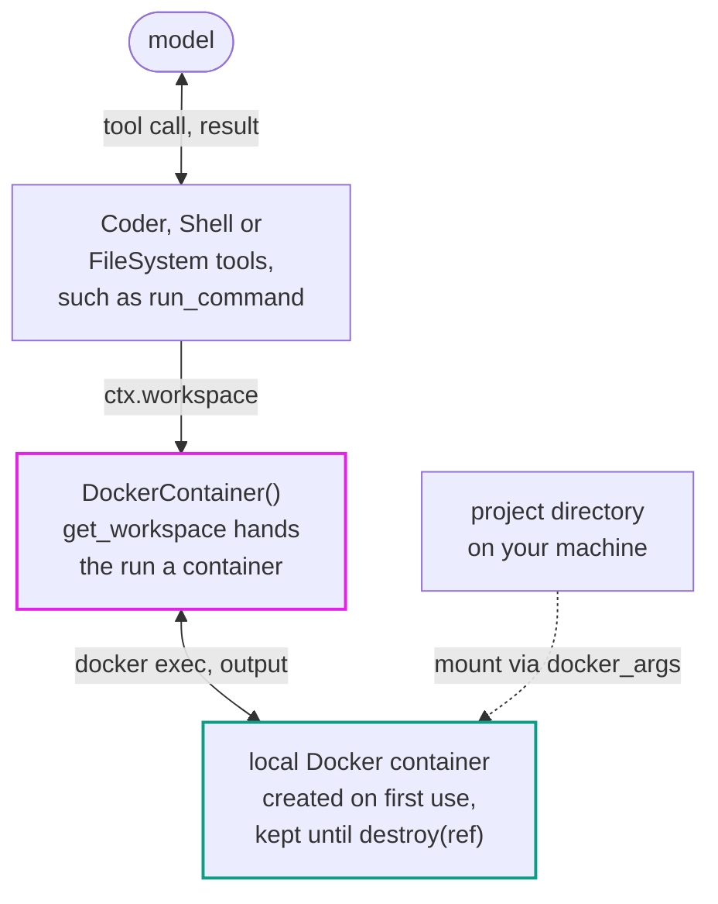

# Docker Container

Run your agent's commands and file edits in a local [Docker](https://www.docker.com/) or Podman container, created on first use, away from your machine's files and processes.

[Source](https://github.com/pydantic/pydantic-ai/tree/main/src/pydantic_ai_harness/pydantic_ai_harness/docker_container/)

> While Pydantic AI Harness is on 0.x releases, the API may change between minor releases; when it does, deprecation warnings and release-note migration guidance tell you (or your agent) exactly how to upgrade. See the [version policy](https://pydantic.dev/docs/ai/harness/#version-policy).



## Install

<span id="platforms"></span>

uv:

```bash
uv add "pydantic-ai-harness[coder,anthropic]"
```

pip:

```bash
pip install "pydantic-ai-harness[coder,anthropic]"
```

The capability runs the `docker` CLI already on your machine, so it needs no extra of its own. The examples also use `Coder` and an Anthropic model, hence the `coder` and `anthropic` extras and `ANTHROPIC_API_KEY`; swap them for your own tools and model provider.

## Quick start

<span id="choose-the-tools"></span>

```python {names="defined"}
from pydantic_ai import Agent
from pydantic_ai_harness.coder import Coder
from pydantic_ai_harness.docker_container import DockerContainer

agent = Agent('anthropic:claude-opus-5-5', capabilities=[DockerContainer(image='python:3.13-slim'), Coder()])
result = agent.run_sync('Write a script that prints the first 10 primes, and run it.')
```

`Coder`'s shell and file tools now run in the container. For a narrower agent, use [`Shell`](https://pydantic.dev/docs/ai/harness/shell/), [`FileSystem`](https://pydantic.dev/docs/ai/harness/filesystem/) or your own tools on [`ctx.workspace`](https://pydantic.dev/docs/ai/core-concepts/workspace/#using-the-workspace-in-tools).

- `Coder` creates it when the run starts, to load the repository's instructions, even if no tool is called. Pass `Coder(repo_context=False)` to wait for the first tool call.
- It keeps running after the run. Nothing removes it, and there is no idle or lifetime limit. See [Clean up](#clean-up).
- It starts empty. To work on files on your machine, [mount a project directory](#work-on-a-project-directory).
- Commands run as the image's user, usually `root`, in `/workspace`, which is created if missing. The image needs a POSIX `sh` and the usual file utilities; Docker pulls it the first time.
- It reaches the internet, your local network and services on this machine through Docker's default bridge. Pass `allow_internet_access=False` to run it with `--network none`.
- The image's entrypoint doesn't run, so a service the image would start on boot isn't running; start it with a command.

## Continue in the same container

<span id="reattach-later"></span>

Pass the message history, and the next run works in the same container, starting it if stopped:

```python {names="defined"}
from pydantic_ai import Agent
from pydantic_ai_harness.coder import Coder
from pydantic_ai_harness.docker_container import DockerContainer

agent = Agent('anthropic:claude-opus-5-5', capabilities=[DockerContainer(image='python:3.13-slim'), Coder()])
result = agent.run_sync('Write a script that prints the first 10 primes, and run it.')

followup = agent.run_sync('Now make it print the first 100.', message_history=result.all_messages())
ref = result.workspace.ref  # or store this, and pass `workspace=ref` to a later run
```

`result.workspace.ref` is a `WorkspaceRef` holding the container's name. Store it to continue later or to remove the container.

If the container has been removed, the run raises `WorkspaceUnavailableError`. Pass `workspace='new'` to start over. [Workspaces](https://pydantic.dev/docs/ai/core-concepts/workspace/#continuing-in-the-same-workspace) covers how runs find their workspace.

Whoever passes a ref runs commands in that container, so only pass refs your application stored itself. `DockerContainer` refuses a container without its `ai.pydantic.workspace=true` label, so a ref can't reach other containers on the daemon. Anyone who can run `docker` can add that label, though.

## Prepare a container before the run

To seed files or install packages before the agent starts, create the backend yourself, work in it through `Workspace`, and pass it to the run:

```python {names="defined"}
import asyncio

from pydantic_ai import Agent
from pydantic_ai.workspaces import Workspace
from pydantic_ai_harness.coder import Coder
from pydantic_ai_harness.docker_container import DockerContainer, DockerContainerBackend

agent = Agent('anthropic:claude-opus-5-5', capabilities=[DockerContainer(image='python:3.13-slim'), Coder()])


async def main() -> None:
    backend = DockerContainerBackend(image='python:3.13-slim')
    try:
        workspace = Workspace(backend)
        await workspace.write_text('calc.py', 'def add(a, b):\n    return a - b\n')
        install = await workspace.run(['pip', 'install', 'pytest'], timeout=300)
        if install.exit_code != 0:
            raise RuntimeError(f'pip install failed: {install.stderr}')
        result = await agent.run('Fix the bug in calc.py.', workspace=backend)
        print(result.output)
    finally:
        ref = backend.ref  # set once the container is being created
        if ref is not None:
            await DockerContainer().destroy(ref)


if __name__ == '__main__':
    asyncio.run(main())
```

The `finally` removes the container even when setup or the run fails. To keep it, store `backend.ref` instead.

`DockerContainer`'s settings don't apply to a backend you pass as `workspace=`. Give the backend its own.

## Give the agent a desktop

Pass `desktop=True` and add [`ComputerUse`](../computer_use/):
`capabilities=[DockerContainer(desktop=True), ComputerUse()]`. The screen is 1280x800; pass a size such as
`desktop=(1440, 900)` for another. The size applies when the screen first starts.

Without an `image`, the first run builds one from `DESKTOP_DOCKERFILE`, with Firefox, and later runs reuse it. That image doesn't get security updates. To update it, build it yourself and pass it as `image`; under [durable execution](https://pydantic.dev/docs/ai/capabilities/durable_execution/overview/), do this before the first run, so the build doesn't count against a step's timeout:

```bash
python -c "from pydantic_ai_harness.docker_container import DESKTOP_DOCKERFILE; print(DESKTOP_DOCKERFILE)" | docker build --pull --no-cache --tag my-desktop -
```

Then pass `DockerContainer(image='my-desktop', desktop=True)`. Another custom `image` needs [the display's programs](../computer_use/#what-the-display-needs), which the first use installs if it can.

The agent can type only ASCII: an action that types or presses a character such as `é` fails, and the model is told why.

## Clean up

Remove a container, with its anonymous volumes, with the ref you stored. A container that is already gone returns quietly:

```python {names="defined"}
from pydantic_ai.workspaces import WorkspaceRef
from pydantic_ai_harness.docker_container import DockerContainer


async def remove_container(ref: WorkspaceRef) -> None:
    await DockerContainer().destroy(ref)
```

`DockerContainer()` without an `image` only attaches to and removes containers by ref.

A failed run returns no result, so remove its container in an `on_run_error` hook:

```python
from typing import Any

import anyio

from pydantic_ai import Agent, RunContext
from pydantic_ai.capabilities import Hooks
from pydantic_ai.run import AgentRunResult
from pydantic_ai_harness.coder import Coder
from pydantic_ai_harness.docker_container import DockerContainer

hooks = Hooks()


@hooks.on.run_error
async def remove_failed_run_container(ctx: RunContext[None], *, error: BaseException) -> AgentRunResult[Any]:
    if ctx.workspace.ref is not None:
        # Shielded so a deadline around the run can't cut the remove short, bounded so a hung call can't hang it.
        with anyio.move_on_after(30, shield=True):
            await DockerContainer().destroy(ctx.workspace.ref)
    raise error


agent = Agent('anthropic:claude-opus-5-5', capabilities=[DockerContainer(image='python:3.13-slim'), Coder(), hooks])
```

### Find a lost container

If your program stops before it stores the ref, for example after a crash, Ctrl-C or a cancelled run, the container is left behind. To find it, run `docker ps --all --filter label=ai.pydantic.workspace=true`. It lists every container `DockerContainer` created.

Then remove it: `await DockerContainer().destroy(WorkspaceRef(provider='docker', id='<name>'))`.

## Work on a project directory

Mount a directory on your machine with `docker_args`, extra `docker run` arguments:

```python {names="defined"}
from pathlib import Path

from pydantic_ai_harness.docker_container import DockerContainer

project = Path('.').resolve()
container = DockerContainer(
    image='python:3.13-slim',
    docker_args=['--volume', f'{project}:/workspace', '--memory', '2g', '--cpus', '2'],
    allow_internet_access=False,
)
```

- The mount is the only part of your machine's files the commands can change.
- For a network of your own, leave `allow_internet_access` on and pass `--network` in `docker_args`. Docker refuses a second `--network` next to `--network none`.
- With `desktop`, don't put the container on the host's network (such as `--network host`). Programs in it could reach an X server on your machine through Linux's abstract socket and control your screen.
- `docker_args` can't change the container's name, label or entrypoint.
- A new container gets `--pids-limit 2048`, so a runaway fork loop can't exhaust the process table of the machine running Docker. A command that hits the limit fails with `Cannot fork` or `Resource temporarily unavailable`. Pass your own `--pids-limit` in `docker_args`, or `-1` to remove it.

## Use Podman or a remote Docker host

<span id="use-a-remote-docker-host"></span>

Pass `executable='podman'` to use Podman.

The capability uses whichever daemon your `docker` CLI points at. To run containers on another host, point the CLI there before the agent starts:

```bash
export DOCKER_HOST=ssh://dev@build-box  # or: docker context use build-box
```

- The host needs Docker, and `ssh` must log in without a prompt, through a key or your SSH agent.
- `DOCKER_HOST` overrides `DOCKER_CONTEXT`, which overrides `docker context use`. Unset the ones you don't use, and don't change them while a container is in use.
- Paths in `docker_args`, such as a `--volume` source, are paths on that host, and the container reaches that host's network.
- The `docker` CLI gets the variables that select and reach a daemon (`DOCKER_HOST`, `DOCKER_CONTEXT`, `DOCKER_CONFIG`, `SSH_AUTH_SOCK` and the like) from your environment, plus `PATH`, `HOME` and the locale, and nothing else.

## Security model

A container shares your machine's kernel, so it is a weaker boundary than a VM, which runs its own ([Containers are not VMs](https://www.docker.com/blog/containers-are-not-vms/)). Commands run as the image's user, usually `root`, so anything the agent runs can change anything in the container.

- Don't mount the Docker socket or directories holding secrets. A writable mount also lets commands change files your machine runs later, such as a virtualenv, the `docker` CLI inside one, or git hooks.
- Add hardening such as `--cap-drop ALL`, `--user` or `--read-only` through `docker_args` when the image allows it.
    - With `--user`, point `working_dir` at a directory that user can write, such as a mount, or pass `working_dir=None` to use the image's own.
    - With `--read-only`, mount a writable working directory.
- On Linux, files written to a mounted directory belong to the container's user on your machine too, which is `root` by default. Pass `--user` with your own IDs to avoid that, such as `--user 1000:1000` from `id -u` and `id -g`.
- While a command runs, its `env` values are visible in process listings (`ps`) on your machine.
- Docker adds the proxy settings in your `~/.docker/config.json` to every new container as environment variables.
- `image` is pulled by tag; pin a digest, such as `python:3.13-slim@sha256:...`, to get the same image every time.

## Configuration

| Option | What it does |
| --- | --- |
| `image` | Image for a new container, such as `'python:3.13-slim'`. Default: `None`. The capability then only attaches to and removes containers by ref, unless `desktop=True`, which builds the desktop image. |
| `working_dir` | Absolute directory commands start in and relative paths resolve against, created on first use if missing. Default: `/workspace`. `None` uses the image's own: its `WORKDIR`, or `/`. |
| `env` | Environment variables every command gets, on top of the image's. Default: `None`. Nothing else from your machine's environment reaches the container, except Docker's proxy settings. The agent's commands can read these, so leave out secrets it shouldn't see. |
| `allow_internet_access` | Whether a new container gets outbound network access, through Docker's default bridge. Default: `True`; `False` runs it with `--network none`. |
| `docker_args` | Extra `docker run` arguments for a new container, such as mounts, `--memory` or `--user`. A `--pids-limit` here replaces the default of 2048. Default: `()`. |
| `executable` | The container CLI to run, such as `'podman'`, looked up on `PATH` when the capability is created. Default: `'docker'`. |
| `authority` | Who wrote the container's files: `'none'` for files nobody on your side wrote, such as a cloned third-party repository, or `'user'` for the user's own. Capabilities that put a file into the prompt give it no more [authority](https://pydantic.dev/docs/ai/core-concepts/workspace-custom/#workspace-authority) than this. Default: `'operator'`, files you wrote. |
| `path_authority` | An `authority` level for specific directories and files, overriding `authority` under them. The longest matching path wins. Paths are container paths, relative to the working directory or absolute, and `~` isn't expanded. Default: `None`. |
| `desktop` | Give the container a graphical display for [`ComputerUse`](../computer_use/): `True` for 1280x800, or its `(width, height)`. Default: `False`. |

`image`, `allow_internet_access` and `docker_args` only shape a new container. `working_dir` and `env` apply to every command, including after you reattach.

## Limits

<span id="how-commands-run"></span>

- The machine running the agent must be Linux or macOS, like [`LocalWorkspace`](https://pydantic.dev/docs/ai/core-concepts/workspace/#platforms); on Windows, a run raises `NotImplementedError`.
- Creating or starting the container, including pulling the image, isn't bounded by a command's `timeout`. Nor is starting the desktop, including any install of its programs, the first time a command or file operation needs it.
- File operations run as commands in the container, so large files are slow. Mount a directory for large data.
- With Docker, a command that leaves a background process holding its output open, such as `server &`, doesn't return until that process exits. Redirect its output, as in `server > server.log 2>&1 &`.
- On a timeout or cancellation, the command and the processes it started are stopped; one that detached into its own session, like a [Shell](https://pydantic.dev/docs/ai/harness/shell/) background job, keeps running.
- A container that can't be created or started, or that stops mid-command, raises `WorkspaceUnavailableError`.

## Renamed from `DockerSandbox`

This capability was `DockerSandbox`, with `DockerSandboxBackend`, in `pydantic_ai_harness.docker_sandbox`. The old names still import from there, with a `HarnessDeprecationWarning`, until a future release removes them.

Migrate to `DockerContainer` now, so your agent keeps running in a plain container. After the removal, the `DockerSandbox` name is kept for a possible capability built on [Docker Sandboxes](https://docs.docker.com/ai/sandboxes/), Docker's microVM product.

To load specs saved before the rename, pass the deprecated `DockerSandbox` class in `custom_capability_types`. To migrate a spec, rename its `DockerSandbox` block to `DockerContainer`. The options are unchanged.

## Telemetry

`DockerContainer` emits no spans of its own. Core's [instrumentation](https://pydantic.dev/docs/ai/capabilities/instrumentation/) records `pydantic_ai.workspace.provider` (`docker`) and `pydantic_ai.workspace.id` (the container's name) on the agent run span, and each command or file operation runs inside its tool call's span.

## API reference

::: pydantic_ai_harness.docker_container.DockerContainer

::: pydantic_ai_harness.docker_container.DockerContainerBackend

::: pydantic_ai_harness.docker_container.DESKTOP_DOCKERFILE
