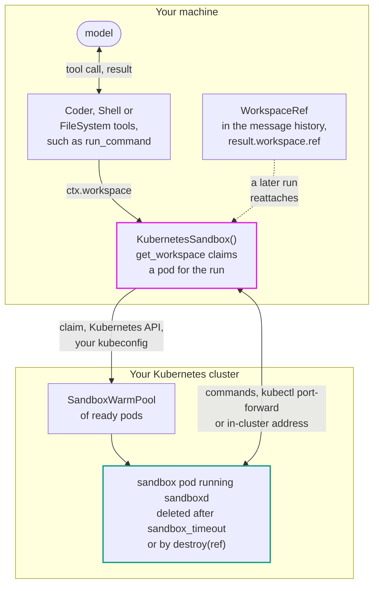

# Kubernetes Sandbox

Run your agent's commands and file edits in a sandbox pod on your own Kubernetes cluster, taken from a [kubernetes-sigs/agent-sandbox](https://agent-sandbox.sigs.k8s.io) warm pool of ready pods.

[Source](https://github.com/pydantic/pydantic-ai/tree/main/src/pydantic_ai_harness/pydantic_ai_harness/kubernetes_sandbox/)



## Install

uv:

```bash
uv add "pydantic-ai-harness[coder,kubernetes,anthropic]"
```

pip:

```bash
pip install "pydantic-ai-harness[coder,kubernetes,anthropic]"
```

The capability reaches the cluster with your kubeconfig, or with the pod's service account when it runs inside the cluster. The default connection to each sandbox is a `kubectl port-forward`, so it needs `kubectl` on your `PATH`. The examples also use `Coder` and an Anthropic model, hence the `coder` and `anthropic` extras and `ANTHROPIC_API_KEY`; swap them for your own tools and model provider.

## Set up the cluster

Install agent-sandbox (v1.0.7 or later) with its extensions:

```bash
kubectl apply --server-side -f https://github.com/kubernetes-sigs/agent-sandbox/releases/download/v1.0.11/sandbox-with-extensions.yaml
```

Then define the pods your agent gets:

- A `SandboxTemplate` describes one sandbox pod.
- A `SandboxWarmPool` keeps a number of pods from that template started and ready, so a run doesn't wait for a pod to start.
- Each run claims one ready pod from the pool. Deleting the claim deletes the pod.

Each sandbox pod must run [sandboxd](https://github.com/kubernetes-sigs/agent-sandbox/tree/main/packages/sandboxd), agent-sandbox's in-pod server. Commands run in the container that runs sandboxd, so that container's image decides which tools the agent has. This template copies sandboxd into `python:3.12`, and the pool keeps three sandboxes ready:

```yaml
apiVersion: extensions.agents.x-k8s.io/v1beta1
kind: SandboxTemplate
metadata:
  name: python
spec:
  podTemplate:
    spec:
      automountServiceAccountToken: false
      securityContext: {runAsNonRoot: true, fsGroup: 1000}
      initContainers:
        - name: install-sandboxd
          image: registry.k8s.io/agent-sandbox/sandboxd:v1.0.11
          command: [/bin/sh, -c, cp /usr/local/bin/sandboxd /sandboxd-bin/sandboxd]
          securityContext: {runAsUser: 1000}
          volumeMounts: [{name: sandboxd-bin, mountPath: /sandboxd-bin}]
      containers:
        - name: app
          image: python:3.12
          command: [/sandboxd-bin/sandboxd, --root-dir=/workspace]
          env: [{name: HOME, value: /workspace}]
          securityContext: {runAsUser: 1000, allowPrivilegeEscalation: false}
          readinessProbe: {httpGet: {path: /v1/health, port: 8080}}
          volumeMounts:
            - {name: sandboxd-bin, mountPath: /sandboxd-bin, readOnly: true}
            - {name: workspace, mountPath: /workspace}
      volumes:
        - {name: sandboxd-bin, emptyDir: {}}
        - {name: workspace, emptyDir: {}}
---
apiVersion: extensions.agents.x-k8s.io/v1beta1
kind: SandboxWarmPool
metadata:
  name: python-pool
spec:
  replicas: 3
  sandboxTemplateRef: {name: python}
```

For stronger isolation, set `runtimeClassName` (gVisor or Kata) on the pod template and [connect from inside the cluster](#connect-to-the-sandbox).

## Quick start

<span id="choose-the-tools"></span>

```python {names="defined"}
from pydantic_ai import Agent
from pydantic_ai_harness.coder import Coder
from pydantic_ai_harness.kubernetes_sandbox import KubernetesSandbox

agent = Agent('anthropic:claude-opus-5-5', capabilities=[KubernetesSandbox(warm_pool='python-pool'), Coder()])
result = agent.run_sync('Clone https://github.com/pydantic/pydantic-ai and summarize how capabilities work.')
```

`Coder`'s shell and file tools now run in a sandbox pod claimed from the warm pool. For a narrower agent, use [`Shell`](https://pydantic.dev/docs/ai/harness/shell/), [`FileSystem`](https://pydantic.dev/docs/ai/harness/filesystem/) or your own tools on [`ctx.workspace`](https://pydantic.dev/docs/ai/core-concepts/workspace/#using-the-workspace-in-tools).

- `Coder` creates it when the run starts, to load the repository's instructions, even if no tool is called. Pass `Coder(repo_context=False)` to wait for the first tool call.
- It keeps running after the run, and is deleted 24 hours after it was claimed, whether or not anyone still uses it. Change that with `sandbox_timeout`, in seconds, or pass `None` to keep it until you delete it. See [Clean up](#clean-up).
- Commands start in sandboxd's root directory, `/workspace` in the template above, and run as the container's user.
- The image needs a POSIX shell with coreutils and `find`, since file operations run as shell commands.
- Files are lost if the pod is lost. When a node fails, agent-sandbox starts a new pod that keeps only what the template puts on a persistent volume; the template above uses `emptyDir`.

## Continue in the same sandbox

<span id="reattach-later"></span>

Pass the message history, and the next run works in the same sandbox:

```python {names="defined"}
from pydantic_ai import Agent
from pydantic_ai_harness.coder import Coder
from pydantic_ai_harness.kubernetes_sandbox import KubernetesSandbox

agent = Agent('anthropic:claude-opus-5-5', capabilities=[KubernetesSandbox(warm_pool='python-pool'), Coder()])
result = agent.run_sync('Clone https://github.com/pydantic/pydantic-ai and summarize how capabilities work.')

followup = agent.run_sync(
    'Which capability would you add next, and where would it live?',
    message_history=result.all_messages(),
)
ref = result.workspace.ref  # or store this, and pass `workspace=ref` to a later run
```

`result.workspace.ref` is a `WorkspaceRef` holding `<namespace>/<claim name>`. Store it to continue later or to delete the sandbox.

If the claim has been deleted, the run raises `WorkspaceUnavailableError`. Pass `workspace='new'` to start over. [Workspaces](https://pydantic.dev/docs/ai/core-concepts/workspace/#continuing-in-the-same-workspace) covers how runs find their workspace.

The process that reattaches needs its own access to the cluster. `KubernetesSandbox` reattaches only to claims it made, as [Security model](#security-model) explains.

## Prepare a sandbox before the run

To seed files before the agent starts, build the backend yourself, write through a `Workspace`, and pass the backend to the run:

```python {names="defined"}
from pydantic_ai import Agent
from pydantic_ai.workspaces import Workspace
from pydantic_ai_harness.coder import Coder
from pydantic_ai_harness.kubernetes_sandbox import KubernetesSandbox, KubernetesSandboxBackend

agent = Agent('anthropic:claude-opus-5-5', capabilities=[KubernetesSandbox(warm_pool='python-pool'), Coder()])


async def run_in_prepared_sandbox() -> str:
    backend = KubernetesSandboxBackend(warm_pool='python-pool')
    try:
        await Workspace(backend).write_text('TASK.md', 'Add a `--version` flag to cli.py.\n')
        result = await agent.run('Do the task in TASK.md.', workspace=backend)
        return result.output
    finally:
        await backend.aclose()
        ref = backend.ref  # set once the sandbox is claimed
        if ref is not None:
            await KubernetesSandbox(warm_pool='python-pool').destroy(ref)
```

The run leaves a backend you built open, so close it with `aclose()`. That closes the connection, including any `kubectl port-forward`, not the sandbox. To keep the sandbox, store `backend.ref` instead of destroying it.

## Give the agent a desktop

Pass `desktop=True` and add [`ComputerUse`](../computer_use/):
`capabilities=[KubernetesSandbox(warm_pool='desktop-pool', desktop=True), ComputerUse()]`. The screen is 1280x800;
pass a size such as `desktop=(1440, 900)` for another.

The template above runs as a non-root user, so nothing is installed for you: build [the display's programs](../computer_use/#what-the-display-needs) into the image, along with the programs the agent should use. Without them, every command and file operation in the sandbox raises `WorkspaceUnavailableError` naming what is missing. Then copy the template and its pool under new names, `desktop` and `desktop-pool`, with that image in place of `python:3.12`:

```dockerfile
FROM python:3.12
RUN apt-get update \
 && apt-get install -y --no-install-recommends xvfb xdotool x11-utils scrot util-linux fluxbox tint2 xterm firefox-esr \
 && rm -rf /var/lib/apt/lists/*
```

The agent can type only ASCII: an action that types or presses a character such as `é` fails, and the model is told why.

## Clean up

Delete a sandbox with the ref you stored. This deletes the claim, and with it the pod:

```python {names="defined"}
from pydantic_ai.workspaces import WorkspaceRef
from pydantic_ai_harness.kubernetes_sandbox import KubernetesSandbox


async def delete_sandbox(ref: WorkspaceRef) -> None:
    await KubernetesSandbox(warm_pool='python-pool').destroy(ref)
```

A failed run returns no result, so delete its sandbox in an `on_run_error` hook:

```python
from typing import Any

import anyio

from pydantic_ai import Agent, RunContext
from pydantic_ai.capabilities import Hooks
from pydantic_ai.run import AgentRunResult
from pydantic_ai_harness.coder import Coder
from pydantic_ai_harness.kubernetes_sandbox import KubernetesSandbox

sandbox = KubernetesSandbox(warm_pool='python-pool')
hooks = Hooks()


@hooks.on.run_error
async def delete_failed_run(ctx: RunContext[None], *, error: BaseException) -> AgentRunResult[Any]:
    if ctx.workspace.ref is not None:
        # Shielded so a deadline around the run can't cut the delete short, bounded so a hung call can't hang it.
        with anyio.move_on_after(30, shield=True):
            await sandbox.destroy(ctx.workspace.ref)
    raise error


agent = Agent('anthropic:claude-opus-5-5', capabilities=[sandbox, Coder(), hooks])
```

### Find a lost sandbox

If your program stops before it stores the ref, for example after a crash or Ctrl-C, the claim and its pod are left behind. To find it, search your logs for `Claimed Kubernetes sandbox <namespace>/<claim name>`, logged at INFO by the `pydantic_ai_harness` logger.

Then delete it: `await KubernetesSandbox(warm_pool='python-pool').destroy(WorkspaceRef(provider='kubernetes', id='<namespace>/<claim name>'))`.

## Connect to the sandbox

By default the client reaches each sandbox through `kubectl port-forward`, which suits running the agent on your machine. An agent running in the cluster connects directly:

```python {names="defined"}
from pydantic_ai_harness.kubernetes_sandbox import KubernetesSandbox

sandbox = KubernetesSandbox(warm_pool='python-pool', namespace='agents', connection='in-cluster-pod-ip')
```

- `'in-cluster-service'` connects through the sandbox's Service instead, which needs `service: true` on the template.
- agent-sandbox's default NetworkPolicy blocks traffic from other pods, so add a `networkPolicy` to the template that lets your agent's pods reach TCP ports 8080 and 9090.
- Port-forwarding doesn't work on gVisor or Kata, so use an in-cluster connection there.

For other sandboxd ports, a port-forward that needs longer to start, or sandboxd started with `--auth-token-sha256` or `--auth-token-file`, pass the SDK's connection config:

```python {names="defined"}
from k8s_agent_sandbox.models import SandboxdPodTunnelConnectionConfig
from pydantic_ai_harness.kubernetes_sandbox import KubernetesSandbox

sandbox = KubernetesSandbox(
    warm_pool='python-pool',
    connection=SandboxdPodTunnelConnectionConfig(grpc_port=9191, rest_port=8181, port_forward_ready_timeout=60),
)
```

`SandboxdInClusterConnectionConfig` takes the same ports, with `mode='in-cluster-pod-ip'` or `mode='in-cluster-service'`. Pass an auth token as either config's `auth_token`; every command sends it.

## Security model

- `KubernetesSandbox` reattaches to and deletes only claims in its `namespace` named `pydantic-ai-` and 32 hex digits, the names it gives its claims. A ref naming any other claim raises `ValueError` before anything reaches the cluster.
- The name is not proof of origin, and a `KubernetesSandboxBackend(ref=...)` you build yourself attaches to any claim it names, so keep refs server-side.
- Your cluster sets everything else:
    - The pod's isolation. It shares its node's kernel unless `runtimeClassName` selects gVisor or Kata.
    - Which claims the agent's kubeconfig or service account can reach.
    - Which pods can reach sandboxd's ports.
    - Whether sandboxd requires an auth token.
- The SDK talks to sandboxd over unencrypted gRPC. `connection='port-forward'` tunnels it through the API server. An in-cluster connection sends it over the cluster network as is.

## Configuration

| Option | What it does |
| --- | --- |
| `warm_pool` | Name of the `SandboxWarmPool` to claim new sandboxes from. Required. |
| `namespace` | Namespace of the warm pool and the claims. Default: `'default'`. |
| `connection` | How the client reaches each sandbox: `'port-forward'`, `'in-cluster-pod-ip'` or `'in-cluster-service'`. For other ports, timeouts and auth tokens, pass the SDK's `SandboxdPodTunnelConnectionConfig` or `SandboxdInClusterConnectionConfig`. Default: `'port-forward'`. |
| `sandbox_timeout` | Seconds after which a newly claimed sandbox is deleted. Default: `86_400`, 24 hours. `None` keeps it until `destroy(ref)`. |
| `working_dir` | Absolute directory commands start in and relative paths resolve against. Default: `None`, sandboxd's root directory. Created on a new claim; on an attached one it must exist. |
| `env` | Environment variables every command gets, on top of the container's own. Default: `None`. The agent's commands can read these, so leave out secrets it shouldn't see. |
| `desktop` | Give the sandbox a graphical display for [`ComputerUse`](../computer_use/): `True` for 1280x800, or its `(width, height)`. Without root or passwordless `sudo` in the pod, its image must have [the display's programs](../computer_use/#what-the-display-needs). The size applies when the display first starts. Default: `False`. |
| `authority` | Who wrote the sandbox's files: `'none'` for files nobody on your side wrote, such as a cloned third-party repository, or `'user'` for the user's own. Capabilities that put a file into the prompt give it no more [authority](https://pydantic.dev/docs/ai/core-concepts/workspace-custom/#workspace-authority) than this. Default: `'operator'`, files you wrote. |
| `path_authority` | An `authority` level for specific directories and files, overriding `authority` under them. The longest matching path wins. Paths are sandbox paths, relative to the working directory or absolute, and `~` isn't expanded. Default: `None`. |

`connection`, `working_dir`, `env`, `authority`, `path_authority` and `desktop` also apply when you reattach; the other options only shape a new claim.

## Limits

<span id="how-commands-run"></span><span id="what-a-timeout-stops"></span>

- Claiming or reattaching gives up with `TimeoutError` after 190 seconds. A claim that times out is deleted.
- A timeout or cancellation kills the command's process group, not the sandbox. A job that detaches with `setsid` may keep running.
- A background job that keeps the command's output open delays the result by about 5 seconds. Redirect its output to a file; `Shell.start_command` does this for you.
- A command whose output passes 10 MiB is stopped with `WorkspaceOutputLimitError`. Redirect large output to a file.
- While a lost pod is replaced, commands fail with an error durable execution retries.
- The agent-sandbox SDK needs asyncio. Under Trio, every operation raises `UserError`.

## Durable execution

Add a durability capability, such as `TemporalDurability()` from the `temporal` extra, next to `KubernetesSandbox()`. [Workspaces](https://pydantic.dev/docs/ai/core-concepts/workspace/#durable-execution) covers what changes.

Outside a run, each command opens and closes its own connection, a new `kubectl port-forward` by default. So each activity takes a little longer than the same call inside a plain run.

## Telemetry

`KubernetesSandbox` emits no spans of its own. Core's [instrumentation](https://pydantic.dev/docs/ai/capabilities/instrumentation/) records `pydantic_ai.workspace.provider` and `pydantic_ai.workspace.id` on the agent run span, and each command or file operation runs inside its tool call's span.

## API reference

::: pydantic_ai_harness.kubernetes_sandbox.KubernetesSandbox

::: pydantic_ai_harness.kubernetes_sandbox.KubernetesSandboxBackend
