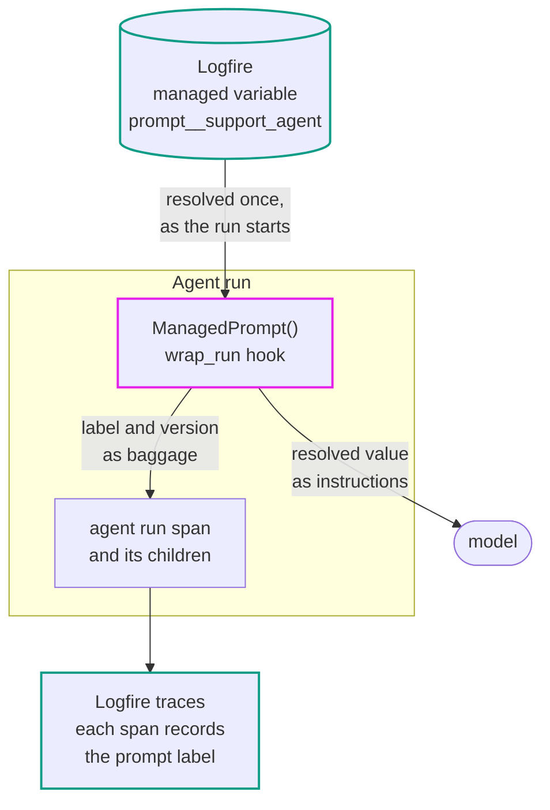
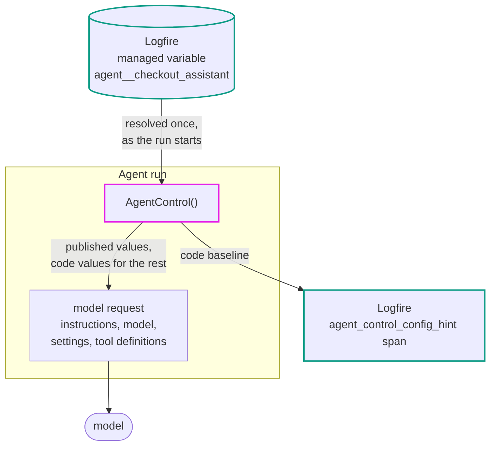

# Logfire-backed capabilities

Drive agent configuration from [Logfire managed variables](https://logfire.pydantic.dev/docs/reference/advanced/managed-variables/),
so you can iterate on it from the Logfire UI -- versioned, labelled, and rolled out -- without redeploying.

Two capabilities cover the two managed surfaces:

- [`AgentControl`](#agentcontrol) -- the whole agent config (`agent__<name>`): instructions, model,
  model settings, and the LLM-facing definitions of the agent's tools, as one variable matching
  Logfire's Agent Control UI
- [`ManagedPrompt`](#managedprompt) -- one managed prompt (`prompt__<name>`), shareable across agents
  (legacy: a prompt-only `AgentControl` now covers this)

`AgentControl` takes an optional `name` that selects its backing variable. When you omit it, the
name defaults to the agent's own `name` -- so `AgentControl()` on an
`Agent(..., name='checkout_assistant')` resolves `agent__checkout_assistant`:

```python
from pydantic_ai import Agent

from pydantic_ai_harness.logfire import AgentControl

agent = Agent(
    'anthropic:claude-fable-5-2',
    name='checkout_assistant',
    tools=[...],
    capabilities=[AgentControl(label='production')],  # -> agent__checkout_assistant
)
```

The agent must then be given an explicit `name=`: one Pydantic AI would infer from the variable the
agent is assigned to is refused when the agent is built, so renaming a local can't move the config it reads. The derived name is normalized
exactly the way the Logfire UI normalizes observed agent names (lowercased, non-alphanumeric runs
collapsed to `_`), so the variable the SDK resolves is the variable the UI creates when you manage
an observed agent. Pass an explicit `name` to decouple the variable from the agent's name, or to
share one variable across agents. A nameless capability derives its variable -- and can source the
model for a model-less agent -- from the agent's `name` the first time it's needed in a run, so
naming the agent is all it takes.

Normalization is lossy, so agent names that differ only in punctuation or case land on one variable:
`checkout-assistant`, `Checkout Assistant`, and `checkout_assistant` all resolve
`agent__checkout_assistant`. Two such agents share a single managed config -- including when they
live in different services that report to the same Logfire project. Pass an explicit `name` to keep
them apart.

They share one contract: **the code-defined agent is the fallback.** Every managed value is a
patch on what's written in code -- absent fields keep their code values, and a missing, invalid,
or unreachable remote value degrades to exactly the agent the developer wrote, so under the default
`on_unmatched` it cannot crash a run (`on_unmatched='error'` raises instead). Values resolve **once per run** and the resolved label + version ride as baggage on every
span of the run, so traces always show which version produced which behavior. Each capability's
`resolved` exposes the active run's `ResolvedVariable`; on Logfire 4.34 and later its `reason` says
*why* it resolved the way it did (e.g. a `'code_default'` fallback).

**These capabilities never write to a variable.** They read a value and nothing else, so the
credential a deployment holds needs `project:read_variables` and nothing more. Creating the variable
is done in the Logfire UI. `LOGFIRE_API_KEY` is read by the Logfire instance `logfire.configure()` set
up, which is the one these capabilities resolve on unless you pass `logfire_instance=`: if your
application configures a `logfire.Logfire` instance of its own, pass that. When the instance has no way
to read variables, `AgentControl` warns once per process for each variable, naming what is missing, and
the agent runs as written.

`AgentControl` is the one that does not need you to create it there first. It emits one
`agent_control_config_hint` span carrying the name of the variable the config belongs in and an
`AgentConfig`-shaped snapshot of the code-side agent (instructions, model, effective settings, and
each tool's description and parameter descriptions) -- the baseline the Logfire UI's override editor
and optimizer diff managed values against. Logfire collects those hints, shows you the agents in your
project that have no config, and creates one from the baseline on request.

Every agent reports, configured or not, and `agent_control.resolution_reason` says which it was: a
`'code_default'` baseline is one waiting for a config to be created from it, a `'resolved'` one is how
the editor tells a stored baseline that still matches the code from one the code has moved past. An
agent that reported only while unconfigured would stop the moment somebody configured it, and its
stored baseline would describe that day's deployment forever. The platform deduplicates against the
variables that already exist either way: this SDK cannot tell an unknown variable from one with
nothing published at the label it asked for.

The hint is emitted at most once per process per agent (its variable, its name as written, and its
Logfire project), on the first model
request that has a baseline to describe, so an agent that never reaches a model reports nothing and a
restart after a code change reports the new baseline.

It also says **which deployment** reported it -- `agent_control.service_name`,
`agent_control.environment`, and `agent_control.service_version`, read off the Logfire instance the
hint is emitted on and left off individually when it does not know them. A variable is derived from
the agent's name alone, so without them two services that each define a `checkout_assistant`, and one
service's dev and prod, are indistinguishable in the span: they land on one
`agent__checkout_assistant`, because a variable holds one value per project and the dev/prod split is
its labels. `agent_control.baseline_sha256` digests the baseline, over the same canonical JSON the
contract takes `SCHEMA_SHA256` over, so a consumer can tell "the same baseline again" from "this
agent's code has moved" -- including across the once-per-process guard, which is what stops a change
made mid-process from being re-reported at all. The digest is always of the *whole* baseline, so a
report reduced to fit the span budget carries the same digest as an unreduced one of the same code.

Because a hint travels the span pipeline rather than the variables API, three things follow: a process
holding only a span-write token can still register an agent, the code baseline can never overwrite a
value a teammate saved in the UI (which a read-modify-write of `example` could), and an agent that
runs only inside a durable workflow registers like any other one.

Each component of the baseline is recorded at the point before `AgentControl` replaces it, so managed
settings, renamed tools, and managed instructions are not mistaken for code. The snapshot is taken
from the triggering request, so for instructions or a toolset that vary with `deps`, run input, or
the step within a run, it is one point-in-time sample rather than a description of the agent.
Dynamic instruction renderings are withheld, but tool names, descriptions, and parameter
descriptions come from that assembled request. A dynamic toolset must not put request data or
secrets in those model-facing fields: they reach the hint span and may become the variable's
example.

Its `instructions` list one entry per code-defined instruction block -- the agent's own text and each
toolset's, snapshotted before any managed block reaches the request -- each carrying the `id` that
addresses it and a `dynamic` flag. That is what the UI needs to offer an override per block: the joined prompt a trace
records has no seams in it, so a baseline built from telemetry alone could only ever be copied
wholesale, and copying it wholesale is exactly [the mistake](#where-your-base-prompt-lives) of
sending the agent's own text to the model twice with a frozen `Today is <date>` in the middle of it.
A block computed per request therefore contributes its `id` and its flag and never its rendered text,
so nothing the run carried reaches the snapshot. An MCP toolset or capability whose `id` was derived
from its server URL is reported as `[REDACTED]`, as it is in every other trace.

Span attributes share a row budget the backend enforces by truncating a long string in place, which
for JSON produces an attribute that still looks like a string and no longer parses. So the hint holds
its own budget: a baseline over it loses its `tool_definitions`, and one still over it after that is
left off entirely. Either way `agent_control.baseline_reduction` on the span says which happened, so
a partial baseline is partial on the record.

Install the extra:

uv:

```bash
uv add 'pydantic-ai-harness[logfire]'
```

pip:

```bash
pip install 'pydantic-ai-harness[logfire]'
```

[Source](https://github.com/pydantic/pydantic-ai/tree/main/src/pydantic_ai_harness/pydantic_ai_harness/logfire/)




## `ManagedPrompt`

`ManagedPrompt` is legacy; use a prompt-only [`AgentControl`](#agentcontrol) for new setups, and see
[Moving from `ManagedPrompt`](#moving-from-managedprompt) for what changes.

`ManagedPrompt` takes an agent's instructions from a Logfire-managed
[prompt](https://logfire.pydantic.dev/docs/reference/advanced/prompt-management/). Edit, version, label, and
roll out the prompt in the Logfire UI; the next run picks it up without a redeploy.

### The problem

Changing a prompt through the edit -> review -> deploy loop is slow, and an A/B test or a rollback needs a
new build. `ManagedPrompt` keeps the prompt in Logfire's managed-variable store instead, where you can roll
a change out to a share of traffic and roll it back from the UI.

### How it works

At the start of each run, `ManagedPrompt` resolves the variable `prompt__<name>` and uses its value as the
instructions for that run. While the run is active, the selected label (and the version, on Logfire 4.34 and
later) is set as baggage, so every span in the run records which prompt produced it.

### Usage

If Logfire is not set up yet, run `uvx logfire-cli wizard --task pydantic-ai` once from your project; see [Using Logfire](https://pydantic.dev/docs/ai/integrations/logfire/#using-logfire) for details.

Pass the prompt name and a default value. The name `support_agent` is declared as the managed
variable `prompt__support_agent`, the naming Logfire's Prompt management uses (hyphens in a
name become underscores). The default is used until a remote value is published.

```python
import logfire
from pydantic_ai import Agent

from pydantic_ai_harness import ManagedPrompt

logfire.configure()

agent = Agent(
    'openai:gpt-5',
    capabilities=[
        ManagedPrompt(
            'support_agent',
            default='You are a helpful customer support agent. Be friendly and concise.',
            label='production',
        )
    ],
)

result = agent.run_sync('My order never arrived.')
print(result.output)
```

### Targeting

For deterministic A/B assignment (the same user always sees the same label), pass a
`targeting_key`. It can be a static string or a callable that derives the key from the
[`RunContext`](https://pydantic.dev/docs/ai/api/pydantic-ai/tools/#pydantic_ai.tools.RunContext), for example from `deps`:

```python
from dataclasses import dataclass

from pydantic_ai import Agent

from pydantic_ai_harness import ManagedPrompt


@dataclass
class Deps:
    user_id: str


agent = Agent(
    'openai:gpt-5',
    deps_type=Deps,
    capabilities=[
        ManagedPrompt(
            'support_agent',
            default='You are a helpful customer support agent.',
            targeting_key=lambda ctx: ctx.deps.user_id,
        ),
    ],
)
```

Pass `attributes` (or a callable returning them) for condition-based targeting rules.
Without `label`, the variable's rollout and targeting rules pick the label. Without `targeting_key`, Logfire
uses its [`targeting_context`](https://logfire.pydantic.dev/docs/reference/advanced/managed-variables/), then
the trace id of the span enclosing the run. The prompt resolves before the agent run span opens, so with no
enclosing span the label is drawn at random per run.

### Templating with deps

By default the resolved prompt is used verbatim. Pass `render_template=True` to render it as a
Handlebars template against the agent's `deps`, the same mechanism as
[`TemplateStr`](https://pydantic.dev/docs/ai/api/pydantic-ai/template/#pydantic_ai.template.TemplateStr), so `{{field}}` is
filled from `deps`:

```python
from dataclasses import dataclass

from pydantic_ai import Agent

from pydantic_ai_harness import ManagedPrompt


@dataclass
class Deps:
    customer_name: str


agent = Agent(
    'openai:gpt-5',
    deps_type=Deps,
    capabilities=[
        ManagedPrompt(
            'support_agent',
            default='You are helping {{customer_name}}. Be friendly and concise.',
            render_template=True,
        ),
    ],
)
```

The template can reference any field of `deps`, so anyone who can edit the prompt in Logfire can place any
`deps` value in the system prompt, and from there in your traces. Keep secrets out of `deps`, or leave
rendering off.

The template is compiled once per run. If a remote prompt is not a valid template, the run uses the code
default, emits a `RuntimeWarning`, and logs a warning to Logfire; the run's baggage and `resolved` then report
the code default, with the template error in `resolved.exception`. An invalid code default raises.

### Prompt-cache trade-off

The resolved value lands in the agent's **system instructions**. Provider prompt caches (Anthropic,
OpenAI, etc.) key strictly by prefix (`tools -> system -> messages`), so each distinct value has
its own cached prefix.

Within one conversation (runs that continue from `message_history`), a new value doesn't rewrite
that prefix. The block keeps the value the conversation started with, and the new version is
[appended](https://pydantic.dev/docs/ai/core-concepts/agent/#appending-instruction-changes) to the history as a
replacement, so the cached conversation behind it stays reusable. That's also why the prompt is
sent inside a `<pyai:context id="capability:managed-prompt-support_agent">` element from the first
request. Appended changes reach the model as system messages, so keep the prompt, and the `deps`
fields `render_template=True` fills in, to text you control: see
[keep untrusted text out of instructions](https://pydantic.dev/docs/ai/core-concepts/agent/#untrusted-instruction-text).

Across conversations, the value a new conversation starts with decides its prefix:

| Mode | Cache impact |
| --- | --- |
| Pinned `label='production'`, no rollout split | **Cache-stable.** The value only changes on a deliberate prompt rollout, which is the same cost as a redeploy. |
| Pinned `label` that does not exist on the variable | Falls back to the rollout; same as no `label`. |
| Percentage rollout across labels (no `label=`) | Different runs land on different labels -> splits the cache into one lane per label. |
| `targeting_key` per user/tenant with multiple labels in play | Cache lanes per assigned label; deterministic per key but still N lanes overall. |
| Mid-traffic label flip in the Logfire UI | New conversations on that label start on a cold prefix; conversations already under way append the new value. |

If you don't need rollouts, pin `label='production'`.

### Using your own variable

Each `ManagedPrompt` builds its own unregistered variable, so several agents can use the same prompt name.
That variable is invisible to `variables_push()` and to `@{...}@` composition from other variables. To get
those, declare it with `logfire.var(...)` and pass it as the first argument. `TemplateVariable` is not
supported; use a plain `Variable` with `render_template=True`.

```python
import logfire
from pydantic_ai import Agent

from pydantic_ai_harness import ManagedPrompt

logfire.configure()

support_prompt = logfire.var(
    name='prompt__support_agent',
    type=str,
    default='You are a helpful customer support agent. Be friendly and concise.',
)

agent = Agent('openai:gpt-5', capabilities=[ManagedPrompt(support_prompt, label='production')])
```

When `name` is a prompt name, pass `logfire_instance=` to declare the variable on a specific
Logfire instance instead of the module-level default. With a `Variable`, `default` and `logfire_instance`
are ignored with a warning, since the variable carries its own.

The capability's `id` is derived from the prompt: `ManagedPrompt('support_agent', ...)` and a
`Variable` named `prompt__support_agent` both get `managed-prompt-support_agent`. It names the
prompt's instruction block, so a new version can be appended to a conversation rather than
rewriting it. Two `ManagedPrompt`s with different names on one agent each get their own block, and
two with the same name raise a `UserError` when the agent is built, since they're one prompt stated
twice. Pass `id=` to override the derived one. Earlier releases left the `id` unset and accepted
two of one name, so an agent built that way now needs a distinct `id` on each.

### Notes

- Resolution is isolated per run via a context variable, so a single capability instance
  is safe to share across concurrent runs.
- `ManagedPrompt.resolved` exposes the active run's `ResolvedVariable` (value, label, version,
  reason), for example from inside a tool. It is `None` outside a run.
- The capability runs outermost (wrapping `Instrumentation`), so the resolved variable's baggage
  covers the agent run span as well as its children. The label is set as the baggage entry
  `logfire.variables.prompt__<name>`; Logfire 4.34 and later also set `logfire.variables.prompt__<name>.version`.
- Resolution happens once per run. A label flip or rollout change that lands in Logfire
  mid-run is picked up when the next run starts.
- Telemetry: besides the baggage, Logfire records a `Resolve variable prompt__<name>` span per run with the
  resolved prompt text, the targeting key, and the targeting attributes. `InstrumentationSettings(include_content=False)`
  does not apply to this span.
- Resolution runs synchronously on the event loop. With Logfire's remote variables provider, the first
  resolution in a process waits for the initial fetch of the variables config; set
  `block_before_first_resolve=False` in `logfire.VariablesOptions` to resolve against the code default instead.

## `AgentControl`

Back a whole agent's configuration -- instructions, model, model settings, and the LLM-facing
definitions of its tools -- with one `agent__<name>` variable, the same variable Logfire's
Agent Control UI edits.



### The problem

An agent's behavior is spread across knobs that all live in code: the instructions, the model and
its sampling settings, and the tool descriptions that make up half of what the model sees. Tuning
any of them -- or letting Logfire's optimizer propose the tuning -- takes a redeploy per tweak, and
tuning them *together* (a new prompt that only works with a smarter model) takes coordinated
redeploys.

### The solution

`AgentControl` resolves one `AgentConfig` value per run with **presence semantics**: each section
that is present -- `instructions`, `model`, `settings`, `tool_definitions` -- is managed from
Logfire, and each absent section keeps the code-defined behavior. The whole config versions and
rolls out as one unit, so a prompt change and the model change it depends on land atomically.
Removing a section in Logfire is a deliberate revert-to-code.

### Usage

```python
import logfire
from pydantic_ai import Agent

from pydantic_ai_harness.logfire import AgentControl

logfire.configure()


def get_weather(city: str) -> str:
    return f'The weather in {city} is sunny.'


agent = Agent(
    'anthropic:claude-fable-5-2',
    name='checkout_assistant',
    instructions='You are a concise checkout assistant.',
    tools=[get_weather],
    capabilities=[AgentControl(label='production')],  # -> agent__checkout_assistant
)
```

[`examples/agent_control.py`](https://github.com/pydantic/pydantic-ai/blob/main/src/pydantic_ai_harness/examples/agent_control.py)
is a complete agent wired up this way: six separately addressable prompt blocks written in five
different ways, four tools in two toolsets, and a printout of what resolved on every run. It runs with no Logfire configured
at all, which is the behavior worth seeing first.

The variable holds an `AgentConfig`. The contract -- that model, its stored JSON schema, how leniently
a published value validates, and what each section does to a request -- is shared with the Logfire UI
and every other framework's Agent Control SDK. This package carries its own copy in `_contract/`: the
modules of logfire's `logfire.agent_control` it uses, each kept diffable against logfire's, and pinned
to the same schema digest and cross-language vectors, so it needs no particular logfire release.
Import `AgentConfig` and its models from `pydantic_ai_harness.logfire` when you want to publish a
value from code.

```json
{
  "instructions": [
    "Always confirm the order total.",
    {"id": "agent", "instructions": "You are a concise checkout assistant."},
    {"id": "toolset:legacy_crm", "instructions": null}
  ],
  "model": "anthropic:claude-fable-5-2",
  "settings": {
    "temperature": 0.4,
    "max_tokens": 2048,
    "thinking": "high"
  },
  "tool_definitions": [
    {
      "name": "get_weather",
      "new_name": "lookup_weather",
      "description": "Look up the current weather for a city.",
      "parameters": {"city": {"description": "City name, e.g. 'London'"}}
    },
    {
      "name": "search",
      "toolset": "crm",
      "description": "Search CRM records by customer name or order id."
    }
  ]
}
```

- `instructions` is a list of blocks, and each entry either **adds** text or **swaps out** one of the
  blocks the agent already assembles. An entry with no `id` adds; an entry with an `id` replaces that
  block's text, or drops it with an explicit `null`. An entry with an `id` and no `instructions` key
  (a misspelled `text`, say) is skipped with a warning and the block keeps its code-defined text.
  A bare string is the shorthand for a single added block, so
  `"instructions": "Be brief."` still means what it always did. See
  [Where your base prompt lives](#where-your-base-prompt-lives).
  Text supports `{{...}}` runtime placeholders, which pass through verbatim unless
  `render_template=True` renders them against `deps` (like `ManagedPrompt`).
- `model` is a model string in `provider:model` form -- pydantic-ai's own, with its provider ids.
  It's a first-class field, not a setting: pydantic-ai keeps the model id separate from
  `ModelSettings` (which has no `model` key), so there's no collision putting them side by side.
- `settings` keys are the canonical, cross-framework ones -- the settings every framework has a knob
  for, under the names `pydantic_ai.settings.ModelSettings` gives them: `max_tokens`, `temperature`,
  `top_p`, `top_k`, `seed`, `presence_penalty`, `frequency_penalty`, `parallel_tool_calls`, `timeout`,
  `stop_sequences`, and `thinking`, which accepts `true`/`false` or an effort level (`'minimal'` ...
  `'xhigh'`) exactly like the unified `thinking` model setting. Provider-specific settings
  (`openai_reasoning_effort`, `extra_headers`) stay in code: a key the section doesn't name is not
  forwarded, and the run reports it (see `on_unmatched` below).
- `tool_definitions` is a list too, each entry naming the tool it patches by its original (code-side)
  `name`; every other field is optional and unset fields keep the tool's own definition. `toolset`
  narrows the match to one toolset's tool of that name -- the same string the baseline reports for
  each tool (its `id`, or its label when it has none) -- and an entry without it matches by `name`
  alone. When both match one tool the narrowed entry wins.

`''` is never accepted where a string carries meaning -- `model`, a block's text, `new_name`, a block's
`id`. Omission and `null` already mean "leave this to code", so an empty string is only ever a
half-filled field, and `"model": ""` in particular is not "no model": Pydantic AI raises
`Unknown model:` on every request the agent makes, and the config around it is valid, so nothing
downstream would catch it. The stored schema refuses it at write time, and a value that reaches an SDK
anyway costs only the section that carries it -- the instructions published beside a `"model": ""`
still apply.

Each instruction block is limited to 65,536 characters. An oversized bare `instructions` value drops
that section; an oversized list entry drops only itself. Both warn once per process, and valid sibling
entries and other config sections continue to apply.

### Where your base prompt lives

Instructions are a **composition point**, not a single field. Pydantic AI assembles them from every
source that contributes one -- the agent's own literal, `@agent.instructions` functions injecting
today's date or the signed-in user, each toolset and MCP server, each capability, a skill catalog --
and a managed section that replaced the lot would silence all of them. So `instructions` works in two
ways, and picking the wrong one is the difference between a prompt that reads well and one sent twice.

**An entry with no `id` adds a block.** This is all a capability can do on its own: pydantic-ai appends
every contribution to the agent's own, so an `Agent(instructions='CODE')` with a managed
`'MANAGED'` sends the model `"CODE\n\nMANAGED"`.

**An entry with an `id` swaps out an existing block** -- replacing its text, or dropping it with
`null`. This is what reaches text no capability owns, the agent's own literal included. The keys come
from pydantic-ai's [`InstructionPart.id`](https://ai.pydantic.dev/api/messages/#pydantic_ai.messages.InstructionPart.id):

| `id` | Addresses |
| --- | --- |
| `agent` | the agent's own literal `instructions` |
| `toolset:<id>` | everything a toolset with that `id` contributes |
| `capability:<id>` | everything a capability with that `id` contributes |
| `agent:<name>` | one `@agent.instructions(name=...)` part |
| `capability:<id>:<name>` | one `@capability.instructions(name=...)` part |

These keys are pydantic-ai's namespace: the contract only reserves `agent` as the cross-framework name
for the prompt as written, and each SDK defines the rest of the ids it lists in its baseline.

Blocks pydantic-ai cannot key have no entry that reaches them: a callable passed to
`Agent(instructions=...)`, anything from `run(instructions=...)`, a toolset with no `id` of its own. An
`id` that matches nothing in this deployment warns rather than fails by default (`on_unmatched`, below),
so one config can be applied across services that don't all install the same toolsets.

The base prompt lives on the agent, where it always has. `AgentControl` carries no code-side config of
its own: the agent *is* the code side, so an `agent` entry rewrites `Agent(instructions=...)` and an
absent one leaves it exactly as written.

```python
from pydantic_ai import Agent

from pydantic_ai_harness.logfire import AgentControl

agent = Agent(
    'anthropic:claude-fable-5-2',
    name='checkout_assistant',
    instructions='You are a concise checkout assistant.',
    capabilities=[AgentControl()],
)
```

> **The mistake to avoid.** Copying the agent's observed system prompt into a managed value as *added*
> text -- a prompt lifted out of a trace, or the whole `example` snapshot -- while the same text stays
> in `Agent(instructions=...)` sends every block of it to the model **twice**, and pins any dynamic
> block (`Today is 2026-07-29.`) to whatever it said at the moment it was copied. Take the text over by
> `id`; don't re-add it.

Added blocks land at the end of the run of static blocks: after the last static block the agent
assembles, before the first one it recomputes per request. That is where a managed addition is both
last in the prompt as written and still inside the prefix a provider can cache; appending it after
per-request text would put published text in the volatile tail instead. An override leaves its block's
position and its `dynamic` flag alone -- replacing a dynamic block does not make it static -- so no
override moves that boundary either. `render_template=True` is the one exception: a rendered block is
this run's `deps` rather than fixed text, so it is contributed as dynamic and sorts with the rest of
the per-request text. Only `agent.override(instructions=...)` replaces the lot, and a capability can't
reach it.

### Moving from `ManagedPrompt`

`AgentControl` is not a drop-in replacement for [`ManagedPrompt`](#managedprompt):

- The config lives in a different variable, `agent__<name>` rather than `prompt__<name>`, so published
  prompt versions and labels don't carry over. Publish the prompt again in the agent's config.
- There is no code-side default on the capability. The default prompt moves into
  `Agent(instructions=...)`, and the published prompt becomes an `{"id": "agent", "instructions": ...}`
  entry that replaces it, rather than the whole value of the variable.
- The agent needs an explicit `name`, or pass `AgentControl(name=...)`.
- `render_template=True` renders only *added* blocks. An entry that replaces the `agent` block is sent
  as published, so keep `{{...}}` placeholders in an added block instead.

### Notes

- **Instructions add unless an entry names what it replaces:** an entry with no `id` is appended to the
  agent's own; an entry *with* an `id` swaps out that block instead. A base prompt you mean to manage
  goes on the agent and is rewritten by an `agent` entry.
- **Overrides apply to the assembled prompt:** they are applied in `before_model_request`, the last
  point at which every contribution exists, which is what lets an entry reach a toolset's or an MCP
  server's text and not just the agent's. They land on
  [`instruction_parts`](https://ai.pydantic.dev/api/models/base/#pydantic_ai.models.ModelRequestParameters.instruction_parts),
  the source of truth for what the model is sent, so the rewritten prompt is what message history and
  traces show too.
- **Two entries naming the same thing keep the first,** with a warning -- the same rule as a colliding
  tool rename, so a hand-edited value stays predictable instead of depending on JSON ordering.
- **Tool definitions are overlays, never code:** the tool itself -- its implementation and its
  parameter schema structure -- stays exactly as written in code. Only the LLM-facing spec (name,
  description, parameter description strings) is remotely patchable, so a remote value can never
  drift from the validator the tool actually runs against.
- **Renames round-trip:** `new_name` changes the name the model is shown; a call to the renamed
  tool routes back to the original implementation, and `ctx.tool_name` inside the tool is the
  original name. The routing is read off the very tool the model was handed, so a dynamic toolset
  that put a different tool behind that name in the meantime cannot make a name-based policy
  authorize one tool and run another. A rename that collides with a name another tool already
  advertises is dropped (other patches still apply) rather than breaking the run. Policies keyed on
  a tool's name that run before the call reaches its toolset (`ToolGuardrail(tools=[...])`,
  name-filtered hooks, `prepare_tools` hiding by name) see the advertised name, so they stop matching
  a renamed tool.
- **`on_unmatched` decides what a published entry that reaches nothing costs:** an override naming a
  tool no toolset advertises (the drift case: the tool was removed or renamed in code), an instruction
  entry whose `id` no block carries -- or only a per-request block carries -- a `parameters` key the
  tool has no parameter for, a rename another advertised tool already answers to, a `settings` key
  this version of the contract has no field for, a top-level key it has no section for at all, and a
  `timeout` that is not a budget a request can be given. `'warn'` (the default) emits a
  `UserWarning` once per process, at the point the request is assembled; `'error'` raises `UserError`
  naming every entry that request could not apply, failing the run; `'ignore'` applies nothing and
  says nothing. Every section is judged
  before any of it is reported, so the strictest policy is also the most complete one rather than a
  report on whichever section the agent graph reached first. Warning rather than raising is the
  default because tool availability is dynamic: one config is applied across deployments that need
  not all install the same toolsets, and a toolset can advertise different tools from one request to
  the next, so an entry that reaches nothing now is not necessarily wrong.
- **Model precedence:** the managed `model` is sourced during model selection via the capability's
  `get_model` hook, so it slots in with the right precedence -- a call-site `run(model=...)` beats
  it, it beats the agent's constructor model, and a fully model-less agent (named or nameless) can be
  driven entirely from Logfire. Model selection evaluates static or callable targeting inputs once,
  and the authoritative run resolution reuses that exact result. A managed model this deployment can't
  use is handled by `on_unmatched`: with `'warn'` or `'ignore'` the run keeps the code model.
- **Settings precedence:** managed settings merge **over** the agent's constructor `model_settings`
  and **under** per-run `model_settings=`, so run arguments always win.
- **Adoption reporting:** for the run's duration, `logfire.managed.applied_sections` baggage names
  the sections the capability applied (e.g. `instructions,settings`), which the Logfire UI reads to
  distinguish a wired-up managed agent from one whose config resolves but isn't applied. `model` is
  reported when present even if a call-site `run(model=...)` outranked it that run. What the agent
  says in code is reported alongside it, on an `agent_control_config_hint` span: see the top of this
  README.
- **Telemetry:** one span, `agent_control_config_hint`, emitted at most once per process per written
  agent identity and variable,
  whether or not a config resolved. It carries `agent_control.variable_name`,
  `agent_control.agent_name`, `agent_control.framework`, `agent_control.baseline_source`,
  `agent_control.schema_sha256`, `agent_control.baseline`, `agent_control.baseline_reduction`,
  `agent_control.baseline_bytes`, `agent_control.resolution_reason`, `agent_control.baseline_sha256`,
  and -- when the Logfire instance knows them -- `agent_control.service_name`,
  `agent_control.environment`, and `agent_control.service_version`. It is emitted on the Logfire
  instance the variable belongs to rather than on the run's tracer, because it is addressed to the
  project that would hold the config
  and has to arrive whether or not core's instrumentation is active -- and as a span rather than a
  log record, because a log below the configured `min_level` is dropped and this signal is a contract
  with the Logfire UI. Everything else this capability does is already covered by core's spans and
  by the resolved label and version that ride as baggage on all of them.
- **One stored schema, one writer:** the variable is created by Logfire, which stores the schema the
  UI edits against and validates every later version of the value against -- the hand-maintained
  `AGENT_CONFIG_JSON_SCHEMA` in `_contract/_schema.py`, which every copy of the contract and the UI pin by digest so the
  copies cannot drift apart quietly. A hint carries that digest as `agent_control.schema_sha256`
  rather than the schema itself, so Logfire stores the schema for the contract version the baseline
  was built against instead of guessing. The schema stays permissive on purpose: `AgentConfig`
  ignores keys it doesn't know, so a value written by a newer UI degrades to the sections an older
  SDK understands instead of failing, and a stored schema that rejected those keys would break that
  by refusing the write.
- **Forward compatibility covers values, not just keys:** a `thinking` effort level that a newer
  Pydantic AI accepts and this SDK has never heard of drops just that setting; a tool override that
  doesn't validate (a missing `name`, an empty `new_name`) drops just that override; an instruction
  entry that doesn't validate (an empty text, an entry naming neither what nor where) drops just that
  block -- each with a warning naming the offending value, emitted once per process so a per-run
  resolution can't turn it into noise. Everything else in the config still applies. A malformed
  settings value drops independently, a settings key this SDK has no field for -- or a whole
  top-level key it has no section for -- is dropped and reported under `on_unmatched`, and a wrong
  instructions, settings, or tool-definitions container drops only that section. Each list entry is
  a unit of degradation for the same reason: it addresses
  exactly one thing, so dropping it costs exactly that thing. The alternative isn't stricter, it's
  blunter: an `AgentConfig` that fails validation falls back to the code-defined agent *whole*, so one
  unfamiliar enum value would silently un-manage the instructions, the model, and every tool override
  with it.
- `AgentControl.resolved` exposes the active run's `ResolvedVariable`, and resolution is isolated
  per run, exactly like `ManagedPrompt`.
