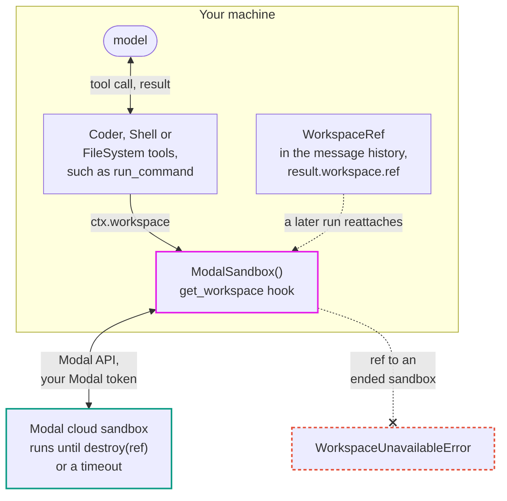

# Modal Sandbox

Run your agent's commands and file edits in an isolated [Modal](https://modal.com) cloud sandbox instead of on your machine.

[Source](https://github.com/pydantic/pydantic-ai/tree/main/src/pydantic_ai_harness/pydantic_ai_harness/modal_sandbox/)

> While Pydantic AI Harness is on 0.x releases, the API may change between minor releases; when it does, deprecation warnings and release-note migration guidance tell you (or your agent) exactly how to upgrade. See the [version policy](https://pydantic.dev/docs/ai/harness/#version-policy).



## Install

uv:

```bash
uv add "pydantic-ai-harness[coder,modal,anthropic]"
uv run modal token new
```

pip:

```bash
pip install "pydantic-ai-harness[coder,modal,anthropic]"
modal token new
```

This saves your Modal credentials. In CI, set `MODAL_TOKEN_ID` and `MODAL_TOKEN_SECRET` instead. The examples also use `Coder` and an Anthropic model, so they need the `coder` and `anthropic` extras and `ANTHROPIC_API_KEY`. Swap them for your own tools and model provider.

## Quick start

<span id="choose-the-tools"></span>

```python {names="defined"}
from pydantic_ai import Agent
from pydantic_ai_harness.coder import Coder
from pydantic_ai_harness.modal_sandbox import ModalSandbox

agent = Agent('anthropic:claude-opus-5-5', capabilities=[ModalSandbox(), Coder()])
result = agent.run_sync('Clone https://github.com/pydantic/pydantic-ai and summarize how capabilities work.')
```

`Coder`'s shell and file tools now run in the sandbox. For a narrower agent, use [`Shell`](https://pydantic.dev/docs/ai/harness/shell/), [`FileSystem`](https://pydantic.dev/docs/ai/harness/filesystem/) or your own tools on [`ctx.workspace`](https://pydantic.dev/docs/ai/core-concepts/workspace/#using-the-workspace-in-tools). `ModalSandbox` warns when the agent has no `Shell` or `FileSystem` tool. If only your own tools use the sandbox, pass `warn_if_no_tools=False`.

- `Coder` creates it when the run starts, to load the repository's instructions, even if no tool is called. Pass `Coder(repo_context=False)` to wait for the first tool call.
- It keeps running, and billing, after the run. See [Clean up](#clean-up).
- It lives for up to 24 hours, Modal's maximum. Pass `sandbox_timeout=3600` to end it sooner, or `idle_timeout=` to end it when unused.
- The first use can take several minutes while Modal builds or pulls the image.
- Commands run as `root` in `/root`. Pass `working_dir='/root/project'` to keep the project out of the home directory. It is created on a new sandbox.
- The default image has Python 3.12, `git` and `rg`, but not your project's dependencies. Bake them into a custom `image`, or install them [before the run](#prepare-a-sandbox-before-the-run).
- It can reach the internet. For network restrictions such as Modal's `block_network`, create the `modal.Sandbox` yourself and [pass it to the run](#continue-in-the-same-sandbox). The model can read every `env` value you pass.

## Continue in the same sandbox

<span id="reattach-later"></span>

Pass the message history, and the next run works in the same sandbox:

```python {names="defined"}
from pydantic_ai import Agent
from pydantic_ai_harness.coder import Coder
from pydantic_ai_harness.modal_sandbox import ModalSandbox

agent = Agent('anthropic:claude-opus-5-5', capabilities=[ModalSandbox(), Coder()])
result = agent.run_sync('Clone https://github.com/pydantic/pydantic-ai and summarize how capabilities work.')

followup = agent.run_sync(
    'Which capability would you add next, and where would it live?',
    message_history=result.all_messages(),
)
ref = result.workspace.ref  # or store this, and pass `workspace=ref` to a later run
```

The history records the sandbox as a `WorkspaceRef`, or "ref": the provider's name and the sandbox's ID. `result.workspace.ref` is the same ref, for continuing without the history.

If the sandbox has been terminated or has expired, the run raises `WorkspaceUnavailableError`. Pass `workspace='new'` to start over. [Workspaces](https://pydantic.dev/docs/ai/core-concepts/workspace/#continuing-in-the-same-workspace) covers how runs find their workspace.

The ref holds no credentials, so the process that reattaches needs your Modal token or a `client=` too.

Already have a `modal.Sandbox`? Pass `workspace=ModalSandboxBackend(sandbox=sandbox, working_dir=..., env=...)` to a run. `ModalSandbox`'s settings don't apply to it. A backend's `get_sandbox()` returns its `modal.Sandbox` for Modal features the workspace API doesn't cover. On a backend with no sandbox yet, it creates one, which Modal bills.

## Prepare a sandbox before the run

To seed files or install packages before the agent starts, create the backend yourself, work in it through `Workspace`, and pass it to the run:

```python {names="defined"}
import asyncio

from pydantic_ai import Agent
from pydantic_ai.workspaces import Workspace
from pydantic_ai_harness.coder import Coder
from pydantic_ai_harness.modal_sandbox import ModalSandbox, ModalSandboxBackend

agent = Agent('anthropic:claude-opus-5-5', capabilities=[ModalSandbox(), Coder()])


async def main() -> None:
    backend = ModalSandboxBackend(working_dir='/root/project')
    try:
        workspace = Workspace(backend)
        await workspace.write_text('calc.py', 'def add(a, b):\n    return a - b\n')
        installed = await workspace.run(['pip', 'install', 'pytest'], timeout=300)
        if installed.exit_code != 0:
            raise RuntimeError(f'pip install failed: {installed.stderr}')
        result = await agent.run('Fix the bug in calc.py.', workspace=backend)
        print(result.output)
    finally:
        ref = backend.ref  # set once the sandbox exists
        if ref is not None:
            await ModalSandbox().destroy(ref)


if __name__ == '__main__':
    asyncio.run(main())
```

The `finally` terminates the sandbox even when setup or the run fails. To keep it, store `backend.ref` instead.

## Give the agent a desktop

Pass `desktop=True` and add [`ComputerUse`](../computer_use/):
`capabilities=[ModalSandbox(desktop=True), ComputerUse()]`. The screen is 1280x800; pass a size such as
`desktop=(1440, 900)` for another.

The default image has [the display's programs](../computer_use/#what-the-display-needs) but no web browser. A custom `image` gets them installed on first use if it can; add a browser to it if the agent needs one.

The agent can type only ASCII: an action that types or presses a character such as `é` fails, and the model is told why.

## Clean up

Terminate a sandbox with the ref you stored:

```python {names="defined"}
from pydantic_ai.workspaces import WorkspaceRef
from pydantic_ai_harness.modal_sandbox import ModalSandbox


async def terminate_sandbox(ref: WorkspaceRef) -> None:
    await ModalSandbox().destroy(ref)
```

A failed run returns no result, so terminate its sandbox in an `on_run_error` hook:

```python
from typing import Any

import anyio

from pydantic_ai import Agent, RunContext
from pydantic_ai.capabilities import Hooks
from pydantic_ai.run import AgentRunResult
from pydantic_ai_harness.coder import Coder
from pydantic_ai_harness.modal_sandbox import ModalSandbox

hooks = Hooks()


@hooks.on.run_error
async def terminate_failed_run(ctx: RunContext[None], *, error: BaseException) -> AgentRunResult[Any]:
    if ctx.workspace.ref is not None:
        # Shielded so a deadline around the run can't cut the kill short, bounded so a hung call can't hang it.
        with anyio.move_on_after(30, shield=True):
            await ModalSandbox().destroy(ctx.workspace.ref)
    raise error


agent = Agent('anthropic:claude-opus-5-5', capabilities=[ModalSandbox(), Coder(), hooks])
```

A sandbox you don't terminate ends when its `sandbox_timeout` runs out, or after `idle_timeout` seconds without activity if you set one. See [Modal's timeouts](https://modal.com/docs/guide/sandbox#timeouts).

A sandbox whose image ignores Modal's stop signal, such as a bare `python` image, can keep running for about 30 seconds after `destroy` returns.

### Find a lost sandbox

If your program stops before it stores the ref, for example after a crash or Ctrl-C, the sandbox runs until its timeout. To find it:

- Search your logs for `Created Modal sandbox <id>`, logged at INFO by the `pydantic_ai_harness` logger.
- A run cancelled while Modal was still creating the sandbox also logs the id at WARNING.

Then terminate it: `await ModalSandbox().destroy(WorkspaceRef(provider='modal', id='<id>'))`.

## Use different credentials for each user

`ModalSandbox(client=modal.Client.from_credentials(token_id, token_secret))` sets one client for the capability. When each user has their own Modal account, supply the workspace from a capability of your own that takes the client from the run's `deps`:

```python {test="skip"}
from dataclasses import dataclass

import modal
from pydantic_ai import Agent, RunContext
from pydantic_ai.capabilities import AbstractCapability
from pydantic_ai.workspaces import WorkspaceBackend, WorkspaceRef
from pydantic_ai_harness import Coder
from pydantic_ai_harness.modal_sandbox import ModalSandboxBackend


@dataclass
class User:
    modal_client: modal.Client


@dataclass
class UsersModal(AbstractCapability[User]):
    def get_workspace(self, ctx: RunContext[User], *, ref: WorkspaceRef | None) -> WorkspaceBackend | None:
        if ref is not None and ref.provider != 'modal':
            return None
        return ModalSandboxBackend(ref=ref, client=ctx.deps.modal_client)


agent = Agent('anthropic:claude-opus-5-5', deps_type=User, capabilities=[UsersModal(), Coder()])
```

- Building a Modal client opens a connection, so build it before the run, not in `get_workspace`, which must not do I/O.
- Destroy a user's sandbox with that user's client: `await ModalSandbox(client=user.modal_client).destroy(ref)`. With another account's client, the sandbox isn't found and `destroy` returns without an error, so the sandbox keeps billing.
- Under [Temporal](https://pydantic.dev/docs/ai/capabilities/durable_execution/temporal/), `deps` are stored in the workflow's history and a client can't be on them. Put a user ID there, and look the client up in `get_workspace` on the worker.

## Configuration

| Option | What it does |
| --- | --- |
| `image` | Image for a new sandbox: a registry tag or a `modal.Image`. Default: Debian slim with Python 3.12, `git` and `ripgrep`. A custom image starts commands in its own working directory. |
| `app_name` | Modal app a new sandbox belongs to. Default: `'pydantic-ai-harness'`. |
| `create_app_if_missing` | Create that app if it doesn't exist. Default: `True`. |
| `sandbox_timeout` | Seconds a new sandbox lives before Modal stops it, from 10 to 86,400. Default: `86_400`. |
| `idle_timeout` | Seconds without activity before Modal stops a new sandbox. Default: `None`, no idle limit. |
| `working_dir` | Absolute directory commands start in and relative paths resolve against. Default: `/root` on the default image, otherwise the image's own. Created on a new sandbox. On an attached one, it must already exist. |
| `env` | Environment variables every command gets. Default: `None`. Nothing from your machine reaches the sandbox. The agent's commands can read these, so leave out secrets it shouldn't see. |
| `client` | A `modal.Client`, such as one from `modal.Client.from_credentials`. Default: `None`, Modal's client from the environment or config. |
| `desktop` | Give the sandbox a graphical display for [`ComputerUse`](../computer_use/): `True` for 1280x800, or its `(width, height)`. The size applies when the display first starts. Default: `False`. |
| `warn_if_no_tools` | Warn when the agent has no `Shell` or `FileSystem` tool (or, with `desktop`, the `computer` tool). Default: `True`. |
| `authority` | Who wrote the sandbox's files. A capability that puts a file's text in the prompt gives it no more [authority](https://pydantic.dev/docs/ai/core-concepts/workspace-custom/#workspace-authority) than this. Default: `'operator'`, your own files. Use `'user'` for the user's files, and `'none'` for files nobody on your side wrote, such as a cloned third-party repository. |
| `path_authority` | Levels for some directories and files, overriding `authority` under them. The longest matching path wins. Paths are in the sandbox, relative to the working directory or absolute, and `~` isn't expanded. Default: `None`. |

`client`, `working_dir`, `env`, `authority` and `path_authority` also apply when you reattach, and `destroy` uses `client`. `warn_if_no_tools` only controls the warning. The other options only shape a new sandbox.

## Limits

<span id="what-a-timeout-stops"></span>

- A timeout or cancellation stops the command's process group, not the sandbox. Custom images need util-linux's `setsid` for that. Without it, the command's children keep running.
- If stopping a command fails, it may keep running. Keep the ref so you can terminate the sandbox.
- A sandbox terminated mid-command raises `WorkspaceUnavailableError`. A command killed in a sandbox that is still running returns exit code 137.
- A command whose output passes 10 MiB is stopped with `WorkspaceOutputLimitError`. Redirect large output to a file.
- Modal's SDK needs asyncio. Under Trio, every operation raises `UserError`.

## Durable execution

Add `TemporalDurability()` next to `ModalSandbox()` and install the `temporal` extra. [Workspaces](https://pydantic.dev/docs/ai/core-concepts/workspace/#durable-execution) covers what changes. A durable run creates its sandbox when it starts.

## Telemetry

`ModalSandbox` emits no spans of its own. Core's [instrumentation](https://pydantic.dev/docs/ai/capabilities/instrumentation/) records `pydantic_ai.workspace.provider` and `pydantic_ai.workspace.id` on the agent run span, and each command or file operation runs inside its tool call's span.

## Upgrading from the previous `ModalSandbox`

<span id="migration-table"></span><span id="what-changed-in-the-lifecycle"></span>

The previous `ModalSandbox` registered its own `run_command`, `read_file`, `write_file` and `list_directory` tools and terminated its sandbox when the run ended. Now it only supplies the sandbox, so add `Coder()`, or `Shell()` and `FileSystem()`. Old arguments still construct, with a `HarnessDeprecationWarning` that names the replacement, and are ignored (`sandbox_id` still attaches). Removed imports fail with an error that names the replacement.

| Previous API | Now |
| --- | --- |
| Sandbox terminated when the run ends | No longer: it keeps running, and billing, until its `sandbox_timeout` (24 hours by default) ends it. Set `idle_timeout=`, or call `await ModalSandbox().destroy(result.workspace.ref)`. |
| `image`, `app_name`, `create_app_if_missing`, `env` | Unchanged. `image` also takes a `modal.Image`, and its default now has `git` and `ripgrep`. |
| `sandbox_timeout` | Unchanged name. The default is now `86_400` (24 hours) instead of `300`. |
| `workdir` | Renamed `working_dir`. `workdir=` still works, with a deprecation warning. |
| Default working directory | `/root` on the default image, where the old default image (`python:3.12-slim`) started commands in `/`. A custom image keeps its own `WORKDIR`. |
| `sandbox_id` | Deprecated. It still attaches to that sandbox when the run has no ref of its own, even with `workspace='new'`. Use `agent.run(..., workspace=WorkspaceRef(provider='modal', id=sandbox_id))`. |
| `session`, `ModalSandboxSession` | `session` is deprecated and ignored. `ModalSandboxSession` is removed. Use `agent.run(..., workspace=ModalSandboxBackend(sandbox=<modal.Sandbox>))`. |
| `default_command_timeout` | Deprecated and ignored. Use `Shell(default_timeout=...)`. |
| `max_command_timeout` | Deprecated and ignored, with no direct equivalent. Nothing caps a timeout the model asks for. `Shell(default_timeout=...)` sets the timeout of commands that don't give one. `sandbox_timeout` limits the lifetime of a new sandbox and does not apply to attached sandboxes. |
| `max_output_bytes`, `max_output_lines` | Deprecated and ignored. Use `Shell(max_output_chars=...)` or `ToolOutputLimits`. A command whose combined stdout and stderr pass 10 MiB is stopped and raises `WorkspaceOutputLimitError`. |
| `max_read_bytes` | Deprecated and ignored. Use `FileSystem(max_read_lines=..., max_read_chars=...)`. |
| `instructions` | Deprecated and ignored. Use the agent's `instructions`. |
| `run_command` tool | Removed. Use `Shell()`. |
| `read_file`, `write_file`, `list_directory` tools | Removed. Use `FileSystem()`. It only reaches the working directory and below. `FileSystem(root_dir='/')` reaches the whole sandbox, as the old tools did. `read_file`'s `offset` is now zero-based: the old tool counted lines from 1. |
| `PrefixTools(ModalSandbox(...), prefix='modal')` next to `Shell()` or `FileSystem()` | The `modal_*` tools are gone, and the unprefixed `Shell` and `FileSystem` tools, which used to act on your machine, now run in the sandbox. Drop `PrefixTools`. |
| `ModalSandboxExecResult` | Removed. Use `pydantic_ai.workspaces.CommandResult`. |
| `ModalSandboxError` | Removed. Catch `pydantic_ai.workspaces.WorkspaceError`. It doesn't cover sandbox creation that doesn't finish within 10 minutes (`TimeoutError`), or transient Modal errors such as connection failures, which propagate unchanged so a durable engine can retry them. Without the `modal` package, importing `pydantic_ai_harness.modal_sandbox` raises `ImportError`. |
| `ModalSandboxTerminalError`, `ModalSandboxUnavailableError`, `ModalSandboxAuthError` | Removed. Catch `pydantic_ai.workspaces.WorkspaceUnavailableError`. |

## API reference

::: pydantic_ai_harness.modal_sandbox.ModalSandbox

::: pydantic_ai_harness.modal_sandbox.ModalSandboxBackend

::: pydantic_ai_harness.modal_sandbox.ModalSandboxNoToolsWarning
