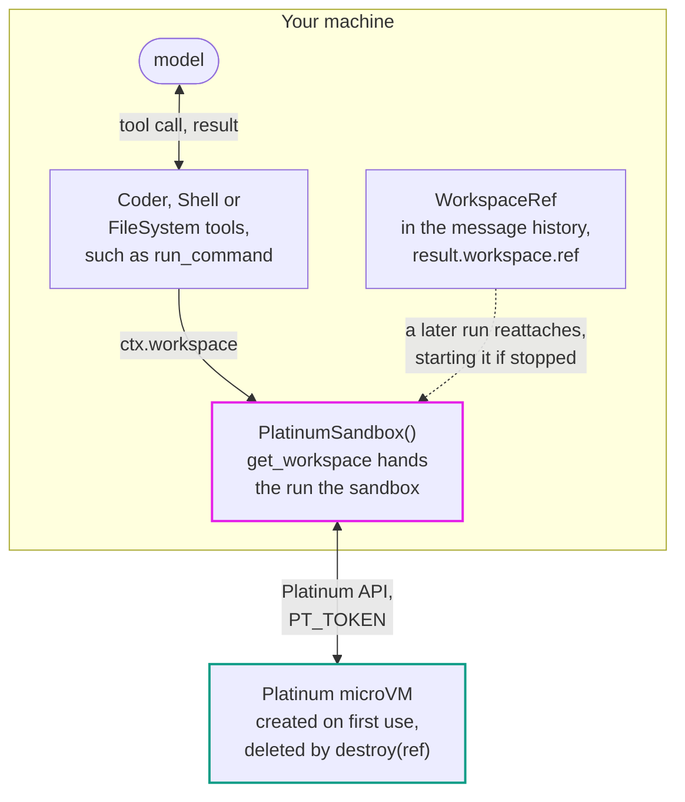

# Platinum Sandbox

Run your agent's commands and file edits in an isolated [Platinum](https://www.platinum.dev) sandbox, a Cloud Hypervisor microVM, instead of on your machine.

[Source](https://github.com/pydantic/pydantic-ai/tree/main/src/pydantic_ai_harness/pydantic_ai_harness/platinum_sandbox/)

> While Pydantic AI Harness is on 0.x releases, the API may change between minor releases; when it does, deprecation warnings and release-note migration guidance tell you (or your agent) exactly how to upgrade. See the [version policy](https://pydantic.dev/docs/ai/harness/#version-policy).



## Install

uv:

```bash
uv add "pydantic-ai-harness[coder,platinum,anthropic]"
```

pip:

```bash
pip install "pydantic-ai-harness[coder,platinum,anthropic]"
```

Set `PT_TOKEN` to an API key from the Platinum dashboard or `pt key create`. Each key belongs to one Platinum organization. Set `PT_API_URL` too if your organization uses an API other than `https://api.platinum.dev`. The examples also use `Coder` and an Anthropic model, so they need the `coder` and `anthropic` extras and `ANTHROPIC_API_KEY`. Swap them for your own tools and model provider.

## Quick start

<span id="choose-the-tools"></span>

```python {names="defined"}
from pydantic_ai import Agent
from pydantic_ai_harness.coder import Coder
from pydantic_ai_harness.platinum_sandbox import PlatinumSandbox

agent = Agent('anthropic:claude-opus-5-5', capabilities=[PlatinumSandbox(), Coder()])
result = agent.run_sync('Write a Python script that prints the first ten primes, and run it.')
```

`Coder`'s shell and file tools now run in the sandbox. For a narrower agent, use [`Shell`](https://pydantic.dev/docs/ai/harness/shell/), [`FileSystem`](https://pydantic.dev/docs/ai/harness/filesystem/) or your own tools on [`ctx.workspace`](https://pydantic.dev/docs/ai/core-concepts/workspace/#using-the-workspace-in-tools).

- `Coder` creates it when the run starts, to load the repository's instructions, even if no tool is called. Pass `Coder(repo_context=False)` to wait for the first tool call.
- It keeps running, and billing, until you stop or delete it: a Platinum sandbox has no lifetime deadline. Set `auto_stop_minutes=` to stop it when idle. See [Clean up](#clean-up).
- Commands run as `root` in `/workspace`, which is created on first use. Pass `working_dir='/workspace/project'` to give the agent another directory.
- The default template, `pt-base`, has Python 3.12 but no git, curl, Node or `rg`. A template is the image a new sandbox boots from. Build one with the tools your agent needs, as in [Bring git, Node or other tools](#bring-git-node-or-other-tools), and pass `template='agent-tools'`. An unknown template fails on first use with `WorkspaceUnavailableError`.
- It can reach the internet. Pass `allow_internet_access=False` to give a new sandbox no route out, except to the hosts of its [`secrets`](#keep-an-api-key-out-of-the-sandbox).

## Continue in the same sandbox

<span id="reattach-later"></span>

Pass the message history, and the next run works in the same sandbox, starting it again if it was stopped:

```python {names="defined"}
from pydantic_ai import Agent
from pydantic_ai_harness.coder import Coder
from pydantic_ai_harness.platinum_sandbox import PlatinumSandbox

agent = Agent('anthropic:claude-opus-5-5', capabilities=[PlatinumSandbox(), Coder()])
result = agent.run_sync('Write a Python script that prints the first ten primes, and run it.')

followup = agent.run_sync(
    'Now make it print the first twenty.',
    message_history=result.all_messages(),
)
ref = result.workspace.ref  # or store this, and pass `workspace=ref` to a later run
```

The history records the sandbox as a `WorkspaceRef`, or "ref": the provider's name and the sandbox's ID. `result.workspace.ref` is the same ref, for continuing without the history.

A stopped sandbox keeps its disk, and its memory and processes where Platinum can save them, so a run that attaches to it usually finds it as it was. A sandbox that stops between two operations of one run is started again, and the operation runs once more.

If the sandbox has been deleted, the run raises `WorkspaceUnavailableError`. Pass `workspace='new'` to start over. [Workspaces](https://pydantic.dev/docs/ai/core-concepts/workspace/#continuing-in-the-same-workspace) covers how runs find their workspace.

The ref holds no credentials, so the process that reattaches needs `PT_TOKEN` or a `client=` too.

Already have a `platinum.AsyncSandbox`? Pass `workspace=PlatinumSandboxBackend(sandbox=sandbox, working_dir=..., env=...)` to a run. `PlatinumSandbox`'s settings don't apply to it. A backend's `get_sandbox()` returns its `platinum.AsyncSandbox` for Platinum features the workspace API doesn't cover, such as snapshots, exposed ports and managed processes. On a backend with no sandbox yet, it creates one, which Platinum bills.

## Prepare a sandbox before the run

To seed files before the agent starts, build the backend yourself, write through a `Workspace`, and pass the backend to the run:

```python {names="defined"}
from pydantic_ai import Agent
from pydantic_ai.workspaces import Workspace
from pydantic_ai_harness.coder import Coder
from pydantic_ai_harness.platinum_sandbox import PlatinumSandbox, PlatinumSandboxBackend

agent = Agent('anthropic:claude-opus-5-5', capabilities=[PlatinumSandbox(), Coder()])


async def run_in_prepared_sandbox() -> str:
    backend = PlatinumSandboxBackend(working_dir='/workspace/project')
    try:
        await Workspace(backend).write_text('TASK.md', 'Add a `--version` flag to cli.py.\n')
        result = await agent.run('Do the task in TASK.md.', workspace=backend)
        return result.output
    finally:
        await backend.aclose()
        ref = backend.ref  # set once the sandbox exists
        if ref is not None:
            await PlatinumSandbox().destroy(ref)
```

The run leaves a backend you built open, so close it with `aclose()`. That closes the client it opened from `PT_TOKEN`, not the sandbox. A `client=` or `sandbox=` you passed is never closed. To keep the sandbox, store `backend.ref` instead of destroying it.

## Bring git, Node or other tools

Build a [template](https://www.platinum.dev/docs/templates) once with Platinum's SDK, and every new sandbox boots with its tools:

```python {test="skip"}
from platinum import Platinum, Template

from pydantic_ai_harness.platinum_sandbox import PlatinumSandbox


def build_agent_tools() -> None:  # once, before the first run that needs the tools
    template = Template.from_image('python:3.12-slim').apt_install(['git', 'curl', 'nodejs', 'npm'])
    template.build(Platinum(), 'agent-tools')


sandbox = PlatinumSandbox(template='agent-tools')
```

The build takes a minute or two. A template's image needs a POSIX `sh`, which runs every command.

## Clean up

Delete a sandbox with the ref you stored. This doesn't start a stopped sandbox:

```python {names="defined"}
from pydantic_ai.workspaces import WorkspaceRef
from pydantic_ai_harness.platinum_sandbox import PlatinumSandbox


async def delete_sandbox(ref: WorkspaceRef) -> None:
    await PlatinumSandbox().destroy(ref)
```

A failed run returns no result, so delete its sandbox in an `on_run_error` hook:

```python
from typing import Any

import anyio

from pydantic_ai import Agent, RunContext
from pydantic_ai.capabilities import Hooks
from pydantic_ai.run import AgentRunResult
from pydantic_ai_harness.coder import Coder
from pydantic_ai_harness.platinum_sandbox import PlatinumSandbox

hooks = Hooks()


@hooks.on.run_error
async def delete_failed_run_sandbox(ctx: RunContext[None], *, error: BaseException) -> AgentRunResult[Any]:
    if ctx.workspace.ref is not None:
        # Shielded so a deadline around the run can't cut the delete short, bounded so a hung call can't hang it.
        with anyio.move_on_after(30, shield=True):
            await PlatinumSandbox().destroy(ctx.workspace.ref)
    raise error


agent = Agent('anthropic:claude-opus-5-5', capabilities=[PlatinumSandbox(), Coder(), hooks])
```

A sandbox you don't delete keeps running until something stops it:

- Set `auto_stop_minutes=` to have Platinum stop a new sandbox after that many idle minutes. A stopped sandbox bills only its disk, and the next run that attaches starts it again.
- By default Platinum archives a sandbox that has been stopped for 7 days, and never deletes one. A run that attaches to an archived sandbox starts it again too. See [Platinum's retention timers](https://www.platinum.dev/docs/sandboxes#retention).

### Find a lost sandbox

If your program stops before it stores the ref, for example after a crash or Ctrl-C, the sandbox is left behind. To find it:

- Run `pt sandbox list`. Sandboxes Pydantic AI creates are named `pydantic-ai-<hex>`.
- Or search your logs for `Created Platinum sandbox <id>`, logged at INFO by the `pydantic_ai_harness` logger.

Then delete it: `await PlatinumSandbox().destroy(WorkspaceRef(provider='platinum', id='<id>'))`.

## Keep an API key out of the sandbox

Pass `secrets` to let a new sandbox spend Platinum organization [secrets](https://www.platinum.dev/docs/secrets) by name. Platinum's egress proxy writes each one into the request headers of the hosts it allows, so the agent's tools use the key without holding it. Create the secret once, then use it:

```python {test="skip"}
from platinum import AsyncPlatinum

from pydantic_ai_harness.platinum_sandbox import PlatinumSandbox


async def create_search_secret(key: str) -> None:  # the API key the agent's tools should use
    async with AsyncPlatinum() as client:
        await client.secrets.create(
            'search-api', f'Bearer {key}', allow=['api.example.com'], headers=['authorization']
        )


sandbox = PlatinumSandbox(secrets=['search-api'])
```

The agent's commands send requests to `api.example.com` with any placeholder key, and the proxy writes the real header on the way out.

- A secret carries one static header value, over HTTPS on port 443, to the exact hosts you allow. Plain HTTP gets nothing.
- The agent can't read the value, but it can use it for anything the allowed hosts let it do. Platinum blocks a response that echoes the value back, but not an encoded copy, so allow only hosts you trust with it.
- An attached sandbox keeps the secrets it was created with.
- The API key needs the `secrets:use` scope to attach a secret.

## Security model

- Each sandbox is a Cloud Hypervisor microVM with its own kernel. Commands run in Platinum's cloud, not on your machine, and share nothing with other sandboxes.
- It can reach the internet unless you pass `allow_internet_access=False`, which blocks outbound connections before the sandbox boots. The hosts of its `secrets` stay reachable.
- Commands can read every value in `env`. Use `secrets` for a key the agent should use but not hold.
- A ref can name any sandbox your API key can see, so keep refs server-side. A key with only the `sandboxes` scope, plus `secrets:use` if you pass `secrets`, can't reach the rest of your organization.

## Configuration

| Option | What it does |
| --- | --- |
| `client` | A `platinum.AsyncPlatinum` to share across runs on one event loop, or to point at another API. Default: `None`, a client each run opens from `PT_TOKEN` and `PT_API_URL` and closes when it ends. You close a client you pass. |
| `template` | Platinum template a new sandbox boots from. Default: `None`, Platinum's `pt-base`. An unknown template fails on first use. |
| `cpu` | vCPUs of a new sandbox. Default: `None`, the template's default. |
| `ram_mb` | Memory of a new sandbox, in MiB. Default: `None`, the template's default. |
| `disk_gb` | Disk of a new sandbox, in GB. Default: `None`, the template's default. |
| `auto_stop_minutes` | Idle minutes before Platinum stops a new sandbox. Default: `None`, Platinum's default, which never stops it. |
| `allow_internet_access` | Whether a new sandbox can reach the internet. Default: `True`. `False` blocks outbound connections, except to the hosts of its `secrets`. |
| `secrets` | Names of organization secrets a new sandbox may spend. Default: `None`. An attached sandbox keeps the ones it was created with. See [Keep an API key out of the sandbox](#keep-an-api-key-out-of-the-sandbox). |
| `working_dir` | Absolute directory commands start in and relative paths resolve against, created if it is missing. Default: `'/workspace'`. `None` uses the template's own, `/` on `pt-base`. |
| `env` | Environment variables every command gets, also on an attached sandbox. A new sandbox keeps them in its own environment too, so its commands still see them after a run with another `env`. Default: `None`. Nothing from your machine reaches the sandbox. The agent's commands can read these, so leave out secrets it shouldn't see. |
| `authority` | Who wrote the sandbox's files. A capability that puts a file's text in the prompt gives it no more [authority](https://pydantic.dev/docs/ai/core-concepts/workspace-custom/#workspace-authority) than this. Default: `'operator'`, your own files. Use `'user'` for the user's files, and `'none'` for files nobody on your side wrote, such as a cloned third-party repository. |
| `path_authority` | Levels for some directories and files, overriding `authority` under them. The longest matching path wins. Paths are in the sandbox, relative to the working directory or absolute, and `~` isn't expanded. Default: `None`. |

`client`, `working_dir`, `env`, `authority` and `path_authority` also apply when you reattach, and `destroy` uses `client`. The other options only shape a new sandbox.

## Limits

<span id="what-a-timeout-stops"></span>

- A command with a timeout of up to 80 seconds is one [exec request](https://www.platinum.dev/docs/exec), which Platinum holds for about 85 seconds at most. A longer timeout, or none, runs the command as a [managed process](https://www.platinum.dev/docs/processes) and streams its output until it exits.
- A timeout or cancellation stops the command's process group, not the sandbox, and `WorkspaceTimeoutError` carries the output printed before it.
- A command whose output passes 16 MiB raises `WorkspaceOutputLimitError`. A managed process keeps only the last 256 KiB of each stream for a reader that falls behind, and losing output that way raises it too. Redirect large output to a file.
- A background job a command starts with `&` doesn't outlive a command of up to 80 seconds, and one that keeps the command's output open can hold up the result of a longer one. Detach it with `setsid` and redirect its output. `Shell.start_command` does this for you.
- Files larger than one request's limit move in parts.
- The Platinum SDK needs asyncio. Under Trio, every operation raises `UserError`.

## Durable execution

Add a durability capability, such as `TemporalDurability()` from the `temporal` extra, next to `PlatinumSandbox()`. [Workspaces](https://pydantic.dev/docs/ai/core-concepts/workspace/#durable-execution) covers what changes.

## Telemetry

`PlatinumSandbox` emits no spans of its own. Core's [instrumentation](https://pydantic.dev/docs/ai/capabilities/instrumentation/) records `pydantic_ai.workspace.provider` and `pydantic_ai.workspace.id` on the agent run span, and each command or file operation runs inside its tool call's span.

## API reference

::: pydantic_ai_harness.platinum_sandbox.PlatinumSandbox

::: pydantic_ai_harness.platinum_sandbox.PlatinumSandboxBackend
