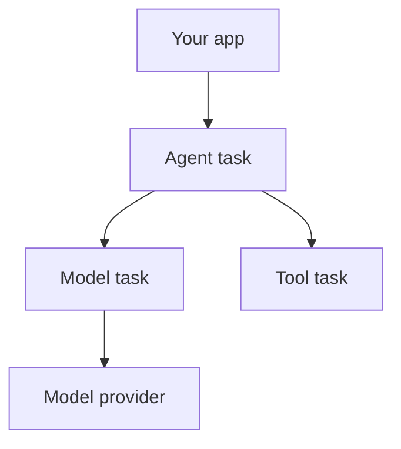

# Render Workflows

Run Pydantic AI agents in the background with separate retries, timeouts, and compute settings for model requests and tools. For example, give a document-processing tool more time and memory than the model requests around it.

Your application starts a task that calls `agent.run(...)`. The integration runs supported model and tool operations as separate Render tasks, called [chained task runs](https://render.com/docs/workflows-defining#chaining-task-runs), each with its own status, logs, and result.



Render runs the agent and tool code; the model provider generates responses. The local example below uses a fake model, so it makes no provider requests.

**Retrying the task that calls `agent.run(...)` restarts the agent and can repeat completed work.** The integration does not save progress for later recovery. If you only need to run the whole agent in the background, a native Render task may be enough.

[Full guide](https://github.com/pydantic/pydantic-ai/blob/main/docs/harness/render-workflows.md) | [Source](https://github.com/pydantic/pydantic-ai/tree/main/src/pydantic_ai_harness/pydantic_ai_harness/render/)

> While Pydantic AI Harness is on 0.x releases, the API may change between minor releases; when it does, deprecation warnings and release-note migration guidance tell you (or your agent) exactly how to upgrade. See the [version policy](https://pydantic.dev/docs/ai/harness/#version-policy).

## Prerequisites

- Python 3.11 or later and [uv](https://docs.astral.sh/uv/), or pip in an activated virtual environment.
- [Render CLI](https://render.com/docs/cli) 2.28.0 or later, installed separately.

The example needs no model API key or Render deployment. The package installs Render SDK 1.2.0 or later.

## Run locally

### 1. Install

In your project directory, run the command for your package manager. For a new uv project, run `uv init --bare` first.

uv:

```bash
uv add "pydantic-ai-harness[render]"
```

pip:

```bash
pip install "pydantic-ai-harness[render]"
```

### 2. Create the agent

Save this as `app.py` in the same directory:

```python
# Pydantic AI runs the agent; TestModel supplies a fake response for local testing.
from pydantic_ai import Agent
from pydantic_ai.models.test import TestModel

# Render registers Python tasks and supplies information about each task run.
from render import TaskContext, Workflows

# This integration sends the agent's model and tool operations to Render tasks.
from pydantic_ai_harness import RenderWorkflows


# A tool is a function the agent can call; this example returns mock weather.
async def get_weather(city: str) -> str:
    return f'It is sunny in {city}.'


# Register this agent and its tools when the worker loads the file.
app = Workflows()
workflows = RenderWorkflows(app)
agent = Agent(
    TestModel(custom_output_text='The workflow completed.'),  # No provider key needed.
    name='support',  # Gives the generated tasks stable names.
    tools=[get_weather],
    capabilities=[workflows],  # Routes supported operations through Render.
)


# Callers submit this task with a prompt; Render supplies ctx automatically.
@workflows.task
async def support(ctx: TaskContext, prompt: str) -> str:
    del ctx  # This example does not need the task information directly.
    return (await agent.run(prompt)).output  # Return the agent's answer as the task result.
```

For an existing agent, add `workflows` to `capabilities` and call the agent from a function decorated with `@workflows.task`. Create agents and tools when the file loads, with one `RenderWorkflows` instance per agent and one shared `app`. A plain `@app.task` does not activate the integration.

### 3. Start the worker

From the directory containing `app.py`:

```bash
render workflows dev -- uv run render-workflows app:app
```

With pip, omit `uv run`. The local server listens on port `8120` and lists tasks including `support` and `support__model.request`. Keep it running.

### 4. Submit a task

In a second terminal:

```bash
render workflows tasks runs start support --local --input '["Check the weather."]' --confirm --output json
```

Replace `<RUN_ID>` with the returned `id`:

```bash
render workflows tasks runs show <RUN_ID> --local --output json
```

Repeat until `status` is `"completed"`. Expect `results: ["The workflow completed."]`. `TestModel` generates sample tool arguments and fixed text; it does not interpret your prompt.

To see the separate model and tool runs:

```bash
render workflows tasks runs list 'support__model.request' --local --output json
render workflows tasks runs list 'support__function_toolset__<agent>.call_tool' --local --output json
```

Expect two model requests and one weather-tool call, each with a `parentTaskRunId` matching your run ID. Stop the server with Ctrl+C when finished; local run history is lost on shutdown.

## Use a real model or deploy

Replace `TestModel` and `get_weather` with your own model and tools. Install your model provider's dependency and set its API key in the worker's environment. See the [model setup example](https://github.com/pydantic/pydantic-ai/blob/main/docs/harness/render-workflows.md#5-use-your-own-model-and-tools).

Once the local example works:

1. Push your project and lockfile to your Git provider, then create a [Render workflow service](https://render.com/docs/workflows-tutorial#4-create-a-workflow-service) linked to that repository.
2. Set the service's root directory to the folder containing `app.py`. For uv, use `uv sync --locked` to build and `uv run render-workflows app:app` to start. With pip, install your dependency file and use `render-workflows app:app`.
3. Add provider credentials to the workflow service, deploy, and confirm `support` appears in its task list.
4. In the calling application, set `RENDER_API_KEY`, remove `RENDER_USE_LOCAL_DEV` and `RENDER_LOCAL_DEV_URL`, and use the deployed task slug from the Dashboard, such as `my-workflow/support`.

The [Python client example](https://github.com/pydantic/pydantic-ai/blob/main/docs/harness/render-workflows.md#7-call-the-agent-from-python) shows how to submit a run, return its ID immediately, and retrieve its result later. The caller can run on Render or elsewhere. The [deployment guide](https://github.com/pydantic/pydantic-ai/blob/main/docs/harness/render-workflows.md#8-deploy-the-agent-to-render) includes a hosted verification step.

## Before production

- **Retries can repeat actions.** Failed model or tool tasks can retry while the agent waits. Retrying the entry task restarts the agent. Prevent duplicate writes in your application; the integration cannot assign stable deduplication keys to chained calls. Render retries, Pydantic AI's `ModelRetry`, and provider retries are separate. [Configure retries](https://github.com/pydantic/pydantic-ai/blob/main/docs/harness/render-workflows.md#6-configure-retries-and-timeouts).
- **Pass data, not live clients or large files.** Inputs, dependencies, events, and results travel as JSON: objects, lists, and simple values such as strings and numbers. Task arguments, including integration metadata, are limited to 4 MB. Pass document IDs or storage URLs and load the data inside the tool. Local memory and files are not shared between task instances. [Storage guidance](https://github.com/pydantic/pydantic-ai/blob/main/docs/harness/render-workflows.md#large-tool-outputs).
- **Keep Render access trusted.** Workflow API callers can invoke generated tasks directly, bypassing the entry function. Keep credentials on your server, authenticate users, validate inputs, and check ownership before returning run details. Caller-supplied approval fields are not authorization. Render retains task data for 30 days, so read secrets from worker environment variables. [Execution limits](https://github.com/pydantic/pydantic-ai/blob/main/docs/harness/render-workflows.md#execution-limits).
- **Results arrive after each operation finishes.** Model tokens and events are buffered. Use Render's task cancellation; Pydantic AI cancellation tokens are unsupported, and cancellation cannot undo external actions.

## Configuration and reference

| Need | Guide |
| --- | --- |
| Set retries, timeouts, and compute; keep selected tools in the parent task | [Task options and tool opt-out](https://github.com/pydantic/pydantic-ai/blob/main/docs/harness/render-workflows.md#task-options-and-tool-opt-out) |
| Combine sub-agents, large tool outputs, or persistent memory | [Sub-agent delegation](https://github.com/pydantic/pydantic-ai/blob/main/docs/harness/render-workflows.md#sub-agent-delegation), [large outputs](https://github.com/pydantic/pydantic-ai/blob/main/docs/harness/render-workflows.md#large-tool-outputs), [memory](https://github.com/pydantic/pydantic-ai/blob/main/docs/harness/render-workflows.md#memory) |
| Understand generated tasks, stable toolset IDs, and the 500-definition limit | [Task definitions](https://github.com/pydantic/pydantic-ai/blob/main/docs/harness/render-workflows.md#task-definitions-and-chained-task-runs), [task names](https://github.com/pydantic/pydantic-ai/blob/main/docs/harness/render-workflows.md#task-names-for-capability-toolsets) |
| Schedule runs, configure tracing, or look up parameters | [Execution and tracing](https://github.com/pydantic/pydantic-ai/blob/main/docs/harness/render-workflows.md#execution-and-tracing), [`RenderWorkflows` API source](https://github.com/pydantic/pydantic-ai/blob/main/src/pydantic_ai_harness/pydantic_ai_harness/render/_capability.py) |
