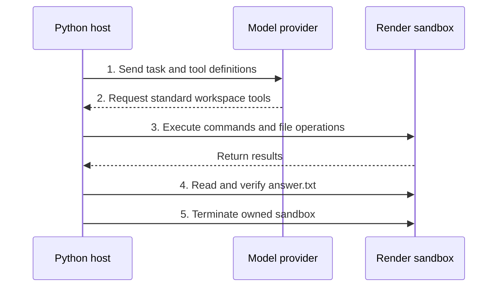

# Render Sandbox

Run agent commands and file edits in an isolated [Render sandbox](https://render.com/docs/sandboxes). Use it with `Coder`, or with `Shell` and `FileSystem`, when the agent needs a disposable cloud environment for code execution.

[Source](https://github.com/pydantic/pydantic-ai/tree/main/src/pydantic_ai_harness/pydantic_ai_harness/render_sandbox/)

> While Pydantic AI Harness is on 0.x releases, the API may change between minor releases; when it does, deprecation warnings and release-note migration guidance tell you (or your agent) exactly how to upgrade. See the [version policy](https://pydantic.dev/docs/ai/harness/#version-policy).

## Prerequisites

You need Python 3.11 or later, a Render workspace with Sandboxes access, and a model-provider account. This provider uses the Python Render SDK. The agent runs in your local Python process (or your server); commands and files live in the Render sandbox. Model requests go from the host to the model provider.

Set these environment variables in the host process before running the example:

| Variable | Purpose and source |
| --- | --- |
| `RENDER_API_KEY` | A [Render API key](https://render.com/docs/api#1-create-an-api-key) with access to the selected workspace; used by the host SDK. |
| `RENDER_WORKSPACE_ID` | The `tea-...` ID of that [Render workspace](https://render.com/docs/workspaces); selects the owner of the sandbox. |
| `ANTHROPIC_API_KEY` | An [Anthropic API key](https://console.anthropic.com/settings/keys); used only for host model requests. |

The adapter does not forward host environment variables or credentials into the sandbox. Render CLI login alone does not populate the SDK's environment variables.

## Install

uv:

```bash
uv add "pydantic-ai-harness[render-sandbox,anthropic]"
```

pip:

```bash
pip install "pydantic-ai-harness[render-sandbox,anthropic]"
```

The `anthropic` extra is for this example's model. Use your model provider's extra when choosing another provider. The Render SDK dependency is bounded to the tested 1.2 minor series because its sandbox API is still evolving.

## Run and verify a task

Save this as `render_example.py`. The agent writes a file in the sandbox. The host reads and checks that file before the capability terminates the environment.



```python
import asyncio

from pydantic_ai import Agent
from pydantic_ai.workspaces import Workspace
from pydantic_ai_harness import FileSystem, RenderSandbox, Shell


async def verify(workspace: Workspace) -> None:
    answer = await workspace.read_text('answer.txt')
    if answer.strip() != '42':
        raise ValueError('The generated answer was incorrect')
    print('Verified answer.txt: 42')


async def main() -> None:
    async with RenderSandbox(on_finish=verify) as sandbox:
        agent = Agent(
            'anthropic:claude-haiku-5-5',
            capabilities=[sandbox, Shell(), FileSystem()],
            model_settings={'parallel_tool_calls': False},
        )
        await agent.run('Use write_file to write only 42 to answer.txt.')


if __name__ == '__main__':
    asyncio.run(main())
```

This example requires live Render and Anthropic credentials, so documentation tests do not execute it.

```bash
uv run python render_example.py
```

Successful verification prints `Verified answer.txt: 42`. Normal return also means the owned sandbox's termination was confirmed. `on_finish` runs only after successful model completion, before cleanup; download wanted files there. Cleanup runs if the model, verification, or a tool fails, too. Termination deletes the sandbox's files.

`parallel_tool_calls=False` keeps this example's operations sequential. It is useful for tasks where a test must run after a file edit in the same model response. The backend itself supports concurrent operations. The `async with` scope closes the SDK's HTTP connections after its runs finish, including when you supply the client. Keep every user of that client inside the scope. For a long-lived service, keep one scope around all users of the client, or call `await capability.aclose()` when shutting down. Closing connections does not terminate a retained sandbox.

For a code-repair example with protected input tests, seven independent checks in a fresh sandbox, and a cleanup audit, see [render_sandbox.py](https://github.com/pydantic/pydantic-ai/blob/main/src/pydantic_ai_harness/examples/render_sandbox.py) and its [fixture](https://github.com/pydantic/pydantic-ai/blob/main/src/pydantic_ai_harness/examples/render_sandbox_fixture.py). From a repository checkout with dependencies installed:

```bash
uv run --no-sync python -m src.pydantic_ai_harness.examples.render_sandbox
```

## Configure the environment

Pass `config=RenderSandboxConfig(...)` to `RenderSandbox` or `RenderSandboxBackend`, importing the config from `pydantic_ai_harness.render_sandbox`.

| Setting | Default | Behavior |
| --- | --- | --- |
| `lifetime_seconds` | `300` | Maximum lifetime requested on creation, from 1 to 86400 seconds. |
| `working_dir` | `/workspace` | Absolute command working directory; created for a new sandbox, required to exist when attaching. |
| `network_policy` | `deny-all` | Sandbox egress; choose `allow-all` explicitly if the task needs it. Does not restrict host model requests. |
| `env` | `None` | Explicit variables provided on creation and to each command, including attached workspaces. |
| `max_output_bytes` | `1048576` | Combined captured stdout and stderr byte limit per command. |
| `command_interval` | `2.5` | Minimum dispatch spacing shared by backends using one SDK client. Set `0` to disable. Separate clients and processes are not coordinated. |

Readiness, individual control operations, cleanup, and command stopping have separate bounded timeouts. Tool command deadlines come from the standard tools or `workspace.run(timeout=...)`; waiting for a dispatch slot precedes that deadline. Each file helper command, SDK copy, and staging cleanup has its own 30-second default bound. Pacing waits are separate, so a complete read or write can take longer than 30 seconds.

Use `files={'input.txt': 'contents'}` to seed a run before its first model request. Use `Coder(sub_agents=False)` for a coding agent, or choose the narrower [`Shell`](https://pydantic.dev/docs/ai/harness/shell/) and [`FileSystem`](https://pydantic.dev/docs/ai/harness/filesystem/) capabilities. With `Coder`, repository inspection can create the sandbox before a model calls a tool. An ordinary run that never touches the workspace creates no sandbox; Workflows prepares it before the run.

## Keep or attach a sandbox

By default, `auto_cleanup=True` destroys a fresh sandbox supplied by this capability after its run. Use `auto_cleanup=False` to retain it and store `result.workspace.ref`. Later, pass that reference as `workspace=ref`, or supply `message_history=result.all_messages()` so core can resolve the reference. Destroy it explicitly with `await capability.destroy(ref)` when finished.

An attached reference and a caller-supplied backend remain caller-owned, even with `auto_cleanup=True`. A missing or expired reference raises `WorkspaceUnavailableError`; the adapter does not create a replacement. Message history from a run that used automatic cleanup therefore cannot resume that destroyed environment. Pass `workspace='new'` to start a fresh one.

For setup outside an agent run, open an `async with RenderSandbox() as capability` scope and construct `RenderSandboxBackend(capability.client)` inside it. Wrap the backend in the public `Workspace` and use its normal file and command methods. Put `await backend.destroy()` in a `finally` block inside the scope: `destroy()` terminates the sandbox, and exiting the scope closes the shared SDK client. Creation is lazy and `backend.ref` is available as soon as the create response returns. Explicit `destroy()` can also terminate attached environments.

## Command, file, and failure behavior

String commands require `shell=True` and use `/bin/sh -c`; argument lists are passed literally. Standard input is closed. Nonzero command exits return `CommandResult`. A timeout or cancellation stops the command's foreground process group, leaving the sandbox available. A background child that outlives its direct parent may keep running; intentionally detached processes require explicit management or sandbox termination.

The adapter sends a small Python supervisor through Render's exec API to preserve output bytes, track process-group ownership, and stop a command after a lost response. It requires Python 3 and Linux utilities in the remote image. Stop failures remain visible as exception causes and notes with the sandbox reference; uncertain commands and creates are not automatically replayed. Rate-limit errors propagate so the application can decide what to do next.

File contents use Render's native `copy_to` and `copy_from` SDK methods. File metadata uses Pydantic AI's public shell implementation. Writes stage beside the destination and replace it after a successful upload; reads copy a bounded snapshot of a regular file. A working directory is not a security boundary within the sandbox. Filesystem permissions and available binaries depend on the remote image.

If termination cannot be confirmed, `RenderSandboxCleanupError` preserves failure and the backend retains its reference for a cleanup retry. If a create response is lost before an ID is known, the error states that cleanup is uncertain; the requested sandbox lifetime remains the backstop.

## Use with Render Workflows

Install `pydantic-ai-harness[render,render-sandbox,anthropic]` to combine background agent tasks with an isolated workspace. Save this as `app.py`, then follow the [Render Workflows guide](https://pydantic.dev/docs/ai/harness/render-workflows/) to start the worker and submit `solve`:

```python
# Render registers background tasks; Pydantic supplies the agent and its tools.
from render import TaskContext, Workflows
from pydantic_ai import Agent
from pydantic_ai_harness import FileSystem, RenderSandbox, RenderWorkflows, Shell

# Build these once at module load so every worker registers the same task names.
app = Workflows()
workflows = RenderWorkflows(app)
sandbox = RenderSandbox(id='sandbox')
agent = Agent(
    'anthropic:claude-haiku-5-5',
    name='sandbox_agent',
    capabilities=[workflows, sandbox, Shell(), FileSystem()],
)

# Render supplies ctx; the caller supplies only the prompt.
@workflows.task
async def solve(ctx: TaskContext, prompt: str) -> str:
    del ctx
    # Model and tool tasks share one sandbox. Owned cleanup finishes before return.
    return (await agent.run(prompt)).output
```

Set the same host credentials on every worker. The explicit `id='sandbox'` gives cleanup a stable task name. Pydantic creates the workspace before the run, passes its reference to child tasks, and terminates an owned sandbox in a cleanup task. Attached sandboxes stay caller-owned. Use `on_finish` to read wanted files before deletion; use `auto_cleanup=False` to retain them.

A root-task retry starts the agent again and can repeat work. A worker crash or a lost create response can prevent cleanup, so the sandbox lifetime remains the backstop. Set it long enough for the whole agent run. Other durable engines and serialized agent specs remain unsupported. Ordinary agent runs still work without Workflows.

## Observe lifecycle and cleanup

`on_sandbox_event` receives a `RenderSandboxEvent` with the event name, sandbox ID, status, and optional exit code. Record created IDs so you can investigate or retry cleanup. Events exclude command text, file contents, and environment values. The callback runs synchronously and should finish quickly; a callback failure raises a warning and does not prevent cleanup.

This capability adds no OpenTelemetry spans. Core already traces agent and tool operations; the callback supplies provider lifecycle metadata for applications that need a resource audit. Read [Observability](https://pydantic.dev/docs/ai/guides/observability/) for core instrumentation.
