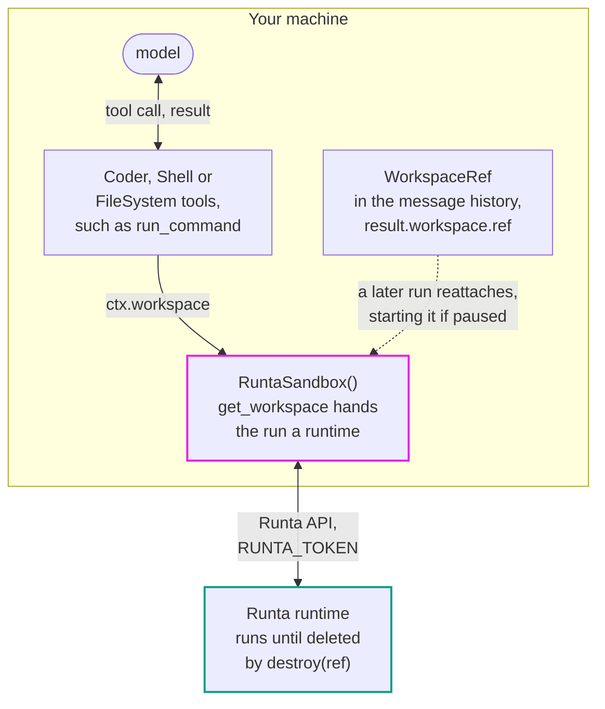

# Runta Sandbox

Run your agent's commands and file edits in a persistent [Runta](https://runta.com/docs/) microVM instead of on your machine.

[Source](https://github.com/pydantic/pydantic-ai/tree/main/src/pydantic_ai_harness/pydantic_ai_harness/runta_sandbox/)

> While Pydantic AI Harness is on 0.x releases, the API may change between minor releases; when it does, deprecation warnings and release-note migration guidance tell you (or your agent) exactly how to upgrade. See the [version policy](https://pydantic.dev/docs/ai/harness/#version-policy).



## Install

uv:

```bash
uv add "pydantic-ai-harness[coder,runta,anthropic]"
```

pip:

```bash
pip install "pydantic-ai-harness[coder,runta,anthropic]"
```

Set `RUNTA_TOKEN` to your Runta API key. The examples also use `Coder` and an Anthropic model, so they need the `coder` and `anthropic` extras and `ANTHROPIC_API_KEY`. Swap them for your own tools and model provider.

## Quick start

```python {names="defined"}
from pydantic_ai import Agent
from pydantic_ai_harness.coder import Coder
from pydantic_ai_harness.runta_sandbox import RuntaSandbox

agent = Agent('anthropic:claude-opus-5-5', capabilities=[RuntaSandbox(), Coder()])
result = agent.run_sync('Clone https://github.com/pydantic/pydantic-ai and summarize how capabilities work.')
```

`Coder`'s shell and file tools now run in a Runta runtime, which is Runta's name for one microVM. For a narrower agent, use [`Shell`](https://pydantic.dev/docs/ai/harness/shell/), [`FileSystem`](https://pydantic.dev/docs/ai/harness/filesystem/) or your own tools on [`ctx.workspace`](https://pydantic.dev/docs/ai/core-concepts/workspace/#using-the-workspace-in-tools).

- `Coder` creates it when the run starts, to load the repository's instructions, even if no tool is called. Pass `Coder(repo_context=False)` to wait for the first tool call. Creating a runtime takes about 15 seconds.
- It has no lifetime limit. It keeps running, keeps its files and installed packages, and costs money until you delete it. See [Clean up](#clean-up).
- Commands run as `root` in `/root`. Pass `working_dir='/root/project'` to give the agent a project directory. It is created on a new runtime.
- The default image is Ubuntu 24.04 with git and Python 3, but not Node.js. Install what your project needs once and reuse the runtime by its ref, or pass another `image`.

## Continue in the same runtime

Pass the message history, and the next run works in the same runtime:

```python {names="defined"}
from pydantic_ai import Agent
from pydantic_ai_harness.coder import Coder
from pydantic_ai_harness.runta_sandbox import RuntaSandbox

agent = Agent('anthropic:claude-opus-5-5', capabilities=[RuntaSandbox(), Coder()])
result = agent.run_sync('Clone https://github.com/pydantic/pydantic-ai and summarize how capabilities work.')

followup = agent.run_sync(
    'Which capability would you add next, and where would it live?',
    message_history=result.all_messages(),
)
ref = result.workspace.ref  # or store this, and pass `workspace=ref` to a later run
```

The history records the runtime as a `WorkspaceRef`, or "ref": the provider's name and the runtime's UUID. `result.workspace.ref` is the same ref, for continuing without the history.

A runtime that was paused, suspended or shut down since is started again when the next command needs it. If it has been deleted, the run raises `WorkspaceUnavailableError`, as does a command running when it is deleted. Pass `workspace='new'` to start over. [Workspaces](https://pydantic.dev/docs/ai/core-concepts/workspace/#continuing-in-the-same-workspace) covers how runs find their workspace.

The ref holds no credentials, so the process that reattaches needs `RUNTA_TOKEN` or a `token=` too.

## Prepare a runtime before the run

To seed files before the agent starts, build the backend yourself, write through a `Workspace`, and pass the backend to the run:

```python {names="defined"}
from pydantic_ai import Agent
from pydantic_ai.workspaces import Workspace
from pydantic_ai_harness.coder import Coder
from pydantic_ai_harness.runta_sandbox import RuntaSandbox, RuntaSandboxBackend

agent = Agent('anthropic:claude-opus-5-5', capabilities=[RuntaSandbox(), Coder()])


async def run_in_prepared_runtime() -> str:
    backend = RuntaSandboxBackend(working_dir='/root/project')
    try:
        await Workspace(backend).write_text('TASK.md', 'Add a `--version` flag to cli.py.\n')
        result = await agent.run('Do the task in TASK.md.', workspace=backend)
        return result.output
    finally:
        ref = backend.ref  # set once the runtime exists
        if ref is not None:
            await RuntaSandbox().destroy(ref)
```

A backend holds no connection between operations, so there is nothing to close. To keep the runtime, store `backend.ref` instead of destroying it.

## Clean up

Delete a runtime with the ref you stored. This doesn't start it:

```python {names="defined"}
from pydantic_ai.workspaces import WorkspaceRef
from pydantic_ai_harness.runta_sandbox import RuntaSandbox


async def delete_runtime(ref: WorkspaceRef) -> None:
    await RuntaSandbox().destroy(ref)
```

A ref can name any runtime your `RUNTA_TOKEN` reaches, and `destroy` deletes whatever it names, so keep refs on your server and only destroy runtimes you created. Deleting a runtime that doesn't exist returns quietly.

Runta bills compute, memory and storage by usage. See [Runta pricing](https://runta.com/pricing/).

### Find a lost runtime

If your program stops before it stores the ref, for example after a crash or Ctrl-C, the runtime stays until you delete it. To find it:

- List your runtimes in the Runta dashboard or with `runta ps -a`. Runtimes Pydantic AI creates are named `pydantic-ai-<hex>`.
- Or search your logs for `Created Runta runtime <id>`, logged at INFO by the `pydantic_ai_harness` logger.

## Configuration

| Option | What it does |
| --- | --- |
| `token` | A Runta API key. Default: `None`, the `RUNTA_TOKEN` environment variable. |
| `endpoint` | The Runta API endpoint. Default: `None`, `RUNTA_ENDPOINT`, then `https://api.runta.com`. |
| `image` | Image for a new runtime. Default: `None`, Runta's default image. An unknown image fails on first use. |
| `vcpus` | vCPUs for a new runtime. Default: `None`, the size Runta picks for the image. |
| `memory_mib` | Memory in MiB for a new runtime. Default: `None`, the size Runta picks for the image. |
| `working_dir` | Absolute directory commands start in and relative paths resolve against. Default: `None`, `/root`. Created on a new runtime. On an attached one, it must already exist. |
| `env` | Environment variables every command gets. Default: `None`. Nothing from your machine reaches the runtime. The agent's commands can read these, so leave out secrets it shouldn't see. |
| `authority` | Who wrote the runtime's files. A capability that puts a file's text in the prompt gives it no more [authority](https://pydantic.dev/docs/ai/core-concepts/workspace-custom/#workspace-authority) than this. Default: `'operator'`, your own files. Use `'user'` for the user's files, and `'none'` for files nobody on your side wrote, such as a cloned third-party repository. |
| `path_authority` | Levels for some directories and files, overriding `authority` under them. The longest matching path wins. Paths are in the runtime, relative to the working directory or absolute, and `~` isn't expanded. Default: `None`. |

`token`, `endpoint`, `working_dir`, `env`, `authority` and `path_authority` also apply when you reattach, and `destroy` uses `token` and `endpoint`. `image`, `vcpus` and `memory_mib` only shape a new runtime.

## Limits

- File operations run as shell commands in the runtime. Runta's file API moves at most 1 MiB and cannot list or remove, so a large file moves in 64 KiB pieces, one command each. Writing and reading back an 8 MiB file took about five minutes.
- A command's output is kept up to 10 MiB. Past that the run raises `WorkspaceOutputLimitError` with the start of the output.
- Commands run as `root`, so Unix permissions don't restrict them. Don't rely on file modes to keep tools out of a path.
- A timeout or cancellation closes the command's connection, and Runta then ends the command. Children it started in the background may keep running. If unsure, inspect or delete the runtime.
- `timeout=None` removes the command deadline. A runtime does not pause when idle unless you set an idle policy on it in Runta.
- The Runta connection needs asyncio. Under Trio, every operation raises `UserError`.

## Telemetry

`RuntaSandbox` emits no spans of its own. Core's [instrumentation](https://pydantic.dev/docs/ai/capabilities/instrumentation/) records `pydantic_ai.workspace.provider` and `pydantic_ai.workspace.id` on the agent run span, and each command or file operation runs inside its tool call's span.

## API reference

::: pydantic_ai_harness.runta_sandbox.RuntaSandbox

::: pydantic_ai_harness.runta_sandbox.RuntaSandboxBackend
