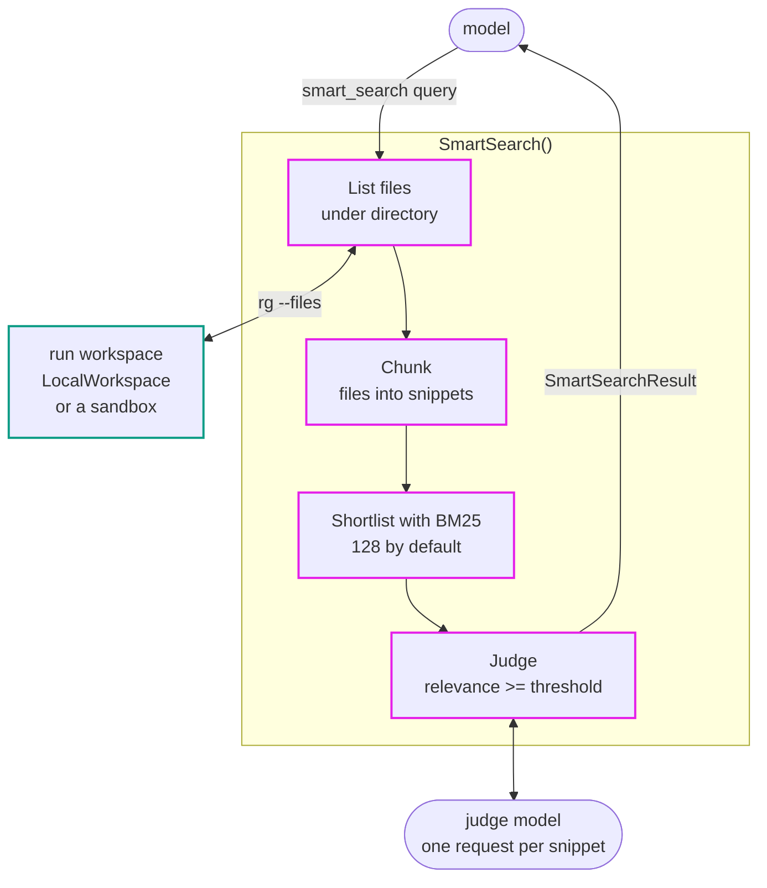

# Smart Search

Code search by behavior: the agent describes what it is looking for in plain English and gets back ranked source
excerpts with file and line ranges. Any Pydantic AI model can judge relevance; a decision model served over the
System One API, or TypeSafe's Jev, is the recommended judge.

[Source](https://github.com/pydantic/pydantic-ai/tree/main/src/pydantic_ai_harness/pydantic_ai_harness/smart_search/)

> While Pydantic AI Harness is on 0.x releases, the API may change between minor releases; when it does, deprecation warnings and release-note migration guidance tell you (or your agent) exactly how to upgrade. See the [version policy](https://pydantic.dev/docs/ai/harness/#version-policy).



## The problem

A coding agent in an unfamiliar repository spends its first turns locating code: guessing identifiers,
chaining exploratory `grep` calls, and reading whole files to find the one function that matters. Text search
only finds what you can already name.

## The solution

`SmartSearch` adds a `smart_search` tool that lists the files in the run's workspace with `rg`, cuts them
into snippets (overlapping line windows, or the functions and methods of a Python file), shortlists them with
local BM25, and has a judge model rate each shortlisted snippet's relevance to the query.

```python
from pydantic_ai import Agent
from pydantic_ai.capabilities import LocalWorkspace
from pydantic_ai_harness import SmartSearch

agent = Agent(
    'openai:gpt-6-astra',
    capabilities=[LocalWorkspace('.'), SmartSearch(model='system-one:clm-latest')],
)
```

The judge is required and pluggable: pass any model or model name as `model`. A decision model over the System One
API, such as `'system-one:clm-latest'`, needs only `SYSTEM_ONE_BASE_URL` (and `SYSTEM_ONE_API_KEY` if the API needs
a key); TypeSafe's Jev is `'typesafe:jev-latest'`. Each judged snippet counts as one request against the run's
`request_limit` (50 by default), and a search spends at most half of what is left, so raise it for full
128-snippet searches.

The workspace must be able to run commands and have [ripgrep](https://github.com/BurntSushi/ripgrep) (`rg`) on its
`PATH`; the `coder` extra installs it for a local workspace. The tool is not offered on a workspace that cannot run
commands, and a run without a workspace fails at its start.

A search sends the query, the shortlisted snippets and their paths to the judge model's provider, and only searches
inside the workspace's working directory. If no source may leave the machine, judge with a local model.

## Settings

| Setting | Default | Meaning |
|---|---|---|
| `model` | required | The judge: any model or model name. A judge given by name times out each request after 30 seconds; a model instance keeps its own `settings`. |
| `threshold` | `0.5` | Relevance (the product of the two judgments, 0 to 1) a snippet needs to be returned. Tuned for Jev; check a few searches and retune for another judge. |
| `concurrency` | `8` | Snippets judged at once. |
| `cache_index` | `False` | Keep each searched directory's index in memory between searches, for the life of the agent. Up to four directories (each with its `glob`) are kept, least recently searched evicted first; later searches re-read every file but only re-index changed ones. |
| `guidance` | `None` | Discovery instructions added whenever the tool is offered: `None` for the default, which has the model reach for `smart_search` before exploratory text search, `''` for none. |
| `id` | `'smart_search'` | Stable identity, under which durable execution records each search's judgments; see [Two of them](#two-of-them). |

A search is capped at 200,000 files (counted after `glob`), 50 million lines and 2 GiB of source; past that it asks
the model to narrow `directory` or `glob`.

## Two of them

`SmartSearch` declares the default `id` `'smart_search'`, under which durable execution records each search's
judgments. Two `SmartSearch`s on one agent that share it become one when they agree, and the agent raises a
`UserError` when it's built if they differ, since a merge could send the source to a judge neither chose. To keep
two, give each its own `id` and wrap them in `PrefixTools`, since both register `smart_search`.

Earlier releases declared no default `id`, so two always failed on the tool name when the run started.

## Telemetry

Each search opens a `smart search` span under its tool call, on the run's tracer:

| Attribute | Value |
|---|---|
| `smart_search.judge_model` | the judge model |
| `smart_search.files`, `.skipped_files`, `.snippets`, `.evaluated` | the coverage figures |
| `smart_search.selection_complete` | whether every snippet was judged |
| `smart_search.indexed_files` | files the search chunked and indexed; with `cache_index`, only new and changed ones |
| `smart_search.matches`, `.omitted_matches` | matches returned, and matches cut by `limit` |
| `smart_search.query` | the query, only when the run includes content in traces |

A failed search records no exception on this span; the enclosing tool span reports it, redacted by the run's
`include_content`. The judge runs themselves are not instrumented, as their prompts carry source, but their usage
is added to the run's.

See the [Smart Search docs](https://pydantic.dev/docs/ai/harness/smart-search/) for the search
pipeline, the result shape, choosing the judge, usage limits, caching and tuning `threshold`.
