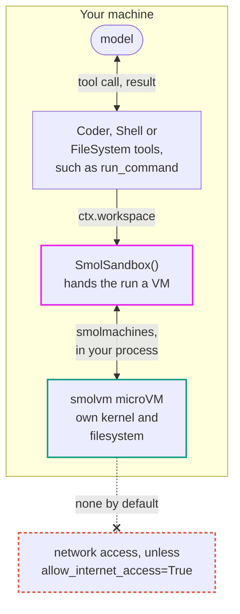

# Smol Sandbox

Run your agent's commands and file edits in a [smolvm](https://github.com/smol-machines/smolvm) microVM on your own machine, isolated from your files and processes, without a cloud account.

[Source](https://github.com/pydantic/pydantic-ai/tree/main/src/pydantic_ai_harness/pydantic_ai_harness/smol_sandbox/)

> While Pydantic AI Harness is on 0.x releases, the API may change between minor releases; when it does, deprecation warnings and release-note migration guidance tell you (or your agent) exactly how to upgrade. See the [version policy](https://pydantic.dev/docs/ai/harness/#version-policy).



## Install

<span id="platforms"></span>

uv:

```bash
uv add "pydantic-ai-harness[coder,smol,anthropic]"
```

pip:

```bash
pip install "pydantic-ai-harness[coder,smol,anthropic]"
```

The `smol` extra installs [smolmachines](https://github.com/smol-machines/smol), which runs VMs on this machine. It needs one of:

- macOS on Apple silicon.
- Linux on x86_64 or aarch64 with glibc 2.34 or newer. The user running the agent needs read and write access to `/dev/kvm`.

smolvm itself also runs on Windows x86_64, with the Windows Hypervisor Platform, but smolmachines has no Windows build, so `SmolSandbox` doesn't run there.

The examples also use `Coder` and an Anthropic model, hence the `coder` and `anthropic` extras and `ANTHROPIC_API_KEY`; swap them for your own tools and model provider.

## Quick start

<span id="choose-the-tools"></span>

```python {names="defined"}
from pydantic_ai import Agent
from pydantic_ai_harness.coder import Coder
from pydantic_ai_harness.smol_sandbox import SmolSandbox

agent = Agent('anthropic:claude-opus-5-5', capabilities=[SmolSandbox(image='python:3.12-alpine'), Coder()])
result = agent.run_sync('Write a script that prints the first 10 primes, and run it.')
```

`Coder`'s shell and file tools now run in a VM with its own kernel and filesystem. For a narrower agent, use [`Shell`](https://pydantic.dev/docs/ai/harness/shell/), [`FileSystem`](https://pydantic.dev/docs/ai/harness/filesystem/) or your own tools on [`ctx.workspace`](https://pydantic.dev/docs/ai/core-concepts/workspace/#using-the-workspace-in-tools).

- `Coder` creates it when the run starts, to load the repository's instructions, even if no tool is called. Pass `Coder(repo_context=False)` to wait for the first tool call.
- Its disk stays on this machine after the run. The VM shuts down when your process exits, but nothing deletes it. See [Clean up](#clean-up).
- It has no network access. Pass `allow_internet_access=True` to install packages or clone repositories. That access is unrestricted and comes from this machine, so the VM can reach anything this machine can, such as your local network or a cloud metadata endpoint.
- Commands run as the image's user, usually `root`, in `/workspace`, which is created if missing.
- Without an `image`, the VM runs smolvm's own Alpine Linux, which has BusyBox but no Python, git or ripgrep. An `image` is any OCI image with a POSIX `/bin/sh`; smolvm pulls it the first time.

## Continue in the same VM

<span id="reattach-later"></span>

Pass the message history, and the next run works in the same VM:

```python {names="defined"}
from pydantic_ai import Agent
from pydantic_ai_harness.coder import Coder
from pydantic_ai_harness.smol_sandbox import SmolSandbox

agent = Agent('anthropic:claude-opus-5-5', capabilities=[SmolSandbox(image='python:3.12-alpine'), Coder()])
result = agent.run_sync('Write a script that prints the first 10 primes, and run it.')

followup = agent.run_sync('Now make it print the first 100.', message_history=result.all_messages())
ref = result.workspace.ref  # or store this, and pass `workspace=ref` to a later run
```

`result.workspace.ref` is a `WorkspaceRef` holding the VM's name. Store it to continue later or to delete the VM.

If the VM has been deleted, the run raises `WorkspaceUnavailableError`. Pass `workspace='new'` to start over. [Workspaces](https://pydantic.dev/docs/ai/core-concepts/workspace/#continuing-in-the-same-workspace) covers how runs find their workspace.

Another process can continue in the VM with the ref, and boots it again. smolmachines saves a VM's disk when the VM stops or when `sync` runs inside it, so stop the VM before your process exits, or its recent file changes can be lost:

```python {names="defined"}
from pydantic_ai.workspaces import WorkspaceRef
from pydantic_ai_harness.smol_sandbox import SmolSandbox


async def stop_vm(ref: WorkspaceRef) -> None:
    machine = await SmolSandbox().backend(ref).get_sandbox()
    await machine.stop()
```

## Prepare a VM before the run

To seed files or install packages before the agent starts, boot the backend yourself, work in it through `Workspace`, and pass it to the run:

```python {names="defined"}
import asyncio

from pydantic_ai import Agent
from pydantic_ai.workspaces import Workspace
from pydantic_ai_harness.coder import Coder
from pydantic_ai_harness.smol_sandbox import SmolSandbox, SmolSandboxBackend

agent = Agent('anthropic:claude-opus-5-5', capabilities=[SmolSandbox(), Coder()])


async def main() -> None:
    backend = SmolSandboxBackend(image='python:3.12-alpine', allow_internet_access=True)
    try:
        workspace = Workspace(backend)
        await workspace.write_text('calc.py', 'def add(a, b):\n    return a - b\n')
        install = await workspace.run(['pip', 'install', 'pytest'], timeout=300)
        if install.exit_code != 0:
            raise RuntimeError(f'pip install failed: {install.stderr}')
        result = await agent.run('Fix the bug in calc.py.', workspace=backend)
        print(result.output)
    finally:
        ref = backend.ref  # set once the VM exists
        if ref is not None:
            await SmolSandbox().destroy(ref)


if __name__ == '__main__':
    asyncio.run(main())
```

The `finally` deletes the VM even when setup or the run fails, or is cancelled mid-boot. To keep it, store `backend.ref` instead.

`SmolSandbox`'s settings don't apply to a backend you pass as `workspace=`. Give the backend its own.

For features the workspace API doesn't cover, `backend.get_sandbox()` returns the SDK's `smol.AsyncMachine`.

## Clean up

Delete a VM and its disk with the ref you stored. A VM that is already gone returns quietly. A stopped VM is booted briefly first, because smolmachines can't delete a local VM without attaching to it:

```python {names="defined"}
from pydantic_ai.workspaces import WorkspaceRef
from pydantic_ai_harness.smol_sandbox import SmolSandbox


async def delete_vm(ref: WorkspaceRef) -> None:
    await SmolSandbox().destroy(ref)
```

A failed run returns no result, so delete its VM in an `on_run_error` hook:

```python
from typing import Any

import anyio

from pydantic_ai import Agent, RunContext
from pydantic_ai.capabilities import Hooks
from pydantic_ai.run import AgentRunResult
from pydantic_ai_harness.coder import Coder
from pydantic_ai_harness.smol_sandbox import SmolSandbox

hooks = Hooks()


@hooks.on.run_error
async def delete_failed_run_vm(ctx: RunContext[None], *, error: BaseException) -> AgentRunResult[Any]:
    if ctx.workspace.ref is not None:
        # Shielded so a deadline around the run can't cut the delete short, bounded so a hung call can't hang it.
        with anyio.move_on_after(30, shield=True):
            await SmolSandbox().destroy(ctx.workspace.ref)
    raise error


agent = Agent('anthropic:claude-opus-5-5', capabilities=[SmolSandbox(image='python:3.12-alpine'), Coder(), hooks])
```

### Find a lost VM

If your program stops before it stores the ref, for example after a crash or Ctrl-C, the VM is left behind. To find it, search your logs for `Creating smol VM <id>`, logged at INFO by the `pydantic_ai_harness` logger.

Then delete it: `await SmolSandbox().destroy(WorkspaceRef(provider='smol', id='<id>'))`.

## Use a VM you already have

Pass one of these as `workspace=`:

- `SmolSandboxBackend(sandbox=machine)`, with a `smol.Machine` or `smol.AsyncMachine`.
- `SmolSandboxBackend(ref=WorkspaceRef(provider='smol', id=...))`, with a VM's name.

Give the backend its own `working_dir=` and `env=`. The backend never deletes the VM.

## Security model

The VM is the boundary. It has its own kernel and filesystem. Nothing from this machine is mounted into it, no ports are published, and none of your environment variables reach it. Commands run as the image's user, `root` on smolvm's Alpine and most images, so anything the agent runs can change anything in the VM.

- smolvm runs in your process with your OS user's permissions. `SMOLVM_*` environment variables configure it, and some, like `SMOLVM_SECCOMP=off`, turn off its own confinement on Linux. Don't let untrusted input set them.
- `image` is pulled by tag; pin a digest, such as `python:3.12-alpine@sha256:...`, to get the same image every time.
- `cpus` and `memory_mb` cap one VM. Nothing limits how many VMs a process boots.

### Which VMs a run can use

Whoever passes a ref runs commands in the VM it names. smolmachines can open any VM of your OS user by name, including ones other tools made with your folders mounted. So:

- **Refs reaching `SmolSandbox`** (message history, `workspace=ref`, `backend(ref)`, `destroy(ref)`) only open VMs `SmolSandbox` booted, named `pydantic-ai-` and 32 hex digits. Any other name raises `ValueError`. Durable execution rebuilds the workspace from its ref, so it only works with VMs `SmolSandbox` booted.
- **`SmolSandboxBackend(...)` built by your code** opens any VM on this machine, because your code chose it. A later run given only its message history raises `ValueError`; pass the backend again, or `workspace='new'`.
- **The name doesn't prove origin**: any program running as your OS user can boot a VM with such a name. Only pass refs your application stored itself, and don't build `SmolSandboxBackend(ref=...)` from user input.

## Configuration

| Option | What it does |
| --- | --- |
| `image` | OCI image for a new VM. Default: `None`, smolvm's own Alpine Linux. |
| `cpus` | vCPUs for a new VM. Default: `None`, smolvm's default. |
| `memory_mb` | Memory for a new VM in MiB. Default: `None`, smolvm's default. |
| `allow_internet_access` | Whether a new VM has unrestricted outbound network access, from this machine's network. Default: `False`. |
| `working_dir` | Absolute directory commands start in and relative paths resolve against, created if missing. Default: `/workspace`. `None` uses the VM's own, `/` without an image. |
| `env` | Environment variables every command gets, on top of the image's. Default: `None`. Nothing from your machine's environment reaches the VM. The agent's commands can read these, so leave out secrets it shouldn't see. |
| `authority` | Who wrote the VM's files: `'none'` for files nobody on your side wrote, such as a cloned third-party repository, or `'user'` for the user's own. Capabilities that put a file into the prompt give it no more [authority](https://pydantic.dev/docs/ai/core-concepts/workspace-custom/#workspace-authority) than this. Default: `'operator'`, files you wrote. |
| `path_authority` | An `authority` level for specific directories and files, overriding `authority` under them. The longest matching path wins. Paths are VM paths, relative to the working directory or absolute, and `~` isn't expanded. Default: `None`. |

`image`, `cpus`, `memory_mb` and `allow_internet_access` only shape a new VM. `working_dir` and `env` apply to every command, including after you reattach.

## Limits

<span id="how-commands-run"></span>

- On an unsupported platform, importing `pydantic_ai_harness.smol_sandbox` raises `ImportError`.
- A host that can't run VMs, such as Linux without `/dev/kvm` access, raises `WorkspaceUnavailableError` on first use. Check with `smol.local_availability()`.
- Files move 64 KiB per command, so a file of several MiB takes seconds to read or write.
- Images need the usual file utilities, which BusyBox has.
- A command whose output passes 10 MiB is stopped with `WorkspaceOutputLimitError`. Redirect large output to a file.
- On a timeout, the command and the processes it started are killed. Jobs that outlive their command, like a [Shell](https://pydantic.dev/docs/ai/harness/shell/) background job, keep running.
- The smol SDK needs asyncio. Under Trio, operations raise `UserError`.

## Telemetry

`SmolSandbox` emits no spans of its own. Core's [instrumentation](https://pydantic.dev/docs/ai/capabilities/instrumentation/) records `pydantic_ai.workspace.provider` (`smol`) and `pydantic_ai.workspace.id` on the agent run span, and each command or file operation runs inside its tool call's span.

Treat the recorded id like a ref: any process of your OS user on this machine can attach to the VM with it.

## API reference

::: pydantic_ai_harness.smol_sandbox.SmolSandbox

::: pydantic_ai_harness.smol_sandbox.SmolSandboxBackend
