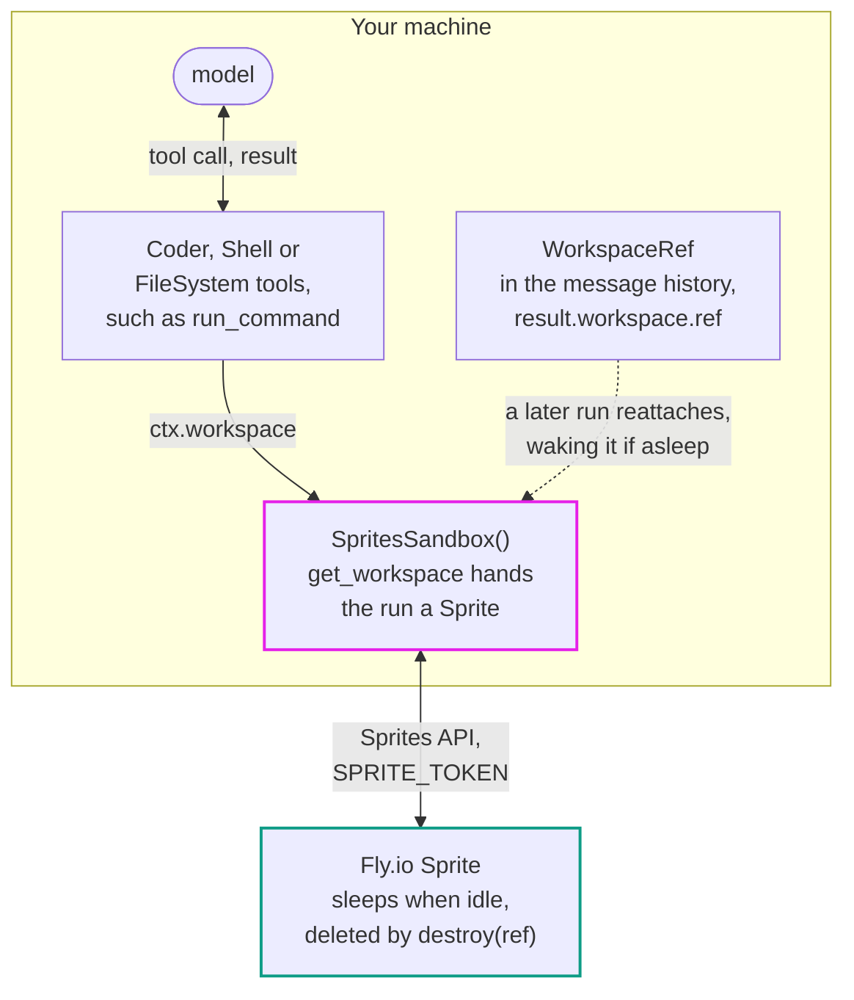

# Sprites Sandbox

Run your agent's commands and file edits in a persistent [Fly.io Sprite](https://sprites.dev) instead of on your machine.

[Source](https://github.com/pydantic/pydantic-ai/tree/main/src/pydantic_ai_harness/pydantic_ai_harness/sprites_sandbox/)



## Install

uv:

```bash
uv add "pydantic-ai-harness[coder,sprites,anthropic]"
```

pip:

```bash
pip install "pydantic-ai-harness[coder,sprites,anthropic]"
```

Set `SPRITE_TOKEN` to your Sprites API token. The examples also use `Coder` and an Anthropic model, so they need the `coder` and `anthropic` extras and `ANTHROPIC_API_KEY`. Swap them for your own tools and model provider.

## Quick start

<span id="choose-the-tools"></span>

```python {names="defined"}
from pydantic_ai import Agent
from pydantic_ai_harness.coder import Coder
from pydantic_ai_harness.sprites_sandbox import SpritesSandbox

agent = Agent('anthropic:claude-opus-5-5', capabilities=[SpritesSandbox(), Coder()])
result = agent.run_sync('Clone https://github.com/pydantic/pydantic-ai and summarize how capabilities work.')
```

`Coder`'s shell and file tools now run in a Sprite. For a narrower agent, use [`Shell`](https://pydantic.dev/docs/ai/harness/shell/), [`FileSystem`](https://pydantic.dev/docs/ai/harness/filesystem/) or your own tools on [`ctx.workspace`](https://pydantic.dev/docs/ai/core-concepts/workspace/#using-the-workspace-in-tools).

- `Coder` creates it when the run starts, to load the repository's instructions, even if no tool is called. Pass `Coder(repo_context=False)` to wait for the first tool call.
- It has no lifetime limit. It sleeps when idle, keeps its files and installed packages, and costs money until you delete it. See [Clean up](#clean-up).
- Processes pause between commands unless you run them as a [Sprites service](https://docs.fly.io/sprites/concepts/services/).
- Commands run as the non-root `sprite` user in `/home/sprite`. Pass `working_dir='/home/sprite/project'` to give the agent a project directory. It is created on a new Sprite.
- A new Sprite has git, Python and Node.js, but not pytest or `rg`. See its [preinstalled tools](https://docs.fly.io/sprites/working-with-sprites/). Install what your project needs once and reuse the Sprite by its ref. For faster `Coder` searches, run `sudo apt-get update && sudo apt-get install ripgrep`.

## Continue in the same Sprite

<span id="continue-in-the-same-sandbox"></span><span id="reattach-later"></span>

Pass the message history, and the next run works in the same Sprite:

```python {names="defined"}
from pydantic_ai import Agent
from pydantic_ai_harness.coder import Coder
from pydantic_ai_harness.sprites_sandbox import SpritesSandbox

agent = Agent('anthropic:claude-opus-5-5', capabilities=[SpritesSandbox(), Coder()])
result = agent.run_sync('Clone https://github.com/pydantic/pydantic-ai and summarize how capabilities work.')

followup = agent.run_sync(
    'Which capability would you add next, and where would it live?',
    message_history=result.all_messages(),
)
ref = result.workspace.ref  # or store this, and pass `workspace=ref` to a later run
```

The history records the Sprite as a `WorkspaceRef`, or "ref": the provider's name and the Sprite's ID. `result.workspace.ref` is the same ref, for continuing without the history.

If the Sprite has been deleted, the run raises `WorkspaceUnavailableError`, as does a command running when it is deleted. Pass `workspace='new'` to start over. [Workspaces](https://pydantic.dev/docs/ai/core-concepts/workspace/#continuing-in-the-same-workspace) covers how runs find their workspace.

The ref holds no credentials, so the process that reattaches needs `SPRITE_TOKEN` or a `client=` too.

Already have a `sprites.AsyncSprite`? Pass `workspace=SpritesSandboxBackend(sandbox=sprite, working_dir=..., env=..., desktop=...)` to a run. `SpritesSandbox`'s settings don't apply to it. A backend's `get_sandbox()` returns its `sprites.AsyncSprite` for Sprites features the workspace API doesn't cover. On a backend with no Sprite yet, it creates one, which Sprites bills.

## Prepare a Sprite before the run

To seed files before the agent starts, build the backend yourself, write through a `Workspace`, and pass the backend to the run:

```python {names="defined"}
from pydantic_ai import Agent
from pydantic_ai.workspaces import Workspace
from pydantic_ai_harness.coder import Coder
from pydantic_ai_harness.sprites_sandbox import SpritesSandbox, SpritesSandboxBackend

agent = Agent('anthropic:claude-opus-5-5', capabilities=[SpritesSandbox(), Coder()])


async def run_in_prepared_sprite() -> str:
    backend = SpritesSandboxBackend(working_dir='/home/sprite/project')
    try:
        await Workspace(backend).write_text('TASK.md', 'Add a `--version` flag to cli.py.\n')
        result = await agent.run('Do the task in TASK.md.', workspace=backend)
        return result.output
    finally:
        await backend.aclose()
        ref = backend.ref  # set once the Sprite exists
        if ref is not None:
            await SpritesSandbox().destroy(ref)
```

The run leaves a backend you built open, so close it with `aclose()`. That closes the client it opened from `SPRITE_TOKEN`, not the Sprite. A `client=` or `sandbox=` you passed is never closed. To keep the Sprite, store `backend.ref` instead of destroying it.

## Give the agent a desktop

Pass `desktop=True` and add [`ComputerUse`](../computer_use/):
`capabilities=[SpritesSandbox(desktop=True), ComputerUse()]`. The screen is 1280x800; pass a size such as
`desktop=(1440, 900)` for another.

The first use installs [the display's programs](../computer_use/#what-the-display-needs) with `apt-get`, which can take a minute. There's no web browser.

- A [cold wake](https://docs.fly.io/sprites/concepts/lifecycle.md) stops the display and closes the agent's windows; files on disk are kept. The display restarts on the agent's next screenshot or action; until then, a program started from the shell can't open a window.
- The agent can type only ASCII: an action that types or presses a character such as `é` fails, and the model is told why.

## Clean up

Delete a Sprite with the ref you stored. This doesn't wake it:

```python {names="defined"}
from pydantic_ai.workspaces import WorkspaceRef
from pydantic_ai_harness.sprites_sandbox import SpritesSandbox


async def delete_sprite(ref: WorkspaceRef) -> None:
    await SpritesSandbox().destroy(ref)
```

A ref can name any Sprite your `SPRITE_TOKEN` reaches, and `destroy` deletes whatever it names, so keep refs on your server and only destroy Sprites you created.

A failed run returns no result, so delete its Sprite in an `on_run_error` hook. If Sprites' reply to the create was lost, the ref still names the Sprite the backend tried to create, which may or may not exist. Delete it by that name anyway; deleting a Sprite that doesn't exist returns quietly:

```python
from typing import Any

import anyio

from pydantic_ai import Agent, RunContext
from pydantic_ai.capabilities import Hooks
from pydantic_ai.run import AgentRunResult
from pydantic_ai_harness.coder import Coder
from pydantic_ai_harness.sprites_sandbox import SpritesSandbox

hooks = Hooks()


@hooks.on.run_error
async def terminate_failed_run(ctx: RunContext[None], *, error: BaseException) -> AgentRunResult[Any]:
    if ctx.workspace.ref is not None:
        # Shielded so a deadline around the run can't cut the kill short, bounded so a hung call can't hang it.
        with anyio.move_on_after(30, shield=True):
            await SpritesSandbox().destroy(ctx.workspace.ref)
    raise error


agent = Agent('anthropic:claude-opus-5-5', capabilities=[SpritesSandbox(), Coder(), hooks])
```

You pay for compute while a Sprite is active, and for storage until you delete it. See [Sprite lifecycle](https://docs.sprites.dev/concepts/lifecycle/).

### Find a lost Sprite

If your program stops before it stores the ref, for example after a crash or Ctrl-C, the Sprite stays until you delete it, since a Sprite never expires. To find it:

- List your Sprites. Sprites Pydantic AI creates are named `pydantic-ai-<hex>`, and the name is the ref's id.
- Or search your logs for `Created Sprite <id>`, logged at INFO by the `pydantic_ai_harness` logger.
- If the run stopped before Sprites replied, there is no log line, but the Sprite may still exist. Look for it in the list.

Then delete it: `await SpritesSandbox().destroy(WorkspaceRef(provider='sprites', id='<id>'))`.

## Configuration

| Option | What it does |
| --- | --- |
| `client` | A `sprites.AsyncSpritesClient` to share across runs on one event loop, or to set its base URL or timeout. Default: `None`, a client each run opens from `SPRITE_TOKEN` and closes when it ends. You close a client you pass. |
| `runtime` | Runtime for a new Sprite. Default: `None`, Sprites' default. An unknown runtime fails on first use with `WorkspaceUnavailableError`. |
| `working_dir` | Absolute directory commands start in and relative paths resolve against. Default: `None`, `/home/sprite`. Created on a new Sprite. On an attached one, it must already exist. |
| `env` | Environment variables every command gets. Default: `None`. Nothing from your machine reaches the Sprite. The agent's commands can read these, so leave out secrets it shouldn't see. |
| `desktop` | Give the Sprite a graphical display for [`ComputerUse`](../computer_use/): `True` for 1280x800, or its `(width, height)`. The size applies when the display first starts. Default: `False`. |
| `authority` | Who wrote the Sprite's files. A capability that puts a file's text in the prompt gives it no more [authority](https://pydantic.dev/docs/ai/core-concepts/workspace-custom/#workspace-authority) than this. Default: `'operator'`, your own files. Use `'user'` for the user's files, and `'none'` for files nobody on your side wrote, such as a cloned third-party repository. |
| `path_authority` | Levels for some directories and files, overriding `authority` under them. The longest matching path wins. Paths are in the Sprite, relative to the working directory or absolute, and `~` isn't expanded. Default: `None`. |

`client`, `working_dir`, `env`, `desktop`, `authority` and `path_authority` also apply when you reattach, and `destroy` uses `client`. `runtime` only shapes a new Sprite.

## Limits

<span id="what-a-timeout-stops"></span>

- Unix permissions don't restrict the `sprite` user. A file with mode `000` is still readable. Don't rely on them to keep tools out of a path.
- Stopping a command on a timeout or cancellation is best effort, and its children may keep running. If unsure, inspect or delete the Sprite.
- A background process that keeps the command's stdout or stderr open keeps `run()` waiting. Redirect its output to a file. `Shell.start_command` does this for you.
- `timeout=None` removes the command deadline, not the Sprite's idle pause.
- The Sprites SDK needs asyncio. Under Trio, every operation raises `UserError`.

## Durable execution

Add a durability capability, such as `TemporalDurability()` from the `temporal` extra, next to `SpritesSandbox()`. [Workspaces](https://pydantic.dev/docs/ai/core-concepts/workspace/#durable-execution) covers what changes.

If the connection drops after a command started but before it finished, the command may have run, so it raises a non-retryable error rather than running again.

In this example, one client is created when the module is imported, so the worker's activities share it. Close it when the worker stops. Run a Temporal dev server on `localhost:7233` first.

```python
import asyncio
import os
import uuid


from pydantic_ai import Agent
from pydantic_ai.durable_exec.temporal import PydanticAIPlugin, PydanticAIWorkflow, TemporalDurability
from pydantic_ai_harness.coder import Coder
from pydantic_ai_harness.sprites_sandbox import SpritesSandbox
from temporalio import workflow
from temporalio.client import Client
from temporalio.worker import Worker

# The provider SDK must not be re-imported inside Temporal's restricted workflow sandbox.
with workflow.unsafe.imports_passed_through():
    from sprites import AsyncSpritesClient

CLIENT = AsyncSpritesClient(token=os.environ['SPRITE_TOKEN'])
agent = Agent(
    'anthropic:claude-opus-5-5',
    name='sprites_coder',
    capabilities=[SpritesSandbox(client=CLIENT), Coder(), TemporalDurability()],
)


@workflow.defn
class SandboxWorkflow(PydanticAIWorkflow):
    __pydantic_ai_agents__ = [agent]

    @workflow.run
    async def run(self, prompt: str) -> str:
        return (await agent.run(prompt)).output


async def main() -> None:
    client = await Client.connect('localhost:7233', plugins=[PydanticAIPlugin()])
    async with CLIENT:
        async with Worker(client, task_queue='sandbox', workflows=[SandboxWorkflow]):
            print(
                await client.execute_workflow(
                    SandboxWorkflow.run,
                    'Use the shell tool to run pwd.',
                    id=f'sandbox-{uuid.uuid4()}', task_queue='sandbox',
                )
            )


if __name__ == '__main__':
    asyncio.run(main())
```

## Telemetry

`SpritesSandbox` emits no spans of its own. Core's [instrumentation](https://pydantic.dev/docs/ai/capabilities/instrumentation/) records `pydantic_ai.workspace.provider` and `pydantic_ai.workspace.id` on the agent run span, and each command or file operation runs inside its tool call's span.

## API reference

::: pydantic_ai_harness.sprites_sandbox.SpritesSandbox

::: pydantic_ai_harness.sprites_sandbox.SpritesSandboxBackend
