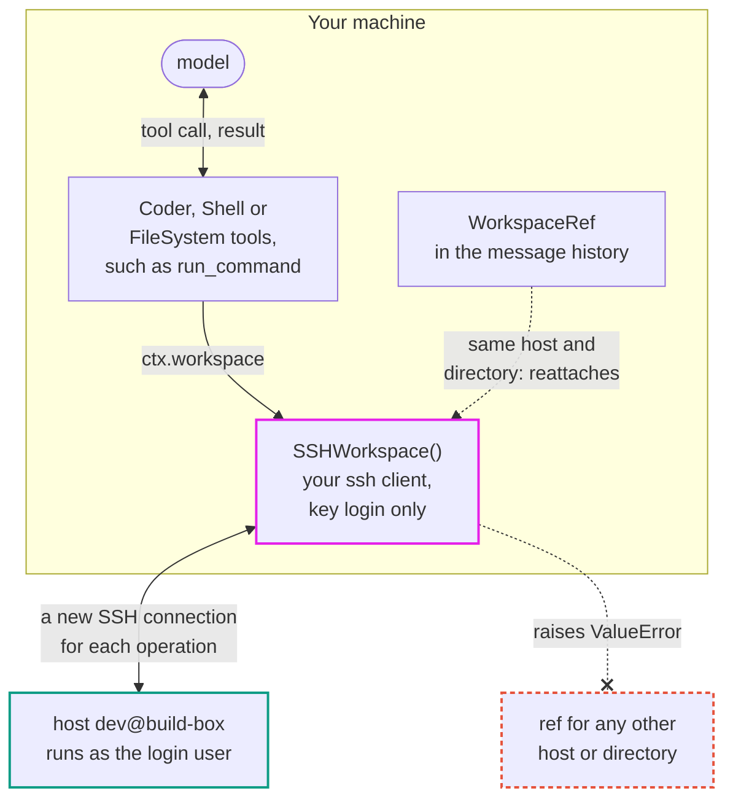

# SSH Workspace

Run your agent's commands and file edits on another machine over SSH, using your own `ssh` client and its configuration.

[Source](https://github.com/pydantic/pydantic-ai/tree/main/src/pydantic_ai_harness/pydantic_ai_harness/ssh_workspace/)

> While Pydantic AI Harness is on 0.x releases, the API may change between minor releases; when it does, deprecation warnings and release-note migration guidance tell you (or your agent) exactly how to upgrade. See the [version policy](https://pydantic.dev/docs/ai/harness/#version-policy).



## Install

<span id="platforms"></span>

uv:

```bash
uv add "pydantic-ai-harness[coder,anthropic]"
```

pip:

```bash
pip install "pydantic-ai-harness[coder,anthropic]"
```

The capability runs the `ssh` client already on your machine, so it needs no extra of its own. The examples also use `Coder` and an Anthropic model, hence the `coder` and `anthropic` extras; swap them for your own tools and model provider.

## Quick start

```python {test="skip"}
from pydantic_ai import Agent
from pydantic_ai_harness import Coder, SSHWorkspace

agent = Agent(
    'anthropic:claude-opus-5-5',
    capabilities=[SSHWorkspace('dev@build-box', working_dir='/srv/app', env={'UV_OFFLINE': '1'}), Coder()],
)
result = agent.run_sync('Run the test suite and fix the first failure.')
```

`Coder`'s shell and file tools now run on `build-box`. For a narrower agent, use [`Shell`](https://pydantic.dev/docs/ai/harness/shell/), [`FileSystem`](https://pydantic.dev/docs/ai/harness/filesystem/) or your own tools on [`ctx.workspace`](https://pydantic.dev/docs/ai/core-concepts/workspace/#using-the-workspace-in-tools).

- Commands run as the user you log in as, with that user's full authority on the host. Neither `working_dir` nor a [FileSystem](https://pydantic.dev/docs/ai/harness/filesystem/) root confines shell commands. To confine them, wrap the capability in [`BubblewrappedWorkspace`](https://pydantic.dev/docs/ai/harness/bubblewrap-sandbox/).
- Logging in needs a key without a prompt. See [Logging in](#logging-in).
- Commands start in `working_dir`, which must already exist. It defaults to the login directory, and a relative `working_dir` is resolved from there.
- Commands get the remote login environment plus `env=`. Your local environment isn't sent, apart from locale variables your `SendEnv` configuration forwards.
- Every operation opens an SSH connection. Turn on connection sharing in your SSH configuration (`ControlMaster auto` with a `ControlPersist` time) to make them fast.

For a single run, pass `workspace=SSHWorkspaceBackend('dev@build-box')` to `agent.run` instead of adding the capability.

## Continue in the same workspace

<span id="reattach-later"></span>

The host's files stay where they are between runs, so any run with the same `SSHWorkspace` works in the same directory. [Workspaces](https://pydantic.dev/docs/ai/core-concepts/workspace/#continuing-in-the-same-workspace) covers how runs find their workspace.

- The run's ref is a `WorkspaceRef` naming the host and directory, such as `WorkspaceRef(provider='ssh', id='dev@build-box:/srv/app')`. It is set as soon as the capability is created.
- `SSHWorkspace` only accepts a ref to its own host and directory, and raises `ValueError` for any other. A ref in the message history can't point it at another machine.

## Logging in

Passwords aren't supported. `ssh` runs with `BatchMode=yes`, so a host that asks for a password or a key passphrase fails right away instead of hanging the run. `ssh_args=` can't turn prompts back on.

- Use a key without a passphrase, such as `ssh_args=['-i', key_path]` or `IdentityFile` in your SSH configuration, or load a key that has one into `ssh-agent` with `ssh-add`.
- Set the user in the destination (`dev@build-box`), with `User` in your SSH configuration, or with `ssh_args=['-l', 'dev']`.
- Your SSH configuration (`~/.ssh/config`) also supplies ports and jump hosts.

## Security

- Commands can do anything the remote user can. Give the agent a login with only the access it needs. Choose the variables commands need with `env=`, and don't pass your local environment through.
- `env=` values show up in process listings. They travel inside the script `ssh` sends, which this machine passes to a local `sh` as arguments. While a command runs, other users on this machine can see them with `ps`. So can users on the host when `ssh` doesn't forward its input: `-n` or `-f` in `ssh_args`, or `StdinNull` in your SSH configuration. On a shared machine, keep secrets out of `env=`. Put them in a file only the remote user can read, or in the remote user's login environment.
- Files the agent reads into the prompt are trusted as yours by default. For a checkout you didn't write, pass `authority='none'`, or `'user'` for the user's own files. Capabilities that put a file into the prompt then give it no more [authority](https://pydantic.dev/docs/ai/core-concepts/workspace-custom/#workspace-authority) than that. `path_authority` sets a level for single paths on the host, and `~` isn't expanded in them. Default: `'operator'`.

## Limits

<span id="how-commands-run"></span>

- The machine running the agent must be Linux or macOS, like [`LocalWorkspace`](https://pydantic.dev/docs/ai/core-concepts/workspace/#platforms). On Windows, constructing `SSHWorkspace` raises `NotImplementedError`.
- The host needs a POSIX `sh` and the usual file utilities.
- A command can be as long as the host allows one program argument to be, 128 KiB on Linux. If `ssh` doesn't forward its input (see [Security](#security)), a long command full of quotes can be too long to start.
- A command that leaves a background process holding its output open, such as `server &`, doesn't return until that process exits. Redirect its output, as in `server > server.log 2>&1 &`.
- On a timeout, a second connection stops the command's processes on the host. A process that detached into its own session, like a [Shell](https://pydantic.dev/docs/ai/harness/shell/) background job, keeps running.
- A host that can't be reached, a missing working directory, or a connection lost mid-command raises `WorkspaceUnavailableError`. A command's exit code is its own, even 255, which `ssh` also uses for its own errors.

## Telemetry

`SSHWorkspace` emits no spans of its own. Core's [instrumentation](https://pydantic.dev/docs/ai/capabilities/instrumentation/) records `pydantic_ai.workspace.provider` (`ssh`) and `pydantic_ai.workspace.id` (the host and directory) on the agent run span, and each command or file operation runs inside its tool call's span.

## API reference

::: pydantic_ai_harness.ssh_workspace.SSHWorkspace

::: pydantic_ai_harness.ssh_workspace.SSHWorkspaceBackend
