# Pax

[](https://github.com/pydantic/pydantic-ai/actions/workflows/ci.yml?query=branch%3Amain)
[](https://pypi.python.org/pypi/pydantic-ai-pax)
[](https://github.com/pydantic/pydantic-ai/tree/main/src/pydantic_ai_pax)
[](https://github.com/pydantic/pydantic-ai/blob/main/src/pydantic_ai_pax/LICENSE)
[](https://logfire.pydantic.dev/docs/join-slack/)

A coding agent TUI built on the [Pydantic AI Harness](https://pydantic.dev/docs/ai/harness/)
SDK's [`Coder`](https://pydantic.dev/docs/ai/harness/coder/), ready to run as it comes or
with a harness of your own. Pax is also a terminal
[interface](https://pydantic.dev/docs/ai/overview/interfaces/) for any
[Pydantic AI](https://pydantic.dev/docs/ai/) agent.

Pax reads your code, edits files, and runs commands, and you see every step as it
happens. Use the model you like: sign in with your ChatGPT or GitHub Copilot
subscription, or bring an API key for OpenAI, Anthropic, or another provider Pydantic AI
supports.

Everything in Pax is a plugin, the coding agent included, so you can add tools,
commands and menus without forking anything, or swap any piece out. Sandboxes and
workspaces are plugins too, so where the agent runs and where it works are yours to
choose. To run an agent of your own instead, use `pax --agent my_module:agent`, which
loads that agent on its own without Pax's plugins.

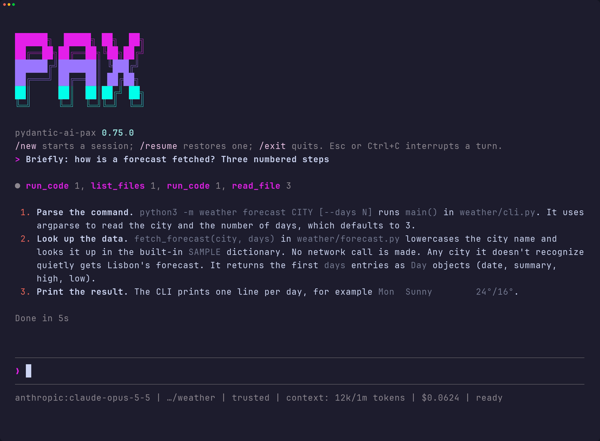

- **Any model, any account.** Switch models mid-conversation. Sign in to several
  accounts and let Pax move to the next one when you hit a limit.
- **Fast.** In code mode, Pax runs the model's tool calls while the model is still
  writing them.
- **Nothing gets lost.** Every conversation is saved. Resume it, fork it into the
  background, or rewind it to an earlier prompt. You can even pick up sessions from
  Claude Code and Codex.
- **Yours to change.** Turn plugins on and off from a menu, install one from Git, or
  write your own in a few lines of Python. Ask Pax how: it can look up its own
  [reference](https://github.com/pydantic/pydantic-ai/blob/main/src/pydantic_ai_pax/docs/reference.md#ask-pax-about-itself)
  and plugin docs when you need them.

Pax runs commands and edits files as you, with no sandbox and no approval step. Run it
in a project you trust.

**Contents:** [Pydantic AI, the harness SDK, `Coder`, and Pax](#pydantic-ai-the-harness-sdk-coder-and-pax) · [Install](#install) · [First run](#first-run) · [Updating](#updating) ·
[Models and accounts](#models-and-accounts) · [A tour](#a-tour) · [Make it yours](#make-it-yours) ·
[Plugins](#plugins) · [Pax in your own code](#pax-in-your-own-code) · [Reference](#reference)

## Pydantic AI, the harness SDK, `Coder`, and Pax

An agent on its own is a loop calling a model and tools. A **harness** is everything around that loop that makes it hold up on real work: the workspace it acts in, the tools, context management, recovery, guardrails, and the interface you steer it through. Four layers carry that idea; start with the one that matches what you are doing:

| Layer | What it is | Start here when |
|---|---|---|
| [Pydantic AI](https://pydantic.dev/docs/ai/) (`pydantic-ai`) | The agent framework: the agent loop, models from every major provider, tools, structured output, and the capability system | You are building an agent, or an LLM feature in your own application |
| [Pydantic AI Harness](https://pydantic.dev/docs/ai/harness/) (`pydantic-ai-harness`) | The SDK you build a harness of your own from: workspaces, file and shell tools, memory, sub-agents, context management, and ready-made agents like `Coder` | Your agent needs to edit files, run commands, remember, delegate, or keep working through long runs |
| [`Coder`](https://pydantic.dev/docs/ai/harness/coder/) | A ready-made coding agent in one capability: file and shell tools, task delegation, repo instructions and context management. You supply the workspace it runs in, and any guardrails | You want a coding agent in your own code, to run, extend or swap parts of |
| [Pax](#install) (`pydantic-ai-pax`) | The TUI in front of `Coder`, and a terminal interface for any Pydantic AI agent; everything in it is a plugin, the coding agent included | You want to use a coding agent rather than build one, or run your own agent in a terminal |

Each package installs the one it is built on: `pydantic-ai-harness` installs `pydantic-ai-slim`, and `pydantic-ai-pax` installs `pydantic-ai-harness`. `Coder` supplies the tools, context management and recovery; you choose the workspace it runs in and any guardrails, and Pax is the interface in front of it. That is why either works without the other: build on `Coder` and never open Pax, or point Pax at an agent that is entirely your own. Neither is the [`clai` chat CLI](https://pydantic.dev/docs/ai/integrations/cli/) that ships with Pydantic AI.

## Install

Pax needs Python 3.11 or newer. Install it with [uv](https://docs.astral.sh/uv/):

```bash
uv tool install --compile-bytecode pydantic-ai-pax
```

This gives you the `pax` command (and `pydantic-ai-pax`, which does the same).
The package used to be `pydantic-clai2`, with the command `clai2`. Those names still work and print a note
pointing here; your settings, sessions, and plugins carry over. A plugin that imports `pydantic_clai2` needs
the `pydantic-clai2` package installed, or its imports changed to `pydantic_ai_pax`.
`--compile-bytecode` makes the install take a little longer so the first start doesn't, and
`/update now` uses it too. To try Pax without installing, run `uvx pydantic-ai-pax`; set
`UV_COMPILE_BYTECODE=1` to compile the bytecode up front there too.

Pax comes with the OpenAI and Anthropic SDKs. Other providers may need their SDK
installed too; `/model` tells you which one when you pick the model. TypeSafe's Jev
models need an extra:

```bash
uv tool install --compile-bytecode 'pydantic-ai-pax[typesafe]'
```

## First run

Open a terminal in your project and start Pax:

```bash
cd my-project
pax
```

You get the Pax banner, a prompt at the bottom, and a status row under it with the
model, the folder, and how much context the conversation uses. Type what you want and
press <kbd>Enter</kbd>.

The default model is `openai-codex:gpt-6-astra`, which runs on a ChatGPT subscription. Run
`/login openai-codex` to sign in, or pick another model with `/model`
([see below](#models-and-accounts)).

A few keys to know:

| Key | What it does |
|---|---|
| <kbd>Enter</kbd> | Send. While Pax works, <kbd>Enter</kbd> queues your message for after the current turn. |
| <kbd>Alt</kbd>+<kbd>Enter</kbd> (<kbd>Option</kbd>+<kbd>Enter</kbd>; <kbd>Ctrl</kbd>+<kbd>Enter</kbd> on [Windows](https://github.com/pydantic/pydantic-ai/blob/main/src/pydantic_ai_pax/docs/reference.md#windows-terminal)) | Steer: send your message to the turn that is running now. |
| <kbd>Esc</kbd> or <kbd>Ctrl</kbd>+<kbd>C</kbd> | Stop the current turn. Your draft stays. |
| <kbd>Esc</kbd> <kbd>Esc</kbd> | Rewind to an earlier prompt ([see below](#rewind-a-conversation)). |
| <kbd>Ctrl</kbd>+<kbd>V</kbd> | Paste an image from the clipboard. |
| <kbd>Ctrl</kbd>+<kbd>O</kbd> | Show or hide the full output of commands. Output already in the terminal's scrollback is shown on the alternate screen, which stays for the session. |
| <kbd>@</kbd> then <kbd>Tab</kbd> | Complete a file path. |
| <kbd>Ctrl</kbd>+<kbd>D</kbd> or `/exit` | Quit. |

Type `/` to see every command, or `/help` for the full list.

Pax reads `AGENTS.md` (or `CLAUDE.md`) from the folder you start it in and the folders above
it, then a subfolder's as it works there, and follows what they say (not yet on Windows). If
the folder (or a parent) has a `.env` file, Pax loads it at startup.

The first time you start Pax in a folder, it asks whether you trust the files in it, and lists
the instruction files, skills, and agent folders it found there. Answer **Yes** for your own
projects. **No**, the default, keeps the folder untrusted: the agent still reads, edits, and runs
code there, and capabilities that check workspace authority treat the folder's files as the
repository's, not yours (walk-up instruction files, skills, and agent folders still load as before
until they check authority). Pax remembers the answer for the whole repository, and `/trust` shows
or changes it. The status row says `trusted` or `untrusted`. See
[folder trust](https://github.com/pydantic/pydantic-ai/blob/main/src/pydantic_ai_pax/docs/reference.md#folder-trust)
in the reference.

### Where Pax keeps things

Your settings, saved sessions, and plugins live in `~/.config/pydantic-clai2/`, or in
`$XDG_CONFIG_HOME/pydantic-clai2/` if you set `XDG_CONFIG_HOME`:

- `config.db`: settings, saved models, plugin choices, and which folders you trust
- `sessions.db`: saved conversations
- `plugins/`: plugins you drop in
- `input-history`: what you typed, for the <kbd>↑</kbd> arrow

Sign-ins and API keys are encrypted, with the key kept in your system keychain. Without a
keychain, they are saved unencrypted in a file only you can read. A
repository can also pin settings for everyone who works in it with a
`.clai/settings.json` file. See [files](https://github.com/pydantic/pydantic-ai/blob/main/src/pydantic_ai_pax/docs/reference.md#files)
and [project settings](https://github.com/pydantic/pydantic-ai/blob/main/src/pydantic_ai_pax/docs/reference.md#project-settings)
in the reference.

## Updating

Run `/update` to see whether a newer Pax is out, and choose **Update…** to install it.
`/update now` installs without asking, and `pax update` (or `pax --update`) does it from your shell and exits
(on Windows, use `/update now` instead).
Pax installs the newest build, then restarts into it with the same conversation open.
In the web UI, **Update…** in Settings › About installs from any session's page, and the
restart reopens the session the terminal shows, or under `pax --web`, the one Pax started with.
While other live sessions run turns, as ones the browser opened can, `/update now`
and `/reload` ask you to try again when they finish; bare `/update` still shows the
menu. Installs and reloads restart Pax in the folder it started in, so a session
from another folder shown in the terminal cannot run them. While another `pax` process
runs from the same install, updating would break it, so Pax asks you to quit it first.

When a newer build is out, the status row tells you, for example
`update 0.57.0: /update`. Pax checks once at startup and again when you change channel.
It shows nothing when you are offline.

There are two channels. Pick one with `/set updates.channel`:

- `stable` (the default): the newest release on PyPI.
- `main`: the newest build of the `main` branch, for trying fixes and features before
  they are released. The status row names the build by its commit.

```text
/set updates.channel main
/update now
```

`/update now` works when Pax was installed with `uv tool install`. On Windows, Pax closes
first and installs in a new PowerShell window; start `pax` again when it is done.
`/update now` reinstalls `pydantic-ai-pax` without extras or `--with` packages, so add those
again afterwards. See
[Updating](https://github.com/pydantic/pydantic-ai/blob/main/src/pydantic_ai_pax/docs/reference.md#updating)
in the reference for the details.

## Models and accounts

### Pick a model: `/model`

`/model` lists the models you have added, with details for the highlighted one. Press
<kbd>Enter</kbd> to switch. The next prompt uses the new model, and the conversation carries on.

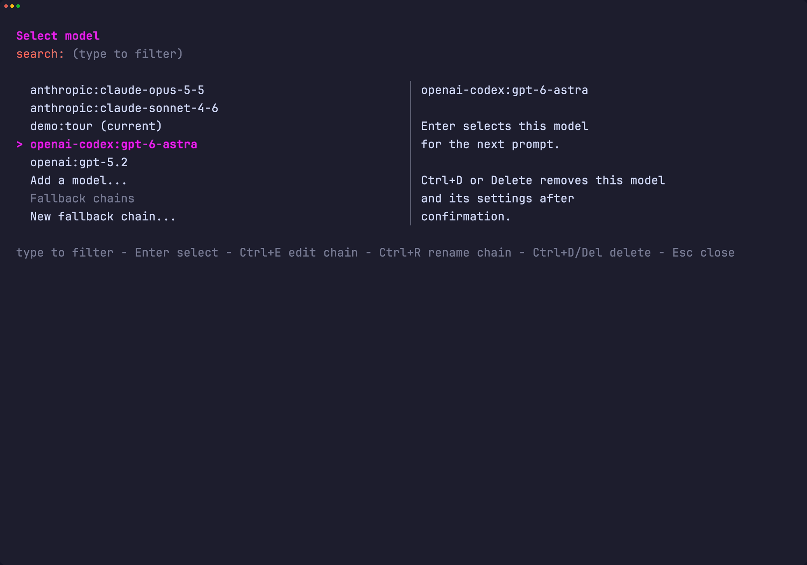

You can also type a model name directly, such as `/model anthropic:claude-sonnet-4-6`.
<kbd>Tab</kbd> completes names. Highlight a model and press <kbd>Ctrl</kbd>+<kbd>D</kbd> to remove it from the list.

### Find a new one: `/model add`

`/model add` lists every provider, then that provider's models, with the context size and
price of each. Type to filter. Press <kbd>Enter</kbd> to use a model, or <kbd>Ctrl</kbd>+<kbd>S</kbd> to change its
settings first, such as reasoning effort or thinking.

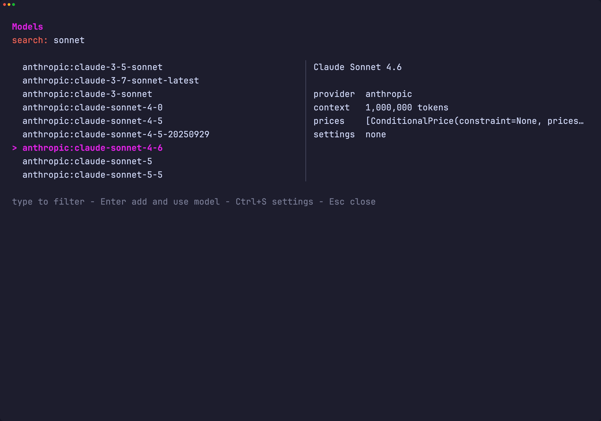

Each model keeps its own settings. Change them later with `/model settings`, or use the
shortcuts: `/effort high` sets reasoning effort, and `/fast` picks the speed of Codex
models, ultrafast by default on the models that offer it.

### Sign in: `/login` and `/accounts`

`/login openai-codex` signs in with your ChatGPT subscription. `/login github-copilot`
signs in with GitHub Copilot. Neither needs an API key.

`/accounts` shows every account you are signed in to, grouped by provider, with usage
limits where the provider reports them. Press `a` to add an account, `r` to rename one,
`[` and `]` to change the order, and `d` to sign out.

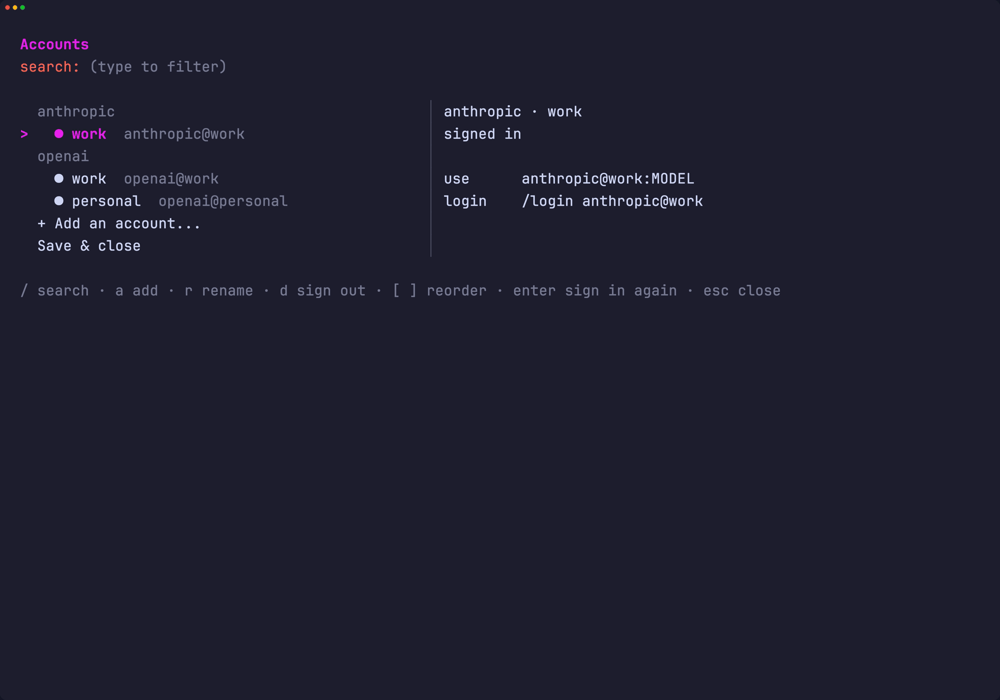

A second account of the same provider is a profile, written `PROVIDER@PROFILE`:

```text
/login openai-codex@work        # a second ChatGPT account
/login openai@work              # an OpenAI API key, saved for this profile
/model openai-codex@work:gpt-6-astra
/model openai-codex@*:gpt-6-astra   # every signed-in Codex account, in /accounts order
```

When a provider has more than one account, a model runs on the first one and moves to
the next when it hits a rate or usage limit.

### Fallback chains

A fallback chain tries several models in order, such as Codex first and Claude after it.
Make one in the `/model` picker with **New fallback chain...**, then select it like any
other model. It shows up as `chain:NAME`.

### API keys and environment variables

For providers that use an API key, set the usual environment variable before you start
Pax, such as `OPENAI_API_KEY` or `ANTHROPIC_API_KEY`. You can also put them in a `.env`
file. Pax loads the nearest `.env` from the folder you start in, or one of its parents.
Variables already set in your shell win. In a folder you do not trust, start Pax with
`PYTHON_DOTENV_DISABLED=1` so it skips `.env` files.

Shell commands the agent runs do not see your provider API keys.

`/keys` keeps named API keys in an encrypted store. vLLM and OpenRouter connections,
`/login PROVIDER@PROFILE`, a model's `api_key` in `/model settings`, and plugins such as
Linear and Notion can use a saved key by name, so you change it in one place. The names are labels: Pax does not set them as
environment variables. Press <kbd>a</kbd> to add a key, <kbd>Enter</kbd> to replace one, <kbd>r</kbd> to rename, and
<kbd>d</kbd> to delete. Values are never shown.

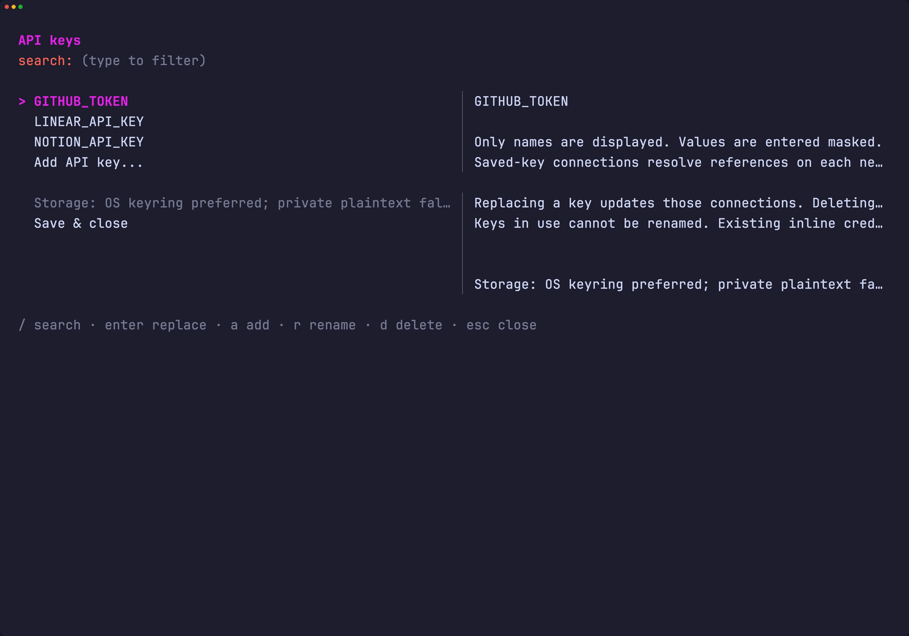

See [Models and their settings](https://github.com/pydantic/pydantic-ai/blob/main/src/pydantic_ai_pax/docs/reference.md#models-and-their-settings),
[Several accounts and fallback chains](https://github.com/pydantic/pydantic-ai/blob/main/src/pydantic_ai_pax/docs/reference.md#several-accounts-and-fallback-chains),
and [Environment variables](https://github.com/pydantic/pydantic-ai/blob/main/src/pydantic_ai_pax/docs/reference.md#environment-variables)
in the reference for everything else, including vLLM and OpenRouter.

## A tour

### Tool calls and diffs

Each tool call gets one line: the tool and what it worked on, as in the screenshot at
the top. When Pax edits or writes a file, you see the diff. A shell command adds one row
with its exit code and line count, such as `⎿ exit 0 · 23 lines`, in red when the
command fails. A failed or refused call of any tool gets a red row with the reason.
The rest of the shell output stays out of the way: press <kbd>Ctrl</kbd>+<kbd>O</kbd> to
show it under the row, or `/set display.tool_output true` to always print a preview; the
model always gets the full output. To list fewer lines, `/set display.tool_calls grouped`
counts calls in a row instead, such as `● shell 4, grep 2`. That style prints no result
rows.

### Questions from the model

When a task could go more than one way, the model can ask you instead of guessing. Pick
an answer with the arrow keys and <kbd>Enter</kbd>, or press its number. **Other** lets you type
your own answer. <kbd>Esc</kbd> declines; the model is told, and carries on with a choice it states.

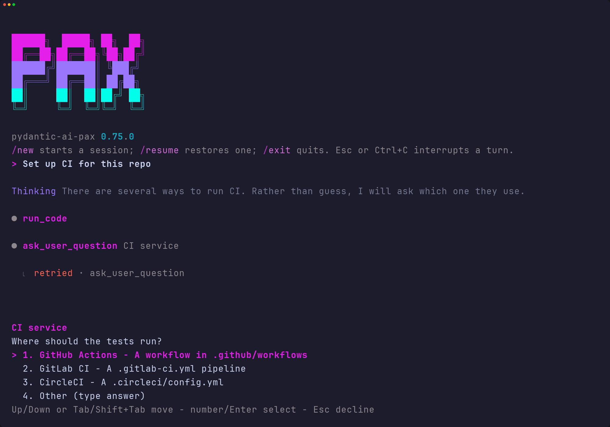

### Run a shell command: `!`

Start a line with `!` to run it as a shell command, without asking the model. The command and
its output are saved, so the model sees them on your next prompt. In a `/sandbox` conversation it runs in
the sandbox. Use `!!` for interactive programs, such as `!!python`, to give them the whole terminal.

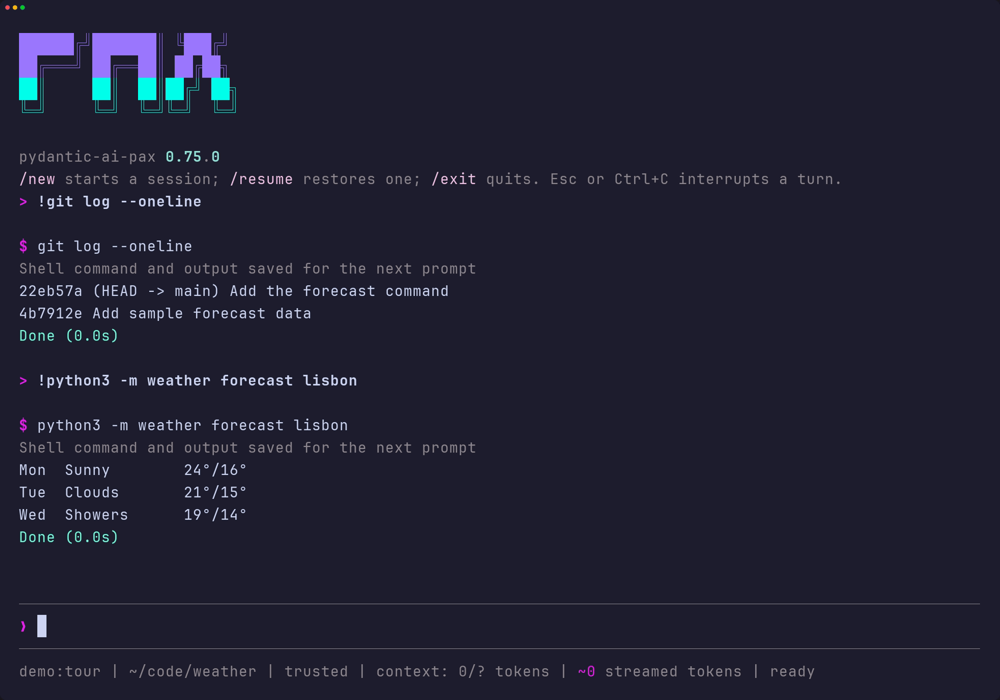

### Code mode and speculative execution

Code mode is on by default. The model writes one short Python snippet that calls many
tools, and Pax runs each statement as soon as it arrives, so a slow test run starts
before the model has finished writing.

Press <kbd>Ctrl</kbd>+<kbd>X</kbd> <kbd>Ctrl</kbd>+<kbd>S</kbd> to turn on speculative execution as well. Pax then starts file
reads and searches the moment their line appears. A row above the status line counts how
many early starts paid off, and the time they saved.

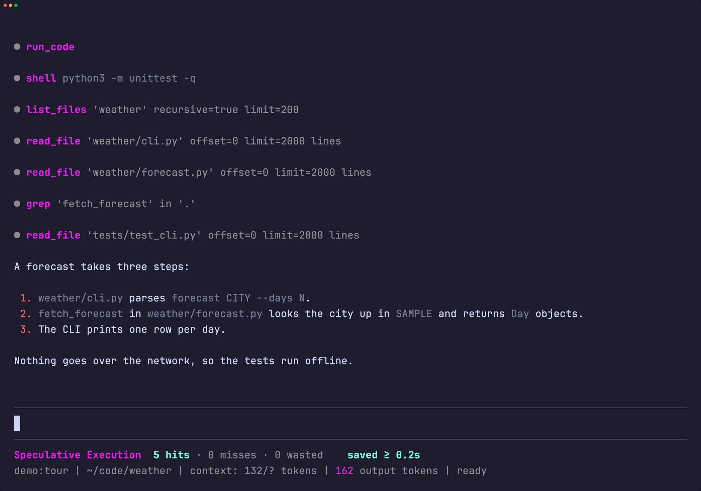

### Rewind a conversation

Between turns, press <kbd>Esc</kbd> twice to open **Rewind conversation**. Pick an earlier prompt
and press <kbd>Enter</kbd>. Pax removes it and everything after it from the conversation, and puts
it back in the editor so you can change it. Rewinding does not undo changes to files.

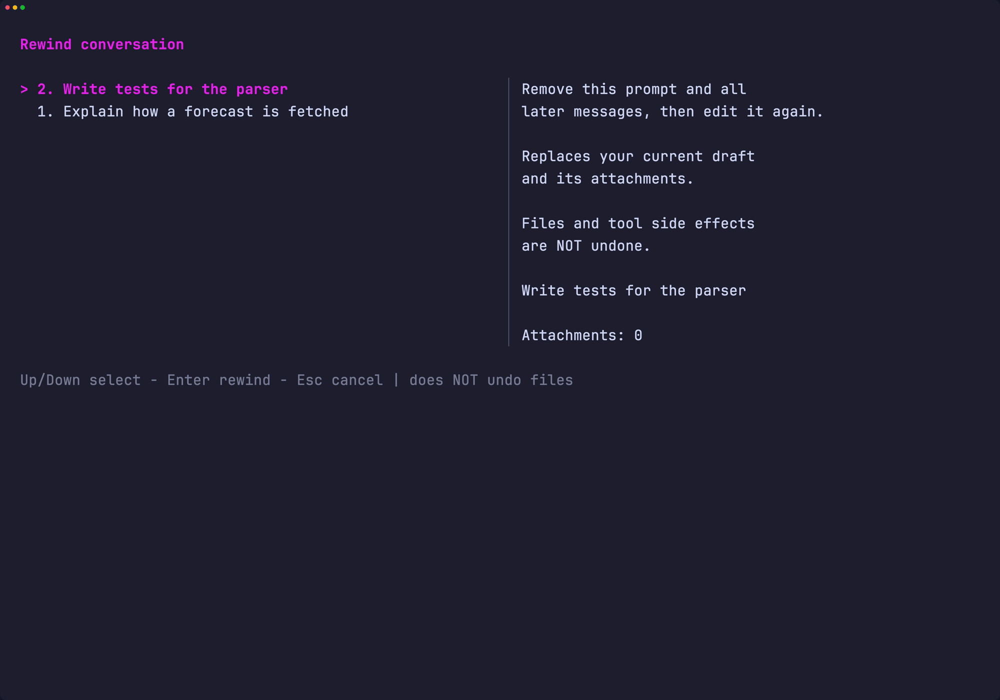

### Pick up where you left off: `/resume`

Every conversation is saved. `/resume` opens a browser with your projects on the left
and their sessions on the right. Pax names sessions in the background so you can find
them, using your current model or a smaller `sessions.naming_model`; `/set sessions.naming false`
keeps the titles taken from each session's first prompt. Press <kbd>/</kbd> to search, <kbd>→</kbd> to read a transcript, and <kbd>Enter</kbd> to resume.
<kbd>a</kbd> archives a session you are done with, hiding it without deleting anything, and <kbd>h</kbd> shows archived ones.

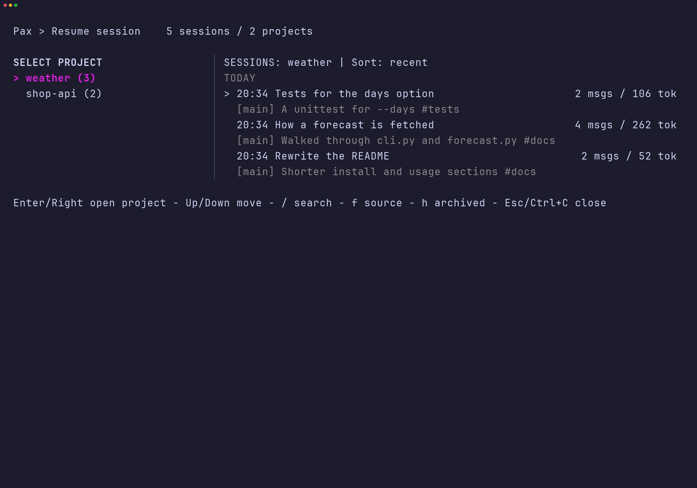

From your shell, `pax --resume` opens the same browser, and `pax --continue` (`-c`)
restores the most recent session in the current directory. `/resume claude` and
`/resume codex` continue a session you started in Claude Code or Codex.

With `/web` running, the browser can open other sessions while this one runs. `/resume`
of one of them shows it here, even mid-turn, instead of copying it; the session you
left keeps running in the browser.

On Unix, `pax sessions` lists live sessions across your terminal tabs and processes,
including idle sessions and those waiting for an answer. It shows unique session-ID
prefixes and folder names without opening a session or starting a turn. See
[Sessions](https://github.com/pydantic/pydantic-ai/blob/main/src/pydantic_ai_pax/docs/reference.md#sessions).

### Work in the background: `/fork`

`/fork PROMPT` runs a copy of the conversation in the background while you keep working.
Add `@MODEL` to use a different model for it. When it finishes, Pax prints its answer
and the session to resume if you want to continue it.

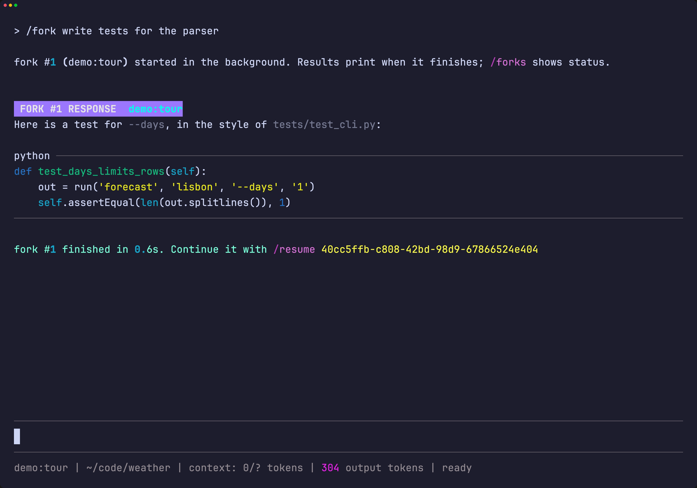

### Several sessions at once: `pax --web`

`pax --web` drives Pax from your browser. Click any session in the sidebar and it
opens live, even while others run: each works in its own folder, with its own queued
prompts and running turn, and a dot shows which ones are running or waiting for you.
Esc stops only the session you are looking at. A session left idle for an hour
closes; it stays saved, so click it to pick it up again. See
[Several sessions in the web UI](https://github.com/pydantic/pydantic-ai/blob/main/src/pydantic_ai_pax/docs/reference.md#several-sessions-in-the-web-ui).

### Usage, cost, and `/compact`

`/usage` shows the tokens and cost of each turn, and `/cost` the total. Costs come from
public price data; a model without a price, like the scripted one in these screenshots,
shows `unknown`. Both answer at once, even while a turn runs, and cover the turns that
have finished.

When a response omits usage, `/usage` and `/cost` label known totals as lower bounds,
and the status row prefixes a known cost with `>=`.

When the conversation nears the model's context limit, Pax summarises older messages
for you. Run `/compact` to do it now, and add a note to say what the summary must keep,
such as `/compact keep the API decisions`.

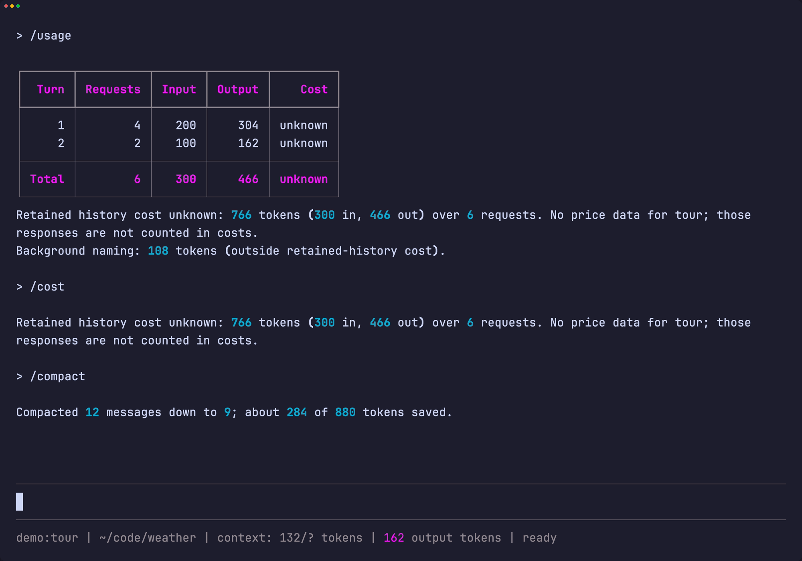

### Your own instructions: `/system_prompt`

`/system_prompt` shows what the model is told: Pax's instructions, your project's
`AGENTS.md`, and what your plugins add. Add instructions of your own and Pax sends them
with every prompt, in this and later sessions.

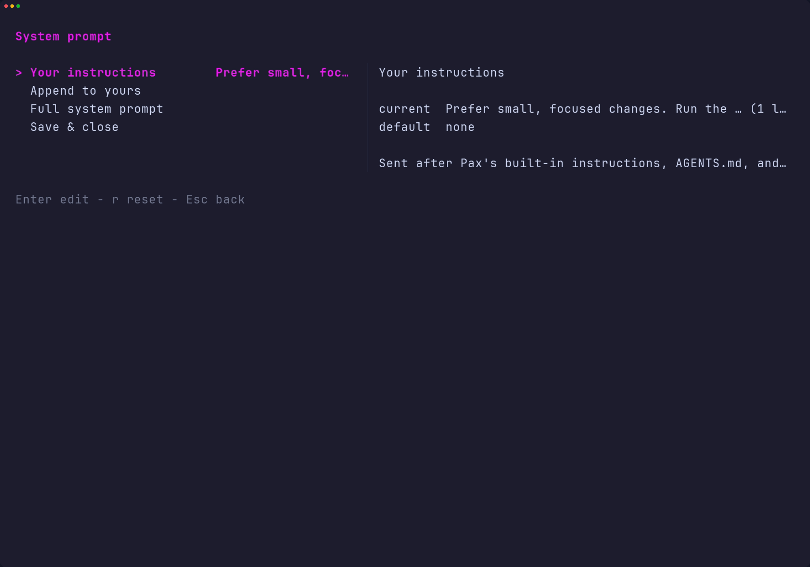

## Make it yours

### Settings: `/set`

`/set` lists every setting with its value, its default, and what it does. Changes save
and apply right away. You can also type one directly, such as
`/set display.thinking false`.

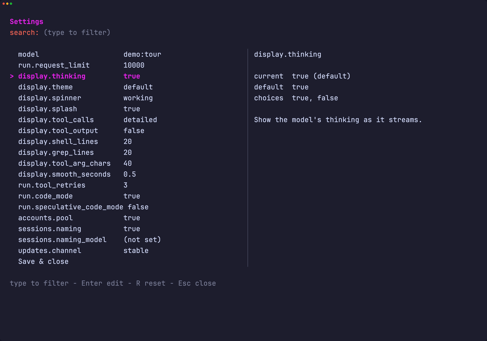

### Colours: `/theme`

`/theme` previews each palette on a sample conversation before you pick it. `default`
keeps Pax's usual colours and leaves your terminal's palette alone. On a light terminal
background it uses darker shades that stay readable on it.

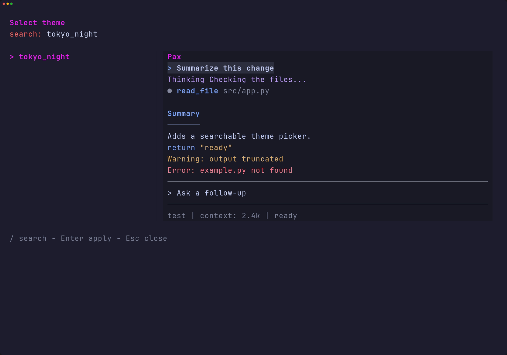

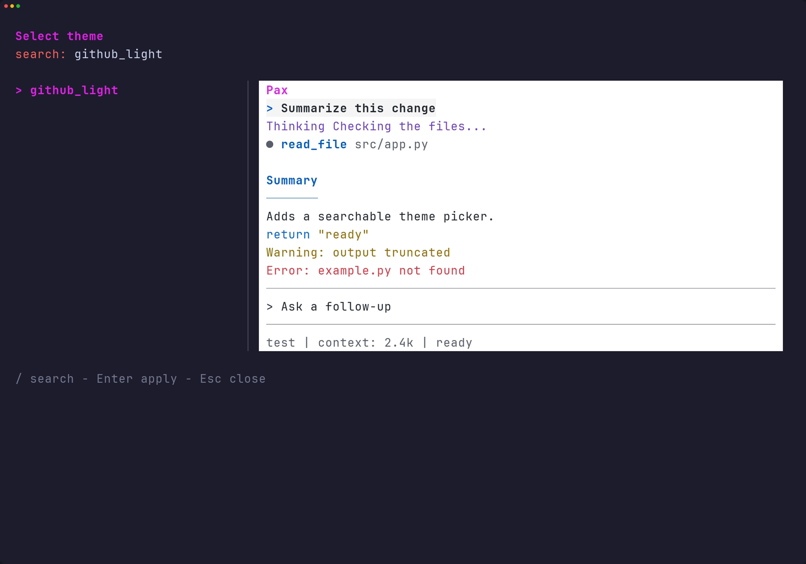

### The working animation: `/spinner`

`/spinner` picks the animation that runs while Pax works, with a live preview. Use `-`
and `+` to change its speed. Add your own in `spinners.json`; `/spinner init` writes a
starter file.

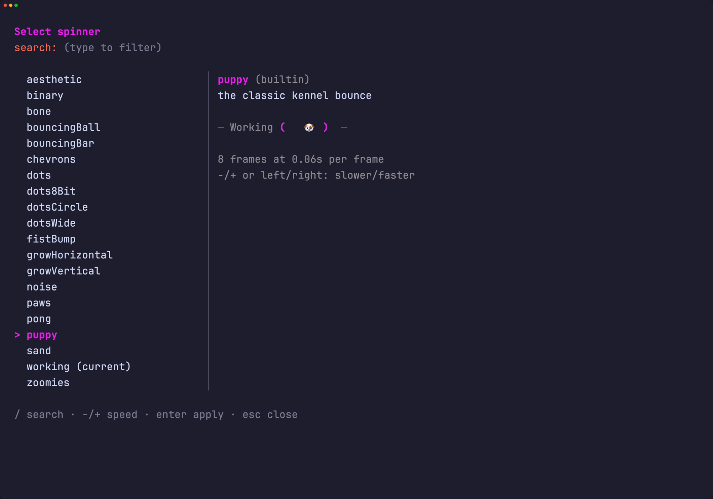

## Plugins

The coding tools are a plugin, and so are the integrations. `/plugins` lists them all:
press <kbd>Space</kbd> to turn one on or off, <kbd>c</kbd> to configure it, <kbd>r</kbd> to reload it, and <kbd>d</kbd> to
remove it. Changes apply from your next prompt, with no restart.

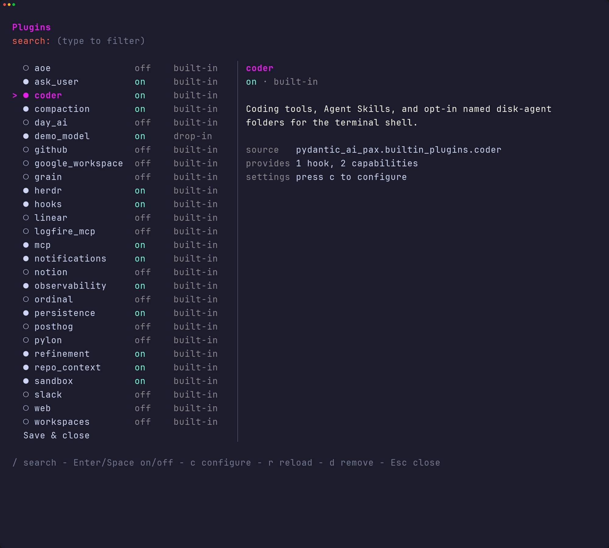

These are on from the start:

- `coder`: the file and shell tools, delegating tasks to sub-agents, and Agent Skills.
  Configure a delegate model menu to select a model per call. Separately enable a read-only `Review`
  specialist to review another directory; see [delegate models](https://github.com/pydantic/pydantic-ai/blob/main/src/pydantic_ai_pax/docs/reference.md#delegate-models-and-review-directory).
- `ask_user`: questions from the model
- `repo_context`: reads `AGENTS.md` or `CLAUDE.md` from the folder, its parents, and subfolders
- `compaction`: summarises older messages, and `/compact`
- `refinement`: `/refine`, which has the model review and revise its last answer
- `persistence`: extra checkpoints so an interrupted session can recover
- `mcp`: MCP servers, managed with `/mcp`
- `notifications`: a desktop notification when a turn finishes
- `observability`: traces to [Logfire](https://pydantic.dev/logfire), when you set a token

Turn on more when you need them, such as `github`, `linear`, `notion`, `slack`,
`google_workspace`, and `logfire_mcp`.

To install a plugin, clone it from Git, name a plugin or a harness capability by its import
path, or drop a file in `~/.config/pydantic-clai2/plugins/`:

```text
/plugins add https://github.com/your-org/my-plugin.git
/plugins add exa pydantic_ai_harness.exa:ExaSearch '{"max_results": 8}'
```

The second line adds web search from
[Pydantic AI Harness](https://pydantic.dev/docs/ai/harness/). It needs the `exa` extra and an `EXA_API_KEY`:

```bash
uv tool install --compile-bytecode pydantic-ai-pax --with 'pydantic-ai-harness[exa]'
export EXA_API_KEY=...
```

Plugins are Python code that runs as you, so only install ones you trust.

To write your own, read the [plugin guide](https://github.com/pydantic/pydantic-ai/blob/main/src/pydantic_ai_pax/PLUGINS.md).
Or ask Pax: it has a guide to its own plugin API, so you can ask it to "make a plugin
that adds a `/standup` command".

## Pax in your own code

- `pax -p "Explain this repository"` runs one prompt and prints only the answer.
- `pax --agent my_module:agent` chats with your own Pydantic AI agent.
- `open_stock_agent(...)` gives your Python code Pax's coding agent, without the terminal.
- `chat(agent, deps=...)` opens the Pax terminal on any agent.

See [Using Pax from code](https://github.com/pydantic/pydantic-ai/blob/main/src/pydantic_ai_pax/docs/reference.md#using-pax-from-code)
in the reference.

## Reference

The [reference](https://github.com/pydantic/pydantic-ai/blob/main/src/pydantic_ai_pax/docs/reference.md)
covers everything in detail:

- [Commands](https://github.com/pydantic/pydantic-ai/blob/main/src/pydantic_ai_pax/docs/reference.md#commands),
  [command-line options](https://github.com/pydantic/pydantic-ai/blob/main/src/pydantic_ai_pax/docs/reference.md#command-line-options),
  [settings](https://github.com/pydantic/pydantic-ai/blob/main/src/pydantic_ai_pax/docs/reference.md#settings),
  [environment variables](https://github.com/pydantic/pydantic-ai/blob/main/src/pydantic_ai_pax/docs/reference.md#environment-variables-at-a-glance),
  and [files](https://github.com/pydantic/pydantic-ai/blob/main/src/pydantic_ai_pax/docs/reference.md#files)
- [Models and accounts](https://github.com/pydantic/pydantic-ai/blob/main/src/pydantic_ai_pax/docs/reference.md#models-and-accounts):
  per-model settings, Codex, Copilot, vLLM, OpenRouter, and saved keys
- [The prompt](https://github.com/pydantic/pydantic-ai/blob/main/src/pydantic_ai_pax/docs/reference.md#the-prompt):
  keys, images, history, and `!` commands
- [Sessions](https://github.com/pydantic/pydantic-ai/blob/main/src/pydantic_ai_pax/docs/reference.md#sessions):
  `/resume`, `/fork`, and Git worktrees
- [Plugins and integrations](https://github.com/pydantic/pydantic-ai/blob/main/src/pydantic_ai_pax/docs/reference.md#plugins-and-integrations):
  MCP, notifications, herdr, Agent of Empires, and telemetry
- [The plugin guide](https://github.com/pydantic/pydantic-ai/blob/main/src/pydantic_ai_pax/PLUGINS.md):
  every plugin method, event, and rule

The screenshots are real Pax sessions. Only the model is scripted (`demo:tour`), so they
need no account and cost nothing. To make them again, run
`src/pydantic_ai_pax/scripts/screenshots/capture.sh`.

## Legacy clai

Pydantic AI also ships [`clai`](https://pydantic.dev/docs/ai/integrations/cli/), the chat CLI
that came before Pax. It is not deprecated: it stays the quickest way to hold a conversation
with a model, it serves the [Web Chat UI](https://pydantic.dev/docs/ai/guides/web/) with
`clai web`, and `agent.to_cli_sync()` opens the same chat from your own code. For a coding
agent, use Pax.
